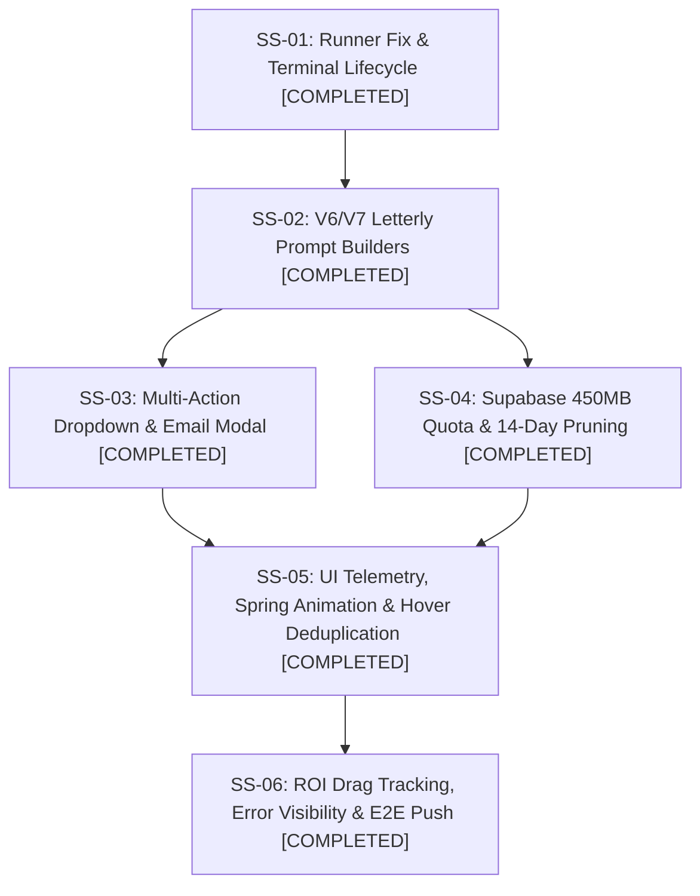

# Plan 87: CAT Product Recording Feature Enhancement

- **Task**: CAT Product Recording Feature Enhancement
- **Slug**: `cat-product-recording-feature-enhancement`
- **Owner**: GitMap Autonomous Engineering
- **Status**: COMPLETED
- **Target Branch**: `main`
- **Spec Directory**: `02-spec/21-app/87-cat-product-recording-feature-enhancement/`
- **Date**: 31-Oct-26

---

## 1. Executive Summary

This plan orchestrates the full architectural enhancement of the CAT product recording and bug diagnostic feature:
1. Streamlining `run.ps1` to eliminate local zip compression, fix illegal path characters, and cleanly terminate process trees without breaking the host terminal.
2. Implementing automatic prompt generation with V6 and V7 GitMap letterly prompt templates.
3. Expanding the export dropdown with unified actions: ZIP, Copy Prompt (V6), Copy Prompt (V7), Direct Email, Supabase Sync (450MB quota + 14-day pruning), Local Disk Save, and CLI Inspection.
4. Rich UI telemetry capturing CSS padding, distance, colors, XPaths, and a magic spring click animation with step numbers.
5. Intelligent Hover Record mode capturing interactive hover states with duplicate suppression.
6. ROI drag/resize start-to-end tracking with pixel coordinates, deltas, and XPaths.
7. Prominent Error Model visibility in navigation and bundling active Split-DB errors into the generated MD file.

---

## 2. Subtask Breakdown & Completion Register

### Subtask 01: Runner Fix & Terminal Lifecycle (`01-runner-fix-and-terminal-lifecycle.md`)
- **Role**: Runner Stability Engineer
- **Status**: COMPLETED
- **Outcome**: Eliminated local `Compress-Archive` in `run.ps1`, normalized forward-slash paths, added Win32 `taskkill /F /T` process tree kill, added graceful shutdown `POST /shutdown`, port release defense (`Free-PortIfBound`), and console mode restoration.

### Subtask 02: V6/V7 Letterly Prompt Builders (`02-v6-v7-letterly-prompt-builders.md`)
- **Role**: Prompt Architecture Engineer
- **Status**: COMPLETED
- **Outcome**: Created `src/lib/recorder/prompt-v6-v7-builder.ts` with Letterly V6 and V7 generators, 5 pillars, non-asset warning, turn-1 comprehension mandate, and `[<seq>_<inst>_<what>](file:;<path>)` IDE image links.

### Subtask 03: Multi-Action Dropdown & Email Modal (`03-multi-action-dropdown-and-email.md`)
- **Role**: Frontend UI Suite Engineer
- **Status**: COMPLETED
- **Outcome**: Created `RecorderExportDropdown.tsx` and `EmailExportModal.tsx`, integrated into `RecorderFloatingHud.tsx` and `RecorderExportModal.tsx`, updated `BE/routes/bug_reports.py` with path protection forbidding writes to repo assets.

### Subtask 04: Supabase 450MB Quota & 14-Day Pruning (`04-supabase-quota-and-pruning.md`)
- **Role**: Cloud & Storage Engineer
- **Status**: COMPLETED
- **Outcome**: Created `BE/bug_reports/supabase_retention.py`, updated `schema.sql` with stored procedures `get_telemetry_storage_usage` and `prune_expired_bug_reports`, implemented client-side `supabase-retention.ts` with 450MB storage ceiling and automatic 14-day rolling eviction.

### Subtask 05: UI Telemetry, Spring Animation & Intelligent Hover (`05-telemetry-spring-and-hover.md`)
- **Role**: Telemetry & Interaction Engineer
- **Status**: COMPLETED
- **Outcome**: Created `RecorderClickAnimation.tsx` and `spring-animation.css` for magic spring click ripple with step badges, added `hover-dedup.ts` for intelligent hover deduplication, and expanded `event-interceptor.ts` with CSS box model and computed color extraction.

### Subtask 06: ROI Drag Tracking, Error Visibility & E2E Push (`06-roi-drag-error-visibility-e2e.md`)
- **Role**: Vision & Error Management Engineer
- **Status**: COMPLETED
- **Outcome**: Created `TopBarErrorButton.tsx` with dynamic error counter badge and integrated into `GlobalNav.tsx` and `StandardAppShellNav.tsx`, created `roi-recording-bridge.ts` and integrated with `RegionOverlay.tsx` and `VisualToolWorkpieceCanvas.tsx` for start/end drag coordinates and paired snapshots.

---

## 3. Verification & Compliance
- Strict relative Git paths only.
- Non-asset ephemeral learning invariant strictly respected.
- Zero secrets committed.
- Strict positive boolean naming standard (`is*`, `has*`).
- Single atomic GitMap commit ready.
