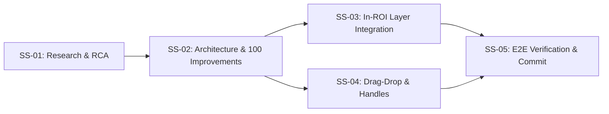

# Plan 83: Modern Design Layer Integration

- **Task**: Modern Design Layer Integration & In-ROI Tooling Architecture
- **Slug**: `modern-design-layer-integration`
- **Owner**: GitMap Autonomous Engineering
- **Status**: Pending / Active
- **Target Branch**: Working Tree / Autonomous Subagents
- **Spec Directory**: `02-spec/21-app/83-modern-design-layer-integration/`

---

## 1. Executive Summary

This plan orchestrates the comprehensive modernization of the vision inspection system's region-of-interest (ROI) management, layering mechanics, and floating interaction toolbars. It bridges the visual precision of CAD/Photoshop layer tools with the operational requirements of semiconductor carrier tape inspection.

Key Objectives:
1. Eliminate whole-body pointer event hijacking in `RegionOverlay.tsx`, confining ROI translation exclusively to a 20px top header grip bar.
2. Upgrade ROI transformation handles from neon `#ff00ff` magenta to modern CAD-grade white/slate square handles (`8x8px`, `#ffffff` fill, `#1e293b` border).
3. Upgrade `RoiToolbar.tsx` from a passive dimension readout into an interactive action bar supporting Lock, Shape selection, Mask overlay, Invert polarity, Crop extraction, and Opacity sliders.
4. Seamlessly wire `PhotoshopLayersPanel.tsx` into `StandardPatternSearch.tsx` via `ToolTabs.tsx` as a first-class "Layers" tab with live bidirectional state synchronization.
5. Fix static inspection canvas rendering in `PatternMatchCanvas.tsx` to ensure handles and grip bars are drawn when conveyor simulation is idle.

---

## 2. Subtask Breakdown

### Subtask 01: Research & Root Cause Analysis (`01-research-and-rca.md`)
- **Task ID**: `sub-084309-task-01`
- **Role / Owner**: Research & RCA Agent
- **Status**: COMPLETE
- **Objectives**:
  - Ingest and cross-reference `RegionOverlay.tsx`, `RoiToolbar.tsx`, `PhotoshopLayersPanel.tsx`, `StandardPatternSearch.tsx`, and `PatternMatchCanvas.tsx`.
  - Conduct 4-part RCA on interior pointer event hijacking and handle aesthetics.
  - Document findings in `02-spec/21-app/83-modern-design-layer-integration/01-research-and-rca-spec.md`.
- **Files Touched**:
  - `02-spec/21-app/83-modern-design-layer-integration/01-research-and-rca-spec.md`
  - `.ai-memory/plans/subtasks/83-modern-design-layer-integration/01-research-and-rca.md`

### Subtask 02: Architecture Spec Authoring & 100 Concrete Improvements Catalog (`02-architecture-spec-and-100-ways.md`)
- **Task ID**: `sub-084313-task-02`
- **Role / Owner**: Architecture & Spec Authoring Agent
- **Status**: COMPLETE
- **Objectives**:
  - Author system architecture specification covering coordinate spaces, layer compositing, and event isolation.
  - Catalog EXACTLY 100 grounded improvements across 5 categories (Handles, Toolbars, Layer Sync, Drag Isolation, Canvas Rendering).
- **Files Touched**:
  - `02-spec/21-app/83-modern-design-layer-integration/02-architecture-spec.md`
  - `02-spec/21-app/83-modern-design-layer-integration/03-100-modern-design-layer-improvements-spec.md`
  - `.ai-memory/plans/subtasks/83-modern-design-layer-integration/02-architecture-spec-and-100-ways.md`

### Subtask 03: In-ROI Layer Integration & Floating Tooling Engineering (`03-in-roi-layer-integration.md`)
- **Task ID**: `sub-084320-task-03`
- **Role / Owner**: In-ROI Layer Integration Agent
- **Status**: PENDING
- **Objectives**:
  - Upgrade `RoiToolbar.tsx` with interactive buttons: Lock toggle, Shape cycling, Mask overlay toggle, Invert toggle, Crop action, Opacity slider.
  - Extend `ToolTabs.tsx` to include "Layers" tab with `Layers` icon.
  - Mount `PhotoshopLayersPanel.tsx` in `StandardToolPanel.tsx` under the "Layers" tab.
  - Wire bidirectional synchronization between layer selection and active canvas ROI.
- **Files Touched**:
  - `src/components/vision/white-box/RoiToolbar.tsx`
  - `src/components/vision/standard/ToolTabs.tsx`
  - `src/components/vision/standard/StandardToolPanel.tsx`
  - `src/components/vision/standard/StandardPatternSearch.tsx`
  - `.ai-memory/plans/subtasks/83-modern-design-layer-integration/03-in-roi-layer-integration.md`

### Subtask 04: Interactive Drag-and-Drop, ROI Selection Handles & Transform Controls (`04-drag-drop-and-selection-handles.md`)
- **Task ID**: `sub-084325-task-04`
- **Role / Owner**: UI Controls & Transform Handles Agent
- **Status**: PENDING
- **Objectives**:
  - Upgrade `RegionOverlay.tsx` with white/slate handles (`#ffffff` fill, `#1e293b` border, `8x8px`), 20px header grip bar with 6-dot matrix icon.
  - Remove interior drag hijacking by making ROI body non-capturing (`pointer-events-none` with click-to-select).
  - Implement single active focus highlighting.
  - Fix static mode handle drawing in `PatternMatchCanvas.tsx` to actively render 8 handles and header bar on canvas.
- **Files Touched**:
  - `src/components/vision/standard/RegionOverlay.tsx`
  - `src/components/vision/standard/tools/pattern-matching/PatternMatchCanvas.tsx`
  - `src/components/vision/white-box/pattern-geometry.ts`
  - `.ai-memory/plans/subtasks/83-modern-design-layer-integration/04-drag-drop-and-selection-handles.md`

### Subtask 05: End-to-End Verification, CLI Test Runner & Atomic Bot Commit (`05-e2e-cli-verification-and-commit.md`)
- **Task ID**: `sub-084333-task-05`
- **Role / Owner**: E2E Verification & Bot Release Agent
- **Status**: PENDING
- **Objectives**:
  - Run TypeScript type checks (`pnpm exec tsc --noEmit`) to ensure 0 errors.
  - Run component verification tests covering ROI handles, toolbar actions, layer tab, and static canvas.
  - Perform clean working tree audit and execute atomic GitMap hyphen-separated commit.
- **Files Touched**:
  - `tests/vision/roi-modern-layer-integration.spec.ts`
  - `.ai-memory/plans/subtasks/83-modern-design-layer-integration/05-e2e-cli-verification-and-commit.md`

---

## 3. Essential Coding Constraints & Invariants

1. **Strict Boolean Standards**: Exclusively use `is` and `has` prefixes (`isActive`, `isLocked`, `isMaskEnabled`, `isInverted`, `hasSliderOpen`). Zero tolerance for `can`, `should`, or raw un-prefixed booleans. Positive framing only.
2. **Parameter Structs**: Any method taking >2-3 arguments must use an options struct.
3. **Vertical Whitespace Discipline**: Mandatory blank lines before `if`, after `}`, and before `return`/`throw`.
4. **Bounded Micro-Batching**: Changes partitioned into discrete, reviewable sets of 5-8 files maximum.
5. **Lovable Sync Invariant**: No rewriting published git history, no rebasing, and clean branch state preservation.
