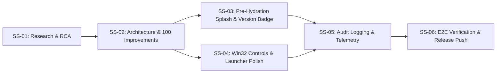

# Plan 84: Button Functionality and User Experience Improvement

- **Task**: Button Functionality and User Experience Improvement
- **Slug**: `button-functionality-and-user-experience-improvement`
- **Owner**: GitMap Autonomous Engineering
- **Status**: Active / In Progress
- **Target Branch**: `main`
- **Spec Directory**: `02-spec/21-app/84-button-functionality-and-user-experience-improvement/`

---

## 1. Executive Summary

This plan orchestrates the definitive remediation of titlebar window control unresponsiveness (minimize, full screen / maximize, close), eliminates initial startup blank screen latency through an instant pre-hydration loading screen, and introduces structured audit logging and stack trace telemetry across frontend and backend.

Key Objectives:
1. **Pre-Hydration Loading Screen**: Zero-latency inline HTML/CSS splash screen with Cat Vision branding, industrial pulse spinner, and dynamic application version display (`v4.113.15`) that gracefully fades out upon React hydration.
2. **Deterministic Win32 Window Controls**: PID-based Chromium HWND resolution, `--start-maximized` launch flag (eliminating the intrusive `"To exit full screen, press Esc"` toast), and instant process termination.
3. **Structured Audit & Stack Trace Telemetry**: Elimination of all silent `catch(() => {})` blocks, capturing full stack traces in `useErrorStore`, and recording window management failures into Split-DB `system_errors`.
4. **Terminal Output Polish**: Clean, padded PowerShell terminal formatting suppressing unformatted JSON dumps.
5. **E2E & Unit Test Coverage**: End-to-end verification and unit tests validating window control endpoints, splash screen dismissal, and process cleanup.

---

## 2. Subtask Breakdown

### Subtask 01: Research & Root Cause Analysis (`01-research-and-rca.md`)
- **Slug**: `button-functionality-and-user-experience-improvement - Task 01`
- **Status**: COMPLETE
- **Deliverables**: Detailed 4-part RCA covering `--start-fullscreen` kiosk trap, silent `.catch` error suppression, and pre-hydration DOM void.

### Subtask 02: Architecture & 100 Concrete Improvements Catalog (`02-architecture-and-100-improvements.md`)
- **Slug**: `button-functionality-and-user-experience-improvement - Task 02`
- **Status**: COMPLETE
- **Deliverables**: Complete architecture specs and 100-item improvement catalog in `02-spec/21-app/84-button-functionality-and-user-experience-improvement/`.

### Subtask 03: Pre-Hydration Splash Screen & Dynamic Version Display (`03-loading-spinner-and-version-showcase.md`)
- **Slug**: `button-functionality-and-user-experience-improvement - Task 03`
- **Status**: ACTIVE
- **Deliverables**: Inline HTML/CSS splash overlay in `src/routes/__root.tsx` with Cat Vision logo, industrial pulse spinner, version showcase (`v4.113.15`), and hydration fade-out hook.

### Subtask 04: Deterministic Win32 Controls & Launcher Polish (`04-native-window-controls-and-loopback.md`)
- **Slug**: `button-functionality-and-user-experience-improvement - Task 04`
- **Status**: PENDING
- **Deliverables**:
  - `run.ps1`: Switch `--start-fullscreen` to `--start-maximized`, silence JSON dumps, format terminal output.
  - `BE/routes/shutdown.py`: Deterministic HWND discovery by Chromium PID and rect dimensions; instant process termination via `taskkill`.

### Subtask 05: Audit Logging & Stack Trace Telemetry (`05-audit-logging-and-stack-trace-telemetry.md`)
- **Slug**: `button-functionality-and-user-experience-improvement - Task 05`
- **Status**: PENDING
- **Deliverables**:
  - `src/components/layout/WindowControlButtons.tsx`: Remove all silent `.catch` blocks, capture full error stack traces into `useErrorStore`.
  - `BE/routes/shutdown.py`: Record structured audit records and tracebacks into Split-DB `system_errors`.

### Subtask 06: E2E Verification & Atomic Release Push (`06-e2e-verification-and-cli-testing.md`)
- **Slug**: `button-functionality-and-user-experience-improvement - Task 06`
- **Status**: PENDING
- **Deliverables**: Automated test suites pass 100%, TypeScript compile clean, launcher verification, single atomic commit via `gitmap cpf`.
