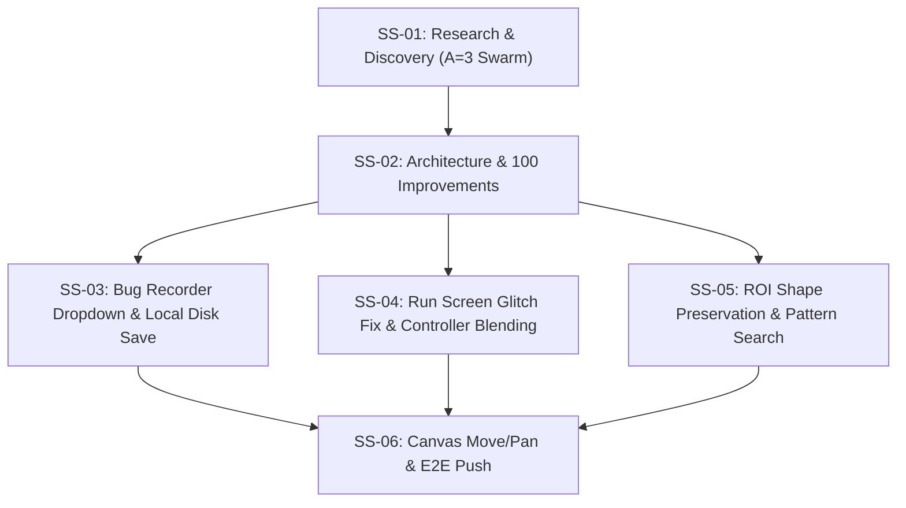

# Plan 85: Run Screen Stability, Bug Export Dropdown & ROI Pattern Search

- **Task**: Run Screen Stability, Bug Export Dropdown & ROI Pattern Search
- **Slug**: `run-screen-stability-bug-export-and-roi-pattern-search`
- **Owner**: GitMap Autonomous Engineering
- **Status**: Active / In Progress
- **Target Branch**: `main`
- **Spec Directory**: `02-spec/21-app/85-run-screen-stability-bug-export-and-roi-pattern-search/`

---

## 1. Executive Summary

This plan orchestrates the eradication of visual glitches and interval loops on the Run screen, re-engineers the Bug Recorder with an Antigravity-grade multi-format export dropdown (Export ZIP, Prompt for IDE with file image references, Save to Local Disk, CLI command), relocates the RUN button into the right-hand controller panel to collapse the bloated bottom bar, fixes canvas move and pan navigation, and strictly enforces ROI shape immutability while adding in-ROI pattern search capabilities.

---

## 2. Subtask Breakdown

### Subtask 01: Research & Discovery (`01-research-and-discovery.md`)
- **Slug**: `run-screen-stability-bug-export-and-roi-pattern-search - Task 01`
- **Role**: Run, Recorder & ROI Research Swarm
- **Status**: ACTIVE (Subagents `ad642943`, `112b8c09`, `b4efa672` in progress)
- **Target Files**: Research findings on Run screen, bug recorder, ROI shape, and canvas pan.

### Subtask 02: Architecture Specification & 100 Concrete Improvements Catalog (`02-architecture-and-100-improvements.md`)
- **Slug**: `run-screen-stability-bug-export-and-roi-pattern-search - Task 02`
- **Role**: Architecture & Spec Authoring Agent
- **Status**: PENDING
- **Target Files**: `02-spec/21-app/85-run-screen-stability-bug-export-and-roi-pattern-search/` specs 01–08.

### Subtask 03: Bug Recorder Dropdown, Antigravity Prompt Formatter & Local Disk Storage (`03-bug-recorder-export-and-cli.md`)
- **Slug**: `run-screen-stability-bug-export-and-roi-pattern-search - Task 03`
- **Role**: Recorder & CLI Engineer
- **Status**: PENDING
- **Target Files**: `src/components/recorder/`, `BE/routes/bugs.py`, CLI commands.

### Subtask 04: Run Screen Glitch Elimination & Bottom Bar Reduction (`04-run-screen-glitch-and-layout.md`)
- **Slug**: `run-screen-stability-bug-export-and-roi-pattern-search - Task 04`
- **Role**: Layout & Performance Engineer
- **Status**: PENDING
- **Target Files**: `src/routes/run/`, `src/components/inspection/`, bottom status bar, right-hand controller.

### Subtask 05: ROI Shape Immutability & In-ROI Pattern Search Integration (`05-roi-preservation-and-pattern-search.md`)
- **Slug**: `run-screen-stability-bug-export-and-roi-pattern-search - Task 05`
- **Role**: Vision Rules & Canvas Engineer
- **Status**: PENDING
- **Target Files**: `src/components/rules/`, `RegionOverlay.tsx`, `PatternMatchCanvas.tsx`, right sidebar properties.

### Subtask 06: Canvas Move/Pan Tooling Fluidity & E2E Release (`06-canvas-movement-and-e2e-push.md`)
- **Slug**: `run-screen-stability-bug-export-and-roi-pattern-search - Task 06`
- **Role**: QA & Release Orchestrator
- **Status**: PENDING
- **Target Files**: Canvas interaction hooks, unit tests, release commit.
