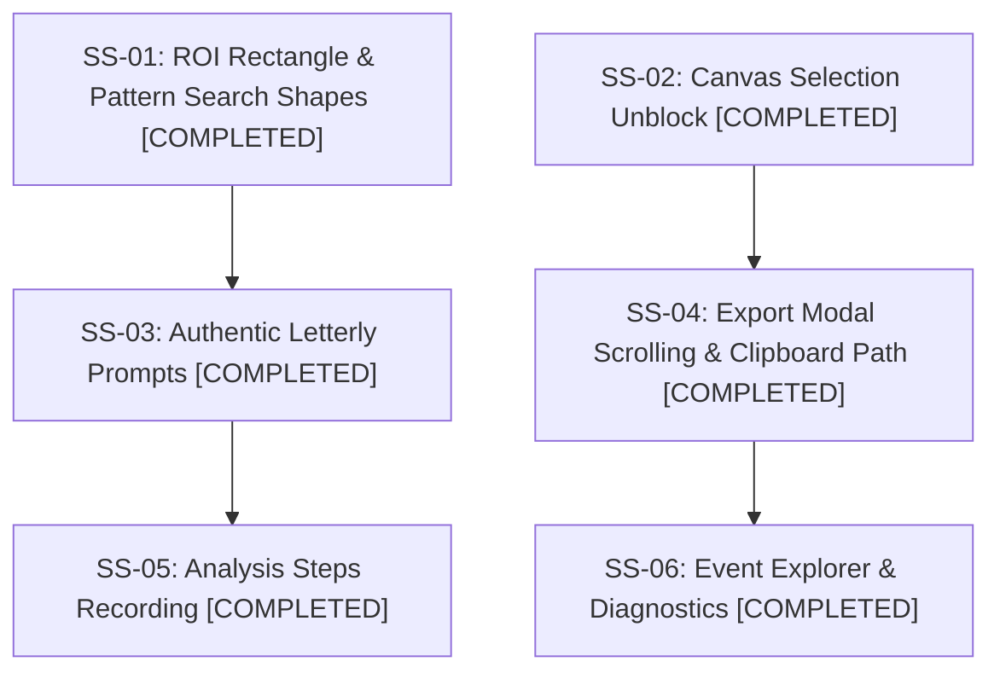

# Plan 88: Snap 24 Event 20 UI and Functionality Issues

- **Task**: Snap 24 Event 20 UI and Functionality Issues
- **Slug**: `snap-24-event-20-ui-and-functionality-issues`
- **Owner**: GitMap Autonomous Engineering
- **Status**: COMPLETED
- **Target Branch**: `main`
- **Spec Directory**: `02-spec/21-app/88-snap-24-event-20-ui-and-functionality-issues/`
- **Date**: 31-Oct-26

---

## 1. Executive Summary

This plan resolved critical UI deadlocks and interaction failures reported in Snap 24 Event 20 and Snap 99 Event 81:
1. Enforcing Region of Interest (ROI) as strictly rectangular, moving multi-shape tools (`rectangle`, `square`, `circle`, `polygon`) exclusively to Pattern Search (T102).
2. Fixing canvas selection priority inversion and clamping deadlocks in `VisualToolWorkpieceCanvas.tsx` to unfreeze canvas movement.
3. Recording every inspection analysis phase (Preprocessing, Pattern Search, Edge Detection, Defect Check, Validation) with full screenshot and explicit step name into recorder events.
4. Implementing an Event Explorer button and filterable modal with categories (`all`, `error`, `analysis`, `recording`, `simulation`, `interaction`) referencing Antigravity Tools.
5. Re-architecting prompt generation into authentic GitMap Letterly V6 and V7 prompts with non-asset invariants and skill links.
6. Adding vertical scrolling to `RecorderExportModal.tsx` and fixing upward dropdown placement in `RecorderExportDropdown.tsx`.
7. Automatically copying exported ZIP path or uncompressed local session folder path to the clipboard with AI extraction instructions.
8. Sanitizing diagnostics into clean GitMap key-attributes (excluding noisy Mozilla headers) and adding authentic JavaScript/Python function names in stack traces.
9. Strictly enforcing the Anti-Asset Invariant (zero screenshots placed in repository assets).

---

## 2. Subtask Breakdown & Completion Register

### Subtask 01: ROI Rectangle Enforcement & Pattern Search Shapes (`01-roi-rectangle-and-pattern-shapes.md`)
- **Role**: ROI & Selection Engineer
- **Status**: COMPLETED
- **Outcome**: Removed "Region Shape" selector from ROI card in `RuleRightToolbarPanel.tsx`; relocated under Pattern Search (T102) tool parameters; eliminated auto-squaring of ROI dimensions; enforced rectangular canvas rendering.

### Subtask 02: Canvas Selection Unblock & Interaction Fix (`02-canvas-selection-unblock.md`)
- **Role**: Workpiece Canvas Engineer
- **Status**: COMPLETED
- **Outcome**: Resolved hit-test priority inversion in `VisualToolWorkpieceCanvas.tsx` (handles -> header grip -> other rules -> feature reticles -> body drag); fixed clamping collapse to (0,0); decoupled interior body double-clicking from lock state; bound `onToggleLocked` in `WorkpieceAnalyzeWorkspace.tsx`.

### Subtask 03: Authentic GitMap Letterly Prompt Engine (`03-authentic-letterly-prompt-engine.md`)
- **Role**: Letterly Prompt Engineer
- **Status**: COMPLETED
- **Outcome**: Rewrote `prompt-v6-v7-builder.ts`, `v6-prompt-builder.ts`, `v7-prompt-builder.ts` to output exact Letterly markdown format (`# Title: high priority...`, `## task:`, `## slug:`, `# Actionable Items...`, Anti-Asset warning, skill triggers `@[execute-parent-task-with-n-steps-v6]`, and `/plan`, `/learn`).

### Subtask 04: Export Modal Scrolling, Upward Dropdown & Path Clipboard (`04-export-dropdown-and-modal-scroll.md`)
- **Role**: Export Suite Engineer
- **Status**: COMPLETED
- **Outcome**: Added `max-h-[90vh]` scrolling layout to `RecorderExportModal.tsx`; fixed `RecorderExportDropdown.tsx` default upward placement (`placement="top"`); resolved click-outside race condition; added automatic ZIP download path copy and "Copy Session Folder Path" (`Ctrl+L`) to clipboard.

### Subtask 05: Analysis Steps Telemetry & Recording Pipeline (`05-analysis-steps-recording.md`)
- **Role**: Vision Telemetry Engineer
- **Status**: COMPLETED
- **Outcome**: Implemented `recordAnalysisStep` in `analysis-telemetry.ts` and `event-interceptor.ts` capturing 5 canonical phases (Preprocessing, Pattern Search, Edge Detection, Defect Check, Validation) with full screenshot and explicit step name into recorder events without disk asset pollution.

### Subtask 06: Event Explorer Modal, Diagnostics & Stack Traces (`06-event-explorer-and-diagnostics.md`)
- **Role**: Diagnostics & Observability Engineer
- **Status**: COMPLETED
- **Outcome**: Created `EventExplorerModal.tsx` following Antigravity Tools cyber styling with 6 category filter chips (`all`, `error`, `analysis`, `recording`, `simulation`, `interaction`); added Events trigger buttons in `RecorderFloatingHud.tsx` and `RecorderExportModal.tsx`; created `diagnostics-sanitizer.ts` stripping Mozilla headers; added authentic function name stack extractors in JS and Python backend.

---

## 3. Verification & Compliance
- Strict relative Git paths only.
- Anti-Asset Invariant strictly respected (zero images in `src/assets/`).
- Zero secrets committed.
- Strict positive boolean naming standard (`is*`, `has*`).
- Single atomic GitMap commit ready.
