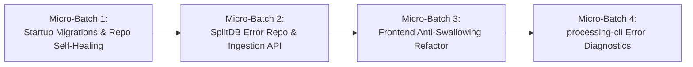

# Subtask Plan: Error Management, SplitDB Persistence & CLI Stack Trace Diagnostics
# File: .ai-memory/plans/subtasks/04-vision-system-and-error-management-instructions/03-error-management-splitdb.md
# Spec Reference: 02-spec/21-app/04-vision-system-and-error-management-instructions/03-error-management-and-splitdb-spec.md
# Status: pending
# Priority: P0 (Critical System Reliability & Anti-Swallowing Gate)

## 1. Objectives & High-Level Scope

This execution plan provides a bounded, phased implementation to eliminate all swallowed errors, guarantee database table existence on startup, persist structured exception telemetry in SplitDB, and provide CLI stack trace inspection tools.

### Core Deliverables
1. **Fix `no such table: Recipe` Bug (`mr6_-1EdpFtG`)**:
   - Implement database migration preflight on server lifespan startup in `BE/main.py`.
   - Add idempotent table creation self-healing in `BE/repos/sqlite_rules_repo.py`.
2. **Eliminate Swallowed Errors in UI**:
   - Refactor `src/components/setup/StandardRoiSetup.tsx` to handle `handleApply`, `handleOk`, and envelope loading errors with operator notifications and telemetry. Prevent premature navigation away on failure.
   - Refactor `src/routes/run.tsx` to eliminate `.catch(() => {})` on telemetry and offline score evaluation.
3. **SplitDB SQLite Error Persistence**:
   - Deploy migration `BE/db/migrations/root/0021_system_errors.sql`.
   - Implement `BE/repos/sqlite_error_repo.py` and API route `POST /api/v1/telemetry/errors`.
   - Wire backend global exception handlers to write uncaught 5xx errors to `SystemError`.
4. **CLI Diagnostics Tooling**:
   - Implement `processing-cli errors list`, `processing-cli errors inspect`, and `processing-cli errors clear` subcommands.

---

## 2. Micro-Batch Architecture (5–8 Files per Batch)

---

### Micro-Batch 1: Startup Migrations & Repo Self-Healing
**Scope**: Guarantee database readiness before accepting HTTP traffic and make repository queries self-healing against missing tables.
**Target Files (6 files)**:
1. `BE/db/preflight.py` — Startup preflight runner applying unapplied migrations for `root`, `task`, and `rules` tiers.
2. `BE/main.py` — Lifespan context manager hook invoking database preflight.
3. `BE/repos/sqlite_rules_repo.py` — Idempotent `_ensure_tables` self-healing on repo instantiation.
4. `BE/db/migrations/root/0020_recipes.sql` — Schema verification for Recipe table.
5. `BE/db/migrations/root/0021_system_errors.sql` — DDL migration for SplitDB SystemError table.
6. `tests/unit/be/db/test_preflight.py` — Unit tests verifying preflight migration execution on clean databases.

#### Execution Tasks:
- [ ] **Task 1.1**: Create `BE/db/preflight.py` with `run_startup_migrations() -> bool`. It reads `SchemaVersion`, applies missing `.sql` migrations in numeric order inside transactions, and returns `isMigrationSuccessful: True`.
- [ ] **Task 1.2**: Update `_app_lifespan` in `BE/main.py` to invoke `run_startup_migrations()` before `yield`. If migrations fail, log critical error and raise `RuntimeError`.
- [ ] **Task 1.3**: Add `_ensure_tables(self)` in `BE/repos/sqlite_rules_repo.py` creating `Recipe` table if not exists with `RuleSetId INTEGER PRIMARY KEY`, `Name TEXT`, `Version INTEGER`, `IsEnabled INTEGER DEFAULT 1`, `PayloadJson TEXT`, `CreatedAt`, `UpdatedAt`.
- [ ] **Task 1.4**: Author `BE/db/migrations/root/0021_system_errors.sql` creating table `SystemError` with indices on `ErrorCode`, `CreatedAt`, and `Subsystem`.
- [ ] **Task 1.5**: Write unit tests in `tests/unit/be/db/test_preflight.py` verifying that fresh in-memory or temp SQLite databases migrate successfully.

---

### Micro-Batch 2: SplitDB System Error Repository & Ingestion API
**Scope**: Ingest and persist structured error telemetry across backend exceptions and frontend crash boundaries.
**Target Files (6 files)**:
1. `BE/errors/codes.py` — Register standardized error codes (`E_UI_SAVE_FAILED`, `E_DB_TABLE_MISSING`, `E_TELEMETRY_INGESTION_FAILED`).
2. `BE/repos/sqlite_error_repo.py` — CRUD operations for `SystemError` (`insert_error`, `list_errors`, `get_error_by_id`, `resolve_error`).
3. `BE/routes/telemetry.py` — Expose endpoint `POST /api/v1/telemetry/errors` validating and writing error payloads.
4. `BE/errors/handlers.py` — Global exception handler automatically logging 5xx exceptions and `AppError` to `SystemError`.
5. `src/lib/api/errorTelemetry.ts` — TypeScript utility to dispatch caught errors to `POST /api/v1/telemetry/errors`.
6. `tests/unit/be/repos/test_sqlite_error_repo.py` — Unit tests for error persistence and querying.

#### Execution Tasks:
- [ ] **Task 2.1**: Update `BE/errors/codes.py` with `E_UI_SAVE_FAILED` and `E_DB_TABLE_MISSING`.
- [ ] **Task 2.2**: Implement `SqliteErrorRepo` in `BE/repos/sqlite_error_repo.py` with methods:
  - `record_error(params: RecordErrorParams) -> SystemErrorRecord`
  - `list_errors(params: ListErrorsParams) -> list[SystemErrorRecord]`
  - `get_error(error_id: str) -> SystemErrorRecord | None`
  - `resolve_error(error_id: str) -> bool`
- [ ] **Task 2.3**: Add route `POST /api/v1/telemetry/errors` in `BE/routes/telemetry.py` receiving JSON payload and persisting via `SqliteErrorRepo`.
- [ ] **Task 2.4**: Update `register_exception_handlers` in `BE/errors/handlers.py` to persist unhandled exceptions directly into `SqliteErrorRepo` with full traceback before returning JSON envelope.
- [ ] **Task 2.5**: Create `src/lib/api/errorTelemetry.ts` implementing `sendErrorTelemetry({ code, message, subsystem, stack, context })`.
- [ ] **Task 2.6**: Add unit tests in `tests/unit/be/repos/test_sqlite_error_repo.py`.

---

### Micro-Batch 3: Frontend Anti-Swallowing Refactor
**Scope**: Eliminate swallowed errors, silent failures, and fake positive toasts in UI components.
**Target Files (6 files)**:
1. `src/components/setup/StandardRoiSetup.tsx` — Surgical remediation of `handleApply`, `handleOk`, and `loadRuleSet`.
2. `src/routes/run.tsx` — Remediation of swallowed promises on lines 146 and 347.
3. `src/lib/api/rules.ts` — Wrap `saveRuleSet` and `loadRuleSet` in typed `Result<T, AppError>` envelopes.
4. `src/components/hmi/RunErrorDrawer.tsx` — Enhance drawer to display full structured error code, timestamp, and retry button.
5. `src/components/error/GlobalErrorBoundary.tsx` — Top-level React error boundary dispatching crash stack traces to SplitDB.
6. `src/types/error.ts` — Shared frontend error interfaces adhering to positive booleans (`isResolved`, `isHandled`).

#### Execution Tasks:
- [ ] **Task 3.1**: In `src/components/setup/StandardRoiSetup.tsx`:
  - Replace `.catch((err) => { console.warn(...) })` on line 83 with error banner state: `hasLoadingError: true` and actionable error UI.
  - In `handleApply`: Catch save exceptions, report to `sendErrorTelemetry`, show toast error with error code, and do NOT show success toast if save fails.
  - In `handleOk`: If save fails, log to telemetry, display error toast, and DO NOT navigate away! Keep user on screen.
  - In lines 137-139 and 174-176: Remove fake `toast.success` when `loadedEnvelopeRef.current` is absent.
- [ ] **Task 3.2**: In `src/routes/run.tsx`:
  - Replace line 146 `.catch(() => {})` with explicit telemetry offline state tracking: `isTelemetryOnline: false`.
  - Replace line 347 `.catch(() => {})` with structured logging of evaluation failure, setting `isMockModeActive: true` only if configured.
- [ ] **Task 3.3**: Update `src/lib/api/rules.ts` to inspect response envelope `Status.IsSuccess`. Throw structured `AppError` when false.
- [ ] **Task 3.4**: Integrate `GlobalErrorBoundary` in root tree to catch unhandled rendering exceptions and send to `sendErrorTelemetry`.

---

### Micro-Batch 4: `processing-cli errors` Diagnostics Subcommands
**Scope**: Provide command-line tools to list, inspect, and resolve captured system errors.
**Target Files (5 files)**:
1. `BE/cli/processing/commands/errors.py` — Handler for `errors list`, `errors inspect`, `errors clear`.
2. `BE/cli/processing/main.py` — Register `errors` subcommand with the dispatcher.
3. `BE/cli/processing/helptext/errors.txt` — Manual help documentation for the CLI command.
4. `tests/unit/be/cli/test_processing_errors.py` — Unit tests for CLI error list and inspect commands.
5. `BE/cli/common/formatters.py` — ANSI table and formatted text renderers for error stack traces.

#### Execution Tasks:
- [ ] **Task 4.1**: Implement `BE/cli/processing/commands/errors.py`:
  - `handle_errors_list(ns, context)`: Queries `SqliteErrorRepo.list_errors` with `--limit`, `--subsystem`, `--unresolved-only`.
  - `handle_errors_inspect(ns, context)`: Queries `SqliteErrorRepo.get_error` and formats stack trace and context JSON.
  - `handle_errors_clear(ns, context)`: Marks error as resolved or purges aged logs.
- [ ] **Task 4.2**: Register `errors` subcommand in `build_dispatcher()` inside `BE/cli/processing/main.py`.
- [ ] **Task 4.3**: Author helptext in `BE/cli/processing/helptext/errors.txt`.
- [ ] **Task 4.4**: Write unit tests in `tests/unit/be/cli/test_processing_errors.py` testing list, inspect, and invalid ID handling.

---

## 3. Positive Boolean Verification Checklist

| Variable Name | Approved Positive Framing | Forbidden Negative Form |
| :--- | :--- | :--- |
| Database migration status | `isMigrationSuccessful` | `hasMigrationFailed` |
| Ruleset load status | `isRulesetLoaded` | `isRulesetMissing` |
| Telemetry online status | `isTelemetryOnline` | `isOffline` |
| Error resolution flag | `isResolved` | `isUnresolved` |
| Save operation result | `isSaveSuccessful` | `isSaveFailed` |
| Mock mode indicator | `isMockModeActive` | `isNotLive` |

---

## 4. Acceptance Criteria & Verification Evidence

1. **Clean Boot Invariant**: Running `python -m uvicorn BE.main:app` on an unmigrated database executes migrations automatically; table `Recipe` exists.
2. **Recipe Save Verification**: In the ROI setup workspace, clicking "SAVE" persists recipe to database and returns HTTP 200 without throwing `no such table: Recipe`.
3. **No Swallowed Promises**: Zero instances of `.catch(() => {})` remain in `StandardRoiSetup.tsx` and `run.tsx`.
4. **SplitDB Telemetry Log**: Triggering an intentional error in the UI results in a new row inside `SystemError` in `root.db`.
5. **CLI Inspection Test**: Running `python -m BE.cli.processing.main errors list` outputs the persisted error envelope with exit code 0.
