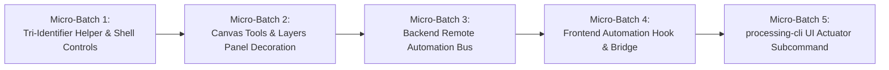

# Subtask Plan: UI Tri-Identifier System & Headless CLI Remote Action Bridge
# File: .ai-memory/plans/subtasks/04-vision-system-and-error-management-instructions/04-ui-tri-identifiers-and-cli-bridge.md
# Spec Reference: 02-spec/21-app/04-vision-system-and-error-management-instructions/04-cli-automation-and-identifiers-spec.md
# Status: pending
# Priority: P0 (Autonomous UI Actuation & Antigravity Tooling Parity)

## 1. Objectives & High-Level Scope

This execution plan establishes an automated UI actuation framework across the CAT Vision desktop application. It ensures every interactive element carries persistent Tri-Identifiers (`id`, `name`, `data-xpath`), sets up a bidirectional SSE/HTTP remote action bridge between the backend and browser, and introduces CLI commands (`processing-cli ui click`, `processing-cli ui list-elements`) modeled after **Google Antigravity Tools** and **Antigravity Manager**.

### Core Deliverables
1. **Tri-Identifier DOM Decoration**:
   - Provide `createAutomationProps` utility for standardizing `id`, `aria-label`, `data-automation-id`, `data-automation-name`, and `data-xpath`.
   - Decorate 100% of interactive buttons, tools, tabs, and sliders across Titlebar, Vision Workbench, Photoshop Layers Panel, and Camera toolbar.
2. **Backend Remote Automation Bus (`BE/routes/ui_automation.py`)**:
   - Provide SSE stream `/api/v1/automation/events`, action queue `/action`, feedback receiver `/feedback`, and DOM snapshot `/elements`.
3. **Frontend UI Automation Bridge Hook (`src/lib/automation/useUiAutomationBridge.ts`)**:
   - React hook listening for incoming actions, evaluating XPath locators, highlighting targets, dispatching synthetic mouse events, and returning execution telemetry.
4. **processing-cli UI Subcommand**:
   - Implement `processing-cli ui click` and `processing-cli ui list-elements` with Universal Response Envelope output.

---

## 2. Micro-Batch Architecture (5–8 Files per Batch)

---

### Micro-Batch 1: Tri-Identifier Helper & Shell Controls
**Scope**: Establish the Tri-Identifier TypeScript helper and decorate top-level window and workspace action buttons.
**Target Files (6 files)**:
1. `src/lib/automation/automation-identifiers.ts` — Core helper `createAutomationProps(params)`.
2. `src/components/layout/StandardAppShell.tsx` — Decorate Titlebar Minimize, Maximize, and Close buttons.
3. `src/components/hmi/Titlebar.tsx` — Decorate header actions, navigation trigger, and release pill.
4. `src/components/vision/workpiece/WorkpieceAnalyzeWorkspace.tsx` — Decorate Save Recipe, Reset ROI, and Apply buttons.
5. `src/components/setup/StandardRoiSetup.tsx` — Decorate OK, Apply, Cancel, and ROI geometry tabs.
6. `tests/unit/ui/test_automation_identifiers.test.ts` — Unit tests verifying XPath generation and positive attributes.

#### Execution Tasks:
- [ ] **Task 1.1**: Author `src/lib/automation/automation-identifiers.ts` exporting `createAutomationProps` and `AutomationAttributes` interface.
- [ ] **Task 1.2**: Update `StandardAppShell.tsx` decorating window control buttons with `btn-window-minimize`, `btn-window-maximize`, and `btn-window-close`.
- [ ] **Task 1.3**: Update `Titlebar.tsx` decorating navigation and brand elements.
- [ ] **Task 1.4**: Decorate primary workbench buttons in `WorkpieceAnalyzeWorkspace.tsx` with `btn-save-recipe`, `btn-reset-roi`, `btn-apply-roi`.
- [ ] **Task 1.5**: Decorate `StandardRoiSetup.tsx` OK, Apply, and Cancel buttons.
- [ ] **Task 1.6**: Add tests in `tests/unit/ui/test_automation_identifiers.test.ts` verifying attribute generation and string format.

---

### Micro-Batch 2: Canvas Tools & Layers Panel Decoration
**Scope**: Decorate canvas manipulation controls, Photoshop-style layer reordering buttons, and live camera triggers.
**Target Files (6 files)**:
1. `src/components/vision/layers/PhotoshopLayersPanel.tsx` — Decorate Bring to Front, Send to Back, Move Up, Move Down, Lock, and Visibility toggles.
2. `src/components/vision/tools/RoiShapeToolbar.tsx` — Decorate Rectangle, Square, and Circle shape drawing tools.
3. `src/components/vision/camera/CameraSourceDropdown.tsx` — Decorate camera source selector and live stream trigger.
4. `src/routes/run.tsx` — Decorate Start, Stop, Pause, Reset, and Export buttons.
5. `src/routes/setup.tsx` — Decorate setup category tabs and workpiece selector.
6. `tests/unit/ui/test_canvas_elements_decorated.test.tsx` — React testing library suite verifying presence of `data-xpath` and `data-automation-id`.

#### Execution Tasks:
- [ ] **Task 2.1**: Update `PhotoshopLayersPanel.tsx` adding Tri-Identifiers: `btn-layer-lock-{id}`, `btn-layer-visible-{id}`, `btn-layer-bring-front`, `btn-layer-send-back`, `btn-layer-move-up`, `btn-layer-move-down`.
- [ ] **Task 2.2**: Update `RoiShapeToolbar.tsx` adding `tool-roi-rectangle`, `tool-roi-square`, `tool-roi-circle`.
- [ ] **Task 2.3**: Update `CameraSourceDropdown.tsx` adding `btn-camera-source-trigger`.
- [ ] **Task 2.4**: Update `run.tsx` adding `btn-run-start`, `btn-run-stop`, `btn-run-pause`.
- [ ] **Task 2.5**: Update `setup.tsx` tab triggers with deterministic IDs.
- [ ] **Task 2.6**: Add test suite in `tests/unit/ui/test_canvas_elements_decorated.test.tsx` ensuring zero missing identifiers.

---

### Micro-Batch 3: Backend Remote Automation Bus
**Scope**: Build FastAPI route and domain models for dispatching headless UI commands and collecting execution feedback.
**Target Files (5 files)**:
1. `BE/app/domain/ui_automation.py` — Domain models: `UiActionCommand`, `UiElementTarget`, `UiActionFeedback`.
2. `BE/routes/ui_automation.py` — FastAPI router with SSE stream `/events`, action queue `/action`, and feedback receiver `/feedback`.
3. `BE/main.py` — Register `ui_automation` router under `/api/v1/automation`.
4. `BE/errors/codes.py` — Register `E_UI_AUTOMATION_TIMEOUT` and `E_UI_ELEMENT_NOT_FOUND`.
5. `tests/unit/be/routes/test_ui_automation.py` — Unit tests verifying SSE queue and feedback resolution.

#### Execution Tasks:
- [ ] **Task 3.1**: Create `BE/app/domain/ui_automation.py` defining Pydantic models with positive booleans (`isSuccess`, `isClicked`, `isVisible`).
- [ ] **Task 3.2**: Implement `BE/routes/ui_automation.py` using `asyncio.Event` and in-memory session dispatch queue.
- [ ] **Task 3.3**: Register router in `BE/main.py`.
- [ ] **Task 3.4**: Add error codes in `BE/errors/codes.py`.
- [ ] **Task 3.5**: Write endpoint tests in `tests/unit/be/routes/test_ui_automation.py`.

---

### Micro-Batch 4: Frontend Automation Hook & Bridge
**Scope**: Implement client-side bridge listening to server actions, resolving DOM elements via XPath/Id, and executing clicks.
**Target Files (5 files)**:
1. `src/lib/automation/useUiAutomationBridge.ts` — React hook connecting to SSE and executing DOM actions.
2. `src/lib/automation/xpathResolver.ts` — Evaluates XPath locators and falls back to ID and Name.
3. `src/types/automation.ts` — TypeScript types for remote automation events and feedback.
4. `src/routes/__root.tsx` — Mount `useUiAutomationBridge` in root application context.
5. `tests/unit/ui/test_ui_automation_bridge.test.ts` — Unit tests mocking SSE events and verifying synthetic click dispatch.

#### Execution Tasks:
- [ ] **Task 4.1**: Create `src/types/automation.ts` mirroring backend domain contracts.
- [ ] **Task 4.2**: Implement `src/lib/automation/xpathResolver.ts` with `resolveElement(target: UiElementTarget) -> Element | null`.
- [ ] **Task 4.3**: Author `src/lib/automation/useUiAutomationBridge.ts`:
  - Listens to `/api/v1/automation/events`.
  - On action, resolves target DOM element.
  - Highlights element with temporary green border.
  - Dispatches `pointerdown`, `mousedown`, `pointerup`, `mouseup`, `click`.
  - Dispatches feedback to `/api/v1/automation/feedback` with execution duration.
- [ ] **Task 4.4**: Mount hook in `src/routes/__root.tsx` so automation is globally active.
- [ ] **Task 4.5**: Add unit test in `tests/unit/ui/test_ui_automation_bridge.test.ts`.

---

### Micro-Batch 5: `processing-cli ui` Actuator Subcommand
**Scope**: Provide command-line actuation interface for autonomous agents and external scripts.
**Target Files (5 files)**:
1. `BE/cli/processing/commands/ui.py` — Subcommand handlers for `processing-cli ui click` and `list-elements`.
2. `BE/cli/processing/main.py` — Register `ui` subcommand with the dispatcher.
3. `BE/cli/processing/helptext/ui.txt` — Manual help documentation for the CLI tool.
4. `tests/unit/be/cli/test_processing_ui.py` — Unit tests for CLI click and element listing.
5. `BE/cli/common/formatters.py` — Table and JSON formatters for UI element manifests.

#### Execution Tasks:
- [ ] **Task 5.1**: Implement `BE/cli/processing/commands/ui.py`:
  - `handle_ui_click(ns, context)`: Sends action to `/api/v1/automation/action` and prints Universal Response Envelope.
  - `handle_ui_list(ns, context)`: Queries `/api/v1/automation/elements` and renders table or JSON.
- [ ] **Task 5.2**: Register `ui` subcommand in `BE/cli/processing/main.py`.
- [ ] **Task 5.3**: Author `BE/cli/processing/helptext/ui.txt`.
- [ ] **Task 5.4**: Add unit tests in `tests/unit/be/cli/test_processing_ui.py`.
- [ ] **Task 5.5**: Add element table formatter in `BE/cli/common/formatters.py`.

---

## 3. Positive Boolean Verification Checklist

| Variable Name | Approved Positive Framing | Forbidden Negative Form |
| :--- | :--- | :--- |
| Element visibility | `isVisible` | `isHidden` |
| Element click result | `isClicked` | `isMissed` |
| Remote action status | `isSuccess` | `isFailure` |
| Bridge connection state | `isConnected` | `isDisconnected` |
| Automation enablement | `isEnabled` | `isDisabled` |
| Layer lock state | `isLocked` | `isUnlocked` |

---

## 4. Acceptance Criteria & Verification Evidence

1. **DOM Attribute Coverage**: 100% of interactive buttons on the Vision Workbench and Titlebar expose `id`, `aria-label`, and `data-xpath`.
2. **Bridge Handshake**: When the frontend is running, `useUiAutomationBridge` connects to `/api/v1/automation/events` with status `isConnected: true`.
3. **Headless Click Actuation**: Executing `processing-cli ui click --id="btn-save-recipe"` triggers the Save Recipe button in the browser, displays green feedback flash, and returns exit code 0.
4. **Resilient Fallback**: If an element ID is dynamically renamed, targeting by `--xpath` succeeds without modification.
5. **Timeout Handling**: Querying an invalid element exits with code 1 and surfaces `E_UI_ELEMENT_NOT_FOUND` within the specified timeout.
