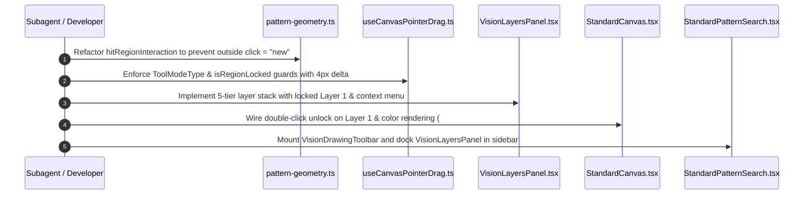

# Subtask SS-05: Vision ROI Shape Tools, Pointer Jump Elimination & Photoshop-Style Layers Panel

**Subtask ID:** `ss-05-roi-shape-tools-and-layers-panel`  
**File:** `.ai-memory/plans/subtasks/04-vision-system-and-error-management-instructions/SS-05-roi-shape-tools-and-layers-panel.md`  
**Parent Plan:** `04-vision-system-and-error-management-instructions` (Tasks 06 & 07)  
**Spec Reference:** `02-spec/21-app/04-vision-system-and-error-management-instructions/05-vision-roi-pattern-and-layers-spec.md`  
**Status:** Ready for Execution  
**Ownership:** Authoring Subagent 3  

---

## 1. Overview & Execution Objectives

This subtask operationalizes the vision inspection drawing tools and multi-tier layer management system in alignment with industrial ICOS inspection workflows (`assets/vision-system-pictures-11Aug/vision-inspection-grid-roi-2.jpg`).

Key execution goals:
1. **Canvas Drawing Toolbar Integration**: Mount `VisionDrawingToolbar.tsx` in `StandardPatternSearch.tsx` and `Pin1MarkingTool.tsx`, directly exposing Rectangle, Circle, and Square geometric creation tools alongside Select mode.
2. **Elimination of Pointer Shape-Jump Defect**: Refactor `src/components/vision/white-box/useCanvasPointerDrag.ts` and `src/components/vision/white-box/pattern-geometry.ts` to introduce `ToolModeType.Select` vs `Create*` modes, preventing destructive 1×1 region overwrites on background clicks.
3. **Photoshop-Style Vision Layers Panel**: Implement and mount `src/components/vision/standard/layers/VisionLayersPanel.tsx` into `StandardPatternSearch.tsx`, managing 5 distinct inspection layers with Layer 1 (Search ROI) locked by default in Crimson Red (`#ef4444`), Layer 2 in Emerald Green (`#10b981`), Layer 3 in Amber (`#f59e0b`), Layer 4 features `[1]` to `[N]`, and Layer 0 Base Image.
4. **Context Menu & Double-Click Unlock**: Provide right-click context menu (Bring to Front, Send to Back, Lock, Visibility) and canvas double-click unlocking on Layer 1.

---

## 2. Micro-Batched Implementation Slices (Bounded 5-8 Files)

### Slice A: Multi-Shape Drawing Tools & Pointer Jump Elimination
**Files Targeted:**
1. `src/lib/vision/DrawingToolType.ts`
2. `src/domain/vision/shapes.ts`
3. `src/components/vision/VisionDrawingToolbar.tsx`
4. `src/components/vision/white-box/pattern-geometry.ts`
5. `src/components/vision/white-box/useCanvasPointerDrag.ts`

**Implementation Actions:**
1. **Update `DrawingToolType.ts` & `shapes.ts`:**
   - Extend `DrawingToolType`:
     ```typescript
     export enum DrawingToolType {
       Select = "Select",
       None = "Select",
       Roi = "Roi",
       Rectangle = "Rectangle",
       Circle = "Circle",
       Square = "Square",
       PatternEdge = "PatternEdge",
       ShapeTrack = "ShapeTrack",
     }
     ```
   - Ensure `ShapeType.Circle`, `ShapeType.Square`, and `ShapeType.Rectangle` are registered with standard geometry parameters (`cx, cy, radius` vs `x, y, width, height`).
2. **Enhance `VisionDrawingToolbar.tsx`:**
   - Add explicit toolbar buttons for Rectangle (`Square` icon), Circle (`Circle` icon), and Square (`Square` icon with 1:1 badge).
   - Ensure all buttons have full 4-attribute automation attributes (`id="btn-tool-rect-roi"`, `data-automation-name="Rectangle Tool"`, `data-xpath="//button[@id='btn-tool-rect-roi']"`).
3. **Eliminate Shape-Jump Bug in `pattern-geometry.ts`:**
   - Replace default `"new"` return in `hitRegionHandle` with `"none"` when in `Select` mode.
   - Introduce `hitRegionInteraction(region, point, toolMode)` which strictly isolates handle manipulation (`nw`, `ne`, `se`, `sw`, `move`) from new shape creation.
4. **Refactor `useCanvasPointerDrag.ts`:**
   - Add `toolMode: DrawingToolType` and `isRegionLocked: boolean` to `CanvasPointerDragParams`.
   - In `handlePointerDown`, if `handle === "none"` or `isRegionLocked`, ignore event without modifying `searchRegion`.
   - In `handlePointerMove` and `handlePointerUp`, enforce a 4px Euclidean movement threshold before committing geometric mutations.

---

### Slice B: Photoshop-Style Vision Layers Panel & Canvas Integration
**Files Targeted:**
1. `src/components/vision/standard/layers/VisionLayersPanel.tsx`
2. `src/components/vision/standard/layers/LayerRowItem.tsx`
3. `src/components/vision/standard/layers/LayerContextMenu.tsx`
4. `src/components/vision/standard/StandardCanvas.tsx`
5. `src/components/vision/standard/StandardPatternSearch.tsx`
6. `src/components/vision/standard/tools/pin1-config/Pin1MarkingTool.tsx`

**Implementation Actions:**
1. **Create `VisionLayersPanel.tsx` & Subcomponents:**
   - Build `VisionLayersPanel.tsx` adhering to the 5-tier layer stack contract:
     - **Layer 4**: Feature Marks `[1..N]` (Cyan `#38bdf8`)
     - **Layer 3**: Mask Overlays (Amber `#f59e0b`)
     - **Layer 2**: Pattern Search Region (Emerald `#10b981`)
     - **Layer 1**: Primary Search ROI (Crimson `#ef4444`, initialized with `isLocked: true`)
     - **Layer 0**: Reference Image (Slate `#64748b`, `isLocked: true`)
   - Each row features:
     - Visibility toggle (Eye icon)
     - Lock toggle (Padlock icon)
     - Layer color chip
     - Coordinate readout badge (`[x, y, w, h]` or `[cx, cy, r]`)
     - Selected state indicator
2. **Implement `LayerContextMenu.tsx`:**
   - Render contextual popup on right-click over any layer row or canvas boundary:
     - `Bring to Front`
     - `Send to Back`
     - `Move Up` / `Move Down`
     - `Toggle Lock`
     - `Toggle Visibility`
3. **Double-Click Unlock Protocol in `StandardCanvas.tsx`:**
   - In `StandardCanvas.tsx`, attach `onDoubleClick` handler to canvas viewport.
   - Detect hit inside Layer 1 Search ROI:
     ```typescript
     if (isPointInsideRegion(clickPoint, settings.searchRegion.geometry)) {
       setIsRoiLocked(false);
       toast.info("Search ROI Unlocked for Positioning");
     }
     ```
   - Render Layer 1 border with Crimson `#ef4444` and Layer 2 border with Emerald `#10b981`.
   - If Layer 1 is locked, suppress hover reticle and corner resize handles.
4. **Mount Toolbar & Layers Panel in `StandardPatternSearch.tsx`:**
   - Position `VisionDrawingToolbar` as a floating vertical bar on the canvas upper-left edge.
   - Dock `VisionLayersPanel` into the right sidebar panel below `StandardToolPanel`.
5. **Mount Toolbar in `Pin1MarkingTool.tsx`:**
   - Expose the shape drawing toolbar directly above `Pin1Canvas`, enabling operators to draw circular and square pin-marker envelopes.

---

## 3. Step-by-Step Execution Sequence



---

## 4. Verification Protocol & Targeted Headless Checks

### 4.1 Automated Headless Playwright Verification
Execute via `scripts/cli-ui-test-runner.ts`:
```powershell
npx tsx scripts/cli-ui-test-runner.ts --suite="vision-roi-layers"
```

### 4.2 Verification Checkpoints
1. **Toolbar Presence**:
   - `page.locator("[role='toolbar'][aria-label='Canvas drawing tools']").isVisible()` returns `true`.
   - Buttons `btn-tool-rect-roi`, `btn-tool-circle-roi`, and `btn-tool-square-roi` are visible.
2. **Shape-Jump Elimination**:
   - Programmatically click at `(50, 50)` on `StandardCanvas` with `ToolModeType.Select`.
   - Verify `settings.searchRegion.geometry` does NOT collapse to `1x1` at `(50, 50)`.
3. **Layer 1 Lock Protection**:
   - Attempt pointer drag on Layer 1 ROI center.
   - Verify ROI coordinates remain unchanged while `isLocked === true`.
4. **Double-Click Unlock**:
   - Programmatically dispatch double-click event on Layer 1.
   - Verify `isLocked` transitions to `false` and corner resize anchors become active.
5. **Context Menu Dispatch**:
   - Right-click Layer 2 (Pattern). Context menu mounts with Bring to Front, Send to Back, Lock, and Visibility.

---

## 5. Coding Standards Invariants

- **Strict Boolean Standards**: `isLocked`, `isVisible`, `isPrimary`, `isSelected`, `hasActiveDrag` only.
- **No Bare Parameters**: Functions take structured `Params` objects (`CanvasPointerDragParams`, `LayerReorderParams`).
- **Vertical Line Spacing**: Mandatory empty line before `if`, after `}`, and before `return`.
- **Strictly Relative Paths**: All imports and documentation link via relative workspace paths.
