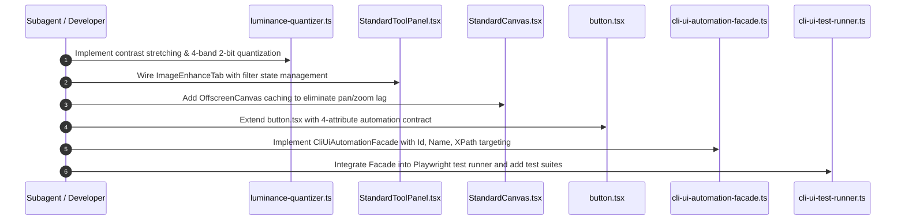

# Subtask SS-06: Grayscale Luminance Bit-Reduction Engine & CLI-to-UI Automation Facade

**Subtask ID:** `ss-06-grayscale-engine-and-cli-automation`  
**File:** `.ai-memory/plans/subtasks/04-vision-system-and-error-management-instructions/SS-06-grayscale-engine-and-cli-automation.md`  
**Parent Plan:** `04-vision-system-and-error-management-instructions` (Tasks 04 & 08)  
**Spec Reference:** `02-spec/21-app/04-vision-system-and-error-management-instructions/06-grayscale-luminance-and-cli-facade-spec.md`  
**Status:** Ready for Execution  
**Ownership:** Authoring Subagent 3  

---

## 1. Overview & Execution Objectives

This subtask delivers the core image enhancement algorithms and autonomous CLI test automation layer required for robust, unattended vision system operation and verification:

1. **Active Wiring of Image Enhance Tab**: Replace inert `PlaceholderTabs` in `StandardToolPanel.tsx` with full live mounting of `ImageEnhanceTab.tsx`.
2. **Grayscale Bit-Reduction & Contrast Engine**:
   - Implement dynamic contrast stretching (2nd to 98th percentile).
   - Implement polarity-aware binary thresholding (darks $\to 0$, whites $\to 255$).
   - Implement 2-bit quantization partitioning the 256 grayscale levels into 4 discrete bands: `[0, 85, 170, 255]`.
   - Offload image processing to a secondary `OffscreenCanvas` in `StandardCanvas.tsx` to maintain 60fps pan/zoom interaction.
3. **4-Attribute Automation Contract**:
   - Update `src/components/ui/button.tsx` and interactive tool elements to guarantee `id`, `data-testid`, `data-automation-name` / `aria-label`, and `data-xpath`.
4. **CLI-to-UI Automation Facade**:
   - Implement `scripts/cli-ui-automation-facade.ts` (`CliUiAutomationFacade`) supporting programmatic targeting and clicking by Id, Name, or XPath.
   - Extend `scripts/cli-ui-test-runner.ts` with automated test suites validating tool selection, threshold manipulation, and canvas updates from the command line.

---

## 2. Micro-Batched Implementation Slices (Bounded 5-8 Files)

### Slice A: Grayscale Luminance, Contrast Stretching & 2-Bit Quantization
**Files Targeted:**
1. `src/lib/vision/luminance-quantizer.ts`
2. `src/components/vision/standard/tabs/ImageEnhanceTab.tsx`
3. `src/components/vision/standard/StandardToolPanel.tsx`
4. `src/components/vision/standard/StandardCanvas.tsx`

**Implementation Actions:**
1. **Create `luminance-quantizer.ts`:**
   - Implement pure functions for luminance extraction, contrast stretching, and quantization:
     ```typescript
     export interface LuminanceFilterParams {
       pixelBuffer: Uint8ClampedArray;
       width: number;
       height: number;
       filterType: "binary" | "contrast" | "quantize2bit" | "none";
       lowerLimit: number;
       upperLimit: number;
       isPolarityInverted: boolean;
     }

     export function applyLuminanceFilter(params: LuminanceFilterParams): void;
     ```
   - Calculate 2nd and 98th percentiles across pixels for dynamic stretching.
   - Implement 2-bit quantization lookup table:
     - $[0, 63] \to 0$
     - $[64, 127] \to 85$
     - $[128, 191] \to 170$
     - $[192, 255] \to 255$
2. **Mount `ImageEnhanceTab.tsx` in `StandardToolPanel.tsx`:**
   - Remove `<PlaceholderTabs name={activeTab} />` for `"Image Enhance"`.
   - Wire `ImageEnhanceTab` to `settings.imageFilters` and `setSettings`.
   - Connect auto-threshold computation based on Otsu / percentile analysis.
3. **Enhance `ImageEnhanceTab.tsx` Controls:**
   - Add `"quantize2bit"` option to the processing method dropdown:
     - `Binary Threshold` (0 or 255)
     - `Contrast Stretching` (Normalized full range)
     - `2-Bit Quantization (4 Levels)` ([0, 85, 170, 255])
     - `Invert Polarity` (Flip darks and lights)
   - Ensure threshold sliders and numeric inputs carry full 4-attribute automation attributes.
4. **Offscreen Buffer in `StandardCanvas.tsx`:**
   - Instantiate `OffscreenEnhanceBuffer` caching filtered canvas output.
   - When zooming or panning, draw cached offscreen canvas via `ctx.drawImage` to avoid recomputing millions of pixels per animation frame.

---

### Slice B: 4-Attribute Contract & CLI Automation Facade
**Files Targeted:**
1. `src/components/ui/button.tsx`
2. `scripts/cli-ui-automation-facade.ts`
3. `scripts/cli-ui-test-runner.ts`

**Implementation Actions:**
1. **Extend `src/components/ui/button.tsx`:**
   - Add `automationName?: string` and `xpath?: string` to `ButtonProps`.
   - Automatically inject attributes:
     - `data-automation-name={automationName ?? (typeof children === "string" ? children : undefined)}`
     - `data-xpath={xpath ?? (id ? `//button[@id='${id}']` : undefined)}`
2. **Implement `scripts/cli-ui-automation-facade.ts`:**
   - Author `CliUiAutomationFacade` class wrapping Playwright `Page`:
     ```typescript
     export class CliUiAutomationFacade {
       constructor(private page: Page) {}

       public async clickById(id: string): Promise<ActionResult<void>>;
       public async clickByName(name: string): Promise<ActionResult<void>>;
       public async clickByXPath(xpath: string): Promise<ActionResult<void>>;
       public async setSliderValue(id: string, value: number): Promise<ActionResult<void>>;
       public async getElementState(target: string): Promise<ActionResult<ElementState>>;
     }
     ```
   - Standardize all returns into monadic `ActionResult<T>` containing `isSuccess`, `hasError`, `data`, `errorMessage`, and `durationMs`.
3. **Extend `scripts/cli-ui-test-runner.ts`:**
   - Initialize `CliUiAutomationFacade` inside test runner execution context.
   - Add automated test suites for vision tools:
     - `clickById("btn-tool-circle-roi")` $\to$ verify Circle tool active.
     - `clickById("tab-image-enhance")` $\to$ verify Image Enhance tab mounted.
     - `setSliderValue("slider-threshold-lower", 110)` $\to$ verify threshold value updated.
     - `clickByXPath("//button[@id='btn-evaluate-rule']")` $\to$ verify evaluation triggered.

---

## 3. Step-by-Step Execution Sequence



---

## 4. Verification Protocol & Targeted Headless Checks

### 4.1 Automated Headless Playwright Verification
Execute via `scripts/cli-ui-test-runner.ts`:
```powershell
npx tsx scripts/cli-ui-test-runner.ts --suite="grayscale-cli-facade"
```

### 4.2 Verification Checkpoints
1. **Image Enhance Tab Mounting**:
   - Facade clicks `#tab-image-enhance`.
   - Verify `#tab-panel-image-enhance` is visible and placeholder is absent.
2. **2-Bit Quantization Verification**:
   - Set filter mode to `quantize2bit`.
   - Inspect sampled canvas pixels; confirm all RGB values belong strictly to $\{0, 85, 170, 255\}$.
3. **Contrast Stretch Verification**:
   - Compare histogram before and after stretch on low-contrast test fixture; confirm full $[0, 255]$ dynamic range coverage.
4. **Programmatic Targeting by Id**:
   - Facade invokes `clickById("btn-tool-rect-roi")`.
   - Verify tool mode changes to `DrawingToolType.Rectangle`.
5. **Programmatic Targeting by XPath**:
   - Facade invokes `clickByXPath("//button[@id='btn-register-image']")`.
   - Verify file input trigger is engaged.
6. **Programmatic Targeting by Name**:
   - Facade invokes `clickByName("Evaluate Rule")`.
   - Verify rule evaluation toast dispatches.

---

## 5. Coding Standards Invariants

- **Strict Boolean Standards**: `isSuccess`, `hasError`, `isPolarityInverted`, `isEnabled`, `hasQuantization` only. Positive framing, non-nullable.
- **No Bare Parameters**: Functions take structured parameter interfaces (`LuminanceFilterParams`, `TargetElementParams`).
- **Vertical Line Spacing**: Mandatory empty line before `if`, after `}`, before `return`, and around multiline structures.
- **Strictly Relative Paths**: All imports and documentation link via relative workspace paths.
