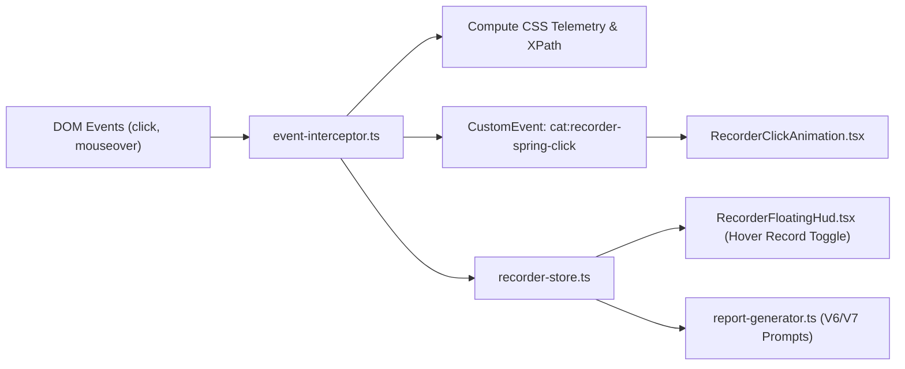

# Subtask 05: UI Telemetry, Spring Animation & Intelligent Hover Deduplication

- **Task**: `cat-product-recording-feature-enhancement - Subtask 05`
- **Module**: `AppRuntime / BugRecorder / UITelemetry / InteractionEngine`
- **Owner**: Telemetry & Interaction Engineer (`3dbff566-894c-466c-bf31-39024c41c49c`)
- **Status**: COMPLETED
- **Target Files**:
  - `src/lib/recorder/types.ts`
  - `src/lib/recorder/event-interceptor.ts`
  - `src/lib/recorder/recorder-store.ts`
  - `src/lib/recorder/report-generator.ts`
  - `src/components/recorder/RecorderClickAnimation.tsx`
  - `src/components/recorder/RecorderFloatingHud.tsx`
  - `src/components/recorder/ActivityRecorderRoot.tsx`
- **Reference Spec**: `02-spec/21-app/87-cat-product-recording-feature-enhancement/02-ui-telemetry-spring-and-hover-spec.md`

---

## 1. Context & Objectives

To enable autonomous AI assistants (Antigravity, Claude, Letterly) to accurately diagnose and resolve visual UI defects, the bug recorder must capture rich structural and styling telemetry beyond standard screenshots. 

This subtask implements:
1. **Deep CSS Telemetry**: Extraction of exact bounding boxes, distances from viewport boundaries, computed padding, margins, borders, typography, background colors, and resilient deterministic XPaths for every captured event.
2. **Magic Spring Click Animation**: Dynamic visual spring ripple feedback rendered at click coordinates displaying an expanding step number badge (`Step #N`).
3. **Intelligent Hover Record Engine**: A dedicated HUD toggle that captures hover state transitions exclusively on interactive elements (`cursor: pointer`, buttons, links, inputs) while deduplicating identical targets within the session to prevent screenshot bloat.

---

## 2. Technical Architecture & File Modifications



### 2.1 File Modification Map

| File Path | Planned Modifications |
| :--- | :--- |
| `src/lib/recorder/types.ts` | Define `ElementGeometry`, `ViewportDistances`, `BoxModelMetrics`, `StyleMetrics`, and `UiTelemetrySnapshot` interfaces; extend `RecorderEvent` and `AddEventParams` with telemetry. |
| `src/lib/recorder/event-interceptor.ts` | Implement `computeDeterministicXPath`, `extractElementTelemetry`, click ripple dispatcher, and debounced/deduplicated `handleHoverEvent`. |
| `src/lib/recorder/recorder-store.ts` | Add `isHoverRecordEnabled: boolean`, `toggleHoverRecord()`, and session-scoped `hoveredTargetsCache: Set<string>`. |
| `src/components/recorder/RecorderClickAnimation.tsx` | Create React portal/overlay rendering expanding cyan spring ripples with `Step #N` badge pill. |
| `src/components/recorder/RecorderFloatingHud.tsx` | Add "Hover Record" toggle pill button with visual active status indicator. |
| `src/components/recorder/ActivityRecorderRoot.tsx` | Mount `<RecorderClickAnimation />` inside recorder root component hierarchy. |
| `src/lib/recorder/report-generator.ts` | Serialize telemetry (XPath, bounding box, padding, colors) into Markdown step entries. |

---

## 3. Step-by-Step Implementation Breakdown

### Step 1: Extend Recorder Data Models in `types.ts`
- Add `UiTelemetrySnapshot` and supporting interfaces complying with the Strict Boolean standard:
  ```typescript
  export interface ElementGeometry {
    x: number;
    y: number;
    width: number;
    height: number;
    clientX: number;
    clientY: number;
  }

  export interface ViewportDistances {
    distanceToViewportTop: number;
    distanceToViewportRight: number;
    distanceToViewportBottom: number;
    distanceToViewportLeft: number;
  }

  export interface BoxModelMetrics {
    paddingTop: number;
    paddingRight: number;
    paddingBottom: number;
    paddingLeft: number;
    marginTop: number;
    marginRight: number;
    marginBottom: number;
    marginLeft: number;
    borderWidth: number;
    borderRadius: string;
  }

  export interface StyleMetrics {
    color: string;
    backgroundColor: string;
    borderColor: string;
    fontSize: string;
    fontWeight: string;
    fontFamily: string;
    cursor: string;
    isVisible: boolean;
    hasPointerCursor: boolean;
  }

  export interface UiTelemetrySnapshot {
    stepNumber: number;
    xpath: string;
    fullDomPath: string;
    tagName: string;
    textContent: string;
    componentIdentifier: string;
    geometry: ElementGeometry;
    viewport: ViewportDistances;
    boxModel: BoxModelMetrics;
    styles: StyleMetrics;
    isInteractive: boolean;
    isHoverRecorded: boolean;
  }
  ```
- Add optional `telemetry?: UiTelemetrySnapshot` to `RecorderEvent` and `AddEventParams`.
- Add `Hover = "hover"` to `RecorderEventType` enum.

### Step 2: Implement Telemetry Extraction & XPath Resolver in `event-interceptor.ts`
- Implement `computeDeterministicXPath(el: HTMLElement): string`:
  - Priority 1: `@id` (skipping dynamic Radix `:r` / `radix-` prefixes).
  - Priority 2: `@data-tour` or `@data-testid`.
  - Priority 3: Tag-indexed DOM ancestry path `/html/body/...`.
- Implement `extractElementTelemetry(el: HTMLElement, clientX: number, clientY: number, stepNumber: number): UiTelemetrySnapshot`:
  - Query `el.getBoundingClientRect()`.
  - Compute distances to viewport boundaries:
    - `top: rect.top`
    - `bottom: window.innerHeight - rect.bottom`
    - `left: rect.left`
    - `right: window.innerWidth - rect.right`
  - Query `window.getComputedStyle(el)` for box model (padding, margin, border) and visual styles (color, backgroundColor, font).
  - Determine `isInteractive`: checks `cursor === 'pointer'`, semantic interactive tag (`BUTTON`, `A`, `INPUT`, etc.), or ARIA role.

### Step 3: Implement `RecorderClickAnimation.tsx`
- Create component `src/components/recorder/RecorderClickAnimation.tsx`.
- Register global event listener for `"cat:recorder-spring-click"`.
- Render fixed overlay at `z-[999999]` with `pointer-events-none`.
- Pulse visual elements:
  - Expanding cyan halo (`border-cyan-400 bg-cyan-500/20`, box shadow glow).
  - High-contrast centered badge displaying `Step #{stepNumber}` in bold monospace font.
  - Automatically remove pulse node from component state after 800ms.
- Mount component in `src/components/recorder/ActivityRecorderRoot.tsx`.

### Step 4: Add "Hover Record" State to `recorder-store.ts` & HUD Toggle
- In `src/lib/recorder/recorder-store.ts`:
  - Add state `isHoverRecordEnabled: boolean` (default: `false`).
  - Add action `toggleHoverRecord(): void`.
  - Add `hoverCache: Set<string>` initialized as empty on recording start.
  - Add method `hasRecordedHover(key: string): boolean` and `markHoverRecorded(key: string): void`.
- In `src/components/recorder/RecorderFloatingHud.tsx`:
  - Add a pill toggle button: `<Button onClick={toggleHoverRecord} variant={isHoverRecordEnabled ? "secondary" : "ghost"}>`.
  - Display icon and text: `Hover Record` with active cyan glow indicator when enabled.

### Step 5: Implement Intelligent Hover Detection & Deduplication
- In `src/lib/recorder/event-interceptor.ts`:
  - Add `mouseover` / `mousemove` event listener with 250ms dwell debounce.
  - Filter logic:
    1. If `!store.isHoverRecordEnabled || !store.isRecording`, return immediately.
    2. If target is within `[data-recorder-hud]`, return immediately.
    3. Evaluate if target is interactive: must have `cursor: pointer` OR be `button`, `a`, `input`, `select`, or `role="button"`.
    4. Compute deduplication key: `${window.location.pathname}:${xpath}`.
    5. If key already exists in `hoverCache`, return immediately (zero duplication).
    6. After 250ms dwell timeout, if cursor is still on target:
       - Add key to `hoverCache`.
       - Capture single snapshot screenshot.
       - Extract full telemetry.
       - Emit `RecorderEventType.Hover` event to store.

### Step 6: Integrate Telemetry into Report Generator
- In `src/lib/recorder/report-generator.ts`:
  - When rendering markdown steps, output formatted tables containing:
    - Target element and XPath.
    - Bounding geometry and viewport distances.
    - CSS padding, margin, colors, and typography.

---

## 4. Verification & Testing Procedure

1. **Verify Unit Tests**:
   ```bash
   bun test src/lib/recorder/__tests__/
   ```
   *Pass Criteria*: All tests pass with 0 failures.

2. **Verify Click Spring Ripple**:
   - Start recording via HUD.
   - Click an interactive button.
   - *Pass Criteria*: Cyan spring animation appears at click position with badge `Step #1` and smoothly fades out in 800ms without blocking subsequent clicks.

3. **Verify Hover Record & Deduplication**:
   - Toggle "Hover Record" ON.
   - Hover over the "Start Inspection" button -> 1 screenshot captured and event logged.
   - Move cursor away, then hover over "Start Inspection" button again.
   - *Pass Criteria*: No duplicate event or screenshot is taken.

4. **Verify Non-Interactive Rejection**:
   - Hover over a plain text paragraph or background `<div>`.
   - *Pass Criteria*: Zero events emitted.

5. **Verify Markdown Telemetry Serialization**:
   - Open Export Modal and view generated prompt.
   - *Pass Criteria*: Step contains XPath, geometry, box model metrics, and local screenshot references.

---

## 5. Rollback Strategy

1. All state additions in `recorder-store` default to `false` (`isHoverRecordEnabled: false`).
2. Animation overlay operates with `pointer-events: none` and does not mutate DOM outside its own portal.
3. If regressions occur, disabling the hover toggle in HUD restores original recorder behavior without breaking recording flows.
