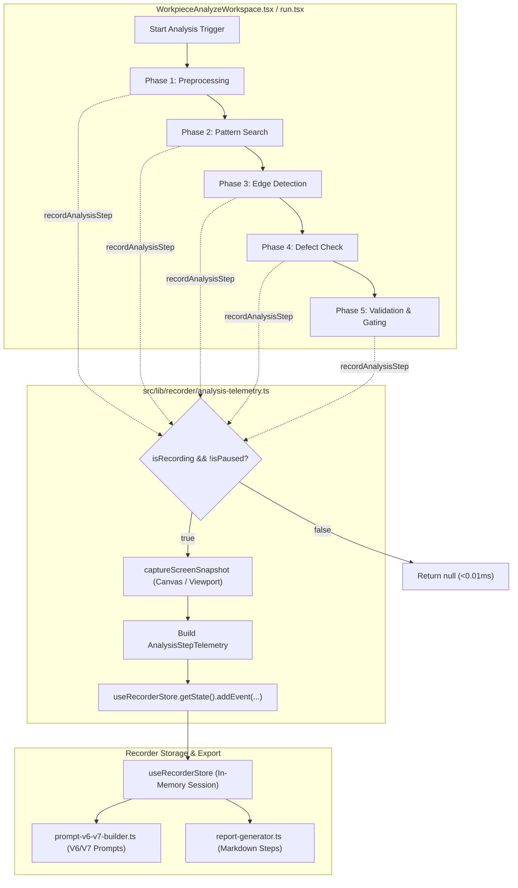

# Subtask 05: Analysis Steps Telemetry & Recording Pipeline Implementation Plan

- **Subtask ID**: `88-snap-24-event-20-ui-and-functionality-issues - Subtask 05`
- **Module**: `AppRuntime / InspectionTelemetry / AnalysisRecorder`
- **Status**: PENDING
- **Reference Spec**: `02-spec/21-app/88-snap-24-event-20-ui-and-functionality-issues/05-analysis-steps-recording-spec.md`
- **Target Files (Bounded Micro-Batch: 7 Files)**:
  1. `src/lib/recorder/types.ts`
  2. `src/lib/recorder/analysis-telemetry.ts`
  3. `src/components/vision/workpiece/WorkpieceAnalyzeWorkspace.tsx`
  4. `src/routes/run.tsx`
  5. `src/lib/recorder/prompt-v6-v7-builder.ts`
  6. `src/lib/recorder/report-generator.ts`
  7. `src/lib/recorder/__tests__/analysis-telemetry.test.ts`

---

## 1. Technical Context & Objectives

To enable autonomous AI models (such as Antigravity, Letterly V6/V7, and Claude) to diagnose root causes of visual inspection failures, inspection steps cannot execute as an opaque black box. When an inspection occurs—whether manually inside `WorkpieceAnalyzeWorkspace.tsx` or continuously within the carrier tape frame loop in `src/routes/run.tsx`—the recorder must capture the **5 discrete inspection phases**:
1. **Phase 1: Preprocessing** (Image acquisition, pocket segmentation, luma normalization).
2. **Phase 2: Pattern Search** (Pin 1 fiducial localization, constellation matching, golden template NCC).
3. **Phase 3: Edge Detection** (Sub-pixel caliper lead pitch, circle gauge diameter).
4. **Phase 4: Defect Check** (Die scratch/void detection, solder bridge short-circuits, 2D code decode).
5. **Phase 5: Validation & Gating** (DAG dependency rule gating, composite scoring, pass/fail verdict).

This subtask implements `recordAnalysisStep` with full screenshot capture, strict relative Git paths, and zero repository asset persistence (**Anti-Asset Invariant**).

---

## 2. Technical Architecture & Component Flow

---

## 3. File Modification Map

| File Path | Operations & Scope |
| :--- | :--- |
| `src/lib/recorder/types.ts` | Define `InspectionPhaseType` enum, `AnalysisStepMetric`, `AnalysisStepTelemetry`, `RecordAnalysisStepParams`. Extend `RecorderEventType` with `AnalysisStep`. |
| `src/lib/recorder/analysis-telemetry.ts` | Author new module implementing `recordAnalysisStep(params)`. Enforce zero overhead when idle, non-blocking canvas screenshots, and formatted telemetry commits. |
| `src/components/vision/workpiece/WorkpieceAnalyzeWorkspace.tsx` | Instrument `handleRunAnalysis` with Phase 1 (Preprocessing), Phase 2 (Pattern Search), Phase 3 (Edge Detection), Phase 4 (Defect Check), and Phase 5 (Validation Gating). |
| `src/routes/run.tsx` | Instrument live carrier tape frame loop in `useVisibleInterval` with 5-phase analysis telemetry calls. |
| `src/lib/recorder/prompt-v6-v7-builder.ts` | Add formatting for `analysis_step` events in V6/V7 prompt tables, displaying phase numbers, step names, and metrics. |
| `src/lib/recorder/report-generator.ts` | Add section in markdown AI instructions summarizing sequential inspection phases and failed checks. |
| `src/lib/recorder/__tests__/analysis-telemetry.test.ts` | Unit tests for `recordAnalysisStep`, verifying non-blocking execution, phase ordering, and Anti-Asset Invariant. |

---

## 4. Step-by-Step Execution Plan

### Step 1: Extend Data Models in `src/lib/recorder/types.ts`
- Define `InspectionPhaseType` enum (`Preprocessing`, `PatternSearch`, `EdgeDetection`, `DefectCheck`, `ValidationGating`).
- Add `AnalysisStep = "analysis_step"` to `RecorderEventType`.
- Define `AnalysisStepMetric`, `AnalysisStepTelemetry`, and `RecordAnalysisStepParams` complying with the Strict Boolean standard (`is*`, `has*` only, positive framing).

### Step 2: Implement `src/lib/recorder/analysis-telemetry.ts`
- Implement `recordAnalysisStep(params: RecordAnalysisStepParams): Promise<RecorderEvent | null>`.
- Fast return if `!store.isRecording || store.isPaused || !store.session`.
- Non-blocking canvas screenshot capture using `captureScreenSnapshot`.
- Strict Anti-Asset Invariant compliance: store data URLs in `CapturedScreenshot` inside the recorder store; do NOT write files to `src/assets/` or `public/`.
- Commit event with `actor: RecorderActorType.System` and `eventType: RecorderEventType.AnalysisStep`.

### Step 3: Instrument `WorkpieceAnalyzeWorkspace.tsx`
- In `handleRunAnalysis`:
  - Phase 1: Wrap image loading, pocket segmentation (`evaluateTapeStripRules`), and luma normalization in `recordAnalysisStep` with `phase: InspectionPhaseType.Preprocessing`.
  - Phases 2-4: Wrap each rule evaluation, mapping `rule.family` (Measurement/Caliper -> Phase 3 Edge Detection; Defect/CodeReader -> Phase 4 Defect Check; Pattern/Color/OCR -> Phase 2 Pattern Search).
  - Phase 5: At conclusion of all rules, record `phase: InspectionPhaseType.ValidationGating` with aggregate score and pass/fail verdict.

### Step 4: Instrument `src/routes/run.tsx`
- In `useVisibleInterval`:
  - Phase 1: Frame fetch & pocket index indexing.
  - Phase 2: Template alignment check against reference image.
  - Phase 3: Caliper & pitch dimension checks.
  - Phase 4: Solder / defect / slot analysis.
  - Phase 5: Gating verdict, counter increment (`ok` / `ng`), status log push.

### Step 5: Update V6/V7 Builders & Report Generators
- Update `formatEventTableRow` in `src/lib/recorder/prompt-v6-v7-builder.ts` to render `[Phase N/5: <phase>] <stepName>` with metrics.
- Update `generateAiInstructions` in `src/lib/recorder/report-generator.ts` to surface inspection phase summaries.

### Step 6: Unit Test Coverage
- Author `src/lib/recorder/__tests__/analysis-telemetry.test.ts`:
  - Test 1: Immediate null return when recorder is idle.
  - Test 2: Event creation with correct phase index and telemetry attributes when recording is active.
  - Test 3: Screenshot attachment verification and in-memory data URL integrity.

---

## 5. Verification & Acceptance Criteria

1. **Coding Constraints**:
   - Strict Boolean Standard: `isPassed`, `isGated`, `hasActiveCamera`, `hasScreenshot` only.
   - Parameter Structs: `RecordAnalysisStepParams` used for all calls with $>2$ parameters.
   - Vertical Line Gaps: Blank lines before `if`, after `}`, before `return`.
2. **Anti-Asset Invariant**: All screenshots remain strictly memory-bound in `CapturedScreenshot.dataUrl`.
3. **Bounded Micro-Batch**: Exactly 7 files modified/created.
4. **Strict Relative Git Paths**: All imports and file links use relative paths.
