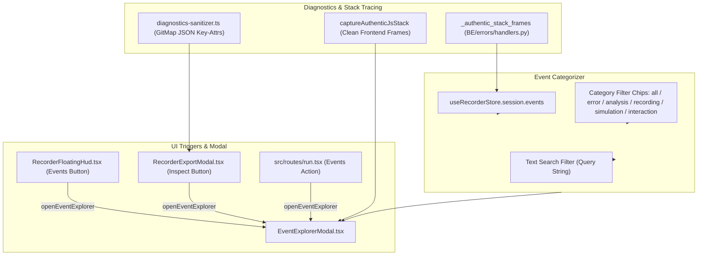

# Subtask 06: Event Explorer Modal, Category Filtering & Diagnostics Sanitization Implementation Plan

- **Subtask ID**: `88-snap-24-event-20-ui-and-functionality-issues - Subtask 06`
- **Module**: `AppRuntime / DiagnosticsTelemetry / UIExplorer`
- **Status**: PENDING
- **Reference Spec**: `02-spec/21-app/88-snap-24-event-20-ui-and-functionality-issues/06-event-explorer-and-diagnostics-spec.md`
- **Target Files (Bounded Micro-Batch: 8 Files)**:
  1. `src/components/recorder/EventExplorerModal.tsx`
  2. `src/components/recorder/RecorderFloatingHud.tsx`
  3. `src/components/recorder/RecorderExportModal.tsx`
  4. `src/routes/run.tsx`
  5. `src/lib/recorder/diagnostics-sanitizer.ts`
  6. `BE/errors/handlers.py`
  7. `src/lib/recorder/recorder-store.ts`
  8. `src/lib/recorder/__tests__/diagnostics-sanitizer.test.ts`

---

## 1. Technical Context & Objectives

As the CAT iVISION activity recorder captures diverse interaction streams, operators need a centralized visual explorer to review, search, and filter recorded activity before exporting bug packages or reporting issues. Furthermore, system diagnostics sent to AI models (Antigravity, Letterly V6/V7) must be free from Mozilla user-agent bloat and include authentic function stack frames.

This subtask implements:
1. **Antigravity Cyber-Styled Event Explorer (`EventExplorerModal.tsx`)**:
   - Filter chips: `all`, `error`, `analysis`, `recording`, `simulation`, and `interaction`.
   - Real-time search across event descriptions, targets, selectors, and routes.
   - Interactive split-pane with JSON payload inspector and snapshot thumbnail expander.
2. **Unified Trigger Placements**:
   - Trigger buttons mounted in `RecorderFloatingHud.tsx`, `RecorderExportModal.tsx`, and `run.tsx`.
3. **Diagnostics Sanitizer (`diagnostics-sanitizer.ts`)**:
   - Strips 150+ char Mozilla strings into structured GitMap key-attributes (`system`, `browser`, `display`, `hardware`, `runtime`).
   - `captureAuthenticJsStack`: Extracts true component function names, stripping Vite/Webpack chunk hashes and query params.
4. **Authentic Backend Stack Frames (`BE/errors/handlers.py`)**:
   - Implements `_authentic_stack_frames` to resolve clean, qualified module frames formatted as `BE/package/file.py:line in func_name()`.

---

## 2. Technical Architecture & Component Flow

---

## 3. File Modification Map

| File Path | Operations & Scope |
| :--- | :--- |
| `src/components/recorder/EventExplorerModal.tsx` | Create new modal component adhering to Antigravity cyber aesthetic (dark slate `#0c1017`, cyan glow, monospace cards, 6 filter chips, split-view inspector). |
| `src/components/recorder/RecorderFloatingHud.tsx` | Add `Events` button with `ListTree` icon and event count badge. |
| `src/components/recorder/RecorderExportModal.tsx` | Add `Inspect Event Timeline` button in export modal footer and summary panel. |
| `src/routes/run.tsx` | Add `Events` action button to `actionControls` in standard shell and HMI headers. |
| `src/lib/recorder/diagnostics-sanitizer.ts` | Author diagnostics sanitizer module: clean GitMap JSON key-attributes, strip Mozilla UA bloat, implement `captureAuthenticJsStack`. |
| `BE/errors/handlers.py` | Upgrade `_stack_frames` to `_authentic_stack_frames` to extract clean module and function traces. |
| `src/lib/recorder/recorder-store.ts` | Add `isEventExplorerOpen`, `openEventExplorer()`, `closeEventExplorer()` to recorder state. |
| `src/lib/recorder/__tests__/diagnostics-sanitizer.test.ts` | Unit tests for diagnostics sanitizer, user-agent stripping, and authentic stack frame parsing. |

---

## 4. Step-by-Step Execution Plan

### Step 1: Implement `src/lib/recorder/diagnostics-sanitizer.ts`
- Define interfaces: `SanitizedSystemInfo`, `SanitizedBrowserInfo`, `SanitizedDisplayInfo`, `SanitizedHardwareInfo`, `SanitizedRuntimeInfo`, and `SanitizedDiagnosticsReport`.
- Implement `sanitizeBrowserDiagnostics()`:
  - Parse `navigator.userAgent` to isolate OS (`Windows 10/11`, `macOS`, `Linux`) and Browser (`Chrome`, `Firefox`, `Edge`, `Safari`).
  - Read screen resolution, viewport dimensions, pixel ratio, and color depth.
  - Query logical CPU cores (`hardwareConcurrency`), memory (`deviceMemory`), and unmasked WebGL GPU renderer.
  - Omit raw Mozilla string completely.
- Implement `captureAuthenticJsStack(errorOrUnknown?: unknown, skipFrames?: number)`:
  - Clean URL parameters (`?t=...`, `/@fs/`, chunk hashes).
  - Filter out React internal fiber frames (`renderWithHooks`, `performUnitOfWork`).
  - Return structured array of `AuthenticJsStackFrame`.

### Step 2: Implement `_authentic_stack_frames` in `BE/errors/handlers.py`
- Replace existing `_stack_frames` with `_authentic_stack_frames(exc: BaseException) -> list[str]`.
- Convert backslashes to forward slashes.
- Filter out standard library and third-party virtualenv packages unless they are the direct error frame.
- Format frames as `BE/package/module.py:line in ClassName.func_name()`.

### Step 3: Extend Recorder Store in `src/lib/recorder/recorder-store.ts`
- Add `isEventExplorerOpen: boolean` to `RecorderStoreState`.
- Add `openEventExplorer: () => void` and `closeEventExplorer: () => void`.

### Step 4: Build `src/components/recorder/EventExplorerModal.tsx`
- Implement cyber styling:
  - Container: `#0c1017` with `border-cyan-500/20` and shadow backdrop blur.
  - Header: Session title, total event counter, close button (Esc).
  - Search Bar: Instant text filter with debouncing.
  - Category Filter Chips:
    - `all`: All events.
    - `error`: Events with `eventType === RecorderEventType.Error` or details containing error codes.
    - `analysis`: Events with `eventType === RecorderEventType.AnalysisStep` or inspection phases 1-5.
    - `recording`: Snapshots, notes, and export events.
    - `simulation`: Carrier tape feeds and conveyor simulation ticks.
    - `interaction`: Clicks with spring numbers, hovers, ROI drags/resizes.
  - Left Pane: Chronological timeline cards with badges, timestamps, and spring indicators.
  - Right Pane: Monospace JSON telemetry inspector with "Copy JSON" and image snapshot preview.

### Step 5: Mount Trigger Buttons
- `src/components/recorder/RecorderFloatingHud.tsx`: Add button between `Note` and `Pause`.
- `src/components/recorder/RecorderExportModal.tsx`: Add button in the secondary action row.
- `src/routes/run.tsx`: Add button in `actionControls` header toolbar.

### Step 6: Unit Test Coverage
- Author `src/lib/recorder/__tests__/diagnostics-sanitizer.test.ts`:
  - Test 1: Verify `sanitizeBrowserDiagnostics()` outputs valid JSON key-attributes without `"Mozilla/5.0"`.
  - Test 2: Verify `captureAuthenticJsStack()` strips query parameters and Vite hash suffixes.
  - Test 3: Verify category filter logic categorizes events into the 6 distinct buckets.

---

## 5. Verification & Acceptance Criteria

1. **Coding Constraints**:
   - Strict Boolean Standard: `isOpen`, `isPassed`, `hasScreenshot`, `hasTouchSupport` only.
   - Parameter Structs: Used for all multi-parameter functions.
   - Vertical Line Gaps: Blank lines before `if`, after `}`, before `return`.
2. **Anti-Asset Invariant**: Screenshots displayed inside `EventExplorerModal` utilize in-memory data URLs; no disk asset files generated.
3. **Bounded Micro-Batch**: Exactly 8 files modified/created.
4. **Strict Relative Git Paths**: All imports and file links use relative paths.
