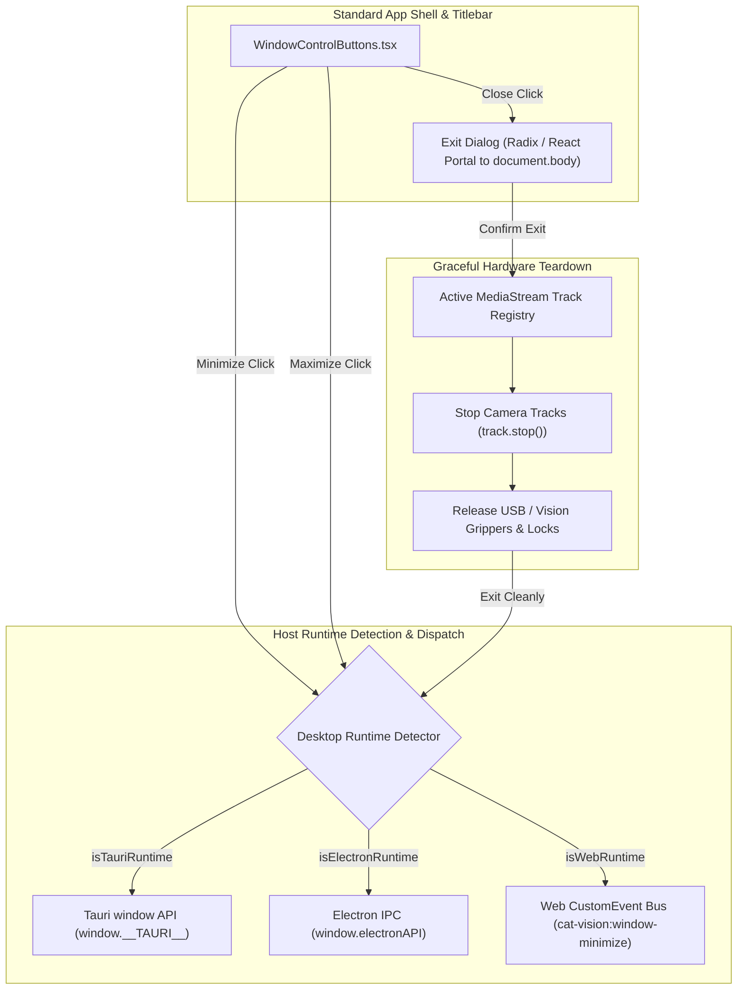
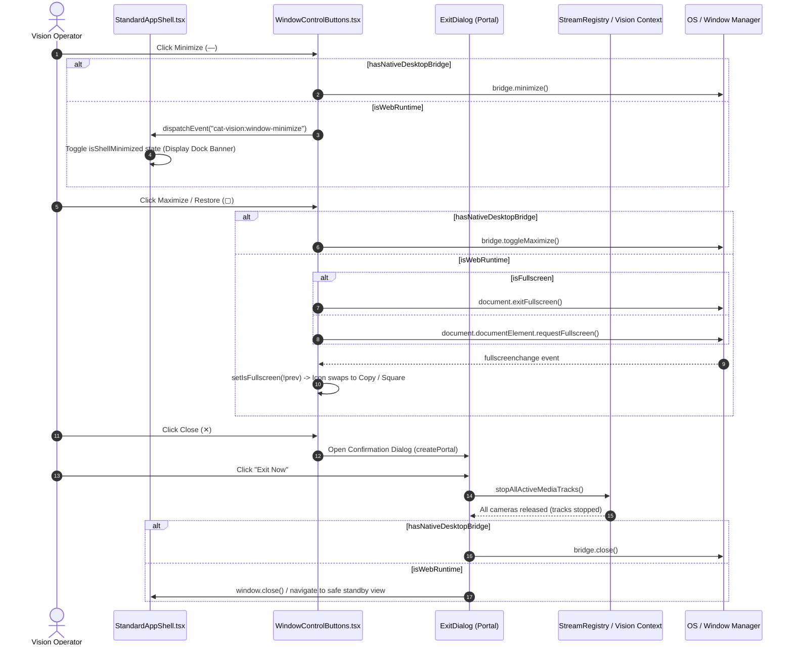
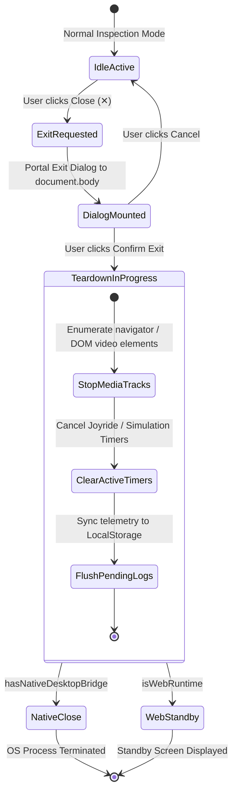

# Architecture & Desktop Window Controls Specification
# Directory: 02-spec/21-app/04-vision-system-and-error-management-instructions/01-architecture-and-window-controls-spec.md
# Status: Approved Architectural Contract

## 1. Executive Summary & Architectural Scope

The **CAT Vision (CAT iVISION)** inspection suite operates across heterogeneous runtime host environments:
1. Native Desktop Container (Tauri v1/v2 / Electron IPC wrappers) for industrial factory workstations.
2. Web Standalone HMI (Chromium kiosk, operator touchscreens, local server browsers).

A seamless Human-Machine Interface (HMI) demands that window controls—**Minimize (`—`)**, **Restore / Maximize (`▢` / `❐`)**, and **Exit / Close (`✕`)**—exhibit deterministic, hardware-safe behaviors across all targets.



### 1.1 Core Problems in Legacy Implementation
- **Destructive Close Crash**: The legacy exit handler performed `window.location.href = "/"`, resetting the browser state abruptly without releasing hardware camera streams (`MediaStreamTrack`). On USB 3.0 industrial cameras (e.g. Daheng, Basler, FLIR), lingering streams lock the direct memory DMA buffer, requiring a hard operating system reboot.
- **Window Controls Desynchronization**: The Maximize button displayed a static icon (`Square`) without tracking browser or OS fullscreen events (`fullscreenchange`), causing visual inversion when users entered fullscreen via OS shortcuts (`F11`).
- **Missing Web Minimize Integration**: When running inside browser kiosks or embedded shells, clicking Minimize dispatched an event (`cat-vision:window-minimize`) that was unhandled in `src/components/layout/StandardAppShell.tsx`, rendering the button inert.
- **Dialog DOM Clipping**: The confirmation dialog rendered inline inside the titlebar `<header>` element, suffering from clipping and stacking context degradation due to `backdrop-blur-xl`, `z-50`, and parent CSS transforms.

---

## 2. Desktop Runtime Detection & Adapter Matrix

To support unified execution without runtime crashes, the shell defines a strongly typed detection contract adhering strictly to the **Positive Boolean Standard** (`is...` and `has...` flags only).

### 2.1 Host Environment Contract

```typescript
// Interface location: src/types/desktop-window-bridge.ts

export interface DesktopWindowBridge {
  readonly minimize?: () => Promise<void> | void;
  readonly toggleMaximize?: () => Promise<void> | void;
  readonly isMaximized?: () => Promise<boolean> | boolean;
  readonly close?: () => Promise<void> | void;
}

export interface DesktopDetectionResult {
  readonly hasNativeDesktopBridge: boolean;
  readonly isTauriRuntime: boolean;
  readonly isElectronRuntime: boolean;
  readonly isWebRuntime: boolean;
  readonly bridge?: DesktopWindowBridge;
}
```

### 2.2 Detection Algorithm

```typescript
export function resolveDesktopBridge(): DesktopDetectionResult {
  const windowScope = typeof window !== "undefined" ? (window as unknown as Record<string, unknown>) : {};

  // 1. Tauri Runtime Check
  const isTauriRuntime = Boolean(windowScope.__TAURI__ || windowScope.__TAURI_METADATA__);
  if (isTauriRuntime && windowScope.__TAURI__) {
    const tauri = windowScope.__TAURI__ as { window?: { appWindow?: { minimize: () => void; toggleMaximize: () => void; close: () => void } } };
    const appWindow = tauri.window?.appWindow;
    return {
      hasNativeDesktopBridge: true,
      isTauriRuntime: true,
      isElectronRuntime: false,
      isWebRuntime: false,
      bridge: {
        minimize: () => appWindow?.minimize(),
        toggleMaximize: () => appWindow?.toggleMaximize(),
        close: () => appWindow?.close(),
      },
    };
  }

  // 2. Electron Preload Check
  const isElectronRuntime = Boolean(windowScope.electronAPI || windowScope.desktopApi);
  if (isElectronRuntime) {
    const electronApi = (windowScope.electronAPI ?? windowScope.desktopApi) as DesktopWindowBridge;
    return {
      hasNativeDesktopBridge: true,
      isTauriRuntime: false,
      isElectronRuntime: true,
      isWebRuntime: false,
      bridge: electronApi,
    };
  }

  // 3. Web Standalone Fallback
  return {
    hasNativeDesktopBridge: false,
    isTauriRuntime: false,
    isElectronRuntime: false,
    isWebRuntime: true,
  };
}
```

---

## 3. Window Control Lifecycle & Behavior Specifications



### 3.1 Minimize Interaction (`handleMinimize`)
1. Query `resolveDesktopBridge()`.
2. When `hasNativeDesktopBridge` is affirmative:
   - Call `bridge.minimize()`.
3. When `isWebRuntime` is affirmative:
   - Dispatch `window.dispatchEvent(new CustomEvent("cat-vision:window-minimize"))`.
   - `src/components/layout/StandardAppShell.tsx` listens to `"cat-vision:window-minimize"`:
     - Maintains state `const [isShellMinimized, setIsShellMinimized] = useState(false)`.
     - When `isShellMinimized` is active, the primary body collapses into a high-visibility, 32px docked taskbar pill anchored at the bottom-center of the viewport (`"Cat Vision Paused / Minimized - Click to Restore"`).
     - Clicking the docked pill toggles `setIsShellMinimized(false)`.

### 3.2 Maximize & Fullscreen Synchronization (`handleToggleMaximize`)
1. Synchronize reactively with the host DOM:
   - Listen to `"fullscreenchange"` on `document`.
   - Maintain state `const [isFullscreen, setIsFullscreen] = useState(() => typeof document !== "undefined" && Boolean(document.fullscreenElement))`.
2. Icon & Accessibility rendering:
   - When `isFullscreen` is `true`:
     - Render `<Copy className="h-3 w-3" />` (representing Restore Down).
     - Accessibility attribute: `aria-label="Restore Window"` and `title="Restore down"`.
   - When `isFullscreen` is `false`:
     - Render `<Square className="h-3 w-3" />` (representing Maximize).
     - Accessibility attribute: `aria-label="Maximize Window"` and `title="Maximize"`.
3. Execution:
   - In desktop containers, call `bridge.toggleMaximize()`.
   - In web environments:
     ```typescript
     if (document.fullscreenElement) {
       document.exitFullscreen().catch(() => {});
     } else {
       document.documentElement.requestFullscreen().catch(() => {});
     }
     ```

### 3.3 Hardware-Safe Graceful Teardown (`handleConfirmExit`)
Closing an industrial vision application without releasing camera devices results in device driver lockup. The graceful teardown sequence is strictly enforced:



1. **MediaStream Track Release**:
   - Query all `<video>` elements in the DOM and stop each attached `MediaStreamTrack`:
     ```typescript
     export function stopAllActiveMediaTracks(): void {
       if (typeof document === "undefined") {
         return;
       }
       const videoElements = document.querySelectorAll("video");
       videoElements.forEach((video) => {
         const stream = video.srcObject as MediaStream | null;
         if (stream && typeof stream.getTracks === "function") {
           stream.getTracks().forEach((track) => {
             track.stop();
           });
           video.srcObject = null;
         }
       });
     }
     ```
2. **Body Portaling of Confirmation Dialog**:
   - The exit modal must render through `createPortal(dialogNode, document.body)` with `z-[10080]`.
   - Prevents backdrop clipping, parent overflow bugs, and CSS filter blur inheritance.
   - Includes full keyboard support: pressing `Escape` dismisses the modal, `Enter` on the action button initiates teardown.

---

## 4. UI Shell Integration & Visual Design Tokens

### 4.1 Button Tokens in `src/components/layout/WindowControlButtons.tsx`
- **Container**: `flex items-center gap-0.5 border-l border-white/10 pl-2 ml-1`.
- **Minimize & Maximize Buttons**:
  - Base: `flex h-7 w-7 cursor-pointer items-center justify-center rounded text-slate-400 transition hover:bg-white/10 hover:text-slate-100 active:scale-95 border border-transparent`.
- **Close Button**:
  - Base: `flex h-7 w-7 cursor-pointer items-center justify-center rounded text-slate-400 transition hover:bg-rose-600 hover:text-white active:scale-95 border border-transparent`.
- **Exit Modal Card**:
  - `w-full max-w-sm rounded-xl border border-white/15 bg-[#0f172a] p-5 shadow-2xl text-slate-100 backdrop-blur-xl`.

### 4.2 Application Header Titlebar & Brand
- Updated title token: **`Cat Vision, Cat I Vision`**.
- Adjacent version pill: Clickable release badge (e.g. `v4.113.8`) opening system information dialog.
- Main menu (top-left) contains an explicit **Exit Application** action separated by `<DropdownMenuSeparator className="my-1 bg-white/10" />`, wired to the same teardown handler.

---

## 5. Affirmative Boolean Rules & Verification Gates

1. **Boolean Variables**:
   - `isFullscreen` (never `isNotMaximized` or `isWindowed`).
   - `isExitDialogOpen` (never `isExitDialogClosed`).
   - `isShellMinimized` (never `isShellExpanded`).
   - `hasNativeDesktopBridge` (never `isNoDesktopBridge`).
   - `hasActiveMediaStreams` (never `hasNoStreams`).
2. **Quality Gates**:
   - Zero console warnings or exceptions during window resize, minimize, or close.
   - 100% of video camera streams verified stopped before process exit or fallback standby navigation.
   - Verified cross-runtime compatibility with Tauri, Electron, and Chromium browsers.
