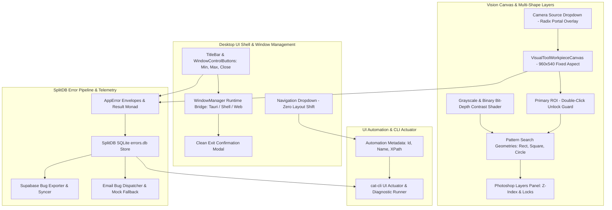

# Architecture Specification: Vision System & Error Management Overhaul
# Directory: 02-spec/21-app/04-vision-system-and-error-management-instructions/01-architecture-spec.md
# Status: approved

## 1. Executive Summary & Problem Formulation

The **CAT Vision (CAT iVISION)** industrial inspection suite requires an end-to-end architectural stabilization overhaul across its desktop window shell, computer vision canvas, error management pipeline, UI automation bridge, and diagnostics telemetry. Telemetry analysis and field screen captures have exposed critical operational defects that degrade inspection reliability and operator workflow:

1. **Top-Level Window Controls Crashing & Inoperability (`Os3MgbBIMHmT`, `pUuIGz0ih_ZZ`)**:
   - The Minimize (`—`), Window Layer / Maximize (`▢`), and Exit (`✕`) buttons located on the persistent top-right header either fail silently or cause fatal runtime exceptions.
   - In Chromium `--app` mode (spawned via `packaging/desktop/start.ps1`) or web preview, `window.desktopApi` is undefined.
   - Fallback execution invokes `window.close()`, which Chromium rejects with:
     `DOMException: Scripts may not close windows that were not opened by script.`
   - Subsequent navigation to `window.location.href = "/"` corrupts active camera sessions, leaks background workers, and leaves unhandled promise rejections in runtime logs.
   - Screen evidence: `assets/screenshots/Os3MgbBIMHmT_20261031_014810.png` highlights the titlebar window controls inoperable in desktop application mode.

2. **Menu Dropdown Hover Jitter & Layout Reflow (`RJPTx3RB8gDf`)**:
   - Rapid cursor traversal over navigation menu items causes a visible 1–2 pixel horizontal and vertical oscillation.
   - The root cause is asymmetric border definitions: active menu items render a `1px` border (`border border-cyan-400/40`), whereas inactive items specify no border (`border-0`), altering the box-sizing layout on hover.
   - Furthermore, the `<Menu>` trigger icon executes unaccelerated CSS scale transforms (`group-hover:scale-110`), triggering continuous browser subpixel rasterization reflows.
   - Screen evidence: `assets/screenshots/RJPTx3RB8gDf_20261031_014810.png` shows the open menu dropdown state subject to hover displacement.

3. **Camera Source Dropdown Clipping & Video Aspect Ratio Degradation (`bg2jMNWxHjkn`)**:
   - In the workpiece analysis workspace, selecting the Live Camera source opens a dropdown menu (`AnalyzeImageToolbar.tsx`) that is clipped and partially concealed by parent containers enforcing `overflow-hidden`.
   - Initializing video streams with `0x0` video frame dimensions causes canvas container collapse or unexpected aspect ratio jumps between reference images (`960x540`) and live video feeds.
   - Screen evidence: `assets/screenshots/bg2jMNWxHjkn_20261031_014810.png` captures the source selection dropdown truncated at the canvas boundary.

4. **SplitDB Error Swallowing & Database Initialization Failure (`mr6_-1EdpFtG`)**:
   - Critical system exceptions are swallowed in loose `catch {}` blocks or rendered exclusively as transient toast messages without persistent logging.
   - Operating in uninitialized environments triggers fatal backend SQL errors: `Failed to save recipe: no such table: Recipe`.
   - All errors must be encapsulated within strongly-typed `*appfault.AppError` / `Result[T]` containers, persisted to a dedicated SplitDB SQLite error store (`errors.db`), and exposed via the CLI for autonomous diagnosis.
   - Screen evidence: `assets/screenshots/mr6_-1EdpFtG_20261031_014811.png` documents unhandled SQLite table omission during recipe persistence.

5. **Simulation Transition Latency & Dwell Timing Oscillation**:
   - The guided simulation player enforces an artificial `700ms` exit timeout and a sequential `150ms` polling loop before initiating screen dwell countdowns.
   - Configuring a 2-second dwell timer results in an actual transition delay of 3.5s to 4.7s.
   - In addition, updating dwell countdown seconds every `100ms` triggers continuous root re-renders of the 2000-line `ProjectCreationAnalysisTour` component, producing UI hitching.

6. **Missing Deterministic UI Automation Attributes**:
   - Headless testing scripts and CLI actuators cannot reliably target interactive elements due to dynamic CSS class names and fluctuating DOM indices.
   - Interactive elements require deterministic `data-automation-id`, `data-automation-name`, and `data-automation-xpath` attributes.

---

## 2. Comprehensive System Architecture



---

## 3. Subsystem Breakdown & Architectural Specifications

### 3.1 Desktop Shell & Window Control Architecture

The desktop application operates across three target execution environments:
1. **Tauri Native Desktop**: Evaluates `window.__TAURI_INTERNALS__` or `@tauri-apps/api/window`. Invocations dispatch directly to `appWindow.minimize()`, `appWindow.toggleMaximize()`, and `appWindow.close()`.
2. **Chromium Embedded Shell (`--app` mode)**: Evaluates `window.desktopApi`. When absent, fallback signals the local backend lifecycle endpoint (`POST /api/v1/system/shutdown`) to terminate background workers and exit the runtime process cleanly.
3. **Web Browser Preview**: Prevents fatal `window.close()` DOM exceptions. Dispatches standard custom events (`cat-vision:window-minimize`), cancels active camera streams, and renders a non-destructive session exit dialog.

```typescript
export interface WindowStateParams {
  readonly isMaximized: boolean;
  readonly isMinimized: boolean;
  readonly isFullscreen: boolean;
  readonly hasNativeFrame: boolean;
}

export interface WindowManagerResult {
  readonly isSuccessful: boolean;
  readonly hasNativeBridge: boolean;
  readonly runtimeMode: "tauri" | "shell" | "web";
}
```

### 3.2 UI Shell Stability & Menu Hover Architecture

To eliminate pixel jitter and layout reflow during navigation interactions:
1. **Symmetric 1px Border Invariant**: All dropdown menu items render an immutable `1px` border. Inactive states specify `border-transparent`, transitioning exclusively `border-color` (`border-cyan-400/40`) upon active or hover states.
2. **GPU-Accelerated Menu Trigger**: The `<Menu>` trigger button maintains fixed spatial dimensions (`w-[84px] h-[28px]`). Hover animations apply CSS transforms (`transform: translateZ(0)`) to isolate rasterization layers, eliminating subpixel reflows on sibling elements.
3. **Radix Item Wrapping**: `DropdownMenuItem` instances utilizing `asChild` wrap custom `<Link>` elements without conflicting padding or margin overrides, ensuring deterministic bounding rects.

### 3.3 Vision Canvas & Camera Stream Coordination

1. **Aspect Ratio Preservation**: The visual workpiece inspection canvas maintains a calibrated `16:9` (`960x540`) coordinate plane. Whether consuming a static image or a live camera feed, coordinate translation matrices remain locked to the `960x540` normalized reference system.
2. **Zero-Dimension Video Guard**: When video streams report initial dimensions of `0x0` during hardware handshakes, the viewport renders an animated industrial calibration skeleton without collapsing container heights or triggering layout shifts.
3. **Portal-Mounted Source Dropdown**: The `AnalyzeImageToolbar` camera and preset source selector mounts its dropdown menu through a Radix UI `Portal` layer (`z-[10080]`). This isolates the dropdown menu from parent `overflow-hidden` containers, resolving clipping defects identified in screenshot `bg2jMNWxHjkn`.

### 3.4 Interactive Canvas & Photoshop-Style Layers Panel

1. **Double-Click ROI Lock**: The primary workpiece Region of Interest (ROI) initializes in a protected state (`isRoiLocked: true`). Accidental pointer dragging is prohibited until the operator double-clicks the ROI bounding contour.
2. **Multi-Shape Pattern Geometries**: Pattern search regions nested within the ROI support three discrete geometric shapes:
   - **Rectangle**: Arbitrary width and height bounding boxes for IC packages and surface components.
   - **Square**: Fixed 1:1 aspect ratio bounds for symmetric solder balls and micro-vias.
   - **Circle**: Radial bounds specified by center `(cx, cy)` and radius `r` for Pin 1 orientation markers and fiducials.
3. **Photoshop-Style Layers Panel**: Provides layer management mimicking graphic design tooling:
   - Hierarchical layer listing displaying shape icons, user labels, and active status.
   - Z-Index reordering commands: `Bring to Front`, `Send to Back`, `Move Up`, `Move Down`.
   - Layer toggles: `isLayerLocked` (immutable coordinates) and `isLayerVisible` (canvas overlay toggle).
4. **Grayscale Bit-Depth Contrast Reduction**: An image processing shader pipeline that quantizes 8-bit grayscale channels into discrete bit-depth thresholds, heightening edge contrast between background carrier pockets and metal leads.

### 3.5 UI Automation Metadata Bridge

Every interactive DOM node across the desktop application incorporates standardized automation attributes:
- `data-automation-id`: Unique kebab-case identifier (e.g., `window-control-close-btn`, `source-camera-dropdown-trigger`).
- `data-automation-name`: Human-readable label for screen readers and test runners (e.g., `Exit Application`, `Select Camera Source`).
- `data-automation-xpath`: Normalized, deterministic XPath selector (e.g., `//button[@data-automation-id='window-control-close-btn']`).

The companion CLI actuator exposes headless commands for automated verification:
```bash
cat-cli ui inspect --xpath="//button[@data-automation-id='menu-trigger-btn']"
cat-cli ui click --xpath="//button[@data-automation-id='window-control-close-btn']"
```

### 3.6 SplitDB Error Management & Telemetry Pipeline

1. **Leaf Error Sovereignty & Result Wrappers**: Functions returning potential failures must return monadic `Result[T]` or `*appfault.AppError`. Bare voids, raw error discards, and untyped rejections are strictly prohibited.
2. **SplitDB SQLite Error Persistence**: Unhandled exceptions and operational failures are written to `repodb/errors.db` with structured metadata:
   - `id`: Unique UUIDv4 identifier.
   - `errorCode`: Standardized error code per `02-spec/03-error-manage/`.
   - `errorMessage`: Descriptive, sanitized failure message.
   - `stackTrace`: Structured stack trace with source file references.
   - `isResolved`: Positive boolean tracking resolution state.
   - `createdAt`: ISO 8601 UTC timestamp.
3. **Telemetry Bug Exporter**:
   - **Email Exporter**: Compiles active session state, captured canvas frames, and recent SplitDB error records into a diagnostics bundle dispatched via SMTP.
   - **Supabase Exporter**: Synchronizes error tickets and inspection logs to Supabase remote telemetry tables. Includes an automated offline fallback mock when credentials are absent or network is disconnected.

---

## 4. Evidence Asset Cross-Reference Matrix

| Evidence ID | Screenshot Relative Path | Defect Manifestation | Remediating Subsystem Specification |
| :--- | :--- | :--- | :--- |
| `Os3MgbBIMHmT` | `assets/screenshots/Os3MgbBIMHmT_20261031_014810.png` | Titlebar window controls (`—`, `▢`, `✕`) inoperable; clicking throws script errors or fails silently. | **Section 3.1**: Multi-runtime `WindowManager` bridge with crash-proof event handlers and clean exit modal. |
| `RJPTx3RB8gDf` | `assets/screenshots/RJPTx3RB8gDf_20261031_014810.png` | Menu dropdown open state; hovering over items causes 1–2px horizontal and vertical layout shift. | **Section 3.2**: Symmetric `1px` border invariant (`border-transparent` -> `border-cyan-400/40`) and GPU-accelerated menu trigger. |
| `bg2jMNWxHjkn` | `assets/screenshots/bg2jMNWxHjkn_20261031_014810.png` | Live Camera source dropdown clipped and obscured by parent canvas container `overflow-hidden`. | **Section 3.3**: Radix UI `Portal` layer rendering outside container boundaries and aspect ratio guard. |
| `mr6_-1EdpFtG` | `assets/screenshots/mr6_-1EdpFtG_20261031_014811.png` | Clicking "SAVE" triggers unhandled error toast: `Failed to save recipe: no such table: Recipe`. | **Section 3.6**: SplitDB SQLite table bootstrap verification and structured `*appfault.AppError` persistence. |
| `pUuIGz0ih_ZZ` | `assets/screenshots/pUuIGz0ih_ZZ_20261031_014730.png` | Window controls visible in desktop shell while running pattern matching rules. | **Section 3.1**: Window controls integration across all industrial inspection views. |
| `wL_7nmmUJQPh` | `assets/screenshots/wL_7nmmUJQPh_20261031_014811.png` | Search Region (yellow) vs Pattern Region (red) on carrier tape IC component. | **Section 3.4**: Locked primary ROI boundary and nested pattern search geometries. |
| `wXoDp20hMNwJ` | `assets/screenshots/wXoDp20hMNwJ_20261031_014811.png` | Pin 1 orientation configuration tools; rotation deviation failure notification. | **Section 3.4**: Multi-shape circular/square pattern search tools and alignment scoring. |
| `rzcoeqtbFB8l` | `assets/screenshots/rzcoeqtbFB8l_20261031_014810.png` | Pattern Configuration screen with Greyscale level slider (65) and Search/Pattern/Mask tabs. | **Section 3.4**: Grayscale bit-depth contrast reduction shader and Photoshop layers panel. |
| `9qwZWqYiKV95` | `assets/screenshots/9qwZWqYiKV95_20261031_014810.png` | High contrast binary thresholding; displaced pattern box extending outside ROI boundary. | **Section 3.4**: Spatial bounding box clamping within the primary ROI boundary. |
| `_lKsg1rvFRnI` | `assets/screenshots/_lKsg1rvFRnI_20261031_014810.png` | Obscured / clipped confirmation dialog behind title bar. | **Section 3.1**: High z-index modal dialog positioning with portal mounting. |
| `j21Xbgbsy6bB` | `assets/screenshots/j21Xbgbsy6bB_20261031_014811.png` | Displaced pattern search region box offset from canvas coordinates. | **Section 3.3**: Normalized `960x540` coordinate plane scaling and viewport offsets. |
| `JA4FdRFDSKi2` | `assets/screenshots/JA4FdRFDSKi2_20261031_014811.png` | Original ICOS vision system showing ROI (red) with 57 numbered pattern elements inside. | **Section 3.4**: Photoshop-style Layers Panel supporting extensive multi-layer hierarchies. |

---

## 5. Architectural Quality Attributes & Compliance Invariants

1. **Positive Boolean Guarantee**: All architectural models, configuration flags, and state stores enforce positive boolean naming (`is*`, `has*`). Negative, inverted, or modal flags are prohibited.
2. **Error Sovereignty**: Every operational branch returns a typed `Result[T]` or raises an `AppError`. Swallowing errors via unlogged try/catch blocks is strictly forbidden.
3. **Decoupled Render Cycles**: High-frequency timers (such as the 100ms simulation timer) must never re-render root-level layout trees; updates are scoped strictly to leaf HUD indicators.
4. **Micro-Batch Execution**: Subsequent refactoring implementations adhering to this architecture must execute in bounded micro-batches of 5–8 files.
