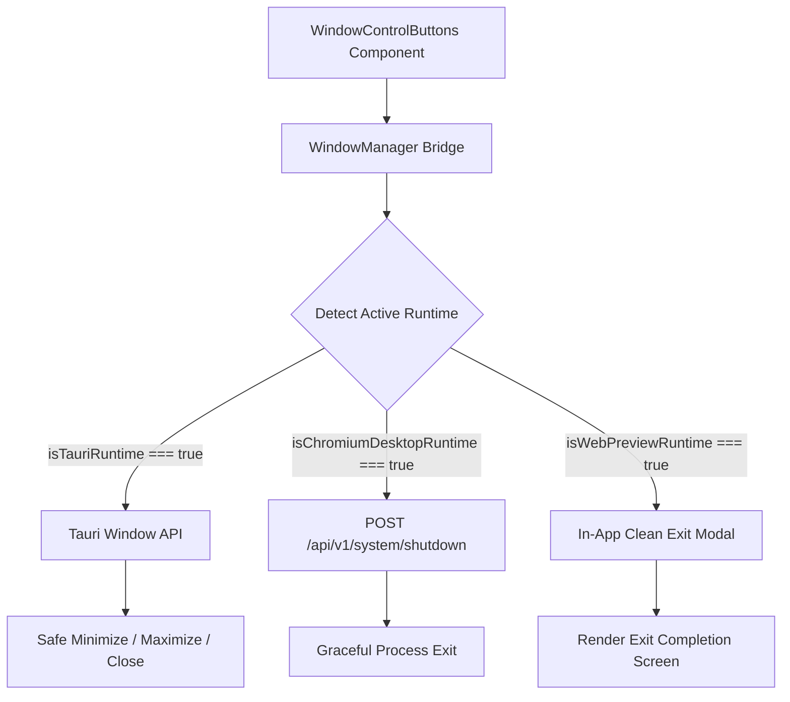
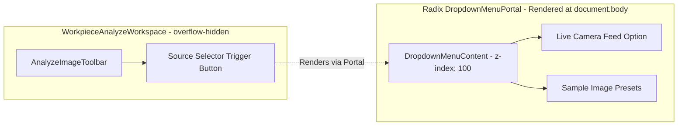

# UI Window Controls, Navigation Stability, Camera Dropdowns & UI Automation Specification

**Version:** 1.0.0  
**Updated:** 2026-10-31  
**Status:** Active  
**AI Confidence:** Production-Ready  
**Ambiguity:** None  
**Specification Path:** `02-spec/21-app/04-vision-system-and-error-management-instructions/01-ui-window-controls-and-automation-spec.md`  

---

## 1. Executive Summary & Problem Formulation

The CAT Vision inspection application requires reliable desktop shell window controls, jitter-free navigation styling, unclipped dropdowns, and a queryable UI automation layer. User feedback and telemetry have highlighted four core interface defects that affect usability and automated testing:

1. **Top-Level Window Controls Failures & Crashes**:
   - In `src/components/layout/WindowControlButtons.tsx`, window minimize, maximize, and close operations rely on an unverified `window.desktopApi`.
   - When running under Chromium `--app` mode or standard browser preview, `window.close()` throws `DOMException: Scripts may not close windows that were not opened by script.`
   - The fallback logic executes `window.location.href = "/"`, wiping out SPA application state and causing jarring screen reloads rather than a graceful exit.
   - Maximize toggles trigger unhandled promise rejections when fullscreen requests are denied outside of transient user activation.

2. **Menu Navigation Hover Jitter & Layout Shifts**:
   - In `src/components/layout/StandardAppShell.tsx`, the menu trigger icon applies `group-hover:scale-110`, which expands element bounding boxes and introduces subpixel layout shifts.
   - Menu items use asymmetric borders: active items have a 1px border (`border border-cyan-400/40`), while inactive items have no border (`border-0`), causing a 1–2px reflow on mouseover.
   - In `src/components/home/StandardHomeView.tsx`, navigation cards apply `group-hover/qa:translate-x-0.5` and `group-hover/enter:translate-x-1`, causing horizontal text vibration.
   - In `src/components/guided-simulation/SimulationPlayerBar.tsx`, 100ms timer re-renders interrupt user focus, while non-tabular typography (`{remainingSec.toFixed(1)}s`) causes horizontal shaking of the player bar. The "Next" button shifts position whenever step titles change length.

3. **Camera Source Dropdown Clipping**:
   - In `src/components/vision/workpiece/AnalyzeImageToolbar.tsx`, the camera source dropdown menu is rendered as an `absolute left-0 top-full` element.
   - The parent workspace `src/components/vision/workpiece/WorkpieceAnalyzeWorkspace.tsx` enforces `overflow-hidden` across main panels.
   - Consequently, the dropdown menu is clipped and partially hidden by the container boundary.

4. **Missing UI Automation Identity Layer**:
   - Interactive components lack stable, machine-readable automation identifiers.
   - Automated testing tools and AI agents cannot deterministically locate and click buttons, select dropdowns, or read state without brittle text-matching heuristics.

---

## 2. Architecture & Design Contracts

### 2.1 Multi-Runtime Window Control Architecture

To ensure zero crashes across all execution environments, window control actions are mediated through a centralized `WindowManagerBridge`:



#### Window Manager Interface Contract

```typescript
export interface WindowStateParams {
  readonly isMaximized: boolean;
  readonly isMinimized: boolean;
  readonly isFullscreen: boolean;
}

export interface WindowManagerContract {
  readonly isTauriAvailable: boolean;
  readonly isDesktopShellAvailable: boolean;
  minimizeWindow: () => Promise<void>;
  toggleMaximizeWindow: () => Promise<void>;
  requestApplicationExit: () => Promise<void>;
}
```

- **Minimize Action**:
  - In Tauri: invokes `@tauri-apps/api/window` `appWindow.minimize()`.
  - In Chromium Shell: dispatches IPC or backend notification to minimize the native frame.
  - In Web Browser Preview: dispatches a custom event `cat-vision:window-minimize` allowing the UI shell to collapse to a taskbar badge without throwing exceptions.
- **Maximize Action**:
  - In Tauri: invokes `appWindow.toggleMaximize()`.
  - In Web: safely checks `document.fullscreenElement` and wraps `requestFullscreen()` in a catch-handled promise.
- **Exit Action**:
  - Preceded by a confirmation dialog (`isExitDialogOpen`).
  - Calls `POST /api/v1/system/shutdown` to terminate background worker daemons.
  - Never executes `window.location.href = "/"`.
  - For browser preview, renders an in-app "Session Concluded" screen with a "Restart Application" button.

---

### 2.2 Zero-Jitter CSS Box & Transform Architecture

To eliminate visual shifting during cursor traversal and timer updates:

1. **Symmetric Border Box Allocation**:
   - All dropdown menu items and navigation links must declare a permanent base border: `border border-transparent`.
   - On hover or active state, only the border color transitions (`border-cyan-400/40`), maintaining identical layout geometry and preventing box-sizing reflows.

2. **Transform Elimination on Interactive Icons**:
   - Remove `group-hover:scale-110` from `StandardAppShell.tsx`.
   - Replace scaling with hardware-accelerated color and glow transitions:
     ```css
     transition: color 150ms cubic-bezier(0.4, 0, 0.2, 1),
                 filter 150ms cubic-bezier(0.4, 0, 0.2, 1);
     ```

3. **Card Navigation Stability**:
   - In `StandardHomeView.tsx`, remove `group-hover/qa:translate-x-0.5` and `group-hover/enter:translate-x-1`.
   - Use opacity and color shifts on arrows instead of layout-altering translations.

4. **Simulation Player HUD Stabilization**:
   - Format remaining time with `tabular-nums` and a fixed-width container:
     ```tsx
     <span className="inline-block w-12 text-right font-mono tabular-nums font-semibold text-cyan-300">
       {remainingSec.toFixed(1)}s
     </span>
     ```
   - Constrain the simulation step title with `max-w-[280px] truncate` so button positions remain stationary.
   - Isolate the "Next" button with a fixed width container and `data-no-lift` attribute to guarantee click stability during rapid timer ticks.

---

### 2.3 Floating Portal Dropdown Pattern

To prevent clipping caused by `overflow-hidden` containers in `WorkpieceAnalyzeWorkspace.tsx`:



- In `AnalyzeImageToolbar.tsx`, replace the inline absolute `<div>` with Radix UI `<DropdownMenu>`:
  - `<DropdownMenu>`: Manages open state (`isOpen`).
  - `<DropdownMenuTrigger asChild>`: Wraps the source selection button.
  - `<DropdownMenuPortal>`: Transcludes content directly into `document.body`.
  - `<DropdownMenuContent>`: Styled with `z-[100] backdrop-blur-2xl bg-[#0b0e14] border border-white/15`, collision padding, and automatic alignment.

---

### 2.4 UI Automation Identity Layer (Id, Name, XPath)

Every interactive control must expose a standard three-part automation identity:

| Attribute | Standard Property | Example Value | Description |
| :--- | :--- | :--- | :--- |
| `id` / `data-automation-id` | Deterministic Slug | `btn-window-minimize` | Unique machine-readable identifier. |
| `aria-label` / `data-automation-name` | Human Title | `Minimize Window` | Accessible, natural-language label. |
| `data-automation-xpath` | Normalized XPath | `//header//button[@id='btn-window-minimize']` | Hierarchical DOM path for headless actuators. |

#### ButtonProps Extension Contract (`src/components/ui/button.tsx`)

```typescript
export interface ButtonAutomationParams {
  readonly automationId?: string;
  readonly automationName?: string;
  readonly automationXPath?: string;
}

export interface ButtonProps
  extends React.ButtonHTMLAttributes<HTMLButtonElement>,
    VariantProps<typeof buttonVariants>,
    ButtonAutomationParams {
  readonly asChild?: boolean;
}
```

#### Runtime XPath Resolver (`src/lib/automation/xpath.ts`)

```typescript
export interface XPathParams {
  readonly tagName: string;
  readonly id: string;
  readonly parentXPath?: string;
}

export interface AutomationElementRecord {
  readonly id: string;
  readonly name: string;
  readonly xpath: string;
  readonly tagName: string;
  readonly isVisible: boolean;
}

export function generateNormalizedXPath(params: XPathParams): string {
  if (params.parentXPath) {
    return `${params.parentXPath}//${params.tagName}[@id='${params.id}']`;
  }

  return `//${params.tagName}[@id='${params.id}']`;
}
```

#### Headless Actuator CLI Interface (`scripts/cli-ui-actuator.ts`)

```bash
# Discover interactive elements across current screen
bun run scripts/cli-ui-actuator.ts --list-elements

# Actuate button by automation ID
bun run scripts/cli-ui-actuator.ts --click --id="btn-window-minimize"

# Actuate button by XPath
bun run scripts/cli-ui-actuator.ts --click --xpath="//header//button[@id='btn-source-selector']"
```

---

## 3. Strict Coding Conventions Compliance

1. **Strict Positive Booleans**:
   - Only `is*` and `has*` prefixes are permitted.
   - Banned prefixes: `can`, `should`, `was`, `allow`, `hasNo`, `not`.
   - Examples in scope: `isExitDialogOpen`, `isMaximized`, `isMinimized`, `isTauriAvailable`, `isDesktopShellAvailable`, `isLiveCameraMode`, `isLiveCameraReady`, `hasAutomationId`, `hasCustomXPath`.

2. **Parameter Structs**:
   - Multi-parameter functions must encapsulate arguments in dedicated read-only options interfaces (e.g. `WindowStateParams`, `XPathParams`, `ButtonAutomationParams`).

3. **Vertical Line Gaps**:
   - Blank lines are mandatory before `if`, after `}`, before `return` / `throw`, and around multiline expressions.

4. **5–8 Files Micro-Batching**:
   - Implementation work is partitioned into bounded subtasks containing at most 5–8 targeted files.

---

## 4. Acceptance Criteria & Test Verification Matrix

| ID | Category | Verifiable Condition |
| :--- | :--- | :--- |
| `AC-01` | Window Controls | Clicking "Minimize" never throws `DOMException` or unhandled promise rejection in browser preview or desktop mode. |
| `AC-02` | Window Controls | Clicking "Maximize" toggles between maximized and normal dimensions safely with try/catch error containment. |
| `AC-03` | Window Controls | Clicking "Close" opens `isExitDialogOpen` confirmation dialog and triggers backend shutdown without calling `window.location.href = "/"`. |
| `AC-04` | Menu Hover | Menu dropdown trigger does not use `scale-110`; bounding box remains invariant during cursor hover. |
| `AC-05` | Menu Hover | All dropdown menu items have permanent `border border-transparent` base; hover transitions do not trigger 1px layout reflow. |
| `AC-06` | Home Navigation | Navigation cards in `StandardHomeView.tsx` do not apply `translate-x-*` shifts on hover. |
| `AC-07` | Simulation Player | Simulation countdown timer utilizes `tabular-nums font-mono` inside a fixed-width container, eliminating horizontal vibration. |
| `AC-08` | Simulation Player | The "Next" button possesses fixed width and `data-no-lift`, and 100ms timer ticks do not interrupt click events. |
| `AC-09` | Camera Dropdown | Camera live source dropdown in `AnalyzeImageToolbar.tsx` renders via Radix UI `<DropdownMenuPortal>` at `document.body`. |
| `AC-10` | Camera Dropdown | Dropdown menu content is fully visible and never clipped by parent `overflow-hidden` containers. |
| `AC-11` | UI Automation | `Button` component in `src/components/ui/button.tsx` forwards `data-automation-id`, `data-automation-name`, and `data-automation-xpath`. |
| `AC-12` | CLI Actuator | `scripts/cli-ui-actuator.ts` successfully queries elements by `id` and `xpath` and returns exit code 0. |

---

## 5. Cross-References

- Parent Architecture: `02-spec/21-app/04-vision-system-and-error-management-instructions/01-architecture-spec.md`
- Subtask 01: `.ai-memory/plans/subtasks/04-vision-system-and-error-management-instructions/01-window-controls-and-crash-fix.md`
- Subtask 02: `.ai-memory/plans/subtasks/04-vision-system-and-error-management-instructions/02-menu-hover-and-simulation-glitches.md`
- Subtask 03: `.ai-memory/plans/subtasks/04-vision-system-and-error-management-instructions/03-ui-automation-id-xpath-system.md`
