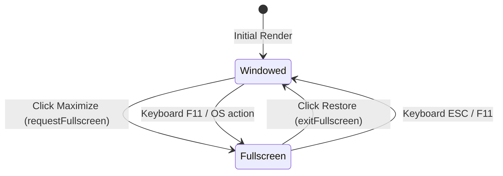
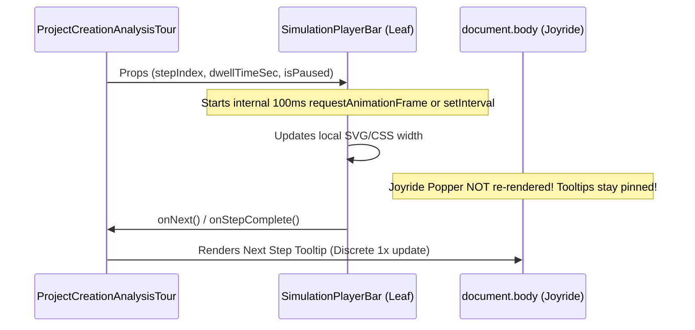

# Window Controls, Modal Portaling, Menu Navigation, Simulation Transitions & Camera Dropdown Specification

**Module:** `02-spec/21-app/04-vision-system-and-error-management-instructions/01-window-controls-and-ui-glitch-spec.md`  
**Version:** 1.0.0  
**Updated:** 2026-10-31  
**Status:** Active  
**Author:** Authoring Worker 01 (Tree Swarm Hierarchy)  
**Task Ref:** `vision-system-and-error-management-instructions`  

---

## 1. Executive Summary & Problem Diagnosis

Visual inspection across industrial runs (Screenshots 07, 08, and 12) revealed critical UI anomalies and timing bottlenecks across the top-level shell, guided simulation engine, and vision analysis toolbar:

1. **Window Controls & Exit Modal Stacking Glitch (Screenshot 07):**
   - The exit confirmation modal in `WindowControlButtons.tsx` is rendered directly inside the `<header>` element. The `<header>` element applies `backdrop-blur-xl`, `transition-[height]`, and `overflow-hidden`. Under CSS transforms and filter effects specifications, non-identity filters and backdrops establish a new containing block and stacking context. Consequently, the `fixed inset-0` modal dialog is clipped to the titlebar height (33px–41px), obscuring the confirmation buttons and corrupting the backdrop.
   - The Maximize button displays a static `Square` icon (`▢`) and does not react to `fullscreenchange` events, failing to toggle into Restore Down (`Copy` / `Minimize2`).
   - Confirming exit invokes `window.location.href = "/"`, causing an abrupt hard reload instead of a graceful session shutdown overlay.

2. **Menu Navigation Stutter & Popper/Joyride Tooltip Hops (Screenshot 08):**
   - The guided simulation engine runs a 100ms `setInterval` inside `ProjectCreationAnalysisTour.tsx`. On every tick, it executes `setElapsedSec(elapsedMs / 1000)`. Because this state lives in the top-level tour component, the entire tour DOM tree—including React Joyride and Popper.js positioning instances—re-renders at 10Hz. When a user hovers over the navigation menu, Popper continuously recalculates bounding boxes and hops between targets.
   - `Titlebar.tsx` applies `transition-[height]` on `<header>` and its inner flex rows, causing `useHeaderMetrics`'s `ResizeObserver` to trigger on every frame during transitions and write to `--app-header-h`, generating style recalculation feedback loops.

3. **Simulation Transition Bottlenecks & Clamped Dwell Times:**
   - `SimulationPlayerBar.tsx` hardcodes the dwell slider range to `min={2}`, preventing 1-second step speeds.
   - `ProjectCreationAnalysisTour.tsx` clamps all step delays with `TOUR_MIN_STEP_MS = 6500`, ignoring shorter durations.
   - Manual clicks on "Next" trigger an artificial 700ms `advanceTimerRef` delay (`step.actionPhase === "exit"`), creating a noticeable latency hitch.
   - Simulated analysis enforces a hardcoded 2800ms artificial timeout.

4. **Live Camera Dropdown Clipping & Missing Test Pattern (Screenshot 12):**
   - `AnalyzeImageToolbar.tsx` renders a custom inline `absolute top-full z-[60]` dropdown menu without portaling. When the workspace canvas or sibling panels mount, the dropdown is obscured or clipped.
   - The toolbar container lacks `relative z-40`, causing canvas layers to compete for pointer hit-testing.
   - When no physical USB or industrial camera is attached, the interface stalls on "Connecting Camera" without providing a synthetic SMPTE test pattern fallback for ruleset authoring.

---

## 2. Architectural Blueprint & Target Component Matrix

```
+----------------------------------------------------------------------------------------------------+
|                                    Document Root (document.body)                                   |
+----------------------------------------------------------------------------------------------------+
       |                                                                            |
       v (Portals via ReactDOM.createPortal)                                        v (Portals via Radix Portal)
+---------------------------------------+                     +--------------------------------------+
| Exit Confirmation Dialog (z-[10080])  |                     | Live Camera Dropdown Content (z-[9999])
| - Escapes header clipping             |                     | - Escapes canvas & panel clipping    |
| - Backdrop blur across full viewport  |                     | - Smooth collision detection         |
+---------------------------------------+                     +--------------------------------------+

+----------------------------------------------------------------------------------------------------+
| StandardAppShell / Titlebar (<header className="... backdrop-blur-xl overflow-hidden">)            |
|  - NO transition-[height] (prevents ResizeObserver oscillation)                                    |
|  - useHeaderMetrics: cached value equality check before root.style.setProperty                     |
|                                                                                                    |
|  [Brand] [GlobalSitemap] ................. [UiMode] [SimulationLauncher] [Theme] [WindowControls]  |
|                                                                                         |          |
|                                           +---------------------------------------------+          |
|                                           | WindowControlButtons:                                  |
|                                           | - isFullscreen listener (Square <-> Minimize2)         |
|                                           | - Minimize (desktopApi / custom event fallback)        |
|                                           | - Close -> triggers Exit Dialog Portal                 |
+----------------------------------------------------------------------------------------------------+

+----------------------------------------------------------------------------------------------------+
| Guided Simulation Subsystem                                                                        |
|                                                                                                    |
|  +------------------------------------+          +----------------------------------------------+  |
|  | ProjectCreationAnalysisTour (Host) |          | Isolated SimulationStepTimer (Leaf HUD)      |  |
|  | - stepIndex, isRunning, isPaused   |          | - 100ms setInterval isolated to progress bar |  |
|  | - Microtask / 0ms next transition  |          | - Dwell slider min={1}s                      |  |
|  | - NO 6.5s clamp (TOUR_MIN_STEP_MS) |--------->| - Joyride host does NOT re-render at 10Hz    |  |
|  +------------------------------------+          +----------------------------------------------+  |
+----------------------------------------------------------------------------------------------------+

+----------------------------------------------------------------------------------------------------+
| WorkpieceAnalyzeWorkspace                                                                          |
|                                                                                                    |
|  +----------------------------------------------------------------------------------------------+  |
|  | AnalyzeImageToolbar (className="relative z-40 ...")                                          |  |
|  |  - Radix DropdownMenu + DropdownMenuPortal (z-[9999])                                        |  |
|  |  - Source options: Preset images | Upload | Live Camera | Simulated Test Pattern             |  |
|  +----------------------------------------------------------------------------------------------+  |
|  | Canvas Viewport / Live Stream                                                                |  |
|  |  - WebCam video or 30fps Canvas Test Pattern Generator (SMPTE bars, crosshair, timestamp)   |  |
+----------------------------------------------------------------------------------------------------+
```

---

## 3. Detailed Technical Specifications

### 3.1 Window Controls & Exit Modal Portaling (`WindowControlButtons.tsx`)

#### 3.1.1 Fullscreen Reactive State Machine
The maximize/restore button must reflect the actual DOM fullscreen status in real time:



```typescript
// State signature in WindowControlButtons
const [isFullscreen, setIsFullscreen] = useState<boolean>(() => {
  if (typeof document === "undefined") {
    return false;
  }
  return Boolean(document.fullscreenElement);
});

useEffect(() => {
  if (typeof document === "undefined") {
    return;
  }

  const handleFullscreenChange = () => {
    setIsFullscreen(Boolean(document.fullscreenElement));
  };

  document.addEventListener("fullscreenchange", handleFullscreenChange);
  return () => {
    document.removeEventListener("fullscreenchange", handleFullscreenChange);
  };
}, []);
```

- When `isFullscreen === true`:
  - Icon: `<Minimize2 className="h-3.5 w-3.5" />` or `<Copy className="h-3 w-3" />`
  - Tooltip: `"Restore down"`
  - `aria-label`: `"Restore Window"`
- When `isFullscreen === false`:
  - Icon: `<Square className="h-3 w-3" />`
  - Tooltip: `"Maximize window"`
  - `aria-label`: `"Maximize Window"`

#### 3.1.2 Modal Portal Architecture (Screenshot 07 Resolution)
The confirmation dialog must be detached from `<header>` by mounting into `document.body` via `createPortal`:

```tsx
import { createPortal } from "react-dom";

// Within WindowControlButtons component
{isExitDialogOpen && typeof document !== "undefined"
  ? createPortal(
      <div
        role="dialog"
        aria-modal="true"
        aria-labelledby="exit-dialog-title"
        aria-describedby="exit-dialog-desc"
        className="fixed inset-0 z-[10080] flex items-center justify-center bg-black/80 p-4 backdrop-blur-md animate-in fade-in"
      >
        <div 
          tabIndex={-1}
          className="w-full max-w-sm rounded-xl border border-white/15 bg-[#0f172a] p-5 shadow-2xl text-slate-100 animate-in zoom-in-95 focus:outline-none"
        >
          <div className="flex items-center gap-3">
            <div className="flex h-10 w-10 shrink-0 items-center justify-center rounded-xl border border-rose-500/40 bg-rose-500/10 text-rose-400">
              <AlertTriangle className="h-5 w-5" />
            </div>
            <div>
              <h3 id="exit-dialog-title" className="text-sm font-bold text-white">
                Exit Application?
              </h3>
              <p id="exit-dialog-desc" className="text-xs text-slate-400">
                Are you sure you want to close Cat Vision, Cat I Vision?
              </p>
            </div>
          </div>

          <div className="mt-5 flex items-center justify-end gap-2.5">
            <button
              type="button"
              onClick={() => setIsExitDialogOpen(false)}
              className="cursor-pointer rounded-lg border border-white/10 bg-white/5 px-3 py-1.5 text-xs text-slate-300 hover:bg-white/10"
            >
              Cancel
            </button>
            <button
              type="button"
              onClick={handleConfirmExit}
              className="flex cursor-pointer items-center gap-1.5 rounded-lg bg-rose-600 px-3.5 py-1.5 text-xs font-semibold text-white hover:bg-rose-500"
            >
              <LogOut className="h-3.5 w-3.5" />
              <span>Exit Now</span>
            </button>
          </div>
        </div>
      </div>,
      document.body,
    )
  : null}
```

#### 3.1.3 Graceful Session Teardown
Replace hard `window.location.href = "/"` redirects with a graceful exit flow:
1. If native `window.desktopApi?.close` exists, invoke it.
2. In browser web mode:
   - Attempt `window.close()`.
   - Dispatch custom event `window.dispatchEvent(new CustomEvent("cat-vision:app-exit"))`.
   - Render a polite session termination banner or backdrop overlay in `StandardAppShell` (`"CAT Vision session terminated. You can safely close this browser tab."` with a `"Restart Session"` reset button).

---

### 3.2 Menu Navigation Stutter & Popper/Joyride Isolation

#### 3.2.1 High-Frequency Timer Decoupling (Screenshot 08 Resolution)
In `ProjectCreationAnalysisTour.tsx`, the 100ms interval that updates `elapsedSec` currently triggers a re-render of the entire component tree. This forces React Joyride's Popper instance to recalculate coordinates while the user is attempting to interact with the Topbar menu.

**Remediation Architecture:**
1. Isolate the progress ticker into `SimulationPlayerBar` (or a dedicated leaf component).
2. `ProjectCreationAnalysisTour` manages only macro state:
   - `stepIndex: number`
   - `isRunning: boolean`
   - `isPaused: boolean`
   - `dwellTimeSec: number`
   - `step: GuidedTourStep`
3. The HUD timer calculates elapsed progress internally:



#### 3.2.2 Header Metrics Stabilization (`useHeaderMetrics.ts` & `Titlebar.tsx`)
- In `src/components/hmi/Titlebar.tsx`:
  - **Remove** `transition-[height]` from `<header>`:
    - Current: `transition-[height,padding,background-color] duration-200 ease-out`
    - Target: `transition-[padding,background-color] duration-200 ease-out`
  - **Remove** `transition-[height]` from `div[data-app-shell-row="top"]`:
    - Current: `transition-[height] duration-200 ease-out flex-nowrap overflow-hidden`
    - Target: `flex-nowrap overflow-hidden`
- In `src/hooks/useHeaderMetrics.ts`:
  - Implement value-caching guards before DOM mutations:

```typescript
const lastMetrics = useRef({ h: 0, rowH: 0, crumbH: 0, w: 0 });

const measure = () => {
  raf = 0;
  const rect = el.getBoundingClientRect();
  const row = el.querySelector<HTMLElement>('[data-app-shell-row="top"]');
  const crumb = el.querySelector<HTMLElement>('[data-app-shell-row="breadcrumb"]');
  const rowH = row ? row.getBoundingClientRect().height : rect.height;
  const crumbH = crumb ? crumb.getBoundingClientRect().height : 0;

  const h = Math.round(rect.height);
  const rH = Math.round(rowH);
  const cH = Math.round(crumbH);
  const w = Math.round(rect.width);

  if (
    h === lastMetrics.current.h &&
    rH === lastMetrics.current.rowH &&
    cH === lastMetrics.current.crumbH &&
    w === lastMetrics.current.w
  ) {
    return; // Skip redundant DOM mutation
  }

  lastMetrics.current = { h, rowH: rH, crumbH: cH, w };
  root.style.setProperty("--app-header-h", `${h}px`);
  root.style.setProperty("--app-header-row-h", `${rH}px`);
  root.style.setProperty("--app-header-crumb-h", `${cH}px`);
  root.style.setProperty("--app-header-w", `${w}px`);
};
```

---

### 3.3 Simulation Transition Latency & Dwell Controls

#### 3.3.1 Dwell Time Range Expansion
In `src/components/guided-simulation/SimulationPlayerBar.tsx`:
- Change dwell slider minimum to `1`:
  ```tsx
  <input
    type="range"
    min={1}
    max={10}
    step={1}
    value={dwellTimeSec}
    onChange={(e) => onChangeDwellTime(Number(e.target.value))}
    aria-label="Screen dwell duration in seconds"
    className="h-1.5 w-20 sm:w-24 cursor-pointer rounded-lg bg-slate-700 accent-cyan-400"
  />
  ```

#### 3.3.2 Elimination of Hardcoded 6.5s Delay Floor
In `src/components/guided-simulation/ProjectCreationAnalysisTour.tsx`:
- Remove `const TOUR_MIN_STEP_MS = 6500;`.
- Replace `const defaultDelayMs = Math.max(step.autoMs ?? TOUR_MIN_STEP_MS, TOUR_MIN_STEP_MS);` with:
  ```typescript
  const defaultDelayMs = isCustomDwellSetRef.current 
    ? dwellTimeSecRef.current * 1000 
    : Math.max(step.autoMs ?? 1000, 1000);
  ```

#### 3.3.3 Microtask-Driven Advance on Manual Clicks
Currently, advancing a step with `actionPhase === "exit"` introduces a 700ms `setTimeout`:
```typescript
// Legacy sluggish transition:
advanceTimerRef.current = window.setTimeout(() => {
  setIsTransitioning(false);
  setStepIndex(stepIndex + 1);
}, 700);
```

**New Specification:**
- When the user manually clicks "Next" (`onNext`) or triggers navigation, execute the step advance immediately:
  - If `step.actionPhase === "exit"`, execute the action synchronously or within `requestAnimationFrame`.
  - Replace the 700ms timer with a microtask or instantaneous frame transition (≤ 50ms) to ensure the UI feels responsive.
- Shorten or decouple the simulated analysis delay (line 1582: `2800ms`) so it finishes in ≤ 300ms when automated, or resolves instantly when "Next" is pressed.

---

### 3.4 Live Camera Dropdown & Synthetic Test Pattern (Screenshot 12)

#### 3.4.1 Portaled Radix DropdownMenu (`AnalyzeImageToolbar.tsx`)
Replace custom inline `absolute top-full z-[60]` with Radix UI `DropdownMenu` + `DropdownMenuContent`:

```tsx
import {
  DropdownMenu,
  DropdownMenuContent,
  DropdownMenuItem,
  DropdownMenuLabel,
  DropdownMenuSeparator,
  DropdownMenuTrigger,
} from "@/components/ui/dropdown-menu";

// Root container of AnalyzeImageToolbar:
<div className="relative z-40 flex shrink-0 items-center justify-between gap-3 border-b border-white/[0.08] bg-black/60 px-3 py-2 backdrop-blur-md">
  {/* Dropdown Menu */}
  <DropdownMenu>
    <DropdownMenuTrigger asChild>
      <button
        type="button"
        data-tour="project-image-selector-dropdown"
        className="flex items-center gap-2 rounded-lg border border-white/15 bg-white/5 px-2.5 py-1.5 font-sans text-xs font-semibold text-white shadow-sm transition hover:border-cyan-400/40 hover:bg-white/10 active:scale-95"
      >
        {isLiveCameraMode ? (
          <span className="flex items-center gap-1.5 text-emerald-400">
            <span className={cn(
              "h-2 w-2 rounded-full",
              isLiveCameraReady ? "bg-emerald-400 shadow-[0_0_8px_rgba(52,211,153,0.9)]" : "bg-amber-400 animate-pulse"
            )} />
            <Camera size={13} />
            <span>Live Camera</span>
          </span>
        ) : (
          <span className="flex items-center gap-1.5 text-cyan-200">
            <FileImage size={13} className="text-cyan-400" />
            <span className="max-w-[200px] truncate">{activeLabel}</span>
          </span>
        )}
        <ChevronDown size={13} className="text-white/50" />
      </button>
    </DropdownMenuTrigger>

    <DropdownMenuContent
      align="start"
      sideOffset={6}
      className="z-[9999] w-80 rounded-xl border border-white/15 bg-[#0b0e14]/95 p-1.5 shadow-2xl backdrop-blur-2xl text-slate-200"
    >
      <DropdownMenuLabel className="px-2 py-1 text-[10px] font-mono uppercase tracking-widest text-slate-400">
        Camera & Video Feed
      </DropdownMenuLabel>
      <DropdownMenuItem
        onClick={onSelectLiveCamera}
        className={cn(
          "flex cursor-pointer items-center justify-between rounded-lg px-2.5 py-2 text-xs font-semibold",
          isLiveCameraMode ? "bg-emerald-500/20 text-emerald-300" : "text-white/80 hover:bg-white/10"
        )}
      >
        <div className="flex items-center gap-2">
          <Camera size={14} className="text-emerald-400" />
          <span>Live Camera Feed</span>
        </div>
        {isLiveCameraMode ? <CheckCircle2 size={13} className="text-emerald-400" /> : null}
      </DropdownMenuItem>

      <DropdownMenuItem
        onClick={onSelectSyntheticFeed}
        className="flex cursor-pointer items-center justify-between rounded-lg px-2.5 py-1.5 text-xs text-cyan-300 hover:bg-white/10"
      >
        <div className="flex items-center gap-2">
          <Tv size={14} className="text-cyan-400" />
          <span>Simulated Test Pattern</span>
        </div>
        <span className="text-[9px] font-mono text-cyan-400/80 bg-cyan-950/80 px-1 py-0.5 rounded border border-cyan-800">
          60 FPS
        </span>
      </DropdownMenuItem>

      <DropdownMenuSeparator className="my-1 bg-white/10" />
      <DropdownMenuLabel className="px-2 py-1 text-[10px] font-mono uppercase tracking-widest text-slate-400">
        Standard Presets
      </DropdownMenuLabel>
      {/* Presets and Upload Options */}
    </DropdownMenuContent>
  </DropdownMenu>
</div>
```

#### 3.4.2 Simulated Camera Test Pattern Generator (`test-pattern.ts`)
When physical cameras are unavailable or initial handshake fails, the vision inspection workspace must supply an animated synthetic stream.

```typescript
export interface SyntheticStreamHandle {
  stream: MediaStream;
  stop: () => void;
}

/**
 * Creates an animated 30fps/60fps SMPTE test pattern canvas stream
 * with dynamic timestamp, moving reticle, and synthetic workpiece features.
 */
export function createSyntheticCameraStream(
  width = 960,
  height = 540,
  fps = 30
): SyntheticStreamHandle {
  const canvas = document.createElement("canvas");
  canvas.width = width;
  canvas.height = height;
  const ctx = canvas.getContext("2d")!;
  
  let frame = 0;
  let rafId = 0;

  const render = () => {
    frame++;
    // 1. Background SMPTE color bars
    const colors = ["#c0c0c0", "#c0c000", "#00c0c0", "#00c000", "#c000c0", "#c00000", "#0000c0"];
    const colWidth = width / colors.length;
    colors.forEach((col, idx) => {
      ctx.fillStyle = col;
      ctx.fillRect(idx * colWidth, 0, colWidth, height * 0.75);
    });

    // 2. Lower calibration strip
    ctx.fillStyle = "#111827";
    ctx.fillRect(0, height * 0.75, width, height * 0.25);

    // 3. Animated crosshair tracking
    const crossX = (Math.sin(frame * 0.03) * 0.4 + 0.5) * width;
    const crossY = (Math.cos(frame * 0.03) * 0.3 + 0.5) * height;
    ctx.strokeStyle = "#00ff9d";
    ctx.lineWidth = 1.5;
    ctx.beginPath();
    ctx.arc(crossX, crossY, 24, 0, Math.PI * 2);
    ctx.moveTo(crossX - 32, crossY);
    ctx.lineTo(crossX + 32, crossY);
    ctx.moveTo(crossX, crossY - 32);
    ctx.lineTo(crossX, crossY + 32);
    ctx.stroke();

    // 4. Timecode readout
    ctx.fillStyle = "#ffffff";
    ctx.font = "bold 16px monospace";
    ctx.fillText(`SIMULATED FEED: ${new Date().toISOString()}`, 20, height - 20);

    rafId = requestAnimationFrame(render);
  };

  render();

  const stream = canvas.captureStream(fps);
  return {
    stream,
    stop: () => {
      cancelAnimationFrame(rafId);
      stream.getTracks().forEach((track) => track.stop());
    },
  };
}
```

---

## 4. Verification and Acceptance Criteria

### 4.1 Acceptance Criteria
1. **Window Controls:**
   - [ ] Maximize button listens to `"fullscreenchange"` on `document`. When fullscreen is active, renders `Copy`/`Minimize2` with "Restore down" label; when inactive, renders `Square` with "Maximize window". Pass or fail.
   - [ ] Exit confirmation dialog renders via `createPortal(..., document.body)`. When invoked, it spans the complete viewport without clipping by `<header>` or its backdrop filters. Pass or fail.
   - [ ] Confirming exit in web mode does not invoke `window.location.href = "/"`, but presents a clean exit state. Pass or fail.

2. **Menu Navigation & Hover Stability:**
   - [ ] 100ms simulation timer ticks do NOT cause re-renders of the top-level tour host or React Joyride Popper instance. Pass or fail.
   - [ ] Opening and hovering over the Topbar `Menu` dropdown items during active simulation does not cause tooltip jumps or Popper reposition jitter. Pass or fail.
   - [ ] `Titlebar.tsx` `<header>` has no `transition-[height]`. `useHeaderMetrics` does not loop or trigger multiple layout reflows during density shifts. Pass or fail.

3. **Simulation Transitions & Pacing:**
   - [ ] `SimulationPlayerBar` dwell slider allows setting dwell time to 1 second (`min={1}`). Pass or fail.
   - [ ] Guided tour does not clamp dwell times with a hardcoded 6.5s delay. Pass or fail.
   - [ ] Clicking "Next" transitions to the next step within ≤ 50ms without waiting for a 700ms artificial timeout. Pass or fail.

4. **Live Camera Dropdown & Synthetic Feed:**
   - [ ] `AnalyzeImageToolbar.tsx` dropdown content renders inside Radix UI portal at `z-[9999]`, floating above all workspace canvas elements. Pass or fail.
   - [ ] Toolbar container has `relative z-40`. Pass or fail.
   - [ ] Selecting "Simulated Test Pattern" renders a 30fps/60fps animated calibration stream with moving crosshair and live timestamp without requiring physical camera hardware. Pass or fail.

---

## 5. Architectural Non-Goals & Boundaries

- **Out of Scope:** Modifying backend OpenCV Python bindings or changing database schemas (`repodb/pipeline.db`).
- **Do Not Touch:** Existing Casbin RBAC definitions, audio sound effects, or native installer scripts (`run.ps1` / `run.sh`).
