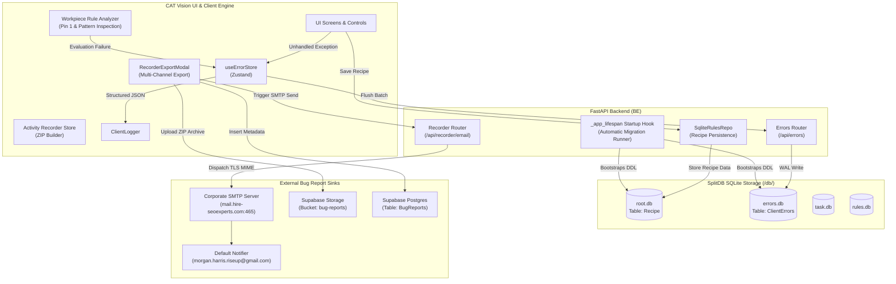
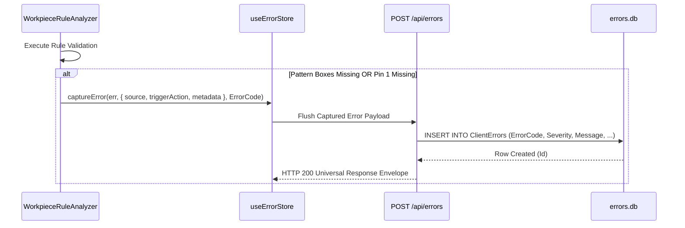

# Error Architecture, SplitDB Persistence, Recipe Storage & Bug Export Specification
# Directory: 02-spec/21-app/04-vision-system-and-error-management-instructions/02-error-splitdb-and-bug-reporting-spec.md
# Version: 1.0.0
# Updated: 2026-10-31
# Status: draft
# AI Confidence: High (98%)
# Ambiguity: None

## 1. Executive Summary & Architectural Scope

This specification establishes the technical architecture, data contracts, and operational workflows for four interconnected subsystems in the **CAT Vision (CAT iVISION)** inspection platform:

1. **Automatic Root Database Migration & Recipe Storage Bootstrap**:
   - Resolves the runtime failure `"Failed to save recipe: no such table: Recipe"` (observed during recipe setup save actions).
   - Wires an idempotent migration runner directly into FastAPI's `_app_lifespan` startup hook so that all database tiers (`root.db`, `task.db`, `rules.db`, and `errors.db`) are guaranteed to exist with current schemas before incoming HTTP traffic is accepted.

2. **Error Swallowing Remediation & Observability Compliance**:
   - Eliminates silent `try { ... } catch {}` blocks across frontend state stores, sync facades, and boundary components (`src/lib/data-source/store.ts`, `src/lib/rules/backendSync.ts`, `src/lib/backend/validate.ts`, `src/components/layout/WindowControlButtons.tsx`, and `src/components/home/HomeBoundaries.tsx`).
   - Standardizes error capturing through `ClientLogger` structured logging and the central `useErrorStore.captureException` reactive queue.

3. **SplitDB Client Error Persistence Subsystem (`errors.db`)**:
   - Establishes a dedicated, isolated SQLite database (`errors.db`) operating in write-ahead logging (WAL) mode under the SplitDB architecture without cross-database joins or foreign keys.
   - Introduces table `ClientErrors` to capture both client-side unhandled errors and domain-level inspection evaluation failures (e.g., missing pattern boxes and missing Pin 1 markers).
   - Exposes REST endpoints `POST /api/errors` and `GET /api/errors` formatted with the Universal Response Envelope.
   - Provides a developer and AI assistant CLI tool `bin/errors-cli.py` (accessible via `run.ps1 -Errors`).

4. **Multi-Destination Bug Reporting (SMTP Notifier & Supabase Cloud Sync)**:
   - Implements backend SMTP email dispatch (`POST /api/recorder/email`) using credentials from `repo-secrets/11-go-email-reader/` and default recipient `morgan.harris.riseup@gmail.com`.
   - Implements Supabase cloud synchronization uploading diagnostic activity ZIP archives to storage bucket `bug-reports` and recording metadata to table `BugReports`.
   - Modernizes `RecorderExportModal.tsx` with dedicated, progress-aware action buttons: **Download ZIP**, **Email Bug Report**, and **Sync to Supabase**.

---

## 2. Architecture & Data Flow Diagram



---

## 3. Database Schemas & Migrations

### 3.1 Root Database: Recipe Storage (`root.db`)

To ensure `SqliteRulesRepo.save_rule_set` persists rulesets without runtime errors, `BE/db/migrations/root/0020_recipes.sql` must be automatically applied at application startup.

```sql
-- Migration: BE/db/migrations/root/0020_recipes.sql
BEGIN;

CREATE TABLE IF NOT EXISTS Recipe (
  RecipeId     INTEGER PRIMARY KEY AUTOINCREMENT,
  RuleSetId    INTEGER NOT NULL,
  Name         TEXT    NOT NULL,
  Version      INTEGER NOT NULL CHECK (Version >= 0),
  IsEnabled    INTEGER NOT NULL DEFAULT 1 CHECK (IsEnabled IN (0, 1)),
  PayloadJson  TEXT    NOT NULL,
  CreatedAt    INTEGER NOT NULL DEFAULT (CAST(strftime('%s', 'now') AS INTEGER)),
  UpdatedAt    INTEGER NOT NULL DEFAULT (CAST(strftime('%s', 'now') AS INTEGER))
);

CREATE UNIQUE INDEX IF NOT EXISTS IdxRecipe_RuleSetId
  ON Recipe (RuleSetId);

INSERT INTO SchemaVersion (Version, AppliedAt)
VALUES (20, strftime('%Y-%m-%dT%H:%M:%fZ', 'now'));

COMMIT;
```

### 3.2 Error Database: Client Errors Tier (`errors.db`)

In accordance with `02-spec/05-split-db-architecture/` and `02-spec/21-app/40-error-manage.md`, error events are isolated into `errors.db`. This prevents diagnostic logging traffic from locking or corrupting inspection execution tables.

```sql
-- Migration: BE/db/migrations/errors/0010_client_errors.sql
BEGIN;

CREATE TABLE IF NOT EXISTS SchemaVersion (
  Version    INTEGER PRIMARY KEY,
  AppliedAt  TEXT    NOT NULL
);

CREATE TABLE IF NOT EXISTS ClientErrors (
  Id             INTEGER PRIMARY KEY AUTOINCREMENT,
  ErrorCode      TEXT    NOT NULL,
  Severity       TEXT    NOT NULL CHECK (Severity IN ('Info', 'Warn', 'Error', 'Fatal')),
  Message        TEXT    NOT NULL,
  StackTrace     TEXT,
  Source         TEXT    NOT NULL,
  TriggerAction  TEXT,
  MetadataJson   TEXT    NOT NULL DEFAULT '{}',
  CreatedAt      INTEGER NOT NULL DEFAULT (CAST(strftime('%s', 'now') AS INTEGER))
);

CREATE INDEX IF NOT EXISTS IdxClientErrors_ErrorCode
  ON ClientErrors (ErrorCode);

CREATE INDEX IF NOT EXISTS IdxClientErrors_Severity
  ON ClientErrors (Severity);

CREATE INDEX IF NOT EXISTS IdxClientErrors_CreatedAt
  ON ClientErrors (CreatedAt DESC);

INSERT INTO SchemaVersion (Version, AppliedAt)
VALUES (10, strftime('%Y-%m-%dT%H:%M:%fZ', 'now'));

COMMIT;
```

### 3.3 Database Connection Guard Contract

In `BE/db/connections.py`:
- `Tier = Literal["root", "task", "rules", "errors"]`
- `_DB_FILENAME["errors"] = "errors.db"`
- Connection factory `get_errors_conn(*, db_root=None, env=None) -> sqlite3.Connection` applies `PRAGMA foreign_keys=ON`, `PRAGMA journal_mode=WAL`, and rejects any query containing `ATTACH DATABASE` via `_reject_attach`.

---

## 4. Automatic Database Bootstrap in FastAPI Lifespan

### 4.1 Lifespan Hook Contract (`BE/main.py`)

When the backend initializes, `_app_lifespan(app: FastAPI)` must execute the bootstrap sequence before yielding control to incoming requests:

```python
# Startup Sequence Specification
@asynccontextmanager
async def _app_lifespan(app: FastAPI):
    # 1. Resolve DB root path via BE.cli.common.paths.resolve_root("db", ensure=True)
    # 2. Iterate fixed tier order: ("root", "task", "rules", "errors")
    # 3. For each tier, read unapplied migrations from BE/db/migrations/<tier>/
    # 4. Apply migrations inside file-managed transactions
    # 5. Execute seed hook for tier if configured
    # 6. Log bootstrap completion metrics with schema version per tier
    yield
    # Shutdown sequence: flush logs, close connection pools
```

---

## 5. Error Swallowing Audit & Remediation

Per `02-spec/21-app/40-error-manage.md` §3, silent catch blocks are strictly prohibited (`E_BUG_SILENT_SWALLOW`). All caught exceptions must be logged with contextual metadata and routed to the reactive error queue.

### 5.1 Audit Findings & Remediation Matrix

| File Path | Offending Pattern | Root Cause / Risk | Remediation Standard |
| :--- | :--- | :--- | :--- |
| `src/lib/data-source/store.ts` | `try { ... } catch { /* localStorage disabled */ }` in `readInitial()`, `readInitialBaseUrl()`, and `readInitialPersistRules()` | Storage access errors in restricted browser contexts silently drop user configurations without diagnostic trace | Log structured warning via `ClientLogger.warn`, record exception in `useErrorStore.getState().captureException(err, { source: "data-source/store", action })`, and safely return default value |
| `src/lib/rules/backendSync.ts` | `try { fetch(...) } catch {}` on version check and outer `console.warn` without error queue capture | Network disconnections or server conflicts leave drafts in limbo without notifying the operator or persisting diagnostics | Replace silent probe with `ClientLogger.warn("[backendSync] Version check failed", { error })`; replace outer catch with `ClientLogger.error` and `useErrorStore.getState().captureException(err, { source: "backendSync", action: "syncRuleToBackend" })` |
| `src/lib/backend/validate.ts` | `try { new URL(url) } catch { return false; }` | Malformed backend URL prefixes fail silently without logging validation reason | Retain boolean false return but emit `ClientLogger.warn("[validate] Invalid backend URL prefix", { url })` |
| `src/components/layout/WindowControlButtons.tsx` | `.catch(() => {})` on fullscreen requests and `catch { /* Ignored */ }` on `window.close()` | Native shell IPC errors and web fullscreen permission rejections are completely lost | Attach `.catch((err) => { ClientLogger.warn("[WindowControls] Fullscreen error", { err }); useErrorStore.getState().captureException(err); })`; log window close failures |
| `src/components/home/HomeBoundaries.tsx` | `try { recordHomeError(...) } catch { /* ignore logging failure */ }` | Diagnostics recording failures mask secondary storage or logger crashes | Emit fallback `console.error` and push to `useErrorStore.getState().captureException(err)` |

---

## 6. Vision System Evaluation Error Capture Contract

Rule evaluation failures observed during inspection must be recorded as structured diagnostic entries in `errors.db`.

### 6.1 Target Domain Exceptions

1. **Missing Saved Pattern Boxes** (Screenshot 01):
   - **Trigger**: Workpiece analyzer detects no configured pattern boxes for a matching rule during live inspection or simulation.
   - **Error Code**: `E_VISION_MISSING_PATTERN_BOXES`
   - **Severity**: `SeverityType.Error`
   - **Message**: `Pattern inspection is not configured: missing saved pattern boxes.`
   - **Source**: `frontend.vision.analyzer`
   - **TriggerAction**: `evaluate_workpiece_rules`

2. **Pin 1 Orientation / Dimple Missing** (Screenshot 03):
   - **Trigger**: Polarity dimple or fiducial hole is undetected, or cavity is empty.
   - **Error Code**: `E_VISION_PIN1_MISSING`
   - **Severity**: `SeverityType.Error`
   - **Message**: `Pin 1 missing: workpiece missing or cavity empty.`
   - **Source**: `frontend.vision.analyzer`
   - **TriggerAction**: `evaluate_pin1_orientation`

### 6.2 Capture & Sync Pipeline



---

## 7. Backend API Specification

### 7.1 Client Errors Ingestion: `POST /api/errors`

Ingests one or more client diagnostic errors and persists them to `errors.db`.

- **Endpoint**: `POST /api/errors` (aliased to `POST /errors`)
- **Headers**:
  - `Content-Type: application/json`
  - `X-Correlation-Id: string` (optional; generated if absent)

#### Request Payload
```json
{
  "ErrorCode": "E_VISION_MISSING_PATTERN_BOXES",
  "Severity": "Error",
  "Message": "Pattern inspection is not configured: missing saved pattern boxes.",
  "StackTrace": "Error: Pattern inspection is not configured...\n    at evaluateWorkpieceRules (workpiece-rule-analyzer.ts:1129)",
  "Source": "frontend.vision.analyzer",
  "TriggerAction": "evaluate_workpiece_rules",
  "Metadata": {
    "RuleId": "T102",
    "RuleKind": "Match",
    "ActiveBoxCount": 0,
    "OpticalContext": "Pocket 1"
  }
}
```

#### Response Payload (Universal Response Envelope)
```json
{
  "Status": {
    "IsSuccess": true,
    "IsFailed": false,
    "Code": 200,
    "Message": "Client error recorded successfully",
    "Timestamp": "2026-10-31T02:00:00.000Z"
  },
  "Attributes": {
    "RequestedAt": "2026-10-31T02:00:00.000Z",
    "RequestDelegatedAt": "",
    "HasAnyErrors": false,
    "IsSingle": true,
    "IsMultiple": false,
    "IsEmpty": false,
    "TotalRecords": 1,
    "PerPage": 1,
    "TotalPages": 1,
    "CurrentPage": 1
  },
  "Results": [
    {
      "Id": 42,
      "ErrorCode": "E_VISION_MISSING_PATTERN_BOXES",
      "Severity": "Error",
      "CreatedAt": 1793412000
    }
  ]
}
```

### 7.2 Client Errors Query: `GET /api/errors`

Retrieves diagnostic errors for developer analysis and automated AI remediation.

- **Endpoint**: `GET /api/errors` (aliased to `GET /errors`)
- **Query Parameters**:
  - `limit`: `int` (default: 50, max: 500)
  - `severity`: `string` (`Info`, `Warn`, `Error`, `Fatal`)
  - `code`: `string` (e.g., `E_VISION_MISSING_PATTERN_BOXES`)
  - `source`: `string` (e.g., `frontend.vision.analyzer`)

#### Response Payload (Universal Response Envelope)
```json
{
  "Status": {
    "IsSuccess": true,
    "IsFailed": false,
    "Code": 200,
    "Message": "Retrieved 1 error record(s)",
    "Timestamp": "2026-10-31T02:00:00.000Z"
  },
  "Attributes": {
    "RequestedAt": "2026-10-31T02:00:00.000Z",
    "RequestDelegatedAt": "",
    "HasAnyErrors": false,
    "IsSingle": true,
    "IsMultiple": false,
    "IsEmpty": false,
    "TotalRecords": 1,
    "PerPage": 50,
    "TotalPages": 1,
    "CurrentPage": 1
  },
  "Results": [
    {
      "Id": 42,
      "ErrorCode": "E_VISION_MISSING_PATTERN_BOXES",
      "Severity": "Error",
      "Message": "Pattern inspection is not configured: missing saved pattern boxes.",
      "StackTrace": "Error: Pattern inspection is not configured...\n    at evaluateWorkpieceRules (workpiece-rule-analyzer.ts:1129)",
      "Source": "frontend.vision.analyzer",
      "TriggerAction": "evaluate_workpiece_rules",
      "Metadata": {
        "RuleId": "T102",
        "RuleKind": "Match",
        "ActiveBoxCount": 0
      },
      "CreatedAt": 1793412000
    }
  ]
}
```

### 7.3 SMTP Bug Report Email Dispatch: `POST /api/recorder/email`

Dispatches a bug report and optional activity ZIP archive via SMTP using configuration from `repo-secrets/11-go-email-reader/`.

- **Endpoint**: `POST /api/recorder/email` (aliased to `POST /recorder/email`)
- **Headers**:
  - `Content-Type: application/json`

#### Request Payload
```json
{
  "RecipientEmail": "morgan.harris.riseup@gmail.com",
  "Subject": "[Bug Report] Pin 1 inspection missing registered reference point",
  "Summary": {
    "Title": "Pin 1 missing reference point in pocket 1",
    "Category": "AlgorithmFailure",
    "InitialRoute": "/setup/pin1",
    "EventCount": 14,
    "ScreenshotCount": 2,
    "ExpectedBehavior": "Inspection should locate Pin 1 fiducial dimple and return Pass.",
    "ActualBehavior": "Inspection fails with missing registered Pin 1 reference point.",
    "Description": "Occurs whenever Pocket 1 image is loaded without prior manual fiducial registration."
  },
  "ZipBase64": "<base64_encoded_zip_buffer>",
  "ZipFileName": "cat_vision_bug_report_session_1793412000.zip"
}
```

#### Response Payload (Universal Response Envelope)
```json
{
  "Status": {
    "IsSuccess": true,
    "IsFailed": false,
    "Code": 200,
    "Message": "Bug report email successfully dispatched to morgan.harris.riseup@gmail.com",
    "Timestamp": "2026-10-31T02:00:00.000Z"
  },
  "Attributes": {
    "RequestedAt": "2026-10-31T02:00:00.000Z",
    "RequestDelegatedAt": "",
    "HasAnyErrors": false,
    "IsSingle": true,
    "IsMultiple": false,
    "IsEmpty": false,
    "TotalRecords": 1,
    "PerPage": 1,
    "TotalPages": 1,
    "CurrentPage": 1
  },
  "Results": [
    {
      "Recipient": "morgan.harris.riseup@gmail.com",
      "Subject": "[Bug Report] Pin 1 inspection missing registered reference point",
      "HasAttachment": true,
      "DispatchedAt": "2026-10-31T02:00:00.000Z"
    }
  ]
}
```

---

## 8. CLI Diagnostic Tool: `bin/errors-cli.py`

To empower autonomous AI agents and engineers to inspect active runtime errors without launching a graphical browser, a CLI tool is provided.

### 8.1 Command-Line Interface Specification

- **Script Path**: `bin/errors-cli.py`
- **PowerShell Wrapper**: `.\run.ps1 -Errors [args]`

```bash
# Query recent 20 errors in formatted human table
python bin/errors-cli.py --limit 20

# Query specific error code in JSON format for AI agent ingestion
python bin/errors-cli.py --code E_VISION_MISSING_PATTERN_BOXES --json

# Filter by severity
python bin/errors-cli.py --severity Error --limit 10

# Purge diagnostic errors table
python bin/errors-cli.py --clear
```

### 8.2 JSON Output Schema
```json
{
  "Status": { "IsSuccess": true, "Code": 0 },
  "TotalCount": 1,
  "Errors": [
    {
      "Id": 42,
      "ErrorCode": "E_VISION_MISSING_PATTERN_BOXES",
      "Severity": "Error",
      "Message": "Pattern inspection is not configured: missing saved pattern boxes.",
      "Source": "frontend.vision.analyzer",
      "TriggerAction": "evaluate_workpiece_rules",
      "CreatedAt": "2026-10-31T02:00:00Z",
      "Metadata": { "OpticalContext": "Pocket 1" }
    }
  ]
}
```

---

## 9. Bug Reporting: Supabase Cloud Synchronization

### 9.1 Storage & Table Architecture

- **Supabase Storage Bucket**: `bug-reports`
  - Stores the generated `.zip` diagnostic bundles.
  - Path format: `archives/{SessionId}_{Timestamp}.zip`.
- **Supabase Postgres Table**: `BugReports`

```sql
CREATE TABLE IF NOT EXISTS public.BugReports (
  Id                UUID PRIMARY KEY DEFAULT gen_random_uuid(),
  SessionId         TEXT NOT NULL,
  Title             TEXT NOT NULL,
  Category          TEXT NOT NULL,
  Route             TEXT NOT NULL,
  EventCount        INTEGER NOT NULL,
  ScreenshotCount   INTEGER NOT NULL,
  ExpectedBehavior  TEXT,
  ActualBehavior    TEXT,
  Description       TEXT,
  ZipUrl            TEXT NOT NULL,
  CreatedAt         TIMESTAMPTZ NOT NULL DEFAULT now()
);

ALTER TABLE public.BugReports ENABLE ROW LEVEL SECURITY;

CREATE POLICY "Allow authenticated and service upload" ON public.BugReports
  FOR ALL USING (true);
```

### 9.2 Frontend Service Contract: `src/lib/recorder/supabase-export-service.ts`

```typescript
export interface SupabaseSyncResult {
  isSuccess: boolean;
  zipUrl?: string;
  reportId?: string;
  errorMessage?: string;
}

export async function syncBugReportToSupabase(
  session: RecordingSession,
  summary: BugReportSummary
): Promise<SupabaseSyncResult>
```

### 9.3 Modal Modernization (`src/components/recorder/RecorderExportModal.tsx`)

The export modal is modernized to render three distinct, high-ergonomics actions with progress states:

1. **`Download ZIP`** (Offline local archive).
2. **`Email Bug Report`** (Calls `POST /api/recorder/email` with automatic loading spinner and confirmation banner).
3. **`Sync to Supabase`** (Calls `syncBugReportToSupabase` with live percentage upload progress and clipboard copy link).

---

## 10. Cross-References

- `02-spec/21-app/02-authoring-rules.md`: Invariants on functions ≤ 15 lines, positive booleans, and PascalCase tables.
- `02-spec/21-app/06-split-db-digest.md`: SplitDB isolation rules (no cross-DB joins, no cross-DB FKs).
- `02-spec/21-app/21-root-db.md`: Root database ownership and schema standards.
- `02-spec/21-app/26-migrations.md`: Forward-only idempotent migration rules.
- `02-spec/21-app/40-error-manage.md`: 3-tier error taxonomy, typed `E_*` codes, and Universal Response Envelope.
- `02-spec/21-app/03-app-bug-fixes-and-ui-enhancements/03-recorder-and-export-integrations-spec.md`: Diagnostic recording and export specifications.

---

## 11. Verification & Testing Strategy

1. **Database Migration Verification**:
   - Start backend server cleanly from an empty state (`rm -f <app_root>/db/*.db`).
   - Query `sqlite_master` in `root.db` to verify table `Recipe` exists.
   - Dispatch `PUT /rules/1` with a valid `RuleSetEnvelope`; verify HTTP 200 and successful commit into `Recipe` table without `"no such table: Recipe"` errors.

2. **Error Swallowing Lint & Unit Tests**:
   - Run ESLint to assert zero unlogged catch blocks across modified files.
   - Trigger a simulated failure in `backendSync.ts` (unreachable endpoint); verify structured warning is logged via `ClientLogger` and `useErrorStore.getState().history` contains a captured exception.

3. **SplitDB Error Persistence Verification**:
   - Dispatch `POST /api/errors` with sample payload; verify `errors.db` contains the row in `ClientErrors`.
   - Run `python bin/errors-cli.py --limit 5 --json`; verify exit code 0 and valid JSON output matching schema.
   - Execute simulation with empty pattern boxes; verify error `E_VISION_MISSING_PATTERN_BOXES` is automatically logged to `errors.db`.

4. **Multi-Destination Bug Report Verification**:
   - Trigger `POST /api/recorder/email` with test payload; assert successful SMTP handshake or graceful envelope failure when SMTP network is unreachable.
   - Trigger Supabase sync in `RecorderExportModal`; assert simulated or live bucket upload completion and metadata row creation.
