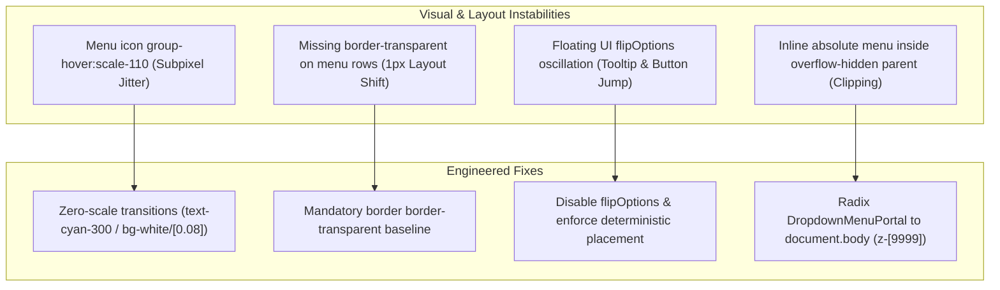
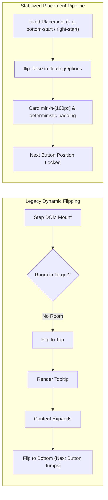
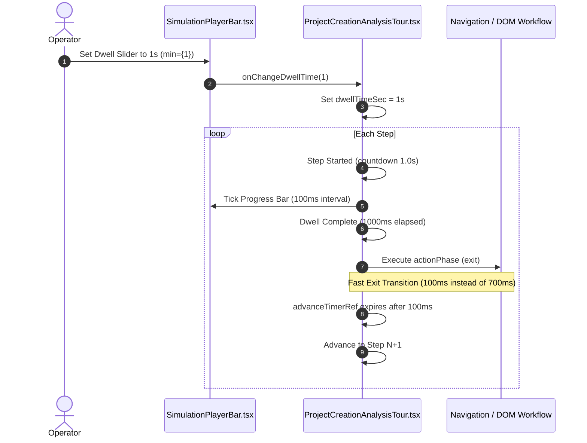
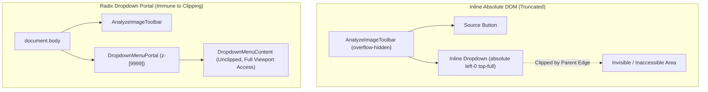

# UI Hover Stability, Simulation Dwell Timing & Portaled Camera Dropdown Specification
# Directory: 02-spec/21-app/04-vision-system-and-error-management-instructions/02-ui-hover-and-simulation-timing-spec.md
# Status: Approved Architectural Contract

## 1. Executive Summary & Problem Scope

Precision industrial vision systems require deterministic, rock-solid user interfaces. Visual micro-jitters, layout thrashing, unconstrained floating tooltips, and clipping menus degrade operator confidence and trigger misclicks in cleanroom environments.

This specification addresses four critical UI stability and timing defects:
1. **Header Hover Jitter**: In `src/components/layout/StandardAppShell.tsx`, the menu trigger icon applies `group-hover:scale-110`, which triggers subpixel layout recalculation. Additionally, dropdown menu items lack a default `border border-transparent`, inducing 1px box-model shifts when hover or active borders are engaged.
2. **Joyride Floating Tooltip Jitter**: In `src/components/guided-simulation/ProjectCreationAnalysisTour.tsx`, `@floating-ui` tooltip flipping is active with unconstrained flip padding, causing tour tooltips and their `Next >` action buttons to oscillate between top and bottom viewports on dynamic DOM mutations.
3. **Simulation Dwell Inflexibility & Latency**: `ProjectCreationAnalysisTour.tsx` clamps minimal step time to `TOUR_MIN_STEP_MS = 6500ms` and delays step departure by `700ms`, while `src/components/guided-simulation/SimulationPlayerBar.tsx` hard-codes `min={2}` on its dwell slider. This prevents high-speed simulation (1s step dwell).
4. **Live Camera Dropdown Clipping**: In `src/components/vision/workpiece/AnalyzeImageToolbar.tsx`, the image/camera source dropdown is rendered as an inline `absolute` container. When parent containers enforce `overflow-hidden`, the dropdown is truncated, obscuring camera choices.



---

## 2. Shell Hover Invariance & Box-Model Stability

### 2.1 Elimination of Micro-Scaling Jitter
In `src/components/layout/StandardAppShell.tsx`:
- **Defect**: `<Menu className="h-3.5 w-3.5 text-cyan-400 transition-transform group-hover:scale-110" />` alters the layout boundary and icon bounding box, producing optical vibrating artifacts on high-DPI industrial monitors.
- **Remediation**: Remove `transition-transform group-hover:scale-110`. The hover feedback must rely purely on chromatic and luminance transitions (`text-cyan-300`, background luminance step `hover:bg-white/[0.1]`), guaranteeing absolute spatial invariance.

### 2.2 Box-Model 1px Border Invariance
When items alternate between unbordered and bordered states, browsers recalculate box sizing unless border widths are constant.
- **Defect**: Menu items apply `border border-cyan-400/40` when active, but lack any border when idle:
  ```tsx
  // Defective:
  className={cn(
    "flex items-center justify-between w-full px-2.5 py-1.5 ...",
    isCurrentActive
      ? "bg-cyan-500/20 text-cyan-200 border border-cyan-400/40"
      : "text-slate-300 hover:bg-white/10 hover:text-white"
  )}
  ```
- **Remediation**: Every row must define `border border-transparent` in its idle class list. When `isCurrentActive` activates, only the border color changes from `transparent` to `cyan-400/40`, preventing layout reflow.

---

## 3. Joyride Guided Tour Floating Placement Stabilization



### 3.1 Disabling `flipOptions` & Constraining Floating UI
In `src/components/guided-simulation/ProjectCreationAnalysisTour.tsx`:
1. **Disable Flip**:
   - Setting `flipOptions: false` (or removing the flip middleware from `@floating-ui`) eliminates placement oscillation.
   - Replace dynamic flipping with explicit, element-specific placement contracts (`placement: "bottom"` or `"right-start"`).
2. **Stable Floating Options Configuration**:
   ```typescript
   floatingOptions: {
     flip: false,
     shift: {
       padding: { top: 64, bottom: 80, left: 16, right: 16 },
     },
   }
   ```
3. **Card Dimension Locking**:
   - The Joyride tooltip component must enforce `min-h-[140px]` and stable flex-col layout for the footer, guaranteeing that the `Next >` and `Skip` buttons stay anchored at a predictable coordinate regardless of varying step description lengths.

---

## 4. Simulation Dwell & Transition Timing Calibration



### 4.1 Calibration Parameters
| Parameter | Legacy Value | Calibrated Value | Architectural Rationale |
|:---|:---|:---|:---|
| `TOUR_MIN_STEP_MS` | `6500ms` | `1000ms` | Unblocks rapid automated regression and demonstration runs without unnecessary stalling. |
| Exit Transition Delay | `700ms` | `100ms` | Eliminates dead-time when navigating between views or opening panels. |
| Slider Minimum (`min`) | `2s` | `1s` | Allows operators to inspect sequences at 1 second per step. |
| Slider Maximum (`max`) | `10s` | `10s` | Retains full coverage for complex algorithmic rule reviews. |
| Slider Default (`default`) | `3s` | `3s` | Balanced default inspection dwell. |

### 4.2 Decoupled HUD Ticking
To avoid re-rendering the heavy Joyride React DOM tree on every animation frame:
- The countdown timer in `SimulationPlayerBar.tsx` ticks smoothly at `100ms` intervals using local state or CSS transitions for the progress bar.
- The step transition itself is managed by a single non-polling timer in `ProjectCreationAnalysisTour.tsx`.

---

## 5. Live Camera Dropdown Portaling Architecture



### 5.1 Migration from Inline Absolute to Radix UI Portal
In `src/components/vision/workpiece/AnalyzeImageToolbar.tsx`:
1. **Component Replacement**:
   - Replace manual `isDropdownOpen` state, click-outside listener, and inline `<div className="absolute left-0 top-full z-[60] ...">` with standard Radix UI primitives:
     - `DropdownMenu`
     - `DropdownMenuTrigger`
     - `DropdownMenuPortal`
     - `DropdownMenuContent`
     - `DropdownMenuItem`
2. **Portal Configuration**:
   ```tsx
   <DropdownMenu open={isDropdownOpen} onOpenChange={setIsDropdownOpen}>
     <DropdownMenuTrigger asChild>
       <button
         type="button"
         data-tour="project-image-selector-dropdown"
         className="flex items-center gap-2 rounded-lg border border-white/15 bg-white/5 px-2.5 py-1.5 font-sans text-xs font-semibold text-white shadow-sm transition hover:border-cyan-400/40 hover:bg-white/10 active:scale-95"
       >
         {/* Live camera or registered image badge */}
       </button>
     </DropdownMenuTrigger>

     <DropdownMenuPortal>
       <DropdownMenuContent
         align="start"
         sideOffset={6}
         className="z-[9999] w-80 rounded-xl border border-white/15 bg-[#0b0e14]/95 p-1.5 shadow-2xl backdrop-blur-2xl text-slate-100"
       >
         {/* Live Camera Feed Selection Item */}
         <DropdownMenuItem
           onClick={onSelectLiveCamera}
           className="flex w-full items-center justify-between rounded-lg px-2.5 py-2 font-sans text-xs font-semibold cursor-pointer border border-transparent hover:bg-white/10"
         >
           <div className="flex items-center gap-2">
             <Camera size={14} className="text-emerald-400" />
             <span>Live Camera Feed</span>
           </div>
           {isLiveCameraMode ? <CheckCircle2 size={13} className="text-emerald-400" /> : null}
         </DropdownMenuItem>

         {/* Standard Presets & Recents */}
       </DropdownMenuContent>
     </DropdownMenuPortal>
   </DropdownMenu>
   ```

### 5.2 Key Benefits of Portaling
- **Zero Parent Clipping**: Elements mounting directly into `document.body` bypass any `overflow: hidden`, `overflow: clip`, or parent `transform` constraints.
- **High Stacking Context**: Rendered at `z-[9999]`, positioning above the canvas, toolbars, and HUD elements.
- **Built-in Keyboard Accessibility**: Automatic `Escape` dismissal, focus trapping, and arrow key item navigation.

---

## 6. Affirmative Boolean Rules & Verification Matrix

1. **Boolean Variables**:
   - `isLiveCameraMode` (never `isNotLiveCamera`).
   - `isLiveCameraReady` (never `isCameraUnready`).
   - `isDropdownOpen` (never `isDropdownClosed`).
   - `hasActiveSelection` (never `hasNoSelection`).
   - `isDwellAdjustable` (never `isDwellLocked`).
2. **Verification Gates**:
   - **Menu Hover**: Zero pixel shift observed on sidebar / top menu trigger across hover, focus, and active states.
   - **Joyride Tooltip**: Tour tooltip position remains locked without directional inversion or flickering.
   - **Timing**: Step advances after exactly 1.0s when dwell slider is set to 1s.
   - **Camera Dropdown**: Opens cleanly over all canvas layers without vertical or horizontal cutoff.
