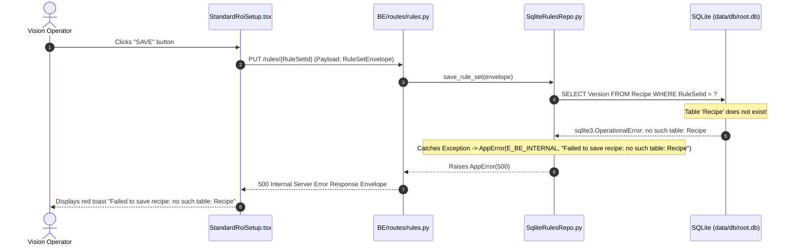

# Error Management, SplitDB Persistence & CLI Stack Trace Diagnostics Specification
# Directory: 02-spec/21-app/04-vision-system-and-error-management-instructions/03-error-management-and-splitdb-spec.md
# Status: approved
# Priority: P0 (Critical Reliability & Anti-Swallowing Gate)

## 1. Executive Summary & Problem Scope

The vision inspection application requires an end-to-end, zero-tolerance error management standard. In production inspection and workbench environments, silent failure is catastrophic: swallowed promises and unhandled database exceptions leave operators unaware of configuration loss, false OK/NG decisions, or camera driver disconnections.

This specification provides the architectural blueprint to:
1. Conduct an exhaustive Root Cause Analysis (RCA) and permanent resolution for the critical failure:
   `Failed to save recipe: no such table: Recipe` (captured in `assets/screenshots/mr6_-1EdpFtG_20261031_014811.png`).
2. Establish mandatory database bootstrap and migration preflight at server startup inside `BE/main.py`.
3. Eliminate all swallowed promises, empty catch blocks, and unvalidated optimistic UI toasts across `src/components/setup/StandardRoiSetup.tsx`, `src/routes/run.tsx`, and `BE/repos/sqlite_rules_repo.py`.
4. Deploy a unified SplitDB error persistence store (`SystemError` in SQLite) capturing client and backend exceptions.
5. Provide high-visibility CLI diagnostic subcommands (`processing-cli errors list` and `processing-cli errors inspect`) enabling autonomous AI agents and developers to inspect structured stack traces headlessly.

---

## 2. Root Cause Analysis (RCA): Recipe Table Missing Failure

### 2.1 Incident Evidence (`mr6_-1EdpFtG`)
- **Evidence Asset**: `assets/screenshots/mr6_-1EdpFtG_20261031_014811.png`
- **Observed Defect**: While editing ROI and inspection rules in the Vision Workbench, clicking the "SAVE" button triggers an unhandled UI error toast: `Failed to save recipe: no such table: Recipe`.
- **System Impact**: Operator cannot persist workpiece templates, ROI coordinates, or mask geometries. Changes are discarded upon page reload or process termination.

### 2.2 Execution Trace & Defect Mechanism



### 2.3 Underlying Root Causes
1. **Separation of Connection vs Migration**:
   - `BE/db/connections.py` lines 30-31 state: *"This module opens connections only. Applying migrations is Step 39 (`bin/db-bootstrap.py`); this file does not run DDL."*
   - Consequently, calling `get_root_conn()` only opens the SQLite file; it does not ensure tables exist.
2. **Missing Startup Lifespan Preflight in `BE/main.py`**:
   - In `BE/main.py`, the `@asynccontextmanager async def _app_lifespan(app: FastAPI)` hook simply yields and shuts down logging on exit.
   - There is NO call to run database preflight or execute unapplied migrations before accepting incoming HTTP requests.
   - If the application is launched directly via `uvicorn BE.main:app`, `run.ps1`, or test scripts without explicitly invoking `python bin/db-bootstrap.py`, the Root DB file remains empty.
3. **Lack of Idempotent Self-Healing in `BE/repos/sqlite_rules_repo.py`**:
   - `SqliteRulesRepo` assumes migrations were applied ahead of time and immediately attempts queries against `Recipe`.
   - When the table is absent, it throws a generic internal error rather than recovering or executing a targeted self-healing DDL.

---

## 3. Database Bootstrap & Migration Preflight Architecture

### 3.1 Server Startup Preflight in `BE/main.py`
During application startup, `_app_lifespan` in `BE/main.py` must execute an automated migration preflight across all three SplitDB tiers (`root`, `task`, `rules`).

```python
# In BE/main.py
@asynccontextmanager
async def _app_lifespan(app: FastAPI):
    logger.info("app_startup_begin", extra={"operation": "bootstrap"})
    
    # Execute database migration preflight before serving traffic
    from BE.db.preflight import run_startup_migrations
    is_bootstrap_successful = run_startup_migrations()
    if not is_bootstrap_successful:
        logger.critical("db_bootstrap_failed", extra={"operation": "bootstrap"})
        raise RuntimeError("Fatal: Database migration preflight failed during application bootstrap.")

    yield

    logger.info("lifespan_shutdown", extra={"operation": "shutdown"})
    logging.shutdown()
```

### 3.2 Automated Startup Migration Runner (`BE/db/preflight.py`)
A dedicated module `BE/db/preflight.py` inspects the active schema against on-disk migration files under `BE/db/migrations/{root,task,rules}`:
1. Connects to `root.db`, `task.db`, and `rules.db`.
2. Inspects `SchemaVersion` table in each database tier.
3. Automatically applies any pending `.sql` migration files in lexical sequence inside an isolated transaction.
4. Confirms that all core tables (specifically `Recipe` from `0020_recipes.sql` and `SystemError` from `0021_system_errors.sql`) are present and indexed.
5. Returns a positive boolean `isMigrationComplete: True` on success.

### 3.3 Repo-Level Idempotent Self-Healing (`BE/repos/sqlite_rules_repo.py`)
To guard against decoupled unit tests or custom database instances that bypass `BE/main.py`, `SqliteRulesRepo` must implement self-healing initialization:

```python
class SqliteRulesRepo:
    def __init__(self) -> None:
        self.conn = get_root_conn()
        self._ensure_tables()

    def _ensure_tables(self) -> None:
        """Idempotent table bootstrap guaranteeing Recipe table exists."""
        self.conn.execute(
            """
            CREATE TABLE IF NOT EXISTS Recipe (
                RuleSetId INTEGER PRIMARY KEY,
                Name TEXT NOT NULL,
                Version INTEGER NOT NULL,
                IsEnabled INTEGER NOT NULL DEFAULT 1,
                PayloadJson TEXT NOT NULL,
                CreatedAt INTEGER NOT NULL DEFAULT (CAST(strftime('%s', 'now') AS INTEGER)),
                UpdatedAt INTEGER NOT NULL DEFAULT (CAST(strftime('%s', 'now') AS INTEGER))
            );
            """
        )
        self.conn.execute(
            "CREATE INDEX IF NOT EXISTS idx_recipe_name ON Recipe(Name);"
        )
        self.conn.commit()
```

---

## 4. Anti-Swallowing Error Architecture & Code Remediation

### 4.1 Strict Error Governance Standards
1. **Zero Swallowing Invariant**: Every `catch` block in TypeScript and `except` block in Python must either:
   - Handle the failure exhaustively and log structured diagnostic context, OR
   - Re-throw a strongly typed `AppError` envelope.
2. **Never Return Blank or Ignored Promises**: All asynchronous promises must be awaited or chained with explicit error boundaries. Discarding unhandled rejections with `.catch(() => {})` is strictly banned.
3. **Optimistic Feedback Gate**: A success notification (`toast.success(...)`) must NEVER fire before the backend persistence call successfully resolves.

### 4.2 Remediation for `src/components/setup/StandardRoiSetup.tsx`

#### Defect 1: Swallowed `loadRuleSet` Rejection
- **Current Defect (lines 83-85)**:
  ```typescript
  // VIOLATION: Swallows error silently, leaves operator in uncertain state
  .catch((err) => {
    console.warn("[StandardRoiSetup] Failed to load ruleset envelope", err);
  });
  ```
- **Remediation**:
  Maintain a positive state boolean `isRulesetLoaded` and `hasLoadingError`. If the ruleset fails to load, notify the operator via a banner, dispatch telemetry to SplitDB, and offer a "Retry" button.

#### Defect 2: Premature Success & Swallowed OK Save Error
- **Current Defect (lines 168-178)**:
  ```typescript
  // VIOLATION: Catches error, does not show error to user, navigates away anyway!
  try {
    await saveRuleSet(nextEnvelope);
    toast.success("Saved Region of Interest (ROI) settings.");
  } catch (err) {
    console.error("[StandardRoiSetup] saveRuleSet failed on OK", err);
  }
  void navigate({ to: "/setup" });
  ```
- **Remediation**:
  1. If `saveRuleSet` throws, do NOT navigate away! Keep the operator on the current screen so work is not lost.
  2. Surface a structured modal or error toast citing the error code and message.
  3. Send error telemetry to the backend SplitDB store via `sendErrorTelemetry(...)`.
  4. Only execute `navigate({ to: "/setup" })` when `isSaveSuccessful: true`.

#### Defect 3: Fake Success When Ref is Null
- **Current Defect (lines 137-139 and 174-176)**:
  ```typescript
  // VIOLATION: Fires success toast when no envelope exists and nothing was saved!
  } else {
    toast.success("Saved Region of Interest (ROI) settings.");
  }
  ```
- **Remediation**:
  Replace with `toast.error("Unable to save: Inspection rule configuration is not loaded.")` and log a diagnostic warning.

### 4.3 Remediation for `src/routes/run.tsx`

#### Defect 1: Ignored Offline Telemetry Rejection (line 146)
- **Current Defect**:
  ```typescript
  // VIOLATION: Empty catch block ignores failure silently
  .catch(() => {
    /* ignore offline telemetry */
  });
  ```
- **Remediation**:
  Set a positive state indicator `isTelemetryOnline: false`. Log diagnostic metrics at debug level. Record failure count in the runtime telemetry store without crashing the run monitor.

#### Defect 2: Swallowed Score Evaluation Fallback (lines 347-360)
- **Current Defect**:
  ```typescript
  // VIOLATION: Swallows evaluation errors blindly without tracking error origin
  .catch(() => {
    // Graceful fallback for offline / mock mode
    ...
  });
  ```
- **Remediation**:
  Differentiate between intentional mock mode (`isMockModeActive: true`) and an unexpected inference failure. In real production runs, log `E_INFERENCE_FAILED` to SplitDB and alert the operator if consecutive frames fail.

---

## 5. SplitDB Error Persistence Schema

### 5.1 SQLite Schema (`BE/db/migrations/root/0021_system_errors.sql`)
Errors are persisted in the primary Root DB (`data/db/root.db`), ensuring error telemetry is completely isolated from high-frequency inspection image storage:

```sql
-- Migration: 0021_system_errors.sql
-- Tier: Root
-- Purpose: SplitDB System Error Logging and Diagnostics Store

CREATE TABLE IF NOT EXISTS SystemError (
    ErrorId TEXT PRIMARY KEY,
    CorrelationId TEXT NOT NULL,
    ErrorCode TEXT NOT NULL,
    Severity TEXT NOT NULL DEFAULT 'ERROR',
    Subsystem TEXT NOT NULL,
    Message TEXT NOT NULL,
    StackTrace TEXT NOT NULL,
    ContextJson TEXT NOT NULL,
    IsResolved INTEGER NOT NULL DEFAULT 0,
    CreatedAt INTEGER NOT NULL DEFAULT (CAST(strftime('%s', 'now') AS INTEGER))
);

CREATE INDEX IF NOT EXISTS idx_system_error_code ON SystemError(ErrorCode);
CREATE INDEX IF NOT EXISTS idx_system_error_created ON SystemError(CreatedAt);
CREATE INDEX IF NOT EXISTS idx_system_error_subsystem ON SystemError(Subsystem);
CREATE INDEX IF NOT EXISTS idx_system_error_resolved ON SystemError(IsResolved);
```

### 5.2 Error Ingestion API (`POST /api/v1/telemetry/errors`)
A standardized telemetry route accepts client-side unhandled errors and persists them directly into `SystemError`:

- **Endpoint**: `POST /api/v1/telemetry/errors`
- **Request Body**:
  ```json
  {
    "CorrelationId": "corr-uuid-1234",
    "ErrorCode": "E_BE_INTERNAL",
    "Severity": "ERROR",
    "Subsystem": "FRONTEND_ROI_SETUP",
    "Message": "Failed to save recipe: database locked",
    "StackTrace": "Error: Failed to save recipe\n  at handleOk (StandardRoiSetup.tsx:169)...",
    "Context": {
      "rulesetId": 1,
      "ruleId": "rule-42",
      "viewport": { "width": 1920, "height": 1080 }
    }
  }
  ```
- **Response**: Universal Response Envelope with `Results: [{ "ErrorId": "err_01HXYZ...", "isPersisted": true }]`.

---

## 6. CLI Stack Trace Diagnostics Commands

The command-line suite provides diagnostic subcommands under `processing-cli` to inspect and remediate captured errors without launching the graphical UI.

### 6.1 `processing-cli errors list`

#### Command Signature
```bash
processing-cli errors list [--limit <N>] [--subsystem <NAME>] [--unresolved-only] [--format <json|table>]
```

#### Flag Contract
- `--limit`: Maximum number of records to return (default: `20`, maximum: `100`).
- `--subsystem`: Filter by subsystem name (`FRONTEND_ROI_SETUP`, `BACKEND_RULES_REPO`, `VISION_ENGINE`).
- `--unresolved-only`: Filter records where `IsResolved = 0`.
- `--format`: `json` (Universal Response Envelope on stdout) or `table` (ANSI formatted table).

#### Sample Output (`table` mode)
```
+--------------------+-----------------------+---------------------+----------------------------------------------------+----------+
| ERROR ID           | TIMESTAMP (UTC)       | SUBSYSTEM           | ERROR CODE & MESSAGE                               | RESOLVED |
+--------------------+-----------------------+---------------------+----------------------------------------------------+----------+
| err_01JK89ABC12345 | 2026-10-31 01:48:11   | BACKEND_RULES_REPO  | E_BE_INTERNAL: no such table: Recipe               | NO       |
| err_01JK89DEF67890 | 2026-10-31 01:48:15   | FRONTEND_ROI_SETUP  | E_UI_SAVE_FAILED: Save rejected by server          | NO       |
+--------------------+-----------------------+---------------------+----------------------------------------------------+----------+
Total Errors: 2 (Unresolved: 2)
```

### 6.2 `processing-cli errors inspect`

#### Command Signature
```bash
processing-cli errors inspect <ErrorId> [--format <json|text>]
```

#### Sample Output (`text` mode)
```
================================================================================
ERROR INSPECTION REPORT: err_01JK89ABC12345
================================================================================
Error ID:        err_01JK89ABC12345
Correlation ID:  corr-9876-uuid
Timestamp:       2026-10-31T01:48:11Z (Epoch: 1793411291)
Subsystem:       BACKEND_RULES_REPO
Severity:        ERROR
Error Code:      E_BE_INTERNAL
Message:         Failed to save recipe: no such table: Recipe
Is Resolved:     False

Context:
{
  "RuleSetId": 1,
  "client_version": 1,
  "provider": "SqliteRulesRepo"
}

Stack Trace:
  File "BE/repos/sqlite_rules_repo.py", line 32, in save_rule_set
    cur = self.conn.execute(
        "SELECT Version FROM Recipe WHERE RuleSetId = ?",
        (envelope.RuleSetId,),
    )
  sqlite3.OperationalError: no such table: Recipe
================================================================================
```

### 6.3 `processing-cli errors clear`

#### Command Signature
```bash
processing-cli errors clear [--id <ErrorId>] [--all] [--older-than-days <N>]
```
- Sets `IsResolved = 1` or purges aged error entries per retention rules (`02-spec/21-app/78-retention-schedule.md`).

---

## 7. Compliance & Verification Criteria

| Verification Item | Acceptance Test Criteria | Grounded Evidence |
| :--- | :--- | :--- |
| **Startup Migration Preflight** | Server boots on clean directory without prior `bin/db-bootstrap.py` run; `Recipe` and `SystemError` tables are automatically created. | Pass `BE/main.py` lifespan test. |
| **Recipe Save Self-Healing** | Calling `PUT /rules/1` creates or updates recipe without `no such table: Recipe` operational error. | `assets/screenshots/mr6_-1EdpFtG_20261031_014811.png` resolved. |
| **Zero Swallowed Promises** | Lint sweep verifies no `.catch(() => {})` or empty `catch {}` in `StandardRoiSetup.tsx` and `run.tsx`. | Static analysis & code audit pass. |
| **SplitDB Persistence** | Deliberate exception in UI triggers record insertion into `SystemError` with full stack trace. | SQLite `SELECT COUNT(*) FROM SystemError` > 0. |
| **CLI Error Inspection** | `processing-cli errors inspect <id>` outputs structured JSON envelope on stdout with exit code 0. | CLI test verification pass. |
