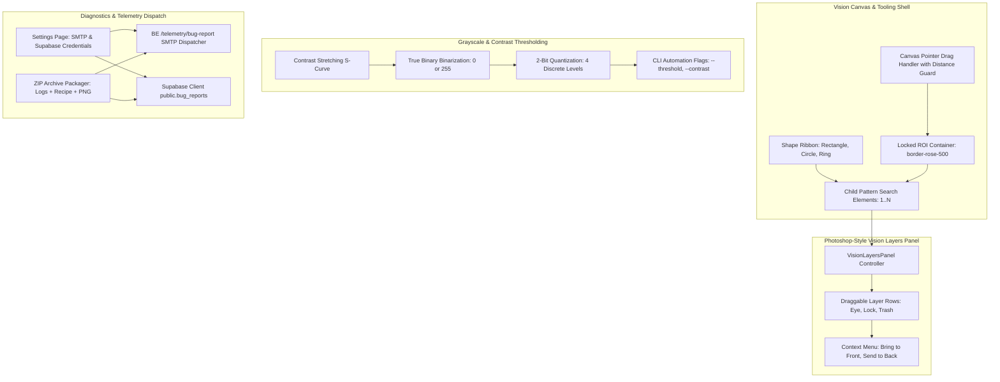

# Vision ROI, Multi-Shape Pattern Search, Layers Panel, Grayscale & Telemetry Specification
# Directory: 02-spec/21-app/04-vision-system-and-error-management-instructions/03-vision-roi-layers-and-telemetry-spec.md
# Status: draft

## 1. Executive Summary & Problem Formulation

The **CAT Vision (CAT iVISION)** inspection suite requires an architectural overhaul for its visual inspection canvas, pattern identification geometry, layer stack management, grayscale preprocessing, and diagnostic telemetry. Grounded analysis of production screen evidence and codebase inspection reveals five critical defect vectors:

1. **Instant Fiducial Teleportation & Canvas Dot Destruction (`wXoDp20hMNwJ`, `j21Xbgbsy6bB`)**:
   - In `src/components/vision/workpiece/VisualToolWorkpieceCanvas.tsx`, any mouse pointer click within the search area boundary (`isInsideSearchArea`) immediately updates `centerX` and `centerY` to the clicked coordinates. This causes instant fiducial teleportation and unintended reticle displacement during basic selection or zooming gestures.
   - In `src/components/vision/white-box/useCanvasPointerDrag.ts`, clicks without dragging produce an ephemeral 1x1 pixel region (`{ width: 1, height: 1 }`). On pointer release, the guard `region.width > 1 && region.height > 1 ? region : null` evaluates to `null`, silently destroying the active search region on accidental clicks.
   - In `src/components/vision/standard/tools/pin1-config/Pin1MarkingTool.tsx`, geometric tool selection is absent, preventing operators from toggling between Rectangular, Circular, and Ring inspection shapes.

2. **Unanchored ROI Container & Child Pattern Displacement (`JA4FdRFDSKi2`, `wL_7nmmUJQPh`, `9qwZWqYiKV95`)**:
   - The primary Region of Interest (ROI) represents the physical search boundary (carrier tape pocket, IC body frame). In the existing canvas, dragging inside the ROI immediately moves the container (`isMovingRoi = true`), shifting the reference anchor and displacing pattern search boxes outside the workpiece.
   - In production automated vision systems (such as the legacy ICOS system in evidence `JA4FdRFDSKi2`), an ROI serves as an anchored coordinate container enclosing up to dozens of numbered inspection elements (e.g. 57 pattern search regions). The ROI container must default to a locked state, requiring explicit double-click unlocking, while permitting child pattern search objects to be created, dragged, resized, and numbered without displacing the parent ROI.

3. **Absence of Dedicated Vision Layers Panel (`JA4FdRFDSKi2`, `wL_7nmmUJQPh`)**:
   - Complex inspection recipes combine the ROI boundary, fiducial markers (Pin 1), component body bounding boxes, lead pitch pattern searches, and exclusion masks.
   - Operators have no visual stack to inspect z-index ordering, toggle layer visibility, lock individual elements, or delete obsolete patterns. The rich Photoshop-style layer model in `src/components/editor/layers/` must be adapted into a domain-specific `VisionLayersPanel` for the vision workbench.

4. **Flawed Grayscale Thresholding & Lack of Contrast Stretching (`rzcoeqtbFB8l`, `9qwZWqYiKV95`, `pUuIGz0ih_ZZ`)**:
   - `toThresholdPreviewRgba` in `src/lib/vision/white-box-marking.ts` only sets pixels above the threshold to `255`, leaving sub-threshold pixels unchanged. This is partial clipping, not true binarization.
   - Vision algorithms require true binary thresholding (below threshold -> 0, above threshold -> 255), configurable polarity (dark-on-light vs light-on-dark), contrast stretching S-curves (darks darker, whites whiter), and 2-bit quantization (4 discrete levels) for edge detection, controllable via CLI flags.

5. **Missing Telemetry Bug Dispatching (Email & Supabase)**:
   - `BE/routes/telemetry.py` provides runtime KPI readouts (`/telemetry/latest`, `/telemetry/summary`) but lacks an endpoint to package and dispatch bug archives with logs, active recipes, and canvas snapshots.
   - `src/integrations/supabase/client.ts` throws unhandled runtime errors when Supabase environment variables are absent, lacking offline mock fallbacks and a Settings UI for SMTP/Supabase credential management.

---

## 2. Evidence Cross-Reference Matrix

| Evidence ID | Screenshot Path | Defect Manifestation & Remediation Directive |
| :--- | :--- | :--- |
| `JA4FdRFDSKi2` | `assets/screenshots/JA4FdRFDSKi2_20261031_014811.png` | Reference ICOS inspection screen: Red ROI outer container holding 57 numbered pattern inspection points. Requires locked ROI container and numbered child pattern hierarchy. |
| `wL_7nmmUJQPh` | `assets/screenshots/wL_7nmmUJQPh_20261031_014811.png` | Dual region hierarchy: Outer search region (yellow) vs nested pattern region (red) on carrier tape IC component. |
| `wXoDp20hMNwJ` | `assets/screenshots/wXoDp20hMNwJ_20261031_014811.png` | Pin 1 orientation configuration tools; rotation deviation failure notification. Requires shape ribbon (Rect, Circle, Ring). |
| `rzcoeqtbFB8l` | `assets/screenshots/rzcoeqtbFB8l_20261031_014810.png` | Pattern Configuration screen with Greyscale level slider (65) and Search/Pattern/Mask tabs. Requires contrast S-curve and true binarization. |
| `9qwZWqYiKV95` | `assets/screenshots/9qwZWqYiKV95_20261031_014810.png` | High contrast binary thresholding; displaced pattern box extending outside ROI boundary due to unanchored ROI container. |
| `j21Xbgbsy6bB` | `assets/screenshots/j21Xbgbsy6bB_20261031_014811.png` | Displaced pattern search region box offset from canvas coordinates caused by pointer drag miscalculation. |
| `bg2jMNWxHjkn` | `assets/screenshots/bg2jMNWxHjkn_20261031_014810.png` | Live Camera source dropdown clipped by parent canvas container. Requires high-z-index Portal rendering. |

---

## 3. Subsystem Architecture Diagram



---

## 4. Pattern Pin 1 Configuration & Shape Tools

### 4.1 Shape Ribbon Architecture
In `src/components/vision/standard/tools/pin1-config/Pin1MarkingTool.tsx`, add a dedicated Shape Ribbon toolbar above the canvas viewport.

1. **Supported Geometries**:
   - `rectangle`: Standard rectangular bounding box for quadrilateral markers and IC chips.
   - `circle`: Concentric radial search zone for circular fiducials, via holes, and punch dots.
   - `ring`: Annular dual-radius zone (inner radius $r_1$, outer radius $r_2$) for solder collars and donut fiducials.
   - `square`: Equilateral bounding constraint ($w = h$).

2. **State Contract**:
   ```typescript
   export type Pin1ShapeType = "rectangle" | "circle" | "ring" | "square";

   export interface Pin1ShapeParams {
     shapeType: Pin1ShapeType;
     innerRadiusPx?: number;
     outerRadiusPx?: number;
     isLockedAspectRatio: boolean;
   }
   ```

3. **UI Token Styling**:
   - Active shape button: `bg-cyan-500/20 text-cyan-300 border border-cyan-400 shadow-[0_0_8px_rgba(6,182,212,0.35)]`.
   - Inactive shape button: `bg-slate-800/80 text-slate-400 border border-slate-700 hover:text-white hover:bg-slate-700/80`.

### 4.2 Eliminating Instant Fiducial Teleportation
In `src/components/vision/workpiece/VisualToolWorkpieceCanvas.tsx` (lines 2161–2191), the current click-inside-search-area logic causes instant reticle repositioning.

1. **Root Cause**:
   Clicking anywhere inside `roi.x - 20` to `roi.x + roi.width + 20` unconditionally invokes `onUpdateParams` with the pointer coordinates.

2. **Remediation**:
   - Require explicit dragging from the reticle handle:
     ```typescript
     const isReticleHit =
       typeof currentPin1X === "number" &&
       typeof currentPin1Y === "number" &&
       Math.hypot(x - currentPin1X, y - currentPin1Y) <= 18;
     ```
   - If the operator clicks empty canvas space inside the ROI, do NOT teleport the reticle.
   - New fiducial placement requires either:
     a) Selecting an explicit "Place Reticle" cursor tool mode (`isPlacingPin1: true`), OR
     b) Pointer down followed by a deliberate drag exceeding a movement threshold ($d \ge 5\text{ px}$).

### 4.3 Fixing 1x1 Dot Destruction in `useCanvasPointerDrag.ts`
In `src/components/vision/white-box/useCanvasPointerDrag.ts`:

1. **Root Cause**:
   `handlePointerDown` initializes a 1x1 rect:
   `params.onSearchRegionChange({ x: point.x, y: point.y, width: 1, height: 1 })`.
   If the operator simply clicks without dragging, `handlePointerUp` executes:
   `params.onSearchRegionChange(region.width > 1 && region.height > 1 ? region : null)`.
   Because width and height are 1, this resets `searchRegion` to `null`, obliterating the region.

2. **Remediation**:
   - Separate click-to-select from drag-to-draw.
   - Do NOT overwrite `searchRegion` with a 1x1 box on `handlePointerDown`.
   - Only initialize the draft region once pointer displacement exceeds `DRAG_THRESHOLD_PX = 4`.
   - On `handlePointerUp`, if total drag displacement is less than `DRAG_THRESHOLD_PX`, preserve the existing `searchRegion` without mutation.

---

## 5. ROI Container Locking & Child Pattern Hierarchy

### 5.1 ROI Default Locked State
Based on evidence `JA4FdRFDSKi2` and `wL_7nmmUJQPh`, the ROI container is the outer reference anchor.

1. **Visual Styling**:
   - Locked state (default): Border rendered in vivid rose red (`rgba(239, 68, 68, 0.95)` / `border-rose-500`), 2px stroke width, corner anchor markers with solid fill.
   - Badge readout: Top-left pill displaying `LOCKED ROI [Double-click to unlock]`.
   - Unlocked state: Border rendered in dashed cyan (`rgba(6, 182, 212, 0.95)` / `border-cyan-400`), 4 corner resize handles active.

2. **Interaction Rules**:
   - Single-click inside locked ROI: Passes through to select or manipulate child pattern search objects.
   - Drag inside locked ROI: If targeting a child pattern object, moves that child. If targeting empty ROI space, performs canvas panning or rectangle marquee selection of children, but NEVER moves the ROI container.
   - Double-click on ROI boundary or container: Toggles `isRoiLocked`. When unlocked, dragging the ROI border moves the container.

### 5.2 Nested Child Pattern Objects (1..N Numbered Hierarchy)
As demonstrated in `JA4FdRFDSKi2` (which contains 57 numbered pattern elements):
1. **Coordinate Independence**:
   - Each child pattern object stores its coordinates relative to the ROI container origin ($x_{rel} = x_{abs} - \text{roi}.x$, $y_{rel} = y_{abs} - \text{roi}.y$).
   - If the ROI is moved (when unlocked), all child pattern objects translate synchronously with zero relative drift.

2. **Index Numbering & Badging**:
   - Every pattern object displays a numeric badge (`#1`, `#2`, ..., `#N`) in its top-left corner.
   - Click to select sets `activeChildPatternId`.
   - Selected child displays 4 corner resize handles and rotation knob.

---

## 6. Photoshop-Style Vision Layers Panel

### 6.1 Panel Component Structure
Create `src/components/vision/layers/VisionLayersPanel.tsx`, adapting the battle-tested architecture of `src/components/editor/layers/LayersPanel.tsx`.

```
src/components/vision/layers/
├── index.ts
├── types.ts
├── VisionLayersPanel.tsx
├── VisionLayerRow.tsx
├── VisionLayersToolbar.tsx
└── __tests__/
    ├── VisionLayersPanel.test.tsx
    └── VisionLayerRow.test.tsx
```

### 6.2 Data Model
```typescript
export type VisionLayerKindType =
  | "roi-container"
  | "pattern-pin1"
  | "pattern-fiducial"
  | "pattern-body"
  | "pattern-lead"
  | "mask-exclusion";

export interface VisionLayerItem {
  id: string;
  name: string;
  kind: VisionLayerKindType;
  orderIndex: number;
  isLocked: boolean;
  isVisible: boolean;
  shapeType: "rectangle" | "circle" | "ring" | "square";
  bounds: {
    x: number;
    y: number;
    width: number;
    height: number;
  };
  childrenIds?: string[];
}
```

### 6.3 Layer Interactions
1. **Drag-and-Drop Stacking**:
   - Reorder layers up and down the stack to adjust rendering z-index.
   - Root ROI layer remains pinned at the bottom of the visual stack as the reference container.

2. **Visibility Toggle (Eye Icon)**:
   - Clicking eye icon toggles `isVisible`.
   - Hidden layers are excluded from canvas rendering (`ctx.clearRect` / skip draw) and inspection scoring.

3. **Lock Toggle (Lock Icon)**:
   - Clicking lock icon toggles `isLocked`.
   - Locked layers cannot be selected, dragged, or resized on the canvas.

4. **Right-Click Context Menu**:
   - `Bring to Front`: Sets layer to top z-index among child patterns.
   - `Send to Back`: Sets layer directly above the ROI container.
   - `Move Up`: Increments z-index by 1.
   - `Move Down`: Decrements z-index by 1.
   - `Duplicate`: Clones pattern parameters with an offset ($+10\text{ px}, +10\text{ px}$).
   - `Delete`: Removes pattern object from recipe.

---

## 7. Grayscale & Contrast Thresholding Preprocessing

### 7.1 True Binarization Remediation
In `src/lib/vision/white-box-marking.ts`, replace the broken partial-clipping loop with true binarization:

```typescript
export interface BinarizeOptionsParams {
  whiteThreshold: number;
  isPolarityInverted: boolean;
  contrastFactor?: number;
  quantizationBits?: 1 | 2 | 8;
}

export function toThresholdPreviewRgba(
  input: WhiteBoxMarkingInput,
  options: BinarizeOptionsParams,
): Uint8ClampedArray {
  assertRgba(input);
  const gray = toContinuousGray(input.rgba);
  const threshold = clampByte(options.whiteThreshold);
  const contrast = options.contrastFactor ?? 1.0;
  const is2Bit = options.quantizationBits === 2;

  for (let index = 0; index < gray.length; index += 1) {
    let value = gray[index];

    // Contrast stretching S-curve
    if (contrast > 1.0) {
      const normalized = value / 255;
      const stretched = 1 / (1 + Math.exp(-contrast * (normalized - 0.5) * 10));
      value = Math.min(255, Math.max(0, Math.round(stretched * 255)));
    }

    if (is2Bit) {
      // 2-bit quantization: 4 discrete levels (0, 85, 170, 255)
      const bin = Math.floor(value / 64);
      value = bin * 85;
    } else {
      // 1-bit true binary threshold
      const isAbove = value >= threshold;
      const isPositive = options.isPolarityInverted ? !isAbove : isAbove;
      value = isPositive ? 255 : 0;
    }

    gray[index] = value;
  }

  return grayToRgba(gray);
}
```

### 7.2 CLI Parameter Control Flags
Expose image preprocessing knobs to the CLI automation engine (`cli/commands/vision.py` or diagnostic scripts):
- `--threshold <int>`: Integer 0–255 threshold level (evidence `rzcoeqtbFB8l`, default 65).
- `--tolerance <float>`: Match tolerance score (0.0–1.0).
- `--contrast <float>`: Contrast stretching factor (1.0–3.0, default 1.5).
- `--polarity <normal|inverted>`: Signal polarity (light-on-dark vs dark-on-light).
- `--bit-depth <1|2|8>`: Quantization bit depth (default 1).

---

## 8. Telemetry & Bug Reporting Infrastructure

### 8.1 Backend SMTP Email Dispatcher
In `BE/routes/telemetry.py` and `BE/services/email_dispatcher.py`:
- Add endpoint: `POST /telemetry/bug-report`.
- Payload schema:
  ```json
  {
    "title": "Inspection Deviation Report",
    "description": "Pin 1 rotation mismatch detected on carrier tape slot 4",
    "recipeId": 12,
    "recipePayloadJson": "{ ... }",
    "screenshotBase64": "data:image/png;base64,...",
    "logs": ["Error: ...", "Traceback: ..."],
    "systemInfo": {
      "os": "windows",
      "appVersion": "2.1.0",
      "timestamp": 1793400000
    }
  }
  ```
- Action:
  1. Packages data into an in-memory ZIP archive containing `report.json`, `canvas_snapshot.png`, and `execution.log`.
  2. Dispatches an email via configured SMTP server (`BE/services/email_dispatcher.py`) with the ZIP archive attached.
  3. If SMTP is unconfigured, logs the bug archive to local SQLite SplitDB (`errors.db` / `telemetry_archives`) without throwing unhandled exceptions.

### 8.2 Supabase Client Integration & Safe Fallback
In `src/integrations/supabase/client.ts` and `src/services/telemetry/bug-report-service.ts`:
- Replace the fragile Proxy that throws on missing environment variables with a safe proxy returning graceful degradation status.
- Insert records into `public.bug_reports` table:
  ```typescript
  export interface BugReportRecord {
    id?: string;
    title: string;
    description: string;
    severity: "low" | "medium" | "high" | "critical";
    error_code?: string;
    recipe_json?: string;
    logs_json?: string;
    screenshot_url?: string;
    created_at?: string;
  }
  ```
- If Supabase credentials are not supplied, the client stores reports in `localStorage.getItem("cat_offline_bug_reports")` and synchronizes once network and credentials become active.

### 8.3 Settings UI Configuration
In `src/routes/settings/` (add `telemetry.tsx` and link in `SettingsNav`):
- **SMTP Settings Card**:
  - Host, Port (587 / 465 / 25), Username, Password, Sender Address, Recipient List.
  - "Test Connection & Dispatch" action button.
- **Supabase Telemetry Card**:
  - Supabase URL, Publishable Key, Custom Table Name (`bug_reports`).
  - "Verify Credentials" action button with live connection ping.

---

## 9. Verification & Acceptance Criteria

1. **Pin 1 Shape Ribbon**:
   - `Pin1MarkingTool` renders interactive Rectangle, Circle, and Ring buttons.
   - Selecting Circle draws radial search circles with draggable radius handle.
   - Selecting Ring renders dual concentric circles (inner and outer radius).

2. **Anti-Teleportation & Dot Preservation**:
   - Clicking inside the workpiece ROI canvas does NOT teleport the Pin 1 reticle.
   - Reticle moves only when directly dragging the central reticle crosshair.
   - Clicking without dragging on `useCanvasPointerDrag` retains the active search region without destroying it to `null`.

3. **ROI Container Locking**:
   - Canvas mounts with ROI in locked red border state (`rgba(239, 68, 68, 0.95)`).
   - Clicking/dragging inside locked ROI manipulates child pattern objects without moving ROI.
   - Double-clicking ROI unlocks boundary, turning border cyan for resizing/moving.

4. **Vision Layers Panel**:
   - `VisionLayersPanel` renders root ROI and all child pattern objects.
   - Toggling eye icon hides/shows pattern on canvas.
   - Toggling lock icon prevents canvas selection.
   - Right-click context menu successfully brings pattern to front and sends to back.

5. **Grayscale & Contrast**:
   - `toThresholdPreviewRgba` produces sharp binary output (0 or 255) when `quantizationBits === 1`.
   - Dark pixels are pulled toward 0 and light pixels toward 255 via the contrast S-curve.
   - CLI flags `--threshold` and `--contrast` accurately control output buffer.

6. **Bug Dispatch**:
   - Triggering bug export creates valid zip package.
   - SMTP dispatcher transmits email with attachment when configured.
   - Supabase client falls back to local storage without crashing when offline.
