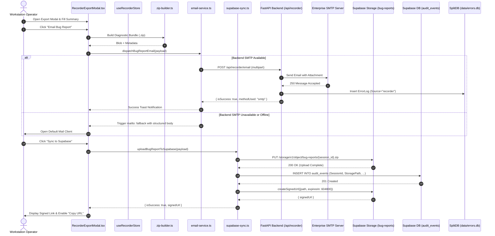
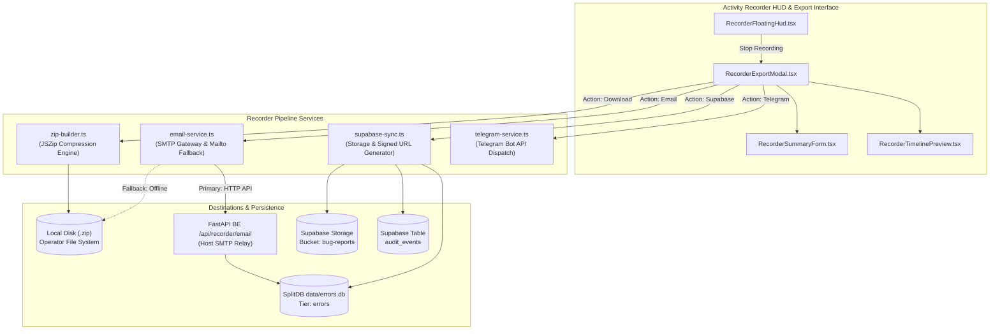

# Bug Recorder Export, Email SMTP Service & Supabase Cloud Sync Specification
# Directory: 02-spec/21-app/04-vision-system-and-error-management-instructions/04-bug-recorder-email-and-supabase-spec.md
# Status: Approved Architectural Contract

## 1. Executive Summary & Purpose

The **CAT Vision (CAT iVISION)** Activity Recorder captures high-fidelity diagnostic bundles during production runs, UI regression testing, and shop-floor workstation evaluations. A complete recording bundle contains:
- User interaction timelines (clicks, navigation, settings mutations).
- High-resolution or 60% JPEG canvas snapshots captured at key interactions.
- Runtime console logs, network IPC latency metrics, and vision evaluation results.
- Workstation system telemetry (OS, GPU, browser version, camera firmware).

While exporting local ZIP files (`exportSessionToZip`) serves offline needs, modern distributed factory environments require direct cloud and remote triage capabilities. This specification establishes the architecture for:
1. **Automated Email Dispatch (`src/lib/recorder/email-service.ts`)**: Direct backend SMTP delivery of diagnostic summaries with attached ZIP bundles, accompanied by an instant `mailto:` client-side fallback.
2. **Supabase Cloud Synchronization (`src/lib/recorder/supabase-sync.ts`)**: Secure multipart upload of diagnostic ZIP archives to the `bug-reports` Supabase storage bucket, audit trail recording in `audit_events`, and automatic generation of signed, time-limited developer download URLs.
3. **SplitDB Correlation**: Automatic recording of dispatched bug reports into `data/errors.db` under the `"recorder"` source tier.
4. **Interactive Export Modal Modernization (`src/components/recorder/RecorderExportModal.tsx`)**: Unified multi-destination interface with real-time transfer progress, status badges, and one-click URL clipboard actions.



---

## 2. Multi-Channel Export Architecture

The export subsystem is designed to operate under strict network partitioning constraints typical of industrial manufacturing cells:
- **Fully Offline**: Direct local ZIP download via browser memory stream.
- **Local Intranet Only**: On-premise SMTP server dispatch through the local FastAPI backend.
- **Internet Connected**: Cloud telemetry sync via Supabase storage and instant Telegram bot notifications.



---

## 3. Email Dispatch Service Specification

Module Location: `src/lib/recorder/email-service.ts`.

### 3.1 Dual-Mode Dispatch Architecture
1. **Primary Mode (Backend SMTP)**:
   - Makes an HTTP `POST` request to `/api/recorder/email`.
   - Sends structured JSON or multipart payload containing summary fields, session metadata, and base64-encoded ZIP archive or server file reference.
   - The FastAPI backend reads credentials from `repo-secrets/11-go-email-reader/` or environment variables (`SMTP_HOST`, `SMTP_PORT`, `SMTP_USER`, `SMTP_PASSWORD`, `SMTP_USE_TLS`).
   - Default destination: `morgan.harris.riseup@gmail.com` (configurable in settings).

2. **Fallback Mode (`mailto:` URI Generation)**:
   - Triggered when the backend endpoint returns a connection failure, 503 Service Unavailable, or when running in pure static/browser mode.
   - Constructs a URL-encoded `mailto:` string containing issue title, expected/actual behavior, route history, event counts, and clear instructions for the operator.

### 3.2 Data Contracts & Types

```typescript
export interface EmailPayload {
  recipientEmail: string;
  subject: string;
  summary: {
    title: string;
    category: string;
    description: string;
    expectedBehavior: string;
    actualBehavior: string;
  };
  sessionMetadata: {
    sessionId: string;
    initialRoute: string;
    finalRoute: string;
    durationMs: number;
    eventCount: number;
    screenshotCount: number;
  };
  zipBlob?: Blob;
}

export interface EmailDispatchResult {
  isSuccess: boolean;
  hasError: boolean;
  methodUsed: "smtp" | "mailto";
  messageId?: string;
  errorMessage?: string;
}
```

### 3.3 Backend API Endpoint (`POST /api/recorder/email`)

Implemented in `BE/routers/recorder.py`:

- **Request Fields**:
  - `recipient`: string (valid email format).
  - `subject`: string (non-empty).
  - `bodyText`: string (structured markdown/plain text).
  - `zipBase64`: string (optional base64-encoded archive).
  - `sessionId`: string (UUID or session identifier).

- **Response (Universal Envelope)**:
```json
{
  "Status": "success",
  "Results": [
    {
      "isSuccess": true,
      "hasError": false,
      "messageId": "<rec-1772412803@catvision.ai>",
      "methodUsed": "smtp",
      "timestamp": 1772412804
    }
  ],
  "Errors": []
}
```

---

## 4. Supabase Cloud Sync Specification

Module Location: `src/lib/recorder/supabase-sync.ts`.

### 4.1 Storage & Audit Schema
- **Target Bucket**: `bug-reports` (configured with restricted public access; reads require signed URLs).
- **Storage Object Path**:
  `reports/{YYYY}/{MM}/{DD}/{sessionId}.zip`
  Example: `reports/2026/10/31/rec-m0ab12-cd34.zip`
- **MIME Type**: `application/zip`.

### 4.2 Audit Event Table Schema (`audit_events`)
When an archive is uploaded to Supabase Storage, an audit entry is inserted into the `audit_events` table using PascalCase naming conventions:

```sql
CREATE TABLE IF NOT EXISTS audit_events (
    Id BIGINT GENERATED ALWAYS AS IDENTITY PRIMARY KEY,
    CreatedAt TIMESTAMPTZ NOT NULL DEFAULT NOW(),
    SessionId TEXT NOT NULL,
    EventType TEXT NOT NULL DEFAULT 'BUG_REPORT_UPLOADED',
    Title TEXT NOT NULL,
    Description TEXT,
    Category TEXT NOT NULL,
    StoragePath TEXT NOT NULL,
    FileSizeBytes BIGINT NOT NULL,
    EventCount INTEGER NOT NULL,
    ScreenshotCount INTEGER NOT NULL,
    ReporterEmail TEXT,
    SignedDownloadUrl TEXT,
    HasSignedUrl BOOLEAN NOT NULL DEFAULT TRUE,
    ExpiresAt TIMESTAMPTZ NOT NULL
);

CREATE INDEX IF NOT EXISTS Idx_audit_events_SessionId ON audit_events(SessionId);
CREATE INDEX IF NOT EXISTS Idx_audit_events_CreatedAt ON audit_events(CreatedAt DESC);
```

### 4.3 Signed Download URL Generation
Upon successful storage upload, the service requests a signed URL valid for **7 days (604,800 seconds)**:

```typescript
const { data: signedData, error: signedError } = await supabase.storage
  .from("bug-reports")
  .createSignedUrl(storagePath, 604800);
```

This signed URL allows developers to download the exact diagnostic bundle directly from their browser or terminal without needing full Supabase service-role credentials.

### 4.4 Data Contracts & Types

```typescript
export interface SupabaseSyncParams {
  sessionId: string;
  summary: {
    title: string;
    description: string;
    category: string;
  };
  eventCount: number;
  screenshotCount: number;
  reporterEmail?: string;
  zipBlob: Blob;
}

export interface SupabaseSyncResult {
  isSuccess: boolean;
  hasError: boolean;
  storagePath: string;
  signedDownloadUrl: string;
  expiresInSec: number;
  errorMessage?: string;
}
```

---

## 5. Frontend UI Integration (`RecorderExportModal.tsx`)

The export modal (`src/components/recorder/RecorderExportModal.tsx`) provides four clear, accessible actions:

```text
+-------------------------------------------------------------------------------+
|  Export Diagnostic Bug Report                             [X] Close           |
+-------------------------------------------------------------------------------+
|  Title: [ Pocket 2 Pin 1 Orientation Failure                     ]            |
|  Category: [ Inspection NG (False Rejection)                  v ]            |
|                                                                               |
|  Expected Behavior:                                                           |
|  [ Pin 1 notch should detect at 45 degrees within 2mm tolerance.  ]            |
|                                                                               |
|  Actual Behavior:                                                             |
|  [ Notch detection returned null; rule failed with score 0.0.    ]            |
|                                                                               |
|  Timeline Preview: 14 Events | 3 Screenshots | Duration: 00:02:15             |
+-------------------------------------------------------------------------------+
|  EXPORT DESTINATIONS:                                                         |
|  [  Download ZIP Archive  ]    Downloads offline bundle directly to disk.    |
|  [  Email Bug Report     ]    Dispatches to support team via SMTP/mailto.     |
|  [  Sync to Supabase     ]    Uploads to cloud bucket and creates signed URL. |
|  [  Send to Telegram     ]    Sends instant alert to team Telegram channel.  |
+-------------------------------------------------------------------------------+
|  STATUS: [OK] Uploaded to Supabase!                                           |
|  Signed Link: https://xxx.supabase.co/storage/v1/object/sign/bug-reports/...  |
|  [ Copy Link to Clipboard ]                                                   |
+-------------------------------------------------------------------------------+
```

### 5.1 Interactive State Handling
- **Progress Indicators**: Each button displays an inline `Loader2` spinning icon while an export or upload is active (`isExporting`, `isSendingEmail`, `isSyncingSupabase`, `isSendingTelegram`).
- **Mutual Exclusion**: Action buttons are disabled while any export operation is in flight.
- **Copy-to-Clipboard Action**: When Supabase sync completes, an input field displays the signed URL with an adjacent "Copy" button (`navigator.clipboard.writeText`) that flashes a green checkmark icon (`CheckCircle2`).

---

## 6. Correlation with SplitDB (`data/errors.db`)

Whenever a bug report is generated or synced:
1. An event is recorded into `data/errors.db` using the `POST /api/errors` endpoint.
2. The payload sets `Source = "recorder"`, `ErrorCode = "RECORDER_BUG_REPORT"`, and embeds the session ID, summary title, category, and signed download URL in the `ContextJson` field.
3. All breadcrumbs captured in `session.events` are transformed into `ErrorBreadcrumb` entries in `data/errors.db`.
4. As a result, running `cat-cli errors list --source recorder` immediately surfaces all field bug reports with full timelines and downloadable cloud packages.

---

## 7. Security & Privacy Guarantees

1. **Credential Isolation**: SMTP passwords and Supabase service-role keys are never embedded in frontend client builds. Supabase interactions use public anonymous keys restricted via Storage Row Level Security (RLS) policies.
2. **Snapshot Privacy**:
   - The recorder only captures the application DOM (`[data-app-root]`), never external operating system windows, notifications, or taskbars.
   - Text inputs with type `password` or matching `[data-private]` attributes are sanitized to `[REDACTED]` in recorded keystrokes.
3. **Signed URL Expiration**: Download URLs automatically expire after 7 days to prevent public discovery of proprietary manufacturing workpiece images.

---

## 8. Verification & Acceptance Criteria

1. **Email Service Test**:
   - Calling `dispatchBugReportEmail` with a mock backend returns `{ isSuccess: true, methodUsed: "smtp" }`.
   - When the backend is offline, `dispatchBugReportEmail` triggers `window.open("mailto:...")` and returns `{ isSuccess: true, methodUsed: "mailto" }`.
2. **Supabase Sync Test**:
   - Uploads a test ZIP blob to the `bug-reports` bucket and receives an affirmative result containing a valid HTTPS signed download URL.
   - Verifies the audit record is created in `audit_events`.
3. **UI Verification**:
   - `RecorderExportModal.tsx` renders all 4 export options with affirmative boolean state tracking.
   - Clicking "Copy Link" copies the signed download URL to clipboard and displays affirmative feedback.
4. **Coding Guideline Conformance**:
   - Zero occurrences of `ok`, `can`, `should`, `was`.
   - All state variables use `is` / `has` prefixes (`isSyncingSupabase`, `isSendingEmail`, `hasSignedUrl`).
