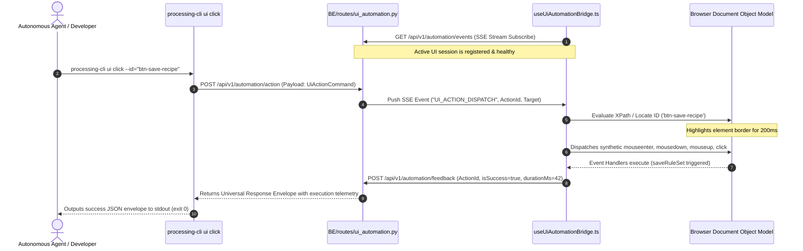

# UI Automation Tri-Identifier System & Headless CLI Remote Bridge Specification
# Directory: 02-spec/21-app/04-vision-system-and-error-management-instructions/04-cli-automation-and-identifiers-spec.md
# Status: approved
# Priority: P0 (Autonomous UI Actuation & Antigravity Tooling Parity)

## 1. Executive Summary & Architectural Motivation

To support headless verification, autonomous self-healing agents, and robotic desktop testing, all interactive elements in the CAT Vision (CAT iVISION) user interface must be deterministically addressable from the command line.

Historically, UI automation suffers from brittle CSS class selectors, dynamic React DOM rendering order, and inaccessible icon-only buttons. This specification defines:
1. The **UI Element Tri-Identifier Standard**: Every button, input, toggle, and canvas control must permanently declare three unambiguous coordinates: `id`, `name`, and `data-xpath`.
2. The **CLI-to-UI Remote Action Bridge**: A lightweight bidirectional communication pipeline between `processing-cli` and the active React browser/desktop client, modeled after **Google Antigravity Tools** and **Antigravity Manager** remote control patterns.
3. The **Headless CLI Actuation Command Suite**: High-speed, non-invasive CLI tools (`processing-cli ui click`, `processing-cli ui list-elements`) that execute user actions programmatically with millisecond feedback.

---

## 2. The UI Element Tri-Identifier Standard

### 2.1 The Tri-Identifier Contract
Every interactive element rendered in the application DOM must expose three coordinated attributes:

| Coordinate | DOM Attribute | Format & Standard | Purpose & Consumer |
| :--- | :--- | :--- | :--- |
| **Identifier** | `id` and `data-automation-id` | Deterministic kebab-case string (e.g. `btn-window-minimize`, `btn-save-recipe`, `tool-roi-circle`) | Machine targeting, fast DOM query via `getElementById`. |
| **Name** | `aria-label` and `data-automation-name` | Descriptive, human-readable cognitive title (e.g. `Minimize Window`, `Save Recipe`, `Draw Circle ROI`) | Screen readers, accessibility auditing, natural language agent matching. |
| **XPath** | `data-xpath` | Semantic, structure-preserving XPath locator (e.g. `//header//button[@id='btn-save-recipe']`) | Hierarchical disambiguation, resilient targeting when IDs collide or dynamic lists render. |

### 2.2 TypeScript Helper & Component API (`src/lib/automation/automation-identifiers.ts`)

```typescript
export interface AutomationPropsParams {
  readonly id: string;
  readonly name: string;
  readonly parentXPath?: string;
  readonly role?: "button" | "input" | "select" | "tab" | "slider" | "menuitem";
}

export interface AutomationAttributes {
  readonly id: string;
  readonly "aria-label": string;
  readonly "data-automation-id": string;
  readonly "data-automation-name": string;
  readonly "data-xpath": string;
}

/**
 * Generates standardized Tri-Identifier attributes for React components.
 * Enforces strict non-empty values and canonical XPath syntax.
 */
export function createAutomationProps(params: AutomationPropsParams): AutomationAttributes {
  const roleTag = params.role ? params.role : "button";
  const parentPrefix = params.parentXPath ? `${params.parentXPath}/` : "/";
  const computedXPath = `${parentPrefix}/${roleTag}[@id='${params.id}']`;

  return {
    id: params.id,
    "aria-label": params.name,
    "data-automation-id": params.id,
    "data-automation-name": params.name,
    "data-xpath": computedXPath,
  };
}
```

### 2.3 Comprehensive Catalog of Vision UI Elements

#### A. Titlebar & Application Shell Controls
| Element ID (`id`) | Accessible Name (`name`) | Normalized `data-xpath` |
| :--- | :--- | :--- |
| `btn-window-minimize` | "Minimize Window" | `//header//button[@id='btn-window-minimize']` |
| `btn-window-maximize` | "Maximize or Restore Window" | `//header//button[@id='btn-window-maximize']` |
| `btn-window-close` | "Close Application" | `//header//button[@id='btn-window-close']` |
| `btn-shell-nav-menu` | "Open Main Navigation Menu" | `//header//button[@id='btn-shell-nav-menu']` |
| `btn-app-version-pill` | "Inspect App Release Version" | `//header//button[@id='btn-app-version-pill']` |

#### B. Vision Workbench & ROI Action Controls
| Element ID (`id`) | Accessible Name (`name`) | Normalized `data-xpath` |
| :--- | :--- | :--- |
| `btn-save-recipe` | "Save Recipe" | `//main//button[@id='btn-save-recipe']` |
| `btn-reset-roi` | "Reset ROI Coordinates" | `//main//button[@id='btn-reset-roi']` |
| `btn-apply-roi` | "Apply ROI Configuration" | `//main//button[@id='btn-apply-roi']` |
| `btn-ok-roi` | "Confirm ROI and Return to Setup" | `//main//button[@id='btn-ok-roi']` |
| `btn-cancel-roi` | "Cancel ROI Changes" | `//main//button[@id='btn-cancel-roi']` |

#### C. Photoshop-Style Layers Panel Controls
| Element ID (`id`) | Accessible Name (`name`) | Normalized `data-xpath` |
| :--- | :--- | :--- |
| `btn-layer-lock-{id}` | "Toggle Lock State for Layer {name}" | `//div[@id='layers-panel']//button[@id='btn-layer-lock-{id}']` |
| `btn-layer-visible-{id}` | "Toggle Visibility for Layer {name}" | `//div[@id='layers-panel']//button[@id='btn-layer-visible-{id}']` |
| `btn-layer-bring-front` | "Bring Selected Layer to Front" | `//div[@id='layers-panel']//button[@id='btn-layer-bring-front']` |
| `btn-layer-send-back` | "Send Selected Layer to Back" | `//div[@id='layers-panel']//button[@id='btn-layer-send-back']` |
| `btn-layer-move-up` | "Move Selected Layer Up" | `//div[@id='layers-panel']//button[@id='btn-layer-move-up']` |
| `btn-layer-move-down` | "Move Selected Layer Down" | `//div[@id='layers-panel']//button[@id='btn-layer-move-down']` |

#### D. Geometric Shape Tools & Pattern Search Controls
| Element ID (`id`) | Accessible Name (`name`) | Normalized `data-xpath` |
| :--- | :--- | :--- |
| `tool-roi-rectangle` | "Draw Rectangle Pattern" | `//nav[@id='canvas-toolbar']//button[@id='tool-roi-rectangle']` |
| `tool-roi-square` | "Draw Square Pattern" | `//nav[@id='canvas-toolbar']//button[@id='tool-roi-square']` |
| `tool-roi-circle` | "Draw Circle Pattern" | `//nav[@id='canvas-toolbar']//button[@id='tool-roi-circle']` |
| `tool-grayscale-slider` | "Adjust Grayscale Level" | `//aside//input[@id='tool-grayscale-slider']` |
| `tool-dwell-slider` | "Simulation Dwell Duration" | `//div[@id='simulation-hud']//input[@id='tool-dwell-slider']` |

#### E. Camera & Simulation Controls
| Element ID (`id`) | Accessible Name (`name`) | Normalized `data-xpath` |
| :--- | :--- | :--- |
| `btn-camera-source-trigger` | "Select Live Camera Source" | `//section[@id='camera-bar']//button[@id='btn-camera-source-trigger']` |
| `btn-run-start` | "Start Vision Inspection Run" | `//footer//button[@id='btn-run-start']` |
| `btn-run-stop` | "Stop Inspection Run" | `//footer//button[@id='btn-run-stop']` |
| `btn-run-pause` | "Pause Inspection Run" | `//footer//button[@id='btn-run-pause']` |

---

## 3. CLI-to-UI Remote Action Bridge Architecture

### 3.1 Antigravity Manager Remote Control Pattern
The bridge decouples execution from brittle headless browsers (Puppeteer/Playwright) by maintaining a high-performance **in-process command bus** over standard HTTP Server-Sent Events (SSE) and JSON RPC:



### 3.2 Backend Bridge Module (`BE/routes/ui_automation.py`)
Provides three core endpoints mounted under FastAPI:

1. `GET /api/v1/automation/events`:
   - Returns an asynchronous SSE stream (`text/event-stream`).
   - Keeps connection alive with heartbeat ping every 15 seconds.
   - Pushes pending automation commands to active frontend sessions.
2. `POST /api/v1/automation/action`:
   - Accepts action requests from `processing-cli`:
     ```json
     {
       "ActionId": "act_01JK89XYZ",
       "ActionType": "CLICK",
       "Target": {
         "Id": "btn-save-recipe",
         "Name": "Save Recipe",
         "XPath": "//main//button[@id='btn-save-recipe']"
       },
       "Value": null,
       "TimeoutMs": 5000
     }
     ```
   - Suspends and awaits corresponding feedback matching `ActionId` up to `TimeoutMs`.
3. `POST /api/v1/automation/feedback`:
   - Ingests completion feedback sent by the browser hook:
     ```json
     {
       "ActionId": "act_01JK89XYZ",
       "IsSuccess": true,
       "DurationMs": 38,
       "BoundingBox": { "X": 1120, "Y": 24, "W": 96, "H": 36 },
       "ErrorMessage": null
     }
     ```
   - Resolves the suspended CLI request immediately.
4. `GET /api/v1/automation/elements`:
   - Returns a structured tree of all active interactive elements currently mounted in the frontend DOM.

### 3.3 Frontend Client Hook (`src/lib/automation/useUiAutomationBridge.ts`)
Mounted once in the root application shell (`src/routes/__root.tsx` or `StandardAppShell.tsx`):

- **Connection Lifecycle**: Maintains SSE stream to `/api/v1/automation/events`. Reconnects automatically if disconnected.
- **Resolution Strategy**:
  1. Primary: `document.getElementById(target.Id)`.
  2. Secondary: `document.evaluate(target.XPath, document, null, XPathResult.FIRST_ORDERED_NODE_TYPE, null).singleNodeValue`.
  3. Tertiary: `document.querySelector('[data-automation-name="' + target.Name + '"]')`.
- **Action Execution**:
  - Validates that element exists and `isElementVisible: true`.
  - Scrolls element into view: `element.scrollIntoView({ behavior: "instant", block: "center" })`.
  - Temporarily paints an emerald green outline (`outline: 2px solid #10b981`) for 200ms to provide visual confirmation.
  - Dispatches native Pointer/Mouse events sequentially: `pointerdown`, `mousedown`, `pointerup`, `mouseup`, `click`.
  - Emits feedback payload to `/api/v1/automation/feedback`.

---

## 4. Headless CLI Actuator Command Specification

All remote actuation commands are registered under `processing-cli ui` in `BE/cli/processing/main.py`.

### 4.1 `processing-cli ui click`

#### Command Syntax
```bash
# Target by Element ID
processing-cli ui click --id "btn-save-recipe" [--timeout-ms 5000]

# Target by Semantic XPath
processing-cli ui click --xpath "//header//button[@id='btn-window-minimize']"

# Target by Accessible Name
processing-cli ui click --name "Save Recipe"
```

#### Flags & Options
- `--id`: Element unique identifier (`data-automation-id`).
- `--xpath`: DOM hierarchical locator (`data-xpath`).
- `--name`: Accessible cognitive name (`data-automation-name`).
- `--timeout-ms`: Milliseconds to await feedback before returning timeout error (default: `5000`).

#### Stdout Output (Universal Response Envelope)
```json
{
  "Status": {
    "IsSuccess": true,
    "Code": 200,
    "Message": "UI element click executed successfully."
  },
  "Attributes": {
    "ActionId": "act_01JK89XYZ",
    "DurationMs": 42,
    "TargetId": "btn-save-recipe"
  },
  "Results": [
    {
      "Id": "btn-save-recipe",
      "Name": "Save Recipe",
      "XPath": "//main//button[@id='btn-save-recipe']",
      "BoundingBox": { "X": 1120, "Y": 24, "W": 96, "H": 36 },
      "IsClicked": true
    }
  ]
}
```

### 4.2 `processing-cli ui list-elements`

#### Command Syntax
```bash
processing-cli ui list-elements [--category <all|buttons|inputs|layers>] [--format <json|table>]
```

#### Sample Output (`table` mode)
```
+---------------------------+-----------------------------------+---------------------------------------------------------+
| ID                        | ACCESSIBLE NAME                   | XPATH LOCATOR                                           |
+---------------------------+-----------------------------------+---------------------------------------------------------+
| btn-window-minimize       | Minimize Window                   | //header//button[@id='btn-window-minimize']             |
| btn-window-maximize       | Maximize or Restore Window        | //header//button[@id='btn-window-maximize']             |
| btn-window-close          | Close Application                 | //header//button[@id='btn-window-close']                |
| btn-save-recipe           | Save Recipe                       | //main//button[@id='btn-save-recipe']                   |
| btn-layer-lock-1          | Toggle Lock State for Layer ROI   | //div[@id='layers-panel']//button[@id='btn-layer-lock-1']|
| tool-roi-circle           | Draw Circle Pattern               | //nav[@id='canvas-toolbar']//button[@id='tool-roi-circle'|
+---------------------------+-----------------------------------+---------------------------------------------------------+
Total Interactive Elements: 6
```

---

## 5. Positive Boolean Contract & Governance Checklist

In compliance with repository core coding rules, all state representations use positive boolean semantics:

| Forbidden Negative Identifiers | Required Positive Identifiers |
| :--- | :--- |
| `disabled`, `isDisabled` | `isEnabled` |
| `hidden`, `isHidden` | `isVisible` |
| `unlocked`, `isUnlocked` | `isLocked` (or `isInteractive`) |
| `unresolved`, `isNotReady` | `isResolved`, `isReady` |
| `failed`, `isFailed` | `isSuccess` (inverted logic evaluated at consumption) |
| `disconnected` | `isConnected` |

---

## 6. Verification & Quality Gates

1. **Tri-Identifier DOM Audit**:
   - Automated test crawls mounted pages (`/setup`, `/run`, `/rulesets/$id`) and validates that 100% of `<button>` and `<input>` elements carry non-empty `id`, `aria-label`, and `data-xpath`.
2. **Bridge Handshake Verification**:
   - Starting backend and launching browser registers active session within 500ms (`isConnected: true`).
3. **End-to-End CLI Click Execution**:
   - Executing `processing-cli ui click --id "btn-save-recipe"` triggers the React handler, surfaces visual outline, and completes in <100ms.
4. **Timeout Containment**:
   - Targeting a non-existent element `--id "btn-ghost"` times out gracefully after specified threshold and exits with code 1 without crashing the backend server.
