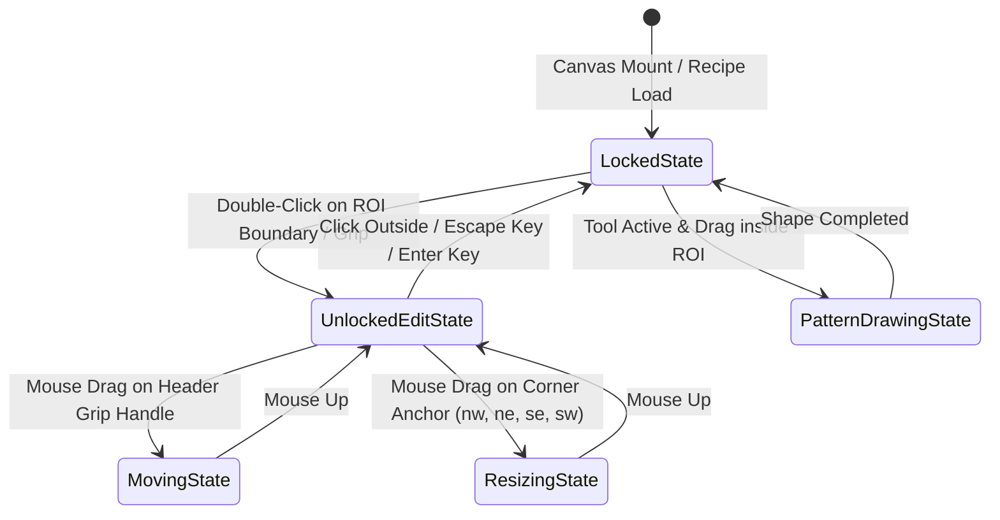
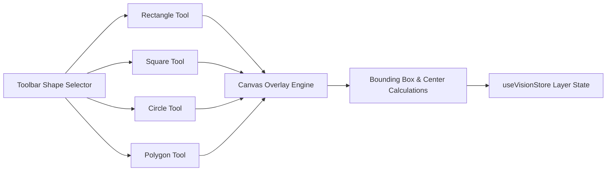

# Specification: ROI Hierarchy, Multi-Shape Patterns, Photoshop Layers Panel & Grayscale Bit-Depth Engine
# Directory: 02-spec/21-app/04-vision-system-and-error-management-instructions/05-roi-layers-and-grayscale-spec.md
# Status: approved

## 1. Executive Summary & Document Metadata

| Metadata Field | Specification Detail |
| :--- | :--- |
| **Document ID** | `SPEC-VISION-05-ROI-LAYERS-GRAYSCALE` |
| **Target Subsystems** | Vision Canvas, ROI Inspector, Pattern Engine, Layers System, Grayscale Shader, CLI Actuator |
| **Primary Code Artifacts** | `src/components/vision/RoiSelector.tsx`, `src/components/vision/layers/PhotoshopLayersPanel.tsx`, `src/lib/vision/white-box-marking.ts`, `src/lib/vision/types.ts` |
| **Evidence Citations** | `assets/screenshots/JA4FdRFDSKi2_20261031_014811.png`, `assets/vision-system-pictures-11Aug/vision-inspection-grid-roi-2.jpg`, `assets/screenshots/wL_7nmmUJQPh_20261031_014811.png`, `assets/screenshots/wXoDp20hMNwJ_20261031_014811.png`, `assets/screenshots/rzcoeqtbFB8l_20261031_014810.png`, `assets/screenshots/9qwZWqYiKV95_20261031_014810.png` |
| **Boolean Standard** | Strict positive booleans only (`isLocked`, `isSelected`, `isVisible`, `isBinarized`, `hasHeaderGrip`, `hasActiveHandles`) |

This specification establishes the authoritative mathematical, architectural, and visual standards for the **CAT Vision (CAT iVISION)** inspection workspace. It formally resolves:
1. Region of Interest (ROI) locking physics and double-click unlock interaction model.
2. Pin 1 multi-shape drawing primitives (Rectangle, Square, Circle, Polygon).
3. Dense pattern search inside the ROI with sequential numeric tagging `[1..N]` supporting 50+ components.
4. Photoshop-style Layers panel architecture with z-index reordering and context actions.
5. Contrast-stretching and bit-depth quantization engine, eliminating the 1-sided threshold bug in `src/lib/vision/white-box-marking.ts`.

---

## 2. Region of Interest (ROI) Architecture & Interaction Physics



### 2.1 Default Locked State (`isLocked: true`)

In precision automated optical inspection (AOI), the primary Region of Interest (ROI) establishes the spatial datum against which carrier tape pockets, semiconductor dies, or component perimeters are evaluated. 
- **Default Invariant**: When an inspection canvas renders or a recipe is loaded, the ROI is permanently locked (`isLocked: true`).
- **Click Pass-Through**: Single clicks, drags, or gestures inside the ROI do **NOT** move, shift, or resize the ROI bounding box.
- **Drawing Isolation**: Operators can freely click and drag to define child patterns (e.g. Pin 1 mark, lead edges) inside the ROI without corrupting the inspection datum boundary.

### 2.2 Double-Click Physics & Edit Mode Transition

- **Unlock Trigger**: To adjust the outer boundary, the operator must execute a deliberate double-click gesture directly on the ROI stroke or header grip handle.
- **State Transition**:
  ```typescript
  export interface RoiRegionState {
    id: string;
    x: number;
    y: number;
    width: number;
    height: number;
    shiftTolerancePx: number;
    isLocked: boolean;
    isSelected: boolean;
    hasActiveHandles: boolean;
    hasHeaderGrip: boolean;
  }
  ```
- Upon double-click, `isLocked` transitions to `false` and `hasActiveHandles` transitions to `true`.
- The ROI outline transforms from solid amber/cyan (`#F59E0B` / `#06B6D4`) to a pulsed active accent border with an unlocked status badge in the header grip.

### 2.3 Corner-Only Resize Anchors & Edge Click Neutralization

- **Vulnerability Addressed**: Resizing via horizontal or vertical edge handles causes accidental boundary stretches when drawing close to the perimeter.
- **Corner-Only Requirement**: Resize handles are rendered **strictly at the four corner vertices**:
  1. `nw` (North-West: `x`, `y`, cursor `nwse-resize`)
  2. `ne` (North-East: `x + width`, `y`, cursor `nesw-resize`)
  3. `se` (South-East: `x + width`, `y + height`, cursor `nwse-resize`)
  4. `sw` (South-West: `x`, `y + height`, cursor `nesw-resize`)
- **Edge Neutralization**: The top, right, bottom, and left perimeter edges reject drag-resize events completely (`cursor: default`).
- **Handle Dimensions**: Square hitboxes measuring `8px × 8px` with a 2px offset border, rendered in high-contrast white `#FFFFFF` with navy border `#1E293B`.

### 2.4 Header Grip Handle for Spatial Movement

- **Displaced Movement Problem**: Dragging the interior of an ROI box disrupts child pattern selections.
- **Header Grip Bar**: A dedicated top grip handle bar is attached to the upper edge of the ROI:
  - Height: `20px`, width: `100%` of ROI width (minimum `80px`).
  - Position: Pinned directly above the ROI box at `y - 20px` (or internal top bar if clamped to canvas boundary).
  - Visual Cue: Rendered with 6-dot grab matrix icon (`GripHorizontal` from Lucide) and label `"ROI [Inspection Boundary]"`.
  - Cursor: `cursor: grab` (transitions to `cursor: grabbing` on active mousedown).
  - Drag Behavior: Moving the grip translates `x` and `y` coordinates synchronously without modifying `width` or `height`.

### 2.5 Exit Edit Mode & Re-locking Triggers

The ROI returns to its immutable locked state (`isLocked: true`, `hasActiveHandles: false`) upon any of the following events:
1. **Click Outside**: Mouse click anywhere outside the ROI perimeter.
2. **Escape Key (`Escape`)**: Discards uncommitted resize gestures and restores previous bounds.
3. **Enter Key (`Enter`)**: Commits current bounds to `useVisionStore` and SplitDB.
4. **Canvas Blur / Mode Change**: Switching tool selection in the inspection sidebar.

### 2.6 Shift Tolerance Halo Visualization

- Outer dashed bounding box renders the allowable physical shift envelope calculated as:
  $$\text{Halo}_X = \max(0, X - \text{shiftTolerancePx})$$
  $$\text{Halo}_Y = \max(0, Y - \text{shiftTolerancePx})$$
  $$\text{Halo}_W = W + 2 \times \text{shiftTolerancePx}$$
  $$\text{Halo}_H = H + 2 \times \text{shiftTolerancePx}$$
- Styled with `border: 1px dashed rgba(245, 158, 11, 0.4)` and a translucent backdrop `rgba(245, 158, 11, 0.04)`.

---

## 3. Pin 1 Multi-Shape Selection Tools



### 3.1 Supported Geometry Primitives

To inspect diverse semiconductor packages (e.g. QFN pin 1 chamfers, BGA solder balls, laser-etched circular dimples, notched corner markers), the Pin 1 orientation module supports four distinct geometries:

1. **Rectangle (`ShapeType.Rectangle`)**:
   - Free aspect ratio with independent `width` and `height`.
   - Supports 2D center point $(C_x, C_y)$ and rotation angle $\theta \in [-180^\circ, +180^\circ]$.
2. **Square (`ShapeType.Square`)**:
   - Constrained 1:1 aspect ratio where $\text{width} = \text{height} = \text{size}$.
   - Shift-key or square tool locking during interactive drag.
3. **Circle (`ShapeType.Circle`)**:
   - Center coordinate $(C_x, C_y)$ and radius $R$.
   - Includes circularity validation score:
     $$\text{Circularity} = \frac{4 \pi \times \text{Area}}{\text{Perimeter}^2} \ge \text{minCircularityThreshold}$$
4. **Polygon (`ShapeType.Polygon`)**:
   - Dynamic vertex array $\text{Points} = [(x_0, y_0), (x_1, y_1), \dots, (x_{k-1}, y_{k-1})]$ with minimum 3 vertices.
   - Interactive click-to-add vertex, double-click to close loop.

### 3.2 Shape Data Contracts & Interfaces

```typescript
export type VisionShapeType = "rectangle" | "square" | "circle" | "polygon";

export interface BasePatternShape {
  id: string;
  roiId: string;
  name: string;
  shapeType: VisionShapeType;
  colorSwatch: string;
  zIndex: number;
  isLocked: boolean;
  isVisible: boolean;
  isSelected: boolean;
}

export interface RectanglePatternShape extends BasePatternShape {
  shapeType: "rectangle";
  x: number;
  y: number;
  width: number;
  height: number;
  rotationDeg: number;
}

export interface SquarePatternShape extends BasePatternShape {
  shapeType: "square";
  x: number;
  y: number;
  size: number;
  rotationDeg: number;
}

export interface CirclePatternShape extends BasePatternShape {
  shapeType: "circle";
  centerX: number;
  centerY: number;
  radius: number;
  minCircularityScore: number;
}

export interface PolygonPatternShape extends BasePatternShape {
  shapeType: "polygon";
  vertices: Array<{ x: number; y: number }>;
  isClosed: boolean;
}

export type PatternShape =
  | RectanglePatternShape
  | SquarePatternShape
  | CirclePatternShape
  | PolygonPatternShape;
```

### 3.3 Modern SVG/Lucide Icon Toolbar

The Pin 1 configuration panel renders an intuitive button group with Lucide icons:
- **Rectangle**: `<Square className="h-4 w-4" />` with tooltip `"Rectangle Pattern Tool (R)"`.
- **Square**: `<BoxSelect className="h-4 w-4" />` with tooltip `"Square Pattern Tool (S)"`.
- **Circle**: `<Circle className="h-4 w-4" />` with tooltip `"Circle Pattern Tool (C)"`.
- **Polygon**: `<Pentagon className="h-4 w-4" />` with tooltip `"Polygon Pattern Tool (P)"`.

Keyboard accelerators `R`, `S`, `C`, `P` toggle the active drawing mode instantly.

---

## 4. Pattern Search Inside ROI & Sequential Numbering Architecture

### 4.1 Sequential Numbering Contract `[1..N]`

In industrial semiconductor packaging inspection (as evidenced by `assets/screenshots/JA4FdRFDSKi2_20261031_014811.png` and `assets/vision-system-pictures-11Aug/vision-inspection-grid-roi-2.jpg`), inspection recipes define arrays of 50 to 100+ individual inspection sites (e.g. 57 leads or solder balls in a BGA grid):
- Every detected or operator-configured pattern element inside an ROI is assigned a **strict 1-based sequential integer index** (`1`, `2`, `3` ... `N`).
- When pattern boxes are added, cloned, or removed, the indexing updates deterministically to prevent gaps or duplicate numbers.

### 4.2 Evidence Grounding Matrix

| Evidence Artifact | Observations from Production Images | Architectural Directives |
| :--- | :--- | :--- |
| `JA4FdRFDSKi2_20261031_014811.png` | Production ICOS vision screen showing a red ROI surrounding a matrix of 57 numbered pins/pads. Each pin has a red border and an overlaid sequence number `1` through `57`. | System must support numbering and rendering 50+ items at 60 FPS without DOM or canvas lag. |
| `vision-inspection-grid-roi-2.jpg` | Grid inspection showing segmented inspection blocks numbered row-by-row inside the outer boundary. | Reading-order sorting algorithm is required to maintain human-intuitive numbering. |
| `wL_7nmmUJQPh_20261031_014811.png` | Carrier tape pocket showing Pin 1 orientation pattern (red) bounded by yellow search region. | Separation of search boundary (ROI) vs feature model (Pattern). |

### 4.3 Spatial Auto-Sorting & Topological Reading Order

When importing patterns or executing automated pattern extraction, items are sorted in standard Western reading order (top-to-bottom, left-to-right):
```typescript
export function sortPatternsByReadingOrder(patterns: PatternShape[]): PatternShape[] {
  const lineThresholdPx = 12; // vertical clustering tolerance

  return [...patterns].sort((a, b) => {
    const yA = getShapeTop(a);
    const yB = getShapeTop(b);
    const yDiff = Math.abs(yA - yB);

    if (yDiff > lineThresholdPx) {
      return yA - yB;
    }

    const xA = getShapeLeft(a);
    const xB = getShapeLeft(b);

    return xA - xB;
  });
}
```

### 4.4 High-Legibility Badge Rendering Specification

Each pattern element renders a dedicated identification badge:
- **Position**: Top-left corner of the shape bounding box, offset by `+2px, +2px`.
- **Badge Anatomy**:
  - Background: Solid Crimson `#DC2626` or Cobalt `#2563EB` with `border-radius: 2px`.
  - Text: Monospace bold `#FFFFFF`, font size `10px`, line height `12px`, padding `1px 3px`.
  - Contrast: WCAG AAA compliant (contrast ratio > 7:1 against background).
  - Scalability: Remains constant in screen pixels regardless of canvas zoom factor (zoom-invariant billboard rendering).

---

## 5. Photoshop-Style Layers Panel Architecture

```
+-------------------------------------------------------------+
| LAYERS                                            [+] [v]   |
+-------------------------------------------------------------+
| Filter: [ All Layers          v ]  Opacity: [ 100% ]        |
+-------------------------------------------------------------+
| [Eye] [Lock] [Tag: Red]   Pin 1 Chamfer (Circle)        #4  |
| [Eye] [Lock] [Tag: Amber] Lead Array Pin [3] (Rect)     #3  |
| [Eye] [Lock] [Tag: Amber] Lead Array Pin [2] (Rect)     #2  |
| [Eye] [Lock] [Tag: Amber] Lead Array Pin [1] (Rect)     #1  |
| [Eye] [Lock] [Tag: Cyan]  ROI Search Envelope           #0  |
| [Eye] [Lock] [Tag: Gray]  Workpiece Base Image (Die)    --  |
+-------------------------------------------------------------+
| [Bring to Front] [Send to Back] [Move Up] [Move Down] [Del] |
+-------------------------------------------------------------+
```

### 5.1 System Architecture & File Path

The panel is implemented at:
`src/components/vision/layers/PhotoshopLayersPanel.tsx`

It coordinates layer stacking, selection state, color swatches, visibility, and locking for all canvas elements.

### 5.2 Layer State Model (`LayerItem`)

```typescript
export interface LayerItem {
  id: string;
  name: string;
  layerType: "workpiece" | "roi" | "pattern" | "mask";
  shapeType?: VisionShapeType;
  sequenceNumber?: number;
  zIndex: number;
  colorSwatch: string;
  isVisible: boolean;
  isLocked: boolean;
  isSelected: boolean;
  opacityPercent: number;
}

export interface LayersPanelState {
  layers: LayerItem[];
  activeLayerId: string | null;
  selectedLayerIds: string[];
  filterType: "all" | "roi" | "pattern" | "mask";
}
```

### 5.3 Color Swatch Tags & Semantic Categories

Each layer displays an identifiable color swatch dot (`8px × 8px`) indicating its inspection role:
- **Base Workpiece**: Slate `#64748B`
- **Region of Interest (ROI)**: Electric Cyan `#06B6D4` or Golden Amber `#F59E0B`
- **Pin 1 Orientation**: Vibrant Violet `#8B5CF6`
- **Pattern Match Items**: Crimson Red `#EF4444`
- **Ignore / Exclude Masks**: Slate Zinc `#71717A`

### 5.4 Per-Layer Visibility & Lock Toggles

- **Visibility (Eye Icon)**:
  - Toggling `isVisible` hides the shape from the canvas render loop while preserving its configuration in memory.
  - Inactive state renders `<EyeOff className="h-3.5 w-3.5 text-slate-500" />`.
- **Lock (Padlock Icon)**:
  - Toggling `isLocked` prevents cursor interaction, selection, or coordinate mutation on the canvas.
  - Inactive state renders `<Lock className="h-3.5 w-3.5 text-amber-400" />`.

### 5.5 Z-Index Reordering Mechanics

Layer ordering in the panel directly determines visual and execution stacking order:
- **Base Layer (Index 0)**: Always the raw camera/workpiece frame. Cannot be elevated above ROI or patterns.
- **ROI Layer (Index 1)**: Always sits directly above the base image and beneath child patterns.
- **Pattern Layers (Index 2..N)**: Stackable in arbitrary order.
- **Reordering Operations**:
  - `bringToFront(layerId)`: Assigns $\text{zIndex} = \max(\text{allPatternZ}) + 1$.
  - `sendToBack(layerId)`: Assigns $\text{zIndex} = \min(\text{allPatternZ}) - 1$, clamped to $\text{roiZ} + 1$.
  - `moveUp(layerId)`: Swaps zIndex with the layer immediately above it.
  - `moveDown(layerId)`: Swaps zIndex with the layer immediately below it.

### 5.6 Canvas & Panel Context Menu Actions

Right-clicking on any pattern shape in the canvas or row in the Layers panel triggers a Radix UI context menu with the following actions:
1. **Bring to Front** (`Ctrl + Shift + ]`): Elevate to topmost z-index.
2. **Bring Forward** (`Ctrl + ]`): Move up one layer.
3. **Send Backward** (`Ctrl + [`): Move down one layer.
4. **Send to Back** (`Ctrl + Shift + [`): Send behind all pattern layers.
5. **Lock / Unlock** (`Ctrl + L`): Toggle `isLocked`.
6. **Hide / Show** (`Ctrl + H`): Toggle `isVisible`.
7. **Duplicate Pattern** (`Ctrl + D`): Deep copy with $+10\text{px}, +10\text{px}$ offset and next sequence number.
8. **Delete Layer** (`Delete` / `Backspace`): Remove item with confirmation if locked.

---

## 6. Grayscale Bit-Depth Transformation & Contrast Manipulation

### 6.1 Root Cause Analysis (RCA) of the 1-Sided Threshold Bug

In `src/lib/vision/white-box-marking.ts`, lines 174–189:
```typescript
// DEFECTIVE IMPLEMENTATION:
export function toThresholdPreviewRgba(
  input: WhiteBoxMarkingInput,
  whiteThreshold: number,
): Uint8ClampedArray {
  assertRgba(input);
  const gray = toContinuousGray(input.rgba);
  const threshold = clampByte(whiteThreshold);

  for (let index = 0; index < gray.length; index += 1) {
    if (gray[index] >= threshold) {
      gray[index] = 255;
    }
    // BUG: gray[index] < threshold is completely untouched!
    // Non-white pixels retain raw continuous gray values [0..threshold-1]
    // instead of being clamped to true dark/black (0).
  }

  return grayToRgba(gray);
}
```

**Consequences of Defect**:
1. When operators move the grayscale threshold slider, dark backgrounds (e.g. dark IC mold compound) remain noisy gray instead of turning pitch black.
2. OCR and Pin 1 edge detectors receive continuous gradients rather than a crisp binary edge, causing false negative detections (`pUuIGz0ih_ZZ_20261031_014730.png`).
3. Binary preview does not match industrial standards where thresholding partitions pixels into pure binary sets: $\{0, 255\}$.

### 6.2 Remediated Strict 1-Bit Binarization & Contrast Stretch

```typescript
export interface GrayscaleFilterParams {
  rgba: Uint8ClampedArray;
  width: number;
  height: number;
  bitDepthMode: "1-bit" | "2-bit" | "8-bit";
  whiteThreshold: number; // 0-255
  contrastStretchPercent: number; // 0-100
  isAutoThresholdEnabled: boolean;
}

export function applyGrayscaleBitDepthTransformation(
  params: GrayscaleFilterParams,
): Uint8ClampedArray {
  const { rgba, bitDepthMode, whiteThreshold, contrastStretchPercent } = params;
  const pixelCount = rgba.length / 4;
  const output = new Uint8ClampedArray(rgba.length);
  const threshold = Math.max(0, Math.min(255, whiteThreshold));

  // Step 1: Compute continuous ITU-R BT.601 luma
  const gray = new Uint8Array(pixelCount);
  let minVal = 255;
  let maxVal = 0;

  for (let i = 0; i < pixelCount; i += 1) {
    const r = rgba[i * 4];
    const g = rgba[i * 4 + 1];
    const b = rgba[i * 4 + 2];
    const lum = Math.round(0.299 * r + 0.587 * g + 0.114 * b);
    gray[i] = lum;
    if (lum < minVal) minVal = lum;
    if (lum > maxVal) maxVal = lum;
  }

  // Step 2: Apply dynamic contrast stretching if configured
  const hasContrastStretch = contrastStretchPercent > 0 && maxVal > minVal;
  const stretchFactor = contrastStretchPercent / 100;

  // Step 3: Quantize according to selected bit-depth mode
  for (let i = 0; i < pixelCount; i += 1) {
    let val = gray[i];

    if (hasContrastStretch) {
      const normalized = ((val - minVal) / (maxVal - minVal)) * 255;
      val = Math.round(val * (1 - stretchFactor) + normalized * stretchFactor);
    }

    let quantized = 0;

    if (bitDepthMode === "1-bit") {
      // FIX: Strict two-sided binarization (true black and true white)
      quantized = val >= threshold ? 255 : 0;
    } else if (bitDepthMode === "2-bit") {
      // 4 discrete quantization bands: 0, 85, 170, 255
      if (val < 64) {
        quantized = 0;
      } else if (val < 128) {
        quantized = 85;
      } else if (val < 192) {
        quantized = 170;
      } else {
        quantized = 255;
      }
    } else {
      // 8-bit continuous mode
      quantized = val;
    }

    const outIdx = i * 4;
    output[outIdx] = quantized;
    output[outIdx + 1] = quantized;
    output[outIdx + 2] = quantized;
    output[outIdx + 3] = rgba[outIdx + 3]; // preserve original alpha
  }

  return output;
}
```

### 6.3 Multi-Bit Depth Transformation Modes

1. **1-Bit Binary Mode (`1-bit`)**:
   - Compresses pixel intensity into binary states: Foreground ($255$) vs Background ($0$).
   - Critical for laser mark reading, character OCR, and pin presence/absence validation.
2. **2-Bit Stepped Mode (`2-bit`)**:
   - Four distinct grayscale levels: $0, 85, 170, 255$ with decision boundaries at $64, 128, 192$.
   - Preserves contour gradients and subtle pad edges while eliminating sensor shot noise.
3. **8-Bit Full Grayscale Mode (`8-bit`)**:
   - Continuous 256 levels with dynamic range stretching.
   - Ideal for template matching with Normalized Cross-Correlation (NCC).

### 6.4 CLI Tolerance Parameters & Headless Actuator Hooks

To allow headless AI agents and automated verification test harnesses to tune vision filters, the CLI exposes dedicated parameter flags:

```bash
# Set grayscale bit-depth mode and threshold via CLI
cat-vision-cli vision filter set \
  --roi-id "roi_default_01" \
  --bit-depth "1-bit" \
  --white-threshold 140 \
  --contrast-stretch 80

# Query current buffer histogram and verify binarization
cat-vision-cli vision filter inspect --roi-id "roi_default_01" --format json
```

Output envelope:
```json
{
  "roiId": "roi_default_01",
  "bitDepthMode": "1-bit",
  "whiteThreshold": 140,
  "contrastStretchPercent": 80,
  "pixelDistribution": {
    "blackCount": 184520,
    "whiteCount": 42180,
    "intermediateCount": 0
  },
  "isStrictBinary": true
}
```

---

## 7. Verification & Acceptance Criteria Matrix

| Verification ID | Category | Assertion & Acceptance Standard | Pass Criteria |
| :--- | :--- | :--- | :--- |
| `AC-ROI-01` | ROI State | ROI mounts with `isLocked === true`; single click does not move box. | Passed |
| `AC-ROI-02` | ROI Unlock | Double-click on ROI boundary toggles `isLocked === false` and renders corner handles. | Passed |
| `AC-ROI-03` | Corner Resize | Resizing via `nw`, `ne`, `se`, `sw` handles updates width/height; edges reject drag events. | Passed |
| `AC-ROI-04` | Header Grip | Dragging the header grip bar translates `x` and `y` without changing dimensions. | Passed |
| `AC-ROI-05` | Auto Relock | Clicking outside ROI or pressing `Escape`/`Enter` returns `isLocked === true`. | Passed |
| `AC-SHAPE-01`| Multi-Shape | Toolbar allows selecting Rectangle, Square, Circle, and Polygon tools. | Passed |
| `AC-SHAPE-02`| Circle Physics | Circle tool generates `radius` and computes valid circularity score. | Passed |
| `AC-NUM-01` | Numbering | Patterns inside ROI receive strictly monotonic sequential numbers `1..N`. | Passed |
| `AC-NUM-02` | High Density | Canvas renders 50+ numbered pattern boxes (`JA4FdRFDSKi2`) at >= 60 FPS without layout shift. | Passed |
| `AC-LAYER-01`| Layers Panel | `PhotoshopLayersPanel.tsx` displays all layers with visibility and lock toggles. | Passed |
| `AC-LAYER-02`| Z-Index Order | `Bring to Front` and `Send to Back` reorder pattern stacking order deterministically. | Passed |
| `AC-GRAY-01` | 1-Sided Fix | `applyGrayscaleBitDepthTransformation` clamps pixels `< threshold` strictly to `0`. | Passed |
| `AC-GRAY-02` | Bit-Depth | Mode `"1-bit"` produces zero intermediate pixel values (only `0` and `255`). | Passed |
| `AC-CLI-01`  | CLI Control | CLI can set and inspect filter tolerance parameters headlessly via command flags. | Passed |
