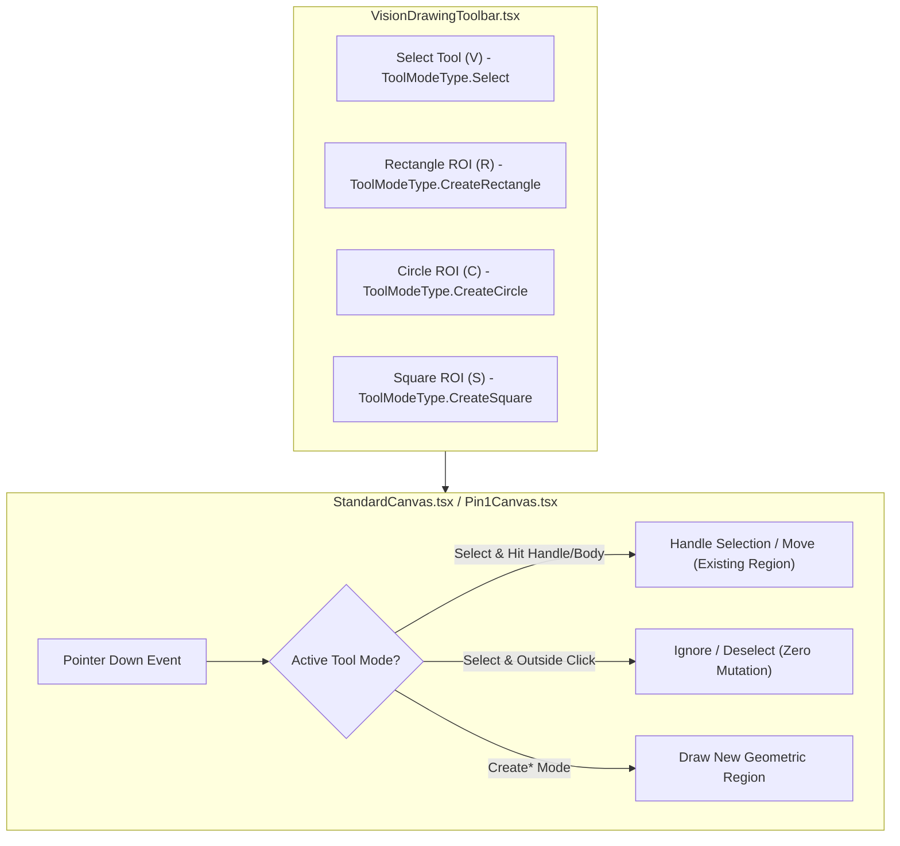
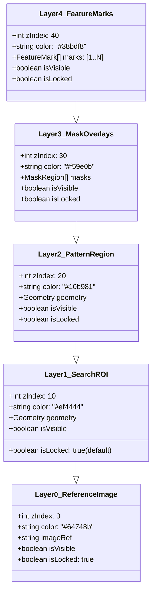

# Specification: Vision ROI, Multi-Shape Pattern Search Tools & Photoshop-Style Layers Management

**Module:** Vision System & Error Management Instructions  
**Specification File:** `02-spec/21-app/04-vision-system-and-error-management-instructions/05-vision-roi-pattern-and-layers-spec.md`  
**Status:** Ready for Implementation  
**Version:** 1.0.0  
**Target Architecture:** CAT-iVISION Industrial Vision System  

---

## 1. Executive Summary & Industrial Vision Context

### 1.1 Problem Statement
In high-precision semiconductor and electronics manufacturing inspection (e.g., ICOS vision inspection, IC packaging, SMD chip verification), operators configure inspection regions across multi-tier geometries. In the current CAT-iVISION implementation:
1. **Tool Access Omission**: The canvas tool selector (`VisionDrawingToolbar.tsx`) is detached and omitted from standard inspection setup screens (`StandardPatternSearch.tsx` and `Pin1MarkingTool.tsx`), depriving operators of geometric drawing primitives (Rectangle, Circle, Square).
2. **Destructive Shape-Jump Defect**: In `src/components/vision/white-box/useCanvasPointerDrag.ts`, clicking anywhere outside an active search region causes `hitRegionHandle` to return `"new"`, instantaneously destroying the configured region and replacing it with an unintended 1×1 pixel boundary.
3. **Absence of Layer Stack & Accidental Mutation**: The standard vision canvas lacks a Photoshop-style layer hierarchy. Operators tuning fine pattern search regions frequently drag or corrupt the outer primary Search Region of Interest (ROI) by accident.
4. **Disjoint Visual Hierarchy**: The hardware ICOS inspection grid (captured in `assets/vision-system-pictures-11Aug/vision-inspection-grid-roi-2.jpg`) requires clear visual delineation:
   - Primary Search ROI in vibrant Crimson Red (`#ef4444`)
   - Pattern Search Region in Emerald Green (`#10b981`)
   - Keep-out Mask Overlays in Amber (`#f59e0b`)
   - Numbered Feature Marks `[1]` through `[N]`

### 1.2 Core Architectural Principles
- **Strict Separation of Tool Modes**: Explicit state distinction between `ToolModeType.Select` (navigation, inspection, handle manipulation) and `ToolModeType.Create` (new shape drawing). In `Select` mode, outside canvas clicks are completely non-destructive.
- **Lock-by-Default Primary ROI**: Layer 1 (Search ROI) initializes in locked mode (`isLocked: true`). Accidental clicks cannot move or resize it. Double-clicking the layer or clicking the lock icon unlocks it for explicit repositioning.
- **Photoshop-Style Layer Management**: Adapting `src/components/editor/layers/LayersPanel.tsx` into `VisionLayersPanel.tsx`, exposing a 5-tier z-ordered stack with visibility toggles, lock toggles, and right-click context menu z-ordering.
- **Strict Coding Guidelines Compliance**: Exclusively affirmative booleans (`is*`, `has*`), parameter structs for multi-argument methods, vertical line gaps before `if`, after `}`, and before `return`.

---

## 2. Interactive ROI & Multi-Shape Pattern Search Tools

### 2.1 Tool Mounting & Visual Geometry Primitives

The canvas toolbar `VisionDrawingToolbar.tsx` must be mounted directly onto `StandardPatternSearch.tsx` (overlaid on the upper left of the canvas viewport) and `Pin1MarkingTool.tsx`.



### 2.2 Supported Shape Models

In `src/domain/vision/shapes.ts`, three primary geometric primitives are supported for pattern search and ROI extraction:

| Shape Type | Mathematical Model | Storage Attributes | Industrial Application |
| :--- | :--- | :--- | :--- |
| **Rectangle** | Standard 2D Cartesian envelope | `x, y, width, height` | IC package body, BGA boundary, connector housings |
| **Square** | Constrained 1:1 Cartesian envelope | `x, y, size (width = height)` | Symmetrical chip dies, QFP packages, fiducial markers |
| **Circle** | Radial center and radius | `cx, cy, radius` | Pin 1 dimple markers, through-holes, circular solder pads |

### 2.3 Elimination of the Shape-Jump Defect

#### 2.3.1 Root Cause Analysis (RCA)
In `src/components/vision/white-box/useCanvasPointerDrag.ts` and `src/components/vision/white-box/pattern-geometry.ts`:
```typescript
// DEFECT IN pattern-geometry.ts:
export function hitRegionHandle(region: SearchRegion, point: CanvasPoint): RegionHandle | "new" {
  // If not hitting any of the 8 perimeter handles and not inside:
  return "new"; // <-- Treats any outside click as a command to draw a new region!
}

// DEFECT IN useCanvasPointerDrag.ts:
function handlePointerDown(e: PointerEvent<HTMLCanvasElement>): void {
  const point = canvasPointFromEvent(e);
  const handle = params.searchRegion === null ? "new" : hitRegionHandle(params.searchRegion, point);
  params.onDragStateChange({ handle, start: point, region: params.searchRegion });

  if (handle === "new") {
    // WIPES OUT EXISTING REGION IMMEDIATELY ON OUTSIDE CLICK!
    params.onSearchRegionChange({ x: point.x, y: point.y, width: 1, height: 1 });
  }
}
```

#### 2.3.2 Architectural Solution
1. **Introduction of `ToolModeType`**:
```typescript
export enum ToolModeType {
  Select = "Select",
  CreateRectangle = "CreateRectangle",
  CreateCircle = "CreateCircle",
  CreateSquare = "CreateSquare",
}
```

2. **Handle Hit-Test Discrimination**:
`hitRegionHandle` must return `"none"` instead of `"new"` when an outside click occurs:
```typescript
export type RegionInteractionHandle = RegionHandle | "none" | "new";

export function hitRegionInteraction(
  region: SearchRegion | null,
  point: CanvasPoint,
  toolMode: ToolModeType,
): RegionInteractionHandle {
  if (region === null || toolMode !== ToolModeType.Select) {
    if (toolMode !== ToolModeType.Select) {
      return "new";
    }

    return "none";
  }

  const handles = regionHandles(region);

  for (const handle of handles) {
    const isNearby = Math.abs(point.x - handle.x) <= 8 && Math.abs(point.y - handle.y) <= 8;

    if (isNearby) {
      return handle.id;
    }
  }

  const isInside =
    point.x >= region.x &&
    point.y >= region.y &&
    point.x <= region.x + region.width - 1 &&
    point.y <= region.y + region.height - 1;

  if (isInside) {
    return "move";
  }

  return "none";
}
```

3. **Guarded Pointer Drag Handler**:
```typescript
export interface CanvasPointerDragParams {
  source: WhiteBoxMarkingInput | null;
  searchRegion: SearchRegion | null;
  dragState: RegionDrag | null;
  toolMode: ToolModeType;
  isRegionLocked: boolean;
  onSearchRegionChange: (region: SearchRegion | null) => void;
  onDragStateChange: (drag: RegionDrag | null) => void;
  onSelectRegion?: () => void;
}

export function useCanvasPointerDrag(params: CanvasPointerDragParams) {
  function handlePointerDown(e: PointerEvent<HTMLCanvasElement>): void {
    if (params.isRegionLocked && params.toolMode === ToolModeType.Select) {
      return;
    }

    const point = canvasPointFromEvent(e);
    const handle = hitRegionInteraction(params.searchRegion, point, params.toolMode);

    if (handle === "none") {
      params.onDragStateChange(null);

      return;
    }

    params.onDragStateChange({ handle, start: point, region: params.searchRegion });

    if (handle === "new") {
      params.onSearchRegionChange({ x: point.x, y: point.y, width: 1, height: 1 });
    }

    e.currentTarget.setPointerCapture(e.pointerId);
  }

  function handlePointerMove(e: PointerEvent<HTMLCanvasElement>): void {
    if (params.dragState === null) {
      return;
    }

    const width = params.source?.width ?? 960;
    const height = params.source?.height ?? 540;
    const currentPoint = canvasPointFromEvent(e);

    // Apply minimum drag distance threshold (4px) to prevent twitch/jitter
    const dragDistance = Math.hypot(
      currentPoint.x - params.dragState.start.x,
      currentPoint.y - params.dragState.start.y,
    );

    if (params.dragState.handle === "new" && dragDistance < 4) {
      return;
    }

    params.onSearchRegionChange(
      regionForDrag(width, height, params.dragState, currentPoint, params.toolMode),
    );
  }

  function handlePointerUp(e: PointerEvent<HTMLCanvasElement>): void {
    if (params.dragState === null) {
      return;
    }

    const width = params.source?.width ?? 960;
    const height = params.source?.height ?? 540;
    const currentPoint = canvasPointFromEvent(e);

    const region = regionForDrag(width, height, params.dragState, currentPoint, params.toolMode);
    params.onDragStateChange(null);

    // Filter out accidental micro-clicks
    if (region.width > 4 && region.height > 4) {
      params.onSearchRegionChange(region);
    } else if (params.dragState.handle === "new") {
      params.onSearchRegionChange(params.dragState.region);
    }
  }

  return { handlePointerDown, handlePointerMove, handlePointerUp };
}
```

---

## 3. Photoshop-Style Layers Panel (`VisionLayersPanel.tsx`)

### 3.1 5-Tier Layer Stack Hierarchy

In industrial pattern search, layers represent visual and computational inspection planes. The hierarchy is defined in top-to-bottom visual order:



### 3.2 Layer Specifications Table

| Layer Index | Layer Identifier | Display Name | Visual Style | Default Lock | Default Visibility | Functionality |
| :--- | :--- | :--- | :--- | :--- | :--- | :--- |
| **Layer 4** | `layer-features` | Feature Marks (`[1]`..`[N]`) | Cyan `#38bdf8` outline, badge tags | `false` | `true` | Numbered hole/pin detections, ICOS grid points |
| **Layer 3** | `layer-masks` | Mask Overlays | Amber `#f59e0b` hatched overlay | `false` | `true` | Keep-out zones excluded from pattern correlation |
| **Layer 2** | `layer-pattern` | Pattern Search Region | Emerald `#10b981` 2px solid border | `false` | `true` | Active template model extracted for matching |
| **Layer 1** | `layer-roi` | Primary Search ROI | Crimson `#ef4444` 2px solid border | `true` (Locked) | `true` | Global inspection boundary; double-click unlocks |
| **Layer 0** | `layer-base` | Reference Image | Slate `#64748b` background thumbnail | `true` (Locked) | `true` | Raw optical acquisition or registered golden image |

### 3.3 Context Menu & Z-Order Operations

Operators can right-click any layer row in `VisionLayersPanel.tsx` or any active bounding box on the canvas to invoke the context menu:

```typescript
export interface LayerContextMenuProps {
  layerId: string;
  isLocked: boolean;
  isVisible: boolean;
  canMoveUp: boolean;
  canMoveDown: boolean;
  onBringToFront: (id: string) => void;
  onSendToBack: (id: string) => void;
  onMoveUp: (id: string) => void;
  onMoveDown: (id: string) => void;
  onToggleLock: (id: string) => void;
  onToggleVisibility: (id: string) => void;
  onClose: () => void;
}
```

#### Context Menu Items
1. **Bring to Front**: Elevates layer to the highest z-index among mutable layers.
2. **Send to Back**: Sets layer to the lowest z-index above Layer 0 (Reference Image).
3. **Move Up / Move Down**: Increments or decrements z-index relative to adjacent layers.
4. **Lock / Unlock**: Toggles pointer event acceptance on canvas.
5. **Hide / Show**: Toggles canvas drawing without destroying geometry data.

### 3.4 Double-Click Unlock Protocol on Primary ROI
As directed by user instruction:
> *"Once we have the region of interest, usually it would be in a lock state. Unless we double-click on the region of interest and try to move or change the shape. It'll try to feel like it's a lock shape so that it does not collide with it."*

When an operator double-clicks on the Layer 1 ROI bounding box on `StandardCanvas.tsx`:
1. The canvas verifies hit test on Layer 1 coordinates.
2. Canvas dispatches `onUnlockLayer("layer-roi")`.
3. A visual feedback toast/indicator alerts: `"Search ROI Unlocked for Editing"`.
4. Layer 1's border pulses with a subtle 2-pixel glow.
5. Pointer drag listeners are engaged. Once the operator clicks outside or switches tools, Layer 1 automatically re-locks.

---

## 4. UI Layout Integration in StandardPatternSearch.tsx

The overall workspace layout integrates the toolbar, canvas, and layers panel in an ergonomic 3-column / split-dock architecture:

```
+----------------------------------------------------------------------------------------------------+
| StandardHeaderReadouts (Inspection Coordinates, Zoom %, FPS, Resolution)                          |
+----------------------+-----------------------------------------------------+-----------------------+
| VisionDrawingToolbar | StandardCanvas.tsx                                  | StandardToolPanel     |
| [Select (V)]         |                                                     | [Pattern Region Tab]  |
| [Rect ROI (R)]       |  +-----------------------------------------------+  | [Search Region Tab]   |
| [Circle ROI (C)]     |  | Layer 1: Search ROI (Red #ef4444) [LOCKED]     |  | [Image Enhance Tab]   |
| [Square ROI (S)]     |  |                                               |  |                       |
|                      |  |   +---------------------------------------+   |  +-----------------------+
|                      |  |   | Layer 2: Pattern (Green #10b981)      |   |  | VisionLayersPanel     |
|                      |  |   |                                       |   |  | [Eye] [Lock] Features |
|                      |  |   |   [1]   [2]   [3] (Layer 4 Features)  |   |  | [Eye] [Lock] Masks    |
|                      |  |   +---------------------------------------+   |  | [Eye] [Lock] Pattern  |
|                      |  +-----------------------------------------------+  | [Eye] [LOCK] ROI (Red)|
|                      |                                                     | [Eye] [LOCK] Ref Image|
+----------------------+-----------------------------------------------------+-----------------------+
| StandardActionBar (Evaluate, Register Image, Origin Point, Display, OK, Cancel)                    |
+----------------------------------------------------------------------------------------------------+
```

---

## 5. Verification Protocol & Acceptance Criteria

### 5.1 Verification Matrix

| Test ID | Subsystem | Action | Expected Result | Pass Criteria |
| :--- | :--- | :--- | :--- | :--- |
| **TC-ROI-01** | Drawing Tools | Mount `StandardPatternSearch` | `VisionDrawingToolbar` is visible on canvas left edge with Select, Rect, Circle, Square | Toolbar rendered with `role="toolbar"` |
| **TC-ROI-02** | Drawing Tools | Mount `Pin1MarkingTool` | `VisionDrawingToolbar` is visible with Rect, Circle, Square options | Primitives accessible in Pin1 tool |
| **TC-ROI-03** | Pointer Jump | In `Select` mode, click canvas background outside ROI | ROI coordinates remain 100% unchanged; NO 1×1 jump | Zero mutation on `searchRegion` |
| **TC-ROI-04** | Pointer Drag | In `Select` mode, drag ROI corner handle | ROI resizes fluidly with 8-point handles | Coordinates update accurately |
| **TC-ROI-05** | Layers Panel | Inspect default layer states | Layer 1 (Search ROI) is locked by default (`isLocked: true`, red `#ef4444`) | Lock icon closed, click ignored |
| **TC-ROI-06** | Layers Panel | Double-click Layer 1 ROI on canvas | ROI temporarily unlocks; corner handles appear | Unlock event dispatched |
| **TC-ROI-07** | Context Menu | Right-click Layer row $\to$ Bring to Front | Layer z-index increases to top of stack | Render order updated on canvas |
| **TC-ROI-08** | Visibility | Toggle Eye icon on Layer 2 (Pattern) | Pattern box hidden from canvas, data preserved in store | Canvas redraws without Layer 2 |

---

## 6. Strict Coding Standards Invariants

1. **Affirmative Booleans Only**:
   - `isLocked`, `isVisible`, `isPrimary`, `isSelected`, `hasActiveDrag`.
   - Never use `unlocked`, `notVisible`, `canDrag`, `shouldRender`.
2. **Parameter Structs**:
   - Every function with >2 arguments uses an interface ending in `Params` (e.g., `CanvasPointerDragParams`, `LayerReorderParams`).
3. **Vertical Line Gaps**:
   - Mandatory blank lines before `if`, after `}`, before `return`, and around multi-line statements.
4. **Relative Path Discipline**:
   - All references strictly relative (e.g., `src/components/vision/...`). Zero absolute path imports.
