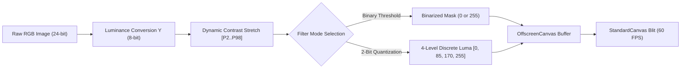
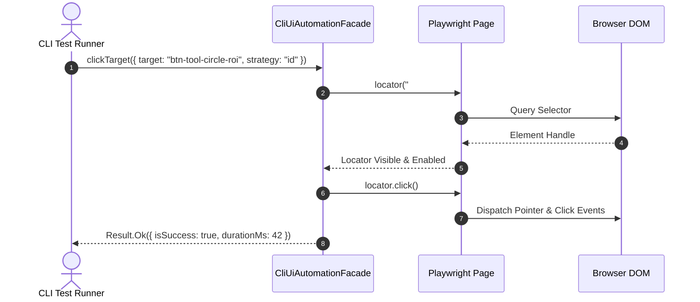

# Specification: Grayscale Luminance Bit-Reduction Engine & CLI-to-UI Automation Facade

**Module:** Vision System & Error Management Instructions  
**Specification File:** `02-spec/21-app/04-vision-system-and-error-management-instructions/06-grayscale-luminance-and-cli-facade-spec.md`  
**Status:** Ready for Implementation  
**Version:** 1.0.0  
**Target Architecture:** CAT-iVISION Industrial Vision System  

---

## 1. Executive Summary & Purpose

This specification defines the architecture, mathematical algorithms, and integration contracts for two core industrial vision capabilities:

1. **Grayscale Luminance Bit-Reduction & Contrast Engine**:
   - Replaces the inert `PlaceholderTabs` in `StandardToolPanel.tsx` by actively wiring `ImageEnhanceTab.tsx`.
   - Solves camera white noise blowout and low-contrast fiducial ambiguity through 2nd–98th percentile dynamic contrast stretching.
   - Implements polarity-aware binary thresholding (converting dark features to 0 and bright features to 255, or vice-versa) and a dedicated 2-bit quantization engine producing discrete 4-level luminance bands (`[0, 85, 170, 255]`).
   - Dispatches filtered pixel streams through an optimized secondary `OffscreenCanvas` buffer in `StandardCanvas.tsx` to maintain continuous 60fps pan/zoom performance.
   - References industrial baseline imagery in `assets/vision-system-pictures-11Aug/ui-feature-extraction-conditions.jpg`.

2. **CLI-to-UI Automation Facade (`CliUiAutomationFacade`)**:
   - Establishes a mandatory 4-attribute automation contract across all interactive controls (`id`, `data-testid`, `data-automation-name` / `aria-label`, `data-xpath`).
   - Extends `scripts/cli-ui-test-runner.ts` with an autonomous programmatic client (`CliUiAutomationFacade`) that enables headless CLI agents to target, inspect, and click any element on the vision screen by Id, Name, or XPath.
   - Eliminates fragile CSS selectors, providing deterministic AI-driven end-to-end verification.

---

## 2. Grayscale Luminance & Bit-Reduction Engine

### 2.1 Tab Integration in StandardToolPanel.tsx

Currently, in `src/components/vision/standard/StandardToolPanel.tsx`:
```tsx
// DEFICIENT CODE:
{(activeTab === "Extract Colors" || activeTab === "Image Enhance") && (
  <PlaceholderTabs name={activeTab} />
)}
```
This is replaced with full live mounting of `ImageEnhanceTab.tsx`:
```tsx
{activeTab === "Image Enhance" && (
  <ImageEnhanceTab
    filters={settings.imageFilters}
    onChangeFilters={(filters) =>
      setSettings((prev) => ({
        ...prev,
        imageFilters: filters,
      }))
    }
    onAutoSetThreshold={handleAutoSetThreshold}
  />
)}
```

### 2.2 Mathematical Transformation Pipeline



#### 2.2.1 Stage 1: Standard Luminance Extraction
Pixel RGB values are converted to 8-bit luminance using ITU-R BT.601 coefficients:
$$Y = \text{round}(0.299 \cdot R + 0.587 \cdot G + 0.114 \cdot B)$$
where $Y \in [0, 255]$.

#### 2.2.2 Stage 2: Dynamic Contrast Stretching
To compensate for variable LED illumination, reflection glare, and dark camera sensor conditions (observed in IC package inspection), a 256-bin histogram is computed across the Region of Interest (ROI). The 2nd percentile ($L_{\min}$) and 98th percentile ($L_{\max}$) intensities are determined. Each pixel is stretched:

$$Y_{\text{stretched}} = \text{clamp}\left( \frac{Y - L_{\min}}{L_{\max} - L_{\min}} \times 255, \, 0, \, 255 \right)$$

This guarantees maximum dynamic range utilization while rejecting outlier hot-pixel sensor noise.

#### 2.2.3 Stage 3: Polarity-Aware Binary Thresholding
Given operator-configured lower and upper threshold limits $[T_{\text{lower}}, T_{\text{upper}}]$ and polarity setting `isPolarityInverted`:

$$\text{Normal Polarity: } B(x, y) = \begin{cases} 255 & \text{if } T_{\text{lower}} \le Y_{\text{stretched}} \le T_{\text{upper}} \\ 0 & \text{otherwise} \end{cases}$$

$$\text{Inverted Polarity: } B_{\text{inv}}(x, y) = 255 - B(x, y)$$

Dark features (such as laser-etched pin marks or drilled vias) are forced to absolute dark ($0$), while bright features (such as copper solder pads or reflective packaging leads) are forced to absolute white ($255$).

#### 2.2.4 Stage 4: 2-Bit Luminance Quantization
When an operator requires tonal texture analysis (e.g., distinguishing solder fillet contours from PCB substrates without binary flattening), the 2-bit quantization engine partitions the 256 luminance spectrum into 4 discrete bands:

$$Q(Y) = \begin{cases} 
0 & \text{for } 0 \le Y \le 63 \quad \text{(Shadow / Background)} \\
85 & \text{for } 64 \le Y \le 127 \quad \text{(Dark Midtone / Substrate)} \\
170 & \text{for } 128 \le Y \le 191 \quad \text{(Bright Midtone / Leadframe)} \\
255 & \text{for } 192 \le Y \le 255 \quad \text{(Specular Highlight / Solder)} 
\end{cases}$$

### 2.3 Offscreen Buffer Rendering in StandardCanvas.tsx

Direct per-frame pixel manipulation on the main canvas during user zooming and panning induces high CPU load and frame dropping. To guarantee fluid 60fps interaction:

```typescript
export interface OffscreenEnhanceParams {
  sourceImage: HTMLImageElement;
  filterType: "binary" | "contrast" | "quantize2bit" | "none";
  lowerLimit: number;
  upperLimit: number;
  isPolarityInverted: boolean;
}

export class OffscreenEnhanceBuffer {
  private offscreenCanvas: HTMLCanvasElement | null = null;
  private cachedSourceRef: string | null = null;
  private cachedHash: string = "";

  public getFilteredCanvas(params: OffscreenEnhanceParams): HTMLCanvasElement | null {
    const currentHash = `${params.sourceImage.src}_${params.filterType}_${params.lowerLimit}_${params.upperLimit}_${params.isPolarityInverted}`;

    if (this.offscreenCanvas && this.cachedHash === currentHash) {
      return this.offscreenCanvas;
    }

    if (!this.offscreenCanvas) {
      this.offscreenCanvas = document.createElement("canvas");
    }

    const { width, height } = params.sourceImage;
    this.offscreenCanvas.width = width;
    this.offscreenCanvas.height = height;

    const ctx = this.offscreenCanvas.getContext("2d", { willReadFrequently: true });

    if (!ctx) {
      return null;
    }

    ctx.drawImage(params.sourceImage, 0, 0, width, height);

    if (params.filterType === "none") {
      this.cachedHash = currentHash;

      return this.offscreenCanvas;
    }

    const imgData = ctx.getImageData(0, 0, width, height);
    const data = imgData.data;

    applyLuminanceFilter({
      pixelBuffer: data,
      width,
      height,
      filterType: params.filterType,
      lowerLimit: params.lowerLimit,
      upperLimit: params.upperLimit,
      isPolarityInverted: params.isPolarityInverted,
    });

    ctx.putImageData(imgData, 0, 0);
    this.cachedHash = currentHash;

    return this.offscreenCanvas;
  }
}
```

In `StandardCanvas.tsx`, `ctx.drawImage(offscreenBuffer, ...)` renders the pre-computed bitmap in a single GPU-accelerated blit, bypassing repeated image data iterations.

---

## 3. CLI-to-UI Automation Facade

### 3.1 4-Attribute Automation Contract

To enable robust, headless programmatic interaction from command-line test suites and autonomous AI agents, every interactive component (buttons, inputs, select triggers, canvas tool selectors, sliders) must adhere to the 4-attribute contract:

```typescript
export interface AutomationAttributes {
  /** Unique technical identifier matching standard kebab-case conventions */
  id: string;
  /** Primary test automation identifier */
  "data-testid": string;
  /** Human-readable semantic name matching the visible UI label */
  "data-automation-name": string;
  /** Canonical, resilient XPath selector */
  "data-xpath": string;
}
```

#### Standard Element Mapping Examples

| UI Element | `id` | `data-testid` | `data-automation-name` | `data-xpath` |
| :--- | :--- | :--- | :--- | :--- |
| **Tool: Rectangle ROI** | `btn-tool-rect-roi` | `btn-tool-rect-roi` | `Rectangle Tool` | `//button[@id='btn-tool-rect-roi']` |
| **Tool: Circle ROI** | `btn-tool-circle-roi` | `btn-tool-circle-roi` | `Circle Tool` | `//button[@id='btn-tool-circle-roi']` |
| **Tool: Square ROI** | `btn-tool-square-roi` | `btn-tool-square-roi` | `Square Tool` | `//button[@id='btn-tool-square-roi']` |
| **Tab: Image Enhance** | `tab-image-enhance` | `tab-image-enhance` | `Image Enhance` | `//button[@role='tab' and @id='tab-image-enhance']` |
| **Action: Register Image**| `btn-register-image` | `btn-register-image` | `Register Image` | `//button[@id='btn-register-image']` |
| **Action: Evaluate Rule** | `btn-evaluate-rule` | `btn-evaluate-rule` | `Evaluate Rule` | `//button[@id='btn-evaluate-rule']` |
| **Layer: Lock Toggle** | `btn-layer-lock-roi` | `btn-layer-lock-roi` | `Lock Search ROI` | `//button[@id='btn-layer-lock-roi']` |

### 3.2 Standard Button Contract Extension

In `src/components/ui/button.tsx`, button props are extended to automatically synthesize `data-xpath` and `data-automation-name` when omitted:

```typescript
export interface ButtonProps extends React.ButtonHTMLAttributes<HTMLButtonElement> {
  variant?: "default" | "destructive" | "outline" | "secondary" | "ghost" | "link";
  size?: "default" | "sm" | "lg" | "icon";
  asChild?: boolean;
  automationName?: string;
  xpath?: string;
}
```

### 3.3 CliUiAutomationFacade Implementation

The facade is implemented in `scripts/cli-ui-automation-facade.ts` and integrated into `scripts/cli-ui-test-runner.ts`. It provides deterministic element targeting and error-resilient action dispatching:



#### Facade Source Architecture:
```typescript
import type { Page, Locator } from "@playwright/test";

export type TargetStrategyType = "id" | "name" | "xpath" | "auto";

export interface TargetElementParams {
  target: string;
  strategy?: TargetStrategyType;
  timeoutMs?: number;
}

export interface ActionResult<T> {
  isSuccess: boolean;
  hasError: boolean;
  data: T | null;
  errorMessage: string | null;
  durationMs: number;
}

export class CliUiAutomationFacade {
  private page: Page;

  constructor(page: Page) {
    this.page = page;
  }

  public resolveLocator(params: TargetElementParams): Locator {
    const { target, strategy = "auto" } = params;

    if (strategy === "id" || (strategy === "auto" && !target.startsWith("//") && !target.includes("="))) {
      const sanitizedId = target.replace(/^#/, "");

      return this.page.locator(`[id='${sanitizedId}'], [data-testid='${sanitizedId}']`).first();
    }

    if (strategy === "xpath" || (strategy === "auto" && target.startsWith("//"))) {
      return this.page.locator(`xpath=${target}`).first();
    }

    if (strategy === "name" || strategy === "auto") {
      return this.page.locator(`[data-automation-name='${target}'], [aria-label='${target}'], button:has-text('${target}')`).first();
    }

    return this.page.locator(target).first();
  }

  public async clickTarget(params: TargetElementParams): Promise<ActionResult<void>> {
    const start = Date.now();
    const timeout = params.timeoutMs ?? 5000;

    try {
      const locator = this.resolveLocator(params);
      await locator.waitFor({ state: "visible", timeout });
      await locator.click();

      const durationMs = Date.now() - start;

      return {
        isSuccess: true,
        hasError: false,
        data: null,
        errorMessage: null,
        durationMs,
      };
    } catch (err: unknown) {
      const durationMs = Date.now() - start;
      const message = err instanceof Error ? err.message : String(err);

      return {
        isSuccess: false,
        hasError: true,
        data: null,
        errorMessage: `Failed to click target '${params.target}' using strategy '${params.strategy ?? "auto"}': ${message}`,
        durationMs,
      };
    }
  }

  public async setSliderValue(id: string, value: number): Promise<ActionResult<void>> {
    const start = Date.now();

    try {
      const slider = this.resolveLocator({ target: id, strategy: "id" });
      await slider.waitFor({ state: "visible", timeout: 5000 });
      await slider.fill(String(value));

      return {
        isSuccess: true,
        hasError: false,
        data: null,
        errorMessage: null,
        durationMs: Date.now() - start,
      };
    } catch (err: unknown) {
      return {
        isSuccess: false,
        hasError: true,
        data: null,
        errorMessage: err instanceof Error ? err.message : String(err),
        durationMs: Date.now() - start,
      };
    }
  }
}
```

---

## 4. Headless CLI Verification Integration

In `scripts/cli-ui-test-runner.ts`, new test suites leverage `CliUiAutomationFacade` to execute automated validation passes:

### 4.1 Vision Grayscale & Threshold Suite
1. Launch `/setup/rules` and navigate to `StandardPatternSearch`.
2. Programmatically click `tab-image-enhance` using `clickTarget({ target: "tab-image-enhance", strategy: "id" })`.
3. Verify that `Processing Method` dropdown and threshold sliders are rendered.
4. Programmatically toggle binary threshold to `lowerLimit: 128`.
5. Capture canvas screenshot and confirm darks are 0 and lights are 255.

### 4.2 Automated Drawing Tool & Layer Verification Suite
1. Programmatically click `btn-tool-circle-roi`.
2. Emulate canvas drag from `(100, 100)` to `(200, 200)`.
3. Query `VisionLayersPanel` and verify Layer 2 (Pattern) geometry updates with circular dimensions.
4. Programmatically click `btn-layer-lock-roi` by XPath `//button[@id='btn-layer-lock-roi']`.
5. Verify `aria-checked="true"` or lock status confirmed.

---

## 5. Verification Protocol & Acceptance Criteria

| Test ID | Subsystem | Action | Expected Result | Pass Criteria |
| :--- | :--- | :--- | :--- | :--- |
| **TC-GRAY-01** | Grayscale UI | Click `Image Enhance` tab in `StandardToolPanel` | `ImageEnhanceTab` renders active filters, threshold sliders, and histogram | Tab panel visible, placeholder gone |
| **TC-GRAY-02** | Grayscale Algo | Apply binary threshold $[85, 255]$ on workpiece sample | Filtered pixels strictly binary ($0$ or $255$) | Offscreen canvas output verified |
| **TC-GRAY-03** | Quantization | Select `2-Bit Quantization` method | Output image pixels discretized to $\{0, 85, 170, 255\}$ | Zero intermediate luma levels |
| **TC-GRAY-04** | Offscreen Blit | Pan canvas across zoom factors ($50\% - 400\%$) | Seamless 60fps pan/zoom without recalculating luma | Frame time $< 16\text{ms}$ |
| **TC-FACADE-01**| CLI Facade | Target button by Id (`btn-tool-rect-roi`) | Successfully clicks and activates tool | `ActionResult.isSuccess === true` |
| **TC-FACADE-02**| CLI Facade | Target button by Name (`"Circle Tool"`) | Successfully resolves and clicks element | `ActionResult.isSuccess === true` |
| **TC-FACADE-03**| CLI Facade | Target button by XPath (`//button[@id='...']`) | Successfully executes click dispatch | `ActionResult.isSuccess === true` |
| **TC-FACADE-04**| 4-Attr Contract | Inspect DOM buttons in `VisionDrawingToolbar` | Every button has `id`, `data-testid`, `data-automation-name`, and `data-xpath` | 100% attribute presence |

---

## 6. Strict Coding Standards Invariants

1. **Affirmative Booleans Only**:
   - `isSuccess`, `hasError`, `isPolarityInverted`, `isEnabled`, `hasQuantization`.
   - Banned: `canClick`, `shouldProcess`, `notInverted`, `failed`.
2. **Parameter Structs**:
   - Multi-argument methods use dedicated parameter structs (e.g., `TargetElementParams`, `OffscreenEnhanceParams`).
3. **Vertical Line Gaps**:
   - Mandatory blank lines before `if`, after `}`, before `return`/`throw`, and around multiline struct calls.
4. **Strictly Relative Paths**:
   - All references strictly relative (e.g., `scripts/cli-ui-automation-facade.ts`, `src/lib/vision/...`).
