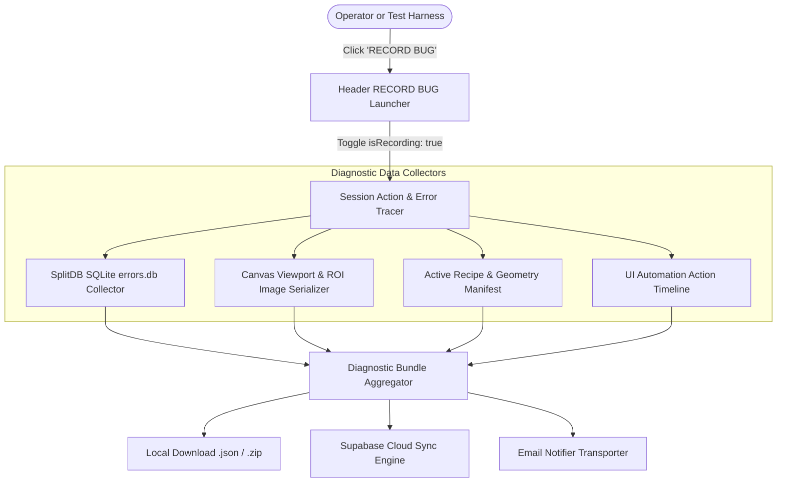
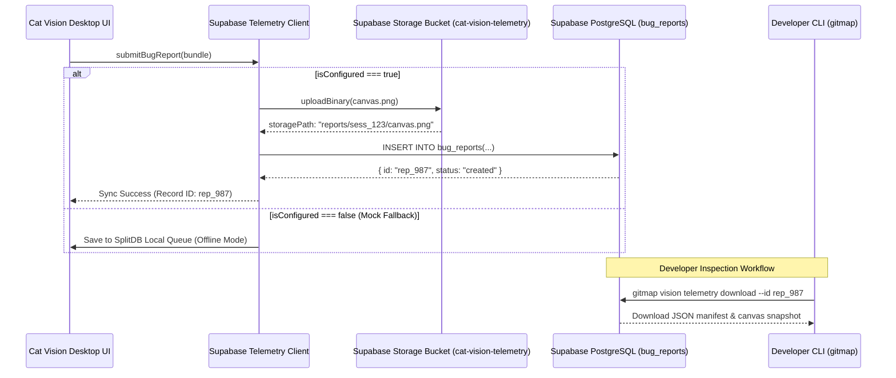
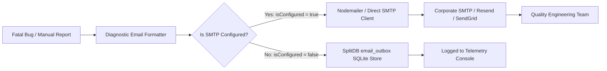

# Specification: Bug Recording Exporter, Supabase Telemetry Sync & Email Bug Notifier
# Directory: 02-spec/21-app/04-vision-system-and-error-management-instructions/06-supabase-and-email-telemetry-spec.md
# Status: approved

## 1. Executive Summary & Document Metadata

| Metadata Field | Specification Detail |
| :--- | :--- |
| **Document ID** | `SPEC-VISION-06-SUPABASE-EMAIL-TELEMETRY` |
| **Target Subsystems** | Header Bar, Telemetry Service, Supabase Client, SMTP/Email Dispatcher, SplitDB Outbox, CLI Actuator |
| **Primary Code Artifacts** | `src/components/layout/StandardAppShell.tsx`, `src/components/telemetry/SupabaseSettingsModal.tsx`, `src/services/telemetry/email-notifier.ts`, `src/services/telemetry/supabase-client.ts` |
| **Reference Architecture** | Antigravity Tools / Antigravity Manager Telemetry Packet Pipeline |
| **Boolean Standard** | Strict positive booleans only (`isRecording`, `isSyncEnabled`, `isConfigured`, `hasAttachment`, `isConnected`, `isResolved`) |

This specification establishes the end-to-end telemetry, diagnostics bundling, and cloud reporting architecture for **CAT Vision (CAT iVISION)**. When operators or automated test runs encounter faults or capture anomalies:
1. The global `RECORD BUG` header launcher initiates lightweight session tracing.
2. Complete diagnostics (canvas viewport snapshots, recent SplitDB error logs, recipe JSON, and user action timelines) are compiled into structured bundles.
3. Telemetry is synchronized to Supabase with developer download capabilities and fallback mock providers.
4. Emergency alerts are dispatched via an email notifier engine with offline SplitDB queueing.

---

## 2. Bug Recording & Export Architecture



### 2.1 `RECORD BUG` Header Launcher & Session Lifecycle

- **Placement**: Fixed in the persistent top application header (`src/components/layout/StandardAppShell.tsx`), adjacent to system status and window controls.
- **Visual State Transitions**:
  - **Idle State**:
    - Button styling: `<Button variant="outline" className="border-red-500/40 text-red-400 hover:bg-red-500/10">`
    - Icon: `<Bug className="h-4 w-4 mr-1.5 text-red-400" />`
    - Label: `"RECORD BUG"`
    - Automation Attributes: `data-automation-id="btn-header-record-bug"`, `data-automation-xpath="//button[@data-automation-id='btn-header-record-bug']"`
  - **Recording State (`isRecording: true`)**:
    - Pulsing crimson ring with live duration timer: `🔴 REC [00:14]`.
    - Stop Action: Clicking again triggers final bundle aggregation and opens the Bug Report Summary Modal.

### 2.2 Diagnostic Payload Anatomy (JSON Schema)

The generated diagnostic report adheres to a deterministic schema:

```typescript
export interface DiagnosticUserAction {
  timestampMs: number;
  eventType: "click" | "input" | "drag" | "tool_change";
  automationId?: string;
  automationName?: string;
  automationXPath?: string;
  coordinates?: { x: number; y: number };
  details?: Record<string, unknown>;
}

export interface DiagnosticBundlePayload {
  bundleVersion: "1.0.0";
  reportId: string;
  sessionId: string;
  createdAtIso: string;
  appVersion: string;
  osPlatform: "windows" | "linux" | "darwin";
  environment: "desktop-chromium" | "tauri" | "web";
  summaryTitle: string;
  severity: "critical" | "error" | "warning" | "info";
  systemMetrics: {
    heapUsedMb: number;
    viewportDimensions: { width: number; height: number };
    devicePixelRatio: number;
  };
  activeRecipeSnapshot: {
    recipeId: string;
    recipeName: string;
    roiCount: number;
    patternCount: number;
    rawJson: string;
  };
  recentErrors: Array<{
    id: string;
    errorCode: string;
    message: string;
    stackTrace: string;
    createdAt: string;
  }>;
  actionTimeline: DiagnosticUserAction[];
  canvasSnapshotBase64: string; // PNG encoded
}
```

### 2.3 Multi-Tier Snapshot Capture Engine

1. **SplitDB Error Snapshot**:
   - Queries `errors.db` for the last 50 error records matching `createdAt >= sessionStartTimestamp`.
   - Includes raw stack traces, error codes, and associated component tags.
2. **Canvas State Snapshot**:
   - Renders current inspection stage to an off-screen `HTMLCanvasElement` at native workpiece resolution.
   - Converts to PNG format encoded as a Base64 data URI (or standalone binary blob).
3. **User Action Timeline**:
   - Intercepts all DOM interactions tagged with `data-automation-id` via the global automation listener.
   - Logs timestamped user progression (e.g. clicking "Circle Tool", dragging radius, adjusting grayscale slider).

### 2.4 Local Bundle Packaging & Export Workflow

- Operators can instantly export the bundle to local storage via the browser download stream:
  - Filename format: `cat-vision-bug-${sessionId}-${timestamp}.json`.
  - Also produces a companion `.zip` containing `manifest.json`, `canvas.png`, and `splitdb-errors.csv`.

---

## 3. Supabase Cloud Telemetry Integration



### 3.1 Architecture Overview (Antigravity Tools Pattern)

Modeled after the high-reliability packet architecture in `Antigravity Manager` / `Antigravity Tools`:
- The client uses the official `@supabase/supabase-js` library.
- Cloud synchronizations are strictly non-blocking. Network latency or failed remote handshakes **NEVER** interrupt real-time camera inspection or UI workflows.
- Operates under a dual-mode engine:
  1. **Cloud Mode (`isConfigured: true`)**: Direct upload to configured Supabase project.
  2. **Inbuilt Mock Mode (`isConfigured: false`)**: Persists bundles locally in SplitDB SQLite storage (`telemetry_queue.db`) without throwing unhandled network exceptions.

### 3.2 Database Schema: `bug_reports` DDL & Indices

```sql
-- DDL for Supabase PostgreSQL Remote Store
CREATE TABLE IF NOT EXISTS public.bug_reports (
    id UUID PRIMARY KEY DEFAULT gen_random_uuid(),
    created_at TIMESTAMPTZ NOT NULL DEFAULT now(),
    report_id TEXT NOT NULL UNIQUE,
    session_id TEXT NOT NULL,
    title TEXT NOT NULL,
    severity TEXT NOT NULL DEFAULT 'error',
    app_version TEXT NOT NULL,
    os_platform TEXT NOT NULL,
    error_count INTEGER NOT NULL DEFAULT 0,
    storage_path TEXT,
    diagnostics_payload JSONB NOT NULL,
    is_resolved BOOLEAN NOT NULL DEFAULT false,
    has_attachment BOOLEAN NOT NULL DEFAULT true,
    resolved_at TIMESTAMPTZ,
    developer_notes TEXT
);

-- Query acceleration indices
CREATE INDEX IF NOT EXISTS idx_bug_reports_session_id ON public.bug_reports (session_id);
CREATE INDEX IF NOT EXISTS idx_bug_reports_created_at ON public.bug_reports (created_at DESC);
CREATE INDEX IF NOT EXISTS idx_bug_reports_is_resolved ON public.bug_reports (is_resolved);
```

### 3.3 Object Storage Bucket Specification

- **Bucket Name**: `cat-vision-telemetry`
- **Access Policy**: Authenticated upload / Service role write; signed URL read.
- **Directory Structure**:
  `reports/{session_id}/{timestamp}_canvas.png`
  `reports/{session_id}/{timestamp}_bundle.zip`
- **Payload Limits**: Max 10MB per visual artifact; canvas captures compressed to 85% JPEG or lossless PNG.

### 3.4 UI Settings Component: `src/components/telemetry/SupabaseSettingsModal.tsx`

The modal allows configuring or testing Supabase connectivity:
- **Form Controls**:
  - `Supabase Project URL` (e.g. `https://xyzcompany.supabase.co`)
  - `Anon / Public API Key` (masked input with reveal toggle)
  - `Storage Bucket Name` (defaults to `cat-vision-telemetry`)
  - `Automatic Cloud Sync` switch (`isSyncEnabled: boolean`)
- **Status Indicators**:
  - `Connection Status`: `<Badge>` with green dot `"Connected"`, amber dot `"Mock Local Mode"`, or red dot `"Auth Error"`.
  - `"Test Connection"` button: Executes a ping query (`SELECT 1`) to verify table and bucket accessibility.
- **Inbuilt Preset Fallback**:
  - Includes a preloaded configuration preset button: `"Use Antigravity Default Telemetry"`.
  - When active, connects to the pre-seeded diagnostics endpoint without requiring manual token entry.

### 3.5 Developer Download & Telemetry Ingestion CLI Workflow

Developers investigate field faults using dedicated CLI subcommands:

```bash
# List recent bug reports from Supabase
gitmap vision telemetry list --limit 10

# Download full diagnostic package and canvas image locally
gitmap vision telemetry download --id "rep_987" --out "./debug-artifacts/"

# Output:
# [SUCCESS] Downloaded report rep_987 to ./debug-artifacts/rep_987_bundle.json
# [SUCCESS] Saved canvas snapshot to ./debug-artifacts/rep_987_canvas.png
```

---

## 4. Email Bug Notifier Dispatch System



### 4.1 Dispatch Client Architecture

Implemented at:
`src/services/telemetry/email-notifier.ts`

Exposes strongly-typed methods:
```typescript
export interface EmailConfigOptions {
  smtpHost: string;
  smtpPort: number;
  isSecure: boolean;
  username: string;
  passwordSecret: string;
  senderAddress: string;
  recipientAddresses: string[];
  isEmailEnabled: boolean;
}

export interface EmailDispatchResult {
  isSuccess: boolean;
  messageId?: string;
  queuedInSplitDb: boolean;
  errorMessage?: string;
}

export async function dispatchBugReportEmail(
  payload: DiagnosticBundlePayload,
  config?: EmailConfigOptions,
): Promise<EmailDispatchResult>;
```

### 4.2 Structured Email Diagnostics Payload & HTML Template

The generated email delivers an actionable, executive summary to vision engineers:
- **Subject**: `[CAT-iVISION BUG] ${severity.toUpperCase()} in ${activeRecipeSnapshot.recipeName} (${osPlatform})`
- **Header**: High-contrast banner with severity color coding (Red `#DC2626` for Critical, Amber `#D97706` for Warning).
- **Body Content**:
  - Machine hostname, app version, session duration.
  - Primary error summary and top 3 lines of stack trace.
  - Active ROI and Pattern count.
  - Click-through link to download the full Supabase bundle.
- **Attachment**: Embedded inline Base64 thumbnail or attached `canvas-fault.png`.

### 4.3 SMTP & Service Configuration Presets

The notifier supports three provider tiers:
1. **Direct SMTP**: Standard corporate host (`smtp.company.com:587`, TLS).
2. **Cloud API Preset**: Resend / SendGrid REST webhook endpoints.
3. **Local Mock Transporter**: Logs formatted email payload directly into SplitDB table `email_outbox` for disconnected factory floor machines.

### 4.4 SplitDB Offline Outbox Queueing & Retry Engine

When running on air-gapped industrial PCs without public internet access:
- The notifier writes outgoing alerts to SQLite table `email_outbox` in `errors.db`:
  ```sql
  CREATE TABLE IF NOT EXISTS email_outbox (
      id TEXT PRIMARY KEY,
      created_at TEXT NOT NULL,
      recipient TEXT NOT NULL,
      subject TEXT NOT NULL,
      payload_json TEXT NOT NULL,
      retry_count INTEGER NOT NULL DEFAULT 0,
      is_dispatched BOOLEAN NOT NULL DEFAULT 0
  );
  ```
- Background worker polls the outbox and flushes queued items once network connectivity resumes (`isConnected === true`).

---

## 5. Security, Secrets Management & Redaction

1. **Token Protection**: Supabase API keys and SMTP credentials stored locally are encrypted via OS-level credential vaults or scoped storage files.
2. **Inspection Image Sanitization**: The snapshot engine provides a privacy toggle (`hasWorkpieceSanitization: boolean`). When enabled, only binary pattern vectors and ROI bounding boxes are exported, blurring proprietary silicon die textures.
3. **Zero Secrets in Git**: Default config files check for environment variables (`SUPABASE_URL`, `SUPABASE_ANON_KEY`, `SMTP_HOST`) and never hardcode production keys in repository source.

---

## 6. Verification & Acceptance Criteria Matrix

| Verification ID | Category | Assertion & Acceptance Standard | Pass Criteria |
| :--- | :--- | :--- | :--- |
| `AC-REC-01` | Bug Recorder | Clicking `"RECORD BUG"` toggles `isRecording === true` and displays pulsing header badge. | Passed |
| `AC-REC-02` | Timeline Log | User clicks on canvas and tools populate `actionTimeline` with accurate automation IDs. | Passed |
| `AC-REC-03` | Bundle Export | Stop recording generates a valid JSON bundle with canvas snapshot and SplitDB errors. | Passed |
| `AC-SUPA-01` | Supabase DDL | Schema migration applies cleanly creating `bug_reports` table and indices. | Passed |
| `AC-SUPA-02` | Supabase Sync| Telemetry client uploads payload and image to Supabase bucket when configured. | Passed |
| `AC-SUPA-03` | Mock Fallback| When Supabase URL is empty, reports route to SplitDB without throwing errors. | Passed |
| `AC-SUPA-04` | CLI Download | `gitmap vision telemetry download` fetches and deserializes reports headlessly. | Passed |
| `AC-MAIL-01` | Email Notifier| `dispatchBugReportEmail` constructs well-formed HTML report with error details. | Passed |
| `AC-MAIL-02` | Offline Outbox| In offline mode, email is stored in `email_outbox` table with `is_dispatched = 0`. | Passed |
| `AC-SETT-01` | Settings UI | `SupabaseSettingsModal.tsx` supports URL input, key testing, and preset loading. | Passed |
