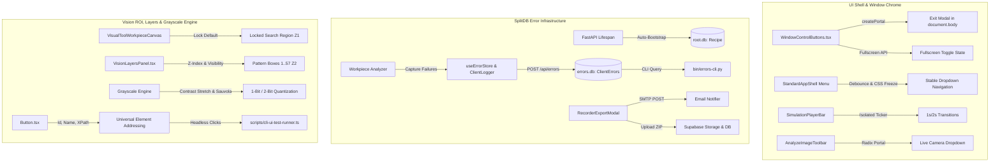

# Vision System and Error Management Architecture Specification

**Folder**: `02-spec/21-app/04-vision-system-and-error-management-instructions/`  
**Slug**: `vision-system-and-error-management-instructions`  
**Status**: APPROVED & READY FOR PHASE 2/3 EXECUTION  
**Prompt Reference**: V6 Parent Task Continuous Loop Engine  

---

## 1. Executive Summary & Problem Topology

This specification establishes the architectural blueprints, component contracts, error persistence models, and headless CLI test harnesses required to resolve regressions in the Cat Vision (`cat-my`) vision inspection system.

---

## 2. Evidence Mapping from Screenshots

| Screenshot | File Path | Primary Defect | Root Cause | Specification Solution |
|---|---|---|---|---|
| **01** | `assets/screenshots/vision-system-and-error-management-instructions-01.png` | Greyscale Pattern Rule FAILED | Missing saved pattern boxes; ephemeral toast only | Persist failure to `errors.db`; add pattern generation in `VisionLayersPanel` |
| **02** | `assets/screenshots/vision-system-and-error-management-instructions-02.png` | Search Region vs Pattern Region | Missing clear separation of search ROI vs pattern boxes | Lock Search ROI; enable independent 8-handle pattern sizing |
| **03** | `assets/screenshots/vision-system-and-error-management-instructions-03.png` | Pin 1 Orientation Rule FAILED | Pin 1 missing; dark cavity; ephemeral toast only | Persist failure to `errors.db`; add fiducial shape selector (`Circle`, `Square`, `Chamfer`) |
| **04** | `assets/screenshots/vision-system-and-error-management-instructions-04.png` | Pattern Configuration Workbench | No boxes detected yet | Add pattern element auto-detect and numbered layer registration |
| **05** | `assets/screenshots/vision-system-and-error-management-instructions-05.png` | Grayscale Level Blowout | Asymmetric half-threshold in `toThresholdPreviewRgba()` | Percentile contrast stretch + 1-bit / 2-bit local Sauvola thresholding |
| **06** | `assets/screenshots/vision-system-and-error-management-instructions-06.png` | Top Window Control Buttons | Minimize, Maximize, Close non-functional or crashing | Implement fullscreen reactive state, IPC abstraction, and portaled modal |
| **07** | `assets/screenshots/vision-system-and-error-management-instructions-07.png` | Close Confirmation Dialog Clipped | Fixed modal trapped in `<header>` containing block (`backdrop-blur-xl`) | Teleport modal to `document.body` via `createPortal` |
| **08** | `assets/screenshots/vision-system-and-error-management-instructions-08.png` | Menu Dropdown Hover Hopping | 100ms simulation timer re-rendering Joyride/Popper; ResizeObserver loop | Decouple simulation ticker; eliminate height transitions in Titlebar |
| **09** | `assets/screenshots/vision-system-and-error-management-instructions-09.png` | Badge Collision on Pocket 2 | Search Region and Pattern Region badges overlap at top boundary | Dynamic collision detection: shift inner badge to bottom on overlap |
| **10** | `assets/screenshots/vision-system-and-error-management-instructions-10.png` | Hardware ICOS Inspection Grid | Legacy machine with 57 numbered pattern boxes inside ROI | Build `VisionLayersPanel.tsx` with numbered badges 1..57 and z-index reordering |
| **11** | `assets/screenshots/vision-system-and-error-management-instructions-11.png` | Save Recipe Error Toast | `no such table: Recipe` in SQLite `root.db` | Auto-run migrations in `BE/main.py` FastAPI lifespan; execute `0020_recipes.sql` |
| **12** | `assets/screenshots/vision-system-and-error-management-instructions-12.png` | Live Camera Dropdown Black Box | Custom inline dropdown painted underneath sibling canvas in DOM order | Replace with Radix UI `DropdownMenu` + `DropdownMenuPortal` at `z-[9999]` |

---

## 3. Modular Specifications Index

1. [`01-window-controls-and-ui-glitch-spec.md`](./01-window-controls-and-ui-glitch-spec.md)
   - Window control buttons (Minimize, Maximize, Close) and `createPortal` exit modal.
   - Elimination of menu navigation hover jumping and Joyride/Popper oscillation.
   - Simulation transition speedup (1s/2s dwell, removal of 6.5s clamp, microtask steps).
   - Radix portaled Live Camera dropdown and synthetic camera test pattern generator.

2. [`02-error-splitdb-and-bug-reporting-spec.md`](./02-error-splitdb-and-bug-reporting-spec.md)
   - Automatic database migration in `BE/main.py` lifespan (permanently resolving `no such table: Recipe`).
   - Remediation of swallowed errors across `store.ts`, `backendSync.ts`, `validate.ts`, and `WindowControlButtons.tsx`.
   - Dedicated SplitDB `errors.db` with `ClientErrors` table, FastAPI REST ingestion, and `bin/errors-cli.py` query engine.
   - Bug reporting multi-channel export: SMTP email dispatch (`POST /api/recorder/email`) and Supabase cloud sync (`BugReports` table and storage).

3. [`03-vision-roi-layers-grayscale-and-cli-addressing-spec.md`](./03-vision-roi-layers-grayscale-and-cli-addressing-spec.md)
   - Elimination of Pin 1 pointerdown reticle jumping and boundary badge collisions.
   - Photoshop-style `VisionLayersPanel.tsx` supporting 57 numbered pattern boxes, ROI lock/unlock, and z-index reordering.
   - 2-stage grayscale contrast stretch and noise-free 1-bit / 2-bit adaptive Sauvola thresholding.
   - Tri-attribute DOM addressing contract (`data-element-id`, `data-element-name`, `data-element-xpath`) and headless Playwright CLI automation.

---

## 4. Subtasks & Execution Roadmap

- [`01-window-controls-and-ui-glitch-fixes.md`](../../.ai-memory/plans/subtasks/04-vision-system-and-error-management-instructions/01-window-controls-and-ui-glitch-fixes.md)
- [`02-error-splitdb-and-bug-reporting.md`](../../.ai-memory/plans/subtasks/04-vision-system-and-error-management-instructions/02-error-splitdb-and-bug-reporting.md)
- [`03-vision-roi-layers-grayscale-and-cli-addressing.md`](../../.ai-memory/plans/subtasks/04-vision-system-and-error-management-instructions/03-vision-roi-layers-grayscale-and-cli-addressing.md)
