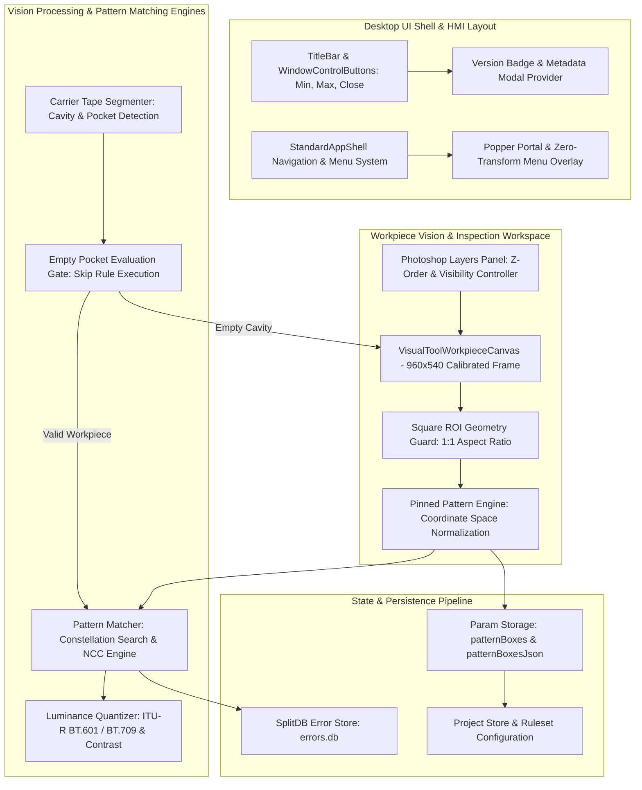
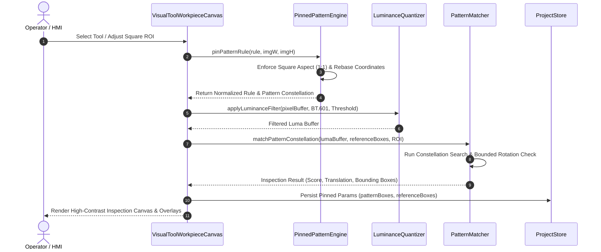
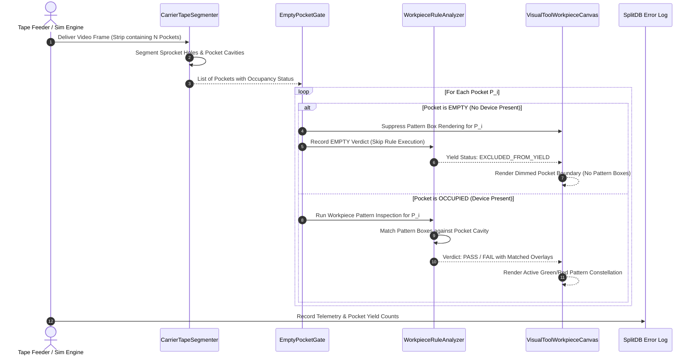

# Architecture Specification: Pattern Search, Carrier Tape Simulation & UI Stabilization Overhaul
# Document Path: 02-spec/21-app/05-pattern-search-and-ui-improvement/01-architecture-spec.md
# Status: Approved Architecture Specification

## 1. Executive Summary & System Context

The **CAT Vision (CAT iVISION)** industrial automation platform performs high-throughput optical inspection for surface-mount technology (SMT), carrier tape component packaging, and discrete semiconductor manufacturing. The inspection core couples high-speed image acquisition with computer vision algorithmic engines that measure device placement, detect missing or rotated parts, inspect lead coplanarity, and verify surface markings (e.g., Atmel/Microchip 24-box constellation marking and IC package pin 1 orientations).

Recent runtime field reports and engineering audits identified systemic architectural divergences following the introduction of the carrier tape simulation pipeline and UI modernization passes:
1. **Geometric Coordinate Drift**: Pattern search regions and template box constellations drift from authored reference frames when scaled across varying display dimensions, causing false-negative inspection verdicts.
2. **Unconstrained Search ROI**: Guided simulation tours initialize inspection regions with unconstrained wide-aspect rectangles (`930x174` px) across the full frame width instead of enforcing a 1:1 square bounding box matching the physical device geometry.
3. **Empty Pocket Ghost Overlays**: The carrier tape simulation renders full pattern template constellations over empty pocket cavities in partial carrier tape strips, corrupting yield calculations.
4. **Luminance and Grayscale Processing Degradation**: Monochromatic transformations exhibit non-uniform luminance weighting, aggressive dynamic range clipping during percentile stretching, and quantization discretization flaws.
5. **Shell Layout & Window Management Glitches**: Navigation dropdowns oscillate during viewport transitions due to conflicting CSS transform stacks over Popper positioning coordinates, and window control actions fail in sandboxed Chromium environments.

This specification codifies the formal architectural contracts, geometric pipelines, data flow topologies, sequence interactions, and UI layout invariants required to guarantee deterministic, sub-millimeter vision inspection across desktop and web environments.

---

## 2. High-Level System Architecture



---

## 3. Coordinate Space Normalization & Pinned Geometry Contract

### 3.1 Three-Tier Coordinate Space Representation

Vision calculations operate across three distinct coordinate spaces:
1. **Natural Frame Space (`W_nat x H_nat`)**: The intrinsic pixel resolution of the hardware camera sensor or reference bitmap (default: `960x540` px in calibrated test suites).
2. **Viewport Display Space (`W_disp x H_disp`)**: The CSS layout dimension of the canvas element rendered on the operator's display screen, governed by container aspect ratio scaling and high-DPI device pixel ratios.
3. **Normalized Unit Space (`[0.0, 1.0]`)**: Dimensionless relative coordinates mapped against either the full frame or the local Search Region of Interest (ROI).

```
+-------------------------------------------------------------------+
| Natural Camera Frame (960 x 540 px)                               |
|                                                                   |
|       +------------------------------------+                      |
|       | Search Region (ROI) [Square 1:1]   |                      |
|       |                                    |                      |
|       |      +-------+       +-------+     |                      |
|       |      | Box 1 |  ...  | Box N |     |                      |
|       |      +-------+       +-------+     |                      |
|       |                                    |                      |
|       +------------------------------------+                      |
+-------------------------------------------------------------------+
```

### 3.2 The Square ROI Contract

Industrial surface-mount devices (QFP, BGA, QFN, SOIC) and carrier tape cavities require isotropic optical evaluation. Unconstrained rectangular search regions distort cross-correlation search kernels and cause directional bias.
- **Contract Rule 1 (Square Invariant)**: For all pattern-search and white-box marking tools, `width === height` is strictly enforced.
- **Contract Rule 2 (Creation Clamping)**: Upon initial creation or interactive reset, the side length `S` is calculated as:
  `S = max(4, min(round(width), round(height)))`
- **Contract Rule 3 (Centering & Bounds Clamping)**:
  `x_clamped = max(0, min(x, W_nat - S))`
  `y_clamped = max(0, min(y, H_nat - S))`

### 3.3 Geometric Rebasing Equation

When an inspection rule authored on frame dimensions `(W_auth, H_auth)` is executed against an image acquired at `(W_nat, H_nat)`, coordinates are transformed via explicit scaling factors:
- `scaleX = W_nat / max(1, W_auth)`
- `scaleY = H_nat / max(1, H_auth)`
- `ROI_rebased = { x: round(x * scaleX), y: round(y * scaleY), width: max(4, round(w * scaleX)), height: max(4, round(h * scaleY)) }`

Every box `B_i` within the pattern constellation is synchronously rebased:
- `B_rebased = { x: round(B.x * scaleX), y: round(B.y * scaleY), width: max(4, round(B.w * scaleX)), height: max(4, round(B.h * scaleY)) }`

### 3.4 Dual-Persistence Schema for Pattern Boxes

To eliminate ambiguity across legacy configurations and modern store reducers, the pattern constellation must be saved symmetrically under both array and serialized JSON properties:
```typescript
interface PatternRuleParams {
  authoredFrameWidth: number;
  authoredFrameHeight: number;
  shapeType: "square";
  searchRegion: SearchRegion;
  searchRegionJson: string;
  patternBoxes: WhiteBoxMark[];
  patternBoxesJson: string;
  referenceBoxes: WhiteBoxMark[];
  referenceBoxesJson: string;
  constellation: WhiteBoxMark[];
  constellationJson: string;
  activeBoxCount: number;
  totalBoxCount: number;
  hasExplicitRoiShift: boolean;
}
```

---

## 4. Carrier Tape Simulation & Inspection Pipelines

### 4.1 Sequence Diagram: Standard Workpiece Inspection

In discrete workpiece inspection, a single stationary part is registered, preprocessed, and matched against the authored pattern constellation:



### 4.2 Sequence Diagram: Carrier Tape Continuous Simulation

In carrier tape simulation, continuous tape strips feed through the inspection window. The segmenter partitions individual cavities, evaluates occupancy, and selectively gates pattern matching:



---

## 5. Pattern Matching Engine Specification

### 5.1 Multi-Stage Pattern Search Architecture

The pattern matching algorithm consists of four distinct stages:
1. **Luminance Normalization**: Convert source RGBA to 8-bit monochromatic luminance using ITU-R BT.601 weighting (`Y = 0.299R + 0.587G + 0.114B`).
2. **Threshold Binarization / Dynamic Contrast**: Apply Otsu or operator-calibrated thresholding to extract foreground mark candidates.
3. **Connected Component Blob Extraction**: Extract 8-connected components within the square search ROI; filter blobs by area, bounding box aspect ratio, and centroid coordinates.
4. **Constellation Alignment & Bounded Rotation Search**:
   - Compute centroid `(Xc, Yc)` of candidate blobs and `(Xr, Yr)` of the reference constellation.
   - For rotation angles `theta in [-theta_max, +theta_max]` in steps of `5 degrees`:
     Apply 2D affine rotation about constellation centroid.
   - Pair rotated reference boxes to nearest candidate centroids using greedy bipartite matching within radius `r_tol`.
   - Select angle `theta*` maximizing match count `M`, then minimizing cumulative Euclidean distance `sum(d_i)`, then minimizing `|theta|`.

---

## 6. UI Shell Layout & Window Management Subsystem

### 6.1 Chromium `--app` Window Control Architecture

Industrial terminals run CAT Vision in Chromium kiosk or application mode (`--app=http://127.0.0.1:port`). In this execution sandbox, standard `window.close()` and OS-level minimize calls are intercepted or blocked:

| Operation | Web Sandbox Restriction | Standard Architecture Resolution |
| :--- | :--- | :--- |
| **Minimize (`—`)** | Browser API prohibits OS minimization | Exit HTML5 Fullscreen if active; display operational guidance toast |
| **Maximize (`▢`)** | Browser API prohibits OS maximize | Toggle document-level HTML5 Fullscreen (`requestFullscreen()` / `exitFullscreen()`) |
| **Close (`✕`)** | `DOMException: Scripts may not close windows...` | Dispatch `POST /shutdown` to backend; supervisor script (`start.ps1`) terminates host processes |

### 6.2 Menu Dropdown Zero-Transform Contract

To eliminate the menu dropdown snapping artifact (where the popup briefly flashes at `(0,0)` top-left):
1. **Tailwind Transform Isolation**: Strip all Tailwind `animate-in`, `slide-in-from-*`, and `zoom-in-*` classes from `DropdownMenuContent`. These classes inject `transform: translateY(...)`, which collides with Radix Popper's computed `transform: translate3d(x, y, 0)`.
2. **Modal Invariant (`modal={false}`)**: Always specify `modal={false}` on top-level navigation dropdowns to prevent pointer-event locks and body scrollbar reflow delays.
3. **Strict Portaling**: Mount `DropdownMenuContent` within `DropdownMenuPrimitive.Portal` directly to the `document.body` to avoid clipping against parent `overflow-hidden` containers.

---

## 7. Photoshop Layers Panel Architecture

The inspection canvas renders overlay components in discrete, selectable z-order layers:

```
+--------------------------------------------------------------+
| Layer Z3: Pattern Search Constellation (Boxes, Labels, ROIs) |
+--------------------------------------------------------------+
| Layer Z2: Pocket & Sprocket Segmentation Overlay             |
+--------------------------------------------------------------+
| Layer Z1: Dynamic Contrast / Binary Luminance Shader Mask    |
+--------------------------------------------------------------+
| Layer Z0: Base Image Frame (Hardware Sensor Bitmap)          |
+--------------------------------------------------------------+
```

### 7.1 Layer Reordering & Directional Invariants
- Visual display stacks top-most layers at the top of the UI panel (index 0 = top of visual list).
- Canvas rendering draws from bottom to top (layer with lowest z-index drawn first).
- **Move Up**: Decrements visual array index (brings element toward top of stack), increasing its rendering precedence.
- **Move Down**: Increments visual array index (sends element toward bottom of stack), decreasing rendering precedence.
- **ROI Lock Default**: By default, `isRoiLocked` is initialized to `true` to protect calibrated inspection regions from accidental operator mouse drags. Double-clicking or toggling the padlock icon unlocks the handles.

---

## 8. Version Synchronization & Startup Verification

1. **Version Badge Invariant**: The HMI TitleBar and the `/run` route header must continuously query and display `APP_VERSION_INFO.version` from `src/lib/version-info.ts` (synchronized with `version.json`).
2. **Browser Launch Discipline**: Startup scripts (`run.ps1` and `run.sh`) must verify whether an instance of Chromium or the application shell is already active before executing browser spawn commands, preventing redundant tab launches.
3. **Cold Start Pre-Warming**: The `/setup` route must pre-warm its component tree and lazy-loaded WASM/vision dependencies during initial app bootstrap to guarantee sub-500ms route transitions.
