# Specification: 100 Concrete System and UI Improvements for CAT-iVISION

**Module:** Pattern Search and UI Improvement  
**Specification File:** `02-spec/21-app/05-pattern-search-and-ui-improvement/03-100-system-and-ui-improvements-spec.md`  
**Status:** Approved for Implementation  
**Version:** 1.0.0  
**Target Platform:** CAT-iVISION Industrial Machine Vision & SMT Semiconductor Inspection System  

---

## 1. Executive Summary & Architectural Scope

This specification establishes an exhaustive, grounded catalog of exactly **100 concrete, high-impact system and user interface improvements** for the CAT-iVISION machine vision platform. These improvements directly address operational bottlenecks, usability defects, cleanroom ergonomics, algorithm-tuning friction, and desktop shell resilience identified across industrial deployments (including high-speed ICOS, carrier tape reel inspection, SMD chip packaging, and BGA/QFP semiconductor inspection).

### 1.1 Core Engineering Principles

Every improvement in this catalog is strictly designed around the following architectural invariants:
1. **Zero Unintended Mutations**: Vision regions, layers, and configuration parameters must maintain strict immutability contracts. Accidental canvas clicks must never alter, destroy, or jump existing geometries.
2. **Kiosk-Grade Shell Stability**: In industrial `--app` mode, window controls, process supervision, exit gates, and full-screen states must behave predictably, cleanly releasing hardware camera locks without zombie processes.
3. **Ergonomic Industrial Touch & Gloved HMI**: Touch targets must satisfy minimum 48px/56px bounding boxes, high-contrast visual hierarchies (WCAG 2.1 AAA compliance), and tactile audio-visual alert mechanics.
4. **Clean Layered Architecture & Relative Path Hygiene**: All referenced files and subsystems strictly utilize relative Git paths. Zero absolute paths or host-specific paths are permitted.
5. **Strict Coding Guidelines Compliance**: Exclusively positive boolean framing (`is*`, `has*`), parameter structs for multi-argument methods, vertical line spacing, and structured AppError handling.

---

## 2. Master Category Breakdown

The 100 improvements are divided equally across 10 mission-critical domains (10 improvements per category):

| Category | Domain | ID Range | Target Focus |
| :---: | :--- | :---: | :--- |
| **1** | Desktop Shell & Window Management | `SYS-UI-001` – `SYS-UI-010` | `--app` mode, minimize/maximize, window bounds, kiosk security, process exit |
| **2** | Menu, Navigation & Dropdown Systems | `SYS-UI-011` – `SYS-UI-020` | Zero-delay menubars, help modal isolation, mnemonics, command palette, run-locks |
| **3** | Canvas Viewport, Zoom, Pan & In-Canvas Controls | `SYS-UI-021` – `SYS-UI-030` | Focal-point zoom, spacebar panning, minimap, sub-pixel rendering, caliper tools |
| **4** | Photoshop-Style Layer Panel & Hierarchy Ergonomics | `SYS-UI-031` – `SYS-UI-040` | Drag-and-drop z-ordering, Layer 1 ROI locking, multi-select, opacity blending, solo mode |
| **5** | Run Screen & HMI Industrial Monitor Ergonomics | `SYS-UI-041` – `SYS-UI-050` | 56px touch targets, glare-resistant contrast, real-time PPM, NG audio/visual alarms |
| **6** | Script Toolchain, Startup Speed & Dev/Operator Runners | `SYS-UI-051` – `SYS-UI-060` | Single-instance checks, <3s startup, port cleaner, offline mode, desktop shortcuts |
| **7** | Telemetry, Observability & Error Diagnostic Feedback | `SYS-UI-061` – `SYS-UI-070` | Unhandled rejection traps, diagnostic zip bundles, ring-buffer logging, stream watchdogs |
| **8** | Carrier Tape Simulation & Strobe Flash Realism | `SYS-UI-071` – `SYS-UI-080` | EIA-481 conveyor physics, strobe specular falloff, sprocket tracking, defect generation |
| **9** | Visual Polish, Theme Tokens, Typography & WCAG Contrast | `SYS-UI-081` – `SYS-UI-090` | 7:1 contrast ratios, monospace tabular numerals, GPU layer promotion, density modes |
| **10** | Multi-Camera, Resolution Mismatch & Preset Switching | `SYS-UI-091` – `SYS-UI-100` | Aspect ratio lock, dual-camera synchronization, zero-stall presets, hot-plugging |

---

## 3. Enumerated Specification Catalog (SYS-UI-001 to SYS-UI-100)

### Category 1: Desktop Shell & Window Management (Improvements 001–010)

#### SYS-UI-001: Seamless Browser `--app` Mode Minimize via Native Bridge & Electron/Tauri Fallback
- **ID:** `SYS-UI-001`
- **Title:** Seamless Browser `--app` Mode Minimize via Native Bridge & Electron/Tauri Fallback
- **Target File / Subsystem:** `src/components/layout/WindowControlButtons.tsx`
- **Problem & Deficiency:** In Chromium `--app` mode (`--app=http://127.0.0.1:5173`), clicking the minimize button currently renders an informational toast ("Minimize is not available in browser mode. Use your operating system window controls...") rather than taking concrete action. Operators on touch kiosks without taskbars or keyboards cannot minimize the application.
- **Proposed Architecture / Implementation Solution:** Enhance `handleMinimize` in `WindowControlButtons.tsx`. First query `resolveDesktopBridge()`. If running in native desktop mode (Electron / Tauri / pywebview), invoke `desktopApi.minimize()`. In web `--app` mode, exit fullscreen mode (`document.exitFullscreen()`), dispatch a custom event `cat-vision:window-minimize-fallback` which sets an in-window minimized floating tray representation, and issue a background call to the backend IPC endpoint `POST /api/window/minimize` leveraging Windows API `ShowWindow(hwnd, SW_MINIMIZE)`.
- **Impact & User Velocity Gain:** Enables factory kiosk operators to quickly minimize the application without keyboard shortcuts or external window managers, eliminating operator confusion.

---

#### SYS-UI-002: Graceful Two-Phase Application Exit with Unsaved Changes Guard & Backend Teardown
- **ID:** `SYS-UI-002`
- **Title:** Graceful Two-Phase Application Exit with Unsaved Changes Guard & Backend Teardown
- **Target File / Subsystem:** `src/components/layout/WindowControlButtons.tsx`
- **Problem & Deficiency:** Clicking the Close (`X`) button triggers an immediate shutdown sequence (`POST /shutdown` followed by `window.close()`). If an engineer has unpersisted rule, shape, or tolerance edits in `useWorkspaceSaveStore`, all unsaved configuration is permanently lost with zero confirmation prompt.
- **Proposed Architecture / Implementation Solution:** Intercept `handleConfirmExit` by reading `useWorkspaceSaveStore.getState().isDirty`. If changes are pending, present a high-contrast industrial modal dialog with three options: "Save and Exit", "Discard and Exit", or "Cancel". When confirmed, execute an orderly drain of pending camera frames via `src/lib/camera/capture-bridge.ts`, issue `POST /shutdown` with a 3000ms AbortController timeout, and cleanly call `window.close()`.
- **Impact & User Velocity Gain:** Eliminates catastrophic loss of complex multi-pin rule setups and prevents dangling backend camera locks upon application termination.

---

#### SYS-UI-003: Frameless Desktop Window Titlebar Drag Region & Double-Click Maximize
- **ID:** `SYS-UI-003`
- **Title:** Frameless Desktop Window Titlebar Drag Region & Double-Click Maximize
- **Target File / Subsystem:** `src/components/hmi/Titlebar.tsx`
- **Problem & Deficiency:** In desktop wrapper configurations, the custom titlebar lacks proper CSS dragging boundaries (`-webkit-app-region: drag`), rendering the window impossible to move across multi-monitor factory consoles, and double-clicking the titlebar does not toggle window maximize/restore.
- **Proposed Architecture / Implementation Solution:** Apply `-webkit-app-region: drag` to the outer container in `Titlebar.tsx`. Decorate all interactive children (menus, buttons, search bars, status icons) with `-webkit-app-region: no-drag` to preserve clickability. Attach an `onDoubleClick` event listener to the neutral titlebar background that dispatches `toggleMaximize()` matching standard operating system window behavior.
- **Impact & User Velocity Gain:** Restores standard operating system desktop ergonomics for dual-monitor workstation installations with zero mouse navigation friction.

---

#### SYS-UI-004: App Version & Git Commit Hash Badge Permanence in Window Titlebar
- **ID:** `SYS-UI-004`
- **Title:** App Version & Git Commit Hash Badge Permanence in Window Titlebar
- **Target File / Subsystem:** `src/components/layout/StandardAppShell.tsx`
- **Problem & Deficiency:** Production operators and maintenance technicians cannot verify the active software release and git commit without navigating away to the About modal, causing delays during shift handovers and quality audit investigations.
- **Proposed Architecture / Implementation Solution:** Ingest `version.json` via `src/lib/version-info.ts` into `StandardAppShell.tsx` and render a permanent, high-contrast monospace badge in the titlebar: `v4.113.9 (commit: #sha)`. Clicking this badge launches `VersionInfoModal.tsx` displaying full release metadata, build timestamp, Python backend status, and active camera driver versions.
- **Impact & User Velocity Gain:** Provides immediate traceability during line-down incidents without interrupting live inspection screens.

---

#### SYS-UI-005: Fullscreen Kiosk Mode Persistence & Auto-Re-entry on Display Reconnect
- **ID:** `SYS-UI-005`
- **Title:** Fullscreen Kiosk Mode Persistence & Auto-Re-entry on Display Reconnect
- **Target File / Subsystem:** `src/components/layout/WindowControlButtons.tsx`
- **Problem & Deficiency:** When industrial display cables experience signal dropouts or operators accidentally tap F11/ESC, the application exits fullscreen mode and exposes the Windows desktop and taskbar, violating cleanroom kiosk security policies.
- **Proposed Architecture / Implementation Solution:** Introduce a Kiosk Lock preference in `src/lib/stores/ui-prefs-store.ts`. When `isKioskLocked: true`, listen to the `fullscreenchange` event; if fullscreen is lost without supervisor PIN authentication, display an on-screen prompt with a 5-second countdown to auto-request fullscreen on the next user interaction, while muting browser toast notifications.
- **Impact & User Velocity Gain:** Prevents unauthorized cleanroom tampering with the underlying OS shell and guarantees an uninterrupted 24/7 dedicated HMI inspection display.

---

#### SYS-UI-006: Dual-Monitor Multi-Window Detachment for Inspection Canvas & Ops Telemetry
- **ID:** `SYS-UI-006`
- **Title:** Dual-Monitor Multi-Window Detachment for Inspection Canvas & Ops Telemetry
- **Target File / Subsystem:** `src/components/layout/StandardAppShell.tsx`
- **Problem & Deficiency:** High-speed vision inspection lines require viewing high-resolution camera feeds simultaneously with real-time pass/fail histograms and reject telemetry. On single 1080p monitors, displaying both views simultaneously results in heavily cramped layouts.
- **Proposed Architecture / Implementation Solution:** Introduce a "Pop-out Ops Console" action in the titlebar that invokes `window.open('/ops?mode=detached', 'cat_ops_window')`. Synchronize application state across windows using `BroadcastChannel('cat-vision:window-sync')`. The primary window hosts the inspection canvas and workpiece editor, while the detached window renders real-time pass/fail charts and defect bin logs.
- **Impact & User Velocity Gain:** Enables dual-screen factory workstation configurations with zero IPC latency and zero layout cramping.

---

#### SYS-UI-007: Display DPI & Resolution Scaling Adaptation with SVG Vector Toolbars
- **ID:** `SYS-UI-007`
- **Title:** Display DPI & Resolution Scaling Adaptation with SVG Vector Toolbars
- **Target File / Subsystem:** `src/components/hmi/HmiShell.tsx`
- **Problem & Deficiency:** On high-density 4K touch displays (3840x2160 @ 150-200% Windows DPI scaling), toolbar icons and buttons render with sub-pixel blurriness and inconsistent hit targets.
- **Proposed Architecture / Implementation Solution:** Define dynamic CSS root clamp variables (`clamp(2rem, 3.5vw, 4rem)`) in `src/styles.css` and convert all raster toolbar assets to pure Lucide SVG vector glyphs. Apply `image-rendering: pixelated` exclusively to raw sensor inspection canvases and crisp vector rendering to all UI controls.
- **Impact & User Velocity Gain:** Delivers razor-sharp UI scaling across both legacy 1280x1024 industrial panels and modern 4K workstation monitors.

---

#### SYS-UI-008: Window State & Docking Layout Auto-Save to LocalStorage / Split SQLite
- **ID:** `SYS-UI-008`
- **Title:** Window State & Docking Layout Auto-Save to LocalStorage / Split SQLite
- **Target File / Subsystem:** `src/lib/workspace/layout-slice.ts`
- **Problem & Deficiency:** Panel widths, collapsed/expanded states, and window dimensions reset to defaults whenever the browser window reloads or restarts, forcing operators to reconfigure their layout every shift.
- **Proposed Architecture / Implementation Solution:** Enhance `useWorkspaceLayoutStore` with a debounced (300ms) persistence middleware that synchronizes docking layouts to `localStorage` key `cat:workspace-layout:v2` and mirrors to SQLite `installation.db` via backend `ops.functions.ts`. Include a "Reset to Factory Default Layout" button in TopMenu.
- **Impact & User Velocity Gain:** Restores exact operator workspace arrangement across app restarts and power cycles without repetitive manual adjustments.

---

#### SYS-UI-009: Anti-Crash Global Error Boundary with In-Window Recovery & State Preservation
- **ID:** `SYS-UI-009`
- **Title:** Anti-Crash Global Error Boundary with In-Window Recovery & State Preservation
- **Target File / Subsystem:** `src/routes/RootErrorBoundary.tsx`
- **Problem & Deficiency:** Unhandled exceptions in canvas rendering or camera drivers crash the entire React DOM tree to a blank white screen, terminating ongoing production runs without error logs.
- **Proposed Architecture / Implementation Solution:** Refactor `RootErrorBoundary.tsx` to isolate sub-component boundaries (Canvas Boundary, Toolbar Boundary, Nav Boundary). If the canvas crashes, isolate the failure to an inline canvas error widget showing the stack trace, capturing an error dump via `useErrorStore`, and offering a "Reload Canvas Subsystem" button without reloading the whole page.
- **Impact & User Velocity Gain:** Guarantees zero unrecoverable white-screen app crashes during live industrial inspection runs.

---

#### SYS-UI-010: Keyboard Focus Lock Trap for Modal Dialogs with Hardware Keyboard & Barcode Scanners
- **ID:** `SYS-UI-010`
- **Title:** Keyboard Focus Lock Trap for Modal Dialogs with Hardware Keyboard & Barcode Scanners
- **Target File / Subsystem:** `src/components/common/DialogFocusTrap.tsx`
- **Problem & Deficiency:** When modal dialogs (e.g., Settings, Recipe Selector) open, pressing Tab can leak focus into background canvas elements, and rapid input from USB barcode scanners triggers unexpected canvas hotkeys.
- **Proposed Architecture / Implementation Solution:** Implement a strict Radix FocusScope trap wrapped in `DialogFocusTrap.tsx` that intercepts all Tab / Shift+Tab cycles, traps focus within the active dialog, and suppresses global canvas hotkeys (`useCanvasViewportKeyboard.ts`) while any dialog or sheet is mounted.
- **Impact & User Velocity Gain:** Prevents catastrophic accidental hotkey triggers during modal interactions and barcode recipe loading.

---

### Category 2: Menu, Navigation & Dropdown Systems (Improvements 011–020)

#### SYS-UI-011: Zero-Delay Menubar Dropdown Opening via Pre-Warmed Radix Portal Stacks
- **ID:** `SYS-UI-011`
- **Title:** Zero-Delay Menubar Dropdown Opening via Pre-Warmed Radix Portal Stacks
- **Target File / Subsystem:** `src/components/nav/TopMenuBar.tsx`
- **Problem & Deficiency:** Clicking menu triggers in `TopMenuBar.tsx` suffers an 80–150ms delay due to lazy DOM instantiation of Radix MenubarContent and route recalculations.
- **Proposed Architecture / Implementation Solution:** Implement pre-warmed hover/focus triggers with `forceMount` optimization and eliminate unnecessary layout re-renders. Use CSS `content-visibility: auto` on inactive menus to eliminate mounting latency while keeping DOM nodes ready for instant (<16ms) opening.
- **Impact & User Velocity Gain:** Menus open instantaneously, matching native desktop Win32/macOS menu responsiveness.

---

#### SYS-UI-012: Elimination of Unnecessary External Browser Spawning on Help & Documentation Clicks
- **ID:** `SYS-UI-012`
- **Title:** Elimination of Unnecessary External Browser Spawning on Help & Documentation Clicks
- **Target File / Subsystem:** `src/components/nav/TopMenuUtils.ts`
- **Problem & Deficiency:** Clicking "Open documentation" executes `window.open("https://docs.ai-memory.dev/", "_blank")`, launching an external Chrome/Edge window and breaking the operator out of the locked `--app` kiosk shell.
- **Proposed Architecture / Implementation Solution:** Replace `window.open` in `openHelpDocs()` with an internal slide-over sheet or modal (`DocumentationSheet.tsx`) that embeds offline Markdown help docs bundled directly within the app assets (`src/assets/docs/`). If external URL navigation is explicitly requested, provide a confirmation prompt.
- **Impact & User Velocity Gain:** Keeps operators strictly inside the kiosk shell without risk of navigating to open internet or losing inspection view.

---

#### SYS-UI-013: Single Active Top-Menu Pill Discipline & Route Path Resolution
- **ID:** `SYS-UI-013`
- **Title:** Single Active Top-Menu Pill Discipline & Route Path Resolution
- **Target File / Subsystem:** `src/components/nav/TopMenuUtils.ts`
- **Problem & Deficiency:** On certain sub-routes (e.g., `/setup/rules`, `/settings/camera`), multiple menu groups highlight simultaneously as active, confusing operators regarding their location in the system hierarchy.
- **Proposed Architecture / Implementation Solution:** Enhance `isGroupActive()` to enforce strict disjoint routing priority. Sort groups by exact path depth matching (`activePaths`), allowing only the most specific matching group to render the active pill styling (`bg-ca-primary/10 text-ca-primary`).
- **Impact & User Velocity Gain:** Clear, unambiguous visual navigation indicating the current location in the application hierarchy.

---

#### SYS-UI-014: Industrial Alt-Mnemonic Keyboard Accelerator Navigation System
- **ID:** `SYS-UI-014`
- **Title:** Industrial Alt-Mnemonic Keyboard Accelerator Navigation System
- **Target File / Subsystem:** `src/components/nav/TopMenuMnemonics.tsx`
- **Problem & Deficiency:** Alt-key navigation (Alt+F for File/Home, Alt+P for Project, Alt+S for Setup, Alt+R for Run) is incomplete and fails to visually underline accelerator letters when Alt is pressed.
- **Proposed Architecture / Implementation Solution:** Implement standard Win32-style mnemonic overlays in `TopMenuMnemonics.tsx`. When the operator taps the Alt key, underline the mnemonic letter in each menu label (`Home`) and register single-key accelerators to open the corresponding menu dropdown.
- **Impact & User Velocity Gain:** Enables lightning-fast keyboard-only navigation for power technicians without mouse or touchscreen.

---

#### SYS-UI-015: Unified Command Palette (Ctrl+K / F1) with Fuzzy Search & Hotkey Cheatsheet
- **ID:** `SYS-UI-015`
- **Title:** Unified Command Palette (Ctrl+K / F1) with Fuzzy Search & Hotkey Cheatsheet
- **Target File / Subsystem:** `src/components/nav/CommandPalette.tsx`
- **Problem & Deficiency:** Complex settings and calibration sub-pages are buried 3-4 levels deep in dropdown menus, slowing down technicians during setup changes.
- **Proposed Architecture / Implementation Solution:** Upgrade `CommandPalette.tsx` with `cmdk` fuzzy search indexing all routes, actions, rules, recipes, and camera controls. Include direct action dispatching (e.g. "Trigger Camera", "Toggle Dark Mode", "Export Inspection Results", "Calibrate Lens").
- **Impact & User Velocity Gain:** Reduces navigation time to any function from 5–10 seconds to under 1 second.

---

#### SYS-UI-016: Run-Lock Protection for Destructive Navigation Actions During Live Inspection
- **ID:** `SYS-UI-016`
- **Title:** Run-Lock Protection for Destructive Navigation Actions During Live Inspection
- **Target File / Subsystem:** `src/components/nav/TopMenuRows.tsx`
- **Problem & Deficiency:** In `TopMenuRows.tsx`, navigation to certain non-setup pages (such as project switching or trial run) is not consistently disabled while `RunStatusType.isRunning(status)` is true, risking accidental abortion of automated manufacturing cycles.
- **Proposed Architecture / Implementation Solution:** Centralize `hasLockedState()` enforcement. Any navigation item with `lockDuringRun: true` or destructive action must render in disabled state with a padlock icon, showing tooltip "Locked while production inspection is running". Attempted navigation triggers an alert toast.
- **Impact & User Velocity Gain:** Eliminates catastrophic accidental line-stoppage caused by stray clicks during production.

---

#### SYS-UI-017: Dynamic Image Source Picker Menu Portaling & Recents Cache
- **ID:** `SYS-UI-017`
- **Title:** Dynamic Image Source Picker Menu Portaling & Recents Cache
- **Target File / Subsystem:** `src/components/vision/workpiece/AnalyzeImageToolbar.tsx`
- **Problem & Deficiency:** The image source dropdown menu renders inline and gets clipped by parent canvas `overflow: hidden` boundaries; also lacks quick access to recently loaded inspection sample images.
- **Proposed Architecture / Implementation Solution:** Portal the source menu dropdown into `document.body` with Radix Popover. Integrate `image-source-recents-store.ts` to display the last 5 inspected image sources (e.g., Live Camera 1, Golden Sample 04, Carrier Tape Sim, Defect Batch BGA-09) with instant switching.
- **Impact & User Velocity Gain:** Effortless image switching with zero menu clipping artifacts across all canvas configurations.

---

#### SYS-UI-018: Touchscreen-Optimized Mobile / Tablet Hamburger Drawer for Floor Tablets
- **ID:** `SYS-UI-018`
- **Title:** Touchscreen-Optimized Mobile / Tablet Hamburger Drawer for Floor Tablets
- **Target File / Subsystem:** `src/components/nav/TopMenuMobile.tsx`
- **Problem & Deficiency:** On factory floor Windows/Android tablets (<1024px width), the navigation bar collapses into a hamburger menu with small, cramped list items that are difficult to press accurately with gloved fingers.
- **Proposed Architecture / Implementation Solution:** Redesign `TopMenuMobile.tsx` as a full-height industrial side-drawer with minimum 56px row height, clear iconography, distinct section headers, and large tactile tap targets with haptic visual feedback (`active:scale-[0.98]`).
- **Impact & User Velocity Gain:** Seamless mobile and tablet operation for line supervisors walking the factory floor.

---

#### SYS-UI-019: Breadcrumb Navigation Trail with One-Click Workspace Jump
- **ID:** `SYS-UI-019`
- **Title:** Breadcrumb Navigation Trail with One-Click Workspace Jump
- **Target File / Subsystem:** `src/lib/breadcrumb-tokens.ts`
- **Problem & Deficiency:** Deeply nested workflows (e.g., Projects > IC Package 14 > Rulesets > Pin 1 Marking > Tolerance Tuning) lack breadcrumb navigation, forcing operators to restart from Home or use browser Back.
- **Proposed Architecture / Implementation Solution:** Implement an interactive Breadcrumb trail component in `SectionTopBar.tsx` driven by `breadcrumb-tokens.ts`. Each segment displays a clickable dropdown showing sibling items (e.g. clicking "Rulesets" shows all rulesets in the active project for instant switching).
- **Impact & User Velocity Gain:** Dramatically reduces click fatigue and cognitive load when managing multi-tier inspection recipes.

---

#### SYS-UI-020: Context-Sensitive Help Popovers with Video / Animated GIF Micro-Guides
- **ID:** `SYS-UI-020`
- **Title:** Context-Sensitive Help Popovers with Video / Animated GIF Micro-Guides
- **Target File / Subsystem:** `src/components/common/HelpTooltip.tsx`
- **Problem & Deficiency:** Complex computer vision parameters (e.g. Bilateral filter spatial sigma, Sobel edge aperture, Cosine similarity threshold) have cryptic labels without inline explanations.
- **Proposed Architecture / Implementation Solution:** Create `HelpTooltip.tsx` supporting rich popovers containing concise 2-sentence technical definitions, recommended parameter ranges for semiconductor packages, and SVG/GIF diagrams illustrating the parameter effect on edge detection or pattern matching.
- **Impact & User Velocity Gain:** Enables junior operators to configure vision algorithms accurately without referencing external manuals.

---

### Category 3: Canvas Viewport, Zoom, Pan & In-Canvas Controls (Improvements 021–030)

#### SYS-UI-021: Focal-Point Cursor Centered Mousewheel Zoom Algorithm
- **ID:** `SYS-UI-021`
- **Title:** Focal-Point Cursor Centered Mousewheel Zoom Algorithm
- **Target File / Subsystem:** `src/components/editor/canvas/CanvasViewport.tsx`
- **Problem & Deficiency:** Mousewheel zoom currently zooms relative to the canvas container origin (0, 0) or viewport center, causing the inspection feature under the operator's mouse cursor to drift rapidly out of view.
- **Proposed Architecture / Implementation Solution:** Refactor `useCanvasViewportZoom.tsx` to compute cursor focal offsets: `newX = cursorX - (cursorX - currentX) * (newScale / currentScale)`. Ensure the exact image pixel under the mouse cursor remains motionless during zoom-in and zoom-out operations.
- **Impact & User Velocity Gain:** Operators can zoom directly into 0.1mm micro-defects with effortless mousewheel precision.

---

#### SYS-UI-022: Spacebar Panning Mode with Dynamic Hand Cursor & Input Immunity
- **ID:** `SYS-UI-022`
- **Title:** Spacebar Panning Mode with Dynamic Hand Cursor & Input Immunity
- **Target File / Subsystem:** `src/components/editor/canvas/useCanvasViewportKeyboard.ts`
- **Problem & Deficiency:** Pressing Spacebar to pan conflicts with typing in text input fields (inserting spaces or panning simultaneously), and releasing Spacebar leaves the cursor stuck in `grabbing` mode.
- **Proposed Architecture / Implementation Solution:** In `useCanvasViewportKeyboard.ts`, ignore Spacebar events when `document.activeElement` is an `HTMLInputElement` or `HTMLTextAreaElement`. When Spacebar is held over the canvas, set `isPanMode: true`, change cursor to `cursor-grab`, switch to `cursor-grabbing` on pointer down, and restore active tool mode cleanly on keyup or window blur.
- **Impact & User Velocity Gain:** Flawless Photoshop-style spacebar panning without corrupted form inputs or stuck cursor glitches.

---

#### SYS-UI-023: Smooth Viewport Pan Inertia & Kinetic Damping
- **ID:** `SYS-UI-023`
- **Title:** Smooth Viewport Pan Inertia & Kinetic Damping
- **Target File / Subsystem:** `src/components/editor/canvas/CanvasViewport.tsx`
- **Problem & Deficiency:** Releasing the mouse during a rapid pan abruptly halts viewport translation, resulting in jarring industrial display motion.
- **Proposed Architecture / Implementation Solution:** Implement kinetic pan physics via `requestAnimationFrame` tracking pointer velocity over the last 3 pointer moves. On release, apply exponential decay damping (`velocity *= 0.92`) until velocity drops below 0.05px/frame, with instant cancellation if pointer down occurs again.
- **Impact & User Velocity Gain:** Silky smooth, organic navigation across massive 20-megapixel sensor images.

---

#### SYS-UI-024: Sub-Pixel Crispness & Anti-Aliasing Control for Pixel-Level Inspection
- **ID:** `SYS-UI-024`
- **Title:** Sub-Pixel Crispness & Anti-Aliasing Control for Pixel-Level Inspection
- **Target File / Subsystem:** `src/components/editor/canvas/CanvasViewportRenderer.ts`
- **Problem & Deficiency:** At extreme zoom levels (>400%), bilinear interpolation blurs individual pixel edges, making it impossible to evaluate single-pixel edge transitions or solder bridge boundaries.
- **Proposed Architecture / Implementation Solution:** Add an "Inspection Pixel Mode" toggle in `CanvasViewportStatusHud.tsx`. When zoom scale > 200%, dynamically apply `image-rendering: pixelated` (or `crisp-edges`) to the image element and canvas context; at normal zoom levels (<200%), retain smooth bilinear filtering to avoid moiré patterns.
- **Impact & User Velocity Gain:** Exact single-pixel defect verification for semiconductor die inspection.

---

#### SYS-UI-025: Quick-Fit Viewport Shortcuts (Fit Window, 100% 1:1 Actual Size, Fill Region)
- **ID:** `SYS-UI-025`
- **Title:** Quick-Fit Viewport Shortcuts (Fit Window, 100% 1:1 Actual Size, Fill Region)
- **Target File / Subsystem:** `src/components/editor/canvas/CanvasViewportZoom.tsx`
- **Problem & Deficiency:** Returning to full overview after inspecting a detail requires repeated manual zooming out, wasting operator time.
- **Proposed Architecture / Implementation Solution:** Bind standard industrial shortcuts: `Ctrl+0` / `Z+F` (Fit to Window with 24px padding), `Ctrl+1` / `Z+1` (100% 1:1 Pixel Mapping), and `Ctrl+2` (Zoom to Selected ROI). Render quick-action buttons directly on the in-canvas zoom pill.
- **Impact & User Velocity Gain:** Instant one-click framing saving hundreds of zoom adjustments per shift.

---

#### SYS-UI-026: Floating In-Canvas HUD Toolbar with Smart Auto-Docking & Transparency on Hover
- **ID:** `SYS-UI-026`
- **Title:** Floating In-Canvas HUD Toolbar with Smart Auto-Docking & Transparency on Hover
- **Target File / Subsystem:** `src/components/editor/canvas/CanvasViewportStatusHud.tsx`
- **Problem & Deficiency:** In-canvas toolbars and status overlays permanently block workpiece corners, forcing operators to pan the workpiece around just to see what is hidden behind the toolbar.
- **Proposed Architecture / Implementation Solution:** Wrap HUD elements in an intelligent dock container. When the mouse pointer hovers within 40px of the HUD or when an active ROI handle is dragged beneath it, fade HUD opacity to 15% (`transition: opacity 150ms`) or auto-flip the HUD to the opposing corner of the canvas.
- **Impact & User Velocity Gain:** 100% unobstructed view of all inspection areas regardless of workpiece positioning.

---

#### SYS-UI-027: Interactive Minimap Viewport Navigator with Gigapixel Sensor Overview
- **ID:** `SYS-UI-027`
- **Title:** Interactive Minimap Viewport Navigator with Gigapixel Sensor Overview
- **Target File / Subsystem:** `src/components/editor/canvas/CanvasMinimap.tsx`
- **Problem & Deficiency:** When zoomed in to 800% on a 5000x4000 sensor feed, operators lose spatial awareness of which chip pin or die corner they are examining.
- **Proposed Architecture / Implementation Solution:** Create `CanvasMinimap.tsx` rendering a high-performance 160x120px thumbnail in the bottom-right corner. Overlay a semi-transparent red rectangle representing the current viewport bounds; dragging the red rectangle on the minimap smoothly pans the main canvas.
- **Impact & User Velocity Gain:** Immediate spatial context and effortless long-distance navigation across large workpiece images.

---

#### SYS-UI-028: Real-Time Sensor Coordinate & Color Sampler HUD (X, Y, RGB, Grayscale Luminance)
- **ID:** `SYS-UI-028`
- **Title:** Real-Time Sensor Coordinate & Color Sampler HUD (X, Y, RGB, Grayscale Luminance)
- **Target File / Subsystem:** `src/components/editor/canvas/CanvasViewportStatusHud.tsx`
- **Problem & Deficiency:** Vision engineers adjusting threshold parameters have no way to inspect the raw RGB or Grayscale values of specific pixels under the pointer.
- **Proposed Architecture / Implementation Solution:** Embed a live pixel inspector in the canvas status bar displaying: `X: 1420px, Y: 890px | RGB: [184, 186, 190] | Gray: 185 (BT.601)`. Include a tiny 5x5 magnified pixel grid showing surrounding intensity values.
- **Impact & User Velocity Gain:** Eliminates guesswork when setting binarization thresholds and pattern match tolerances.

---

#### SYS-UI-029: Precision In-Canvas Measurement Caliper Tool (Point-to-Point & Edge-to-Edge)
- **ID:** `SYS-UI-029`
- **Title:** Precision In-Canvas Measurement Caliper Tool (Point-to-Point & Edge-to-Edge)
- **Target File / Subsystem:** `src/components/editor/canvas/CanvasMeasurementCaliper.tsx`
- **Problem & Deficiency:** Verifying physical dimensions (e.g. pin pitch, package width in microns or pixels) requires saving the image and opening third-party tools.
- **Proposed Architecture / Implementation Solution:** Introduce a Caliper Tool (Hotkey: `M`) allowing operators to click two points on the canvas to render a dimension line with pixel distance, calibrated metric distance (based on lens mm/px factor), and angle in degrees.
- **Impact & User Velocity Gain:** Instant dimensional verification directly on the live inspection canvas.

---

#### SYS-UI-030: Multi-Touch Gestures for Pinch-to-Zoom & Two-Finger Pan on Industrial Touchscreens
- **ID:** `SYS-UI-030`
- **Title:** Multi-Touch Gestures for Pinch-to-Zoom & Two-Finger Pan on Industrial Touchscreens
- **Target File / Subsystem:** `src/components/editor/canvas/useCanvasViewportDragDrop.ts`
- **Problem & Deficiency:** On industrial all-in-one touch panel PCs, multi-touch pinch and two-finger drag gestures are unrecognized, treating all touches as single-click drawing actions.
- **Proposed Architecture / Implementation Solution:** Implement native PointerEvent touch tracking in `useCanvasViewportDragDrop.ts`. Track active pointer IDs in a Map; when pointer count == 2, calculate Euclidean distance for smooth pinch-to-zoom and center-point delta for two-finger pan, while completely disabling shape drawing until touches release.
- **Impact & User Velocity Gain:** Intuitive, tablet-grade touch navigation on the factory floor without peripherals.

---

### Category 4: Photoshop-Style Layer Panel & Hierarchy Ergonomics (Improvements 031–040)

#### SYS-UI-031: True Drag-and-Drop Layer Reordering with Real-Time Z-Index Canvas Synchronization
- **ID:** `SYS-UI-031`
- **Title:** True Drag-and-Drop Layer Reordering with Real-Time Z-Index Canvas Synchronization
- **Target File / Subsystem:** `src/components/vision/workpiece/VisionLayersPanel.tsx`
- **Problem & Deficiency:** Dragging layer rows in `VisionLayersPanel.tsx` updates the visual list state temporarily, but fails to synchronize the underlying rule evaluation order or canvas SVG rendering z-index.
- **Proposed Architecture / Implementation Solution:** Integrate `@dnd-kit/core` with `useSensors` in `VisionLayersPanel.tsx`. On `onDragEnd`, recalculate the array order, update `rule.params.layers`, synchronize the SVG canvas render stack, and persist the new order to the workspace store.
- **Impact & User Velocity Gain:** Complete control over inspection layer precedence and visual stacking order.

---

#### SYS-UI-032: Mandatory Lock-by-Default on Primary Search ROI (Layer 1)
- **ID:** `SYS-UI-032`
- **Title:** Mandatory Lock-by-Default on Primary Search ROI (Layer 1)
- **Target File / Subsystem:** `src/components/vision/workpiece/VisualToolWorkpieceCanvas.tsx`
- **Problem & Deficiency:** Operators tuning small child pattern regions frequently click near the edge of the large primary Search ROI, inadvertently dragging or resizing it and invalidating the entire recipe.
- **Proposed Architecture / Implementation Solution:** In `VisualToolWorkpieceCanvas.tsx`, initialize Layer 1 (Search ROI) with `isLocked: true`. Display a distinct padlock badge. Clicks on a locked layer are pass-through to underlying tools or select child regions. Unlocking requires an explicit click on the layer lock icon or pressing `Ctrl+L`.
- **Impact & User Velocity Gain:** Prevents accidental corruption of master coordinate frames during recipe tuning.

---

#### SYS-UI-033: Multi-Layer Selection (Shift+Click / Ctrl+Click) for Batch Lock & Visibility Actions
- **ID:** `SYS-UI-033`
- **Title:** Multi-Layer Selection (Shift+Click / Ctrl+Click) for Batch Lock & Visibility Actions
- **Target File / Subsystem:** `src/components/editor/layers/LayersPanel.tsx`
- **Problem & Deficiency:** When an inspection recipe contains 20+ pin markers, hiding or locking them requires clicking 20 individual eye or lock icons one by one.
- **Proposed Architecture / Implementation Solution:** Support standard multi-selection in `LayersPanel.tsx` via `selectedLayerIds: Set<string>`. Allow Shift+Click range selection and Ctrl+Click toggling. Clicking the header eye/lock icon applies the action to all selected layers simultaneously.
- **Impact & User Velocity Gain:** Saves up to 90% of layer management time on high-pin-count semiconductor packages.

---

#### SYS-UI-034: Inline Layer Renaming with Duplicate Name Validation & Escape Cancellation
- **ID:** `SYS-UI-034`
- **Title:** Inline Layer Renaming with Duplicate Name Validation & Escape Cancellation
- **Target File / Subsystem:** `src/components/editor/layers/LayerRow.tsx`
- **Problem & Deficiency:** Layer names default to generic labels ("Layer 1", "Rectangle 2") and cannot be renamed inline, making complex recipes confusing.
- **Proposed Architecture / Implementation Solution:** Double-clicking the layer title in `LayerRow.tsx` mounts a high-contrast inline text input. Validate that the name is non-empty and unique within the recipe. Pressing Enter commits the rename; pressing Escape reverts to previous name without side effects.
- **Impact & User Velocity Gain:** Clear semantic labeling (e.g. "Pin 1 Dimple", "IC Package Body", "Lead Coplanarity Zone").

---

#### SYS-UI-035: Semantic Color Tagging for Inspection Tiers (Crimson, Emerald, Amber, Cyan)
- **ID:** `SYS-UI-035`
- **Title:** Semantic Color Tagging for Inspection Tiers (Crimson, Emerald, Amber, Cyan)
- **Target File / Subsystem:** `src/components/vision/workpiece/VisionLayersPanel.tsx`
- **Problem & Deficiency:** All layers share identical monochromatic styling in the panel, failing to reflect the physical canvas overlay colors.
- **Proposed Architecture / Implementation Solution:** Associate each layer category with a standardized semantic color tag:
  - Primary Search ROI: Crimson Red (`#ef4444`)
  - Pattern Search Region: Emerald Green (`#10b981`)
  - Keep-out Mask Overlay: Amber Warning (`#f59e0b`)
  - Measurement Reference: Cyan (`#06b6d4`)
  Render a crisp 4px vertical color swatch on the left edge of each layer row and match the canvas stroke color.
- **Impact & User Velocity Gain:** Instant visual correspondence between the layer panel and canvas geometries.

---

#### SYS-UI-036: Per-Layer Opacity Alpha Blending Slider for Mask & Overlay Inspection
- **ID:** `SYS-UI-036`
- **Title:** Per-Layer Opacity Alpha Blending Slider for Mask & Overlay Inspection
- **Target File / Subsystem:** `src/components/vision/workpiece/VisionLayersPanel.tsx`
- **Problem & Deficiency:** Opaque mask overlays hide the underlying sensor pixels, preventing operators from seeing whether a keep-out mask accurately covers PCB solder traces.
- **Proposed Architecture / Implementation Solution:** Add an opacity slider (0% to 100% in 5% increments) to each layer row in `VisionLayersPanel.tsx`. Bind this value to the SVG fill-opacity / stroke-opacity of the corresponding canvas overlay element.
- **Impact & User Velocity Gain:** Flawless alignment verification of mask boundaries against complex circuit textures.

---

#### SYS-UI-037: Real-Time Layer Search & Type Filter Bar for High-Density IC Packages
- **ID:** `SYS-UI-037`
- **Title:** Real-Time Layer Search & Type Filter Bar for High-Density IC Packages
- **Target File / Subsystem:** `src/components/vision/workpiece/InspectionHierarchyTree.tsx`
- **Problem & Deficiency:** Finding a specific pin or measurement marker in a 64-pin QFP or 256-ball BGA inspection tree requires tedious scrolling through long lists.
- **Proposed Architecture / Implementation Solution:** Embed a compact search input at the top of `InspectionHierarchyTree.tsx` with filter pills: `All`, `ROIs`, `Patterns`, `Masks`, `Pins`. As the operator types, instantly filter the tree with highlighted search matches.
- **Impact & User Velocity Gain:** Instant lookup of any inspection element within seconds.

---

#### SYS-UI-038: Persistent Hierarchy Collapse/Expand Tree State Across Route Navigation
- **ID:** `SYS-UI-038`
- **Title:** Persistent Hierarchy Collapse/Expand Tree State Across Route Navigation
- **Target File / Subsystem:** `src/components/vision/workpiece/InspectionHierarchyTree.tsx`
- **Problem & Deficiency:** Navigating between tabs (e.g. from Canvas to Settings and back) forces all tree folders to collapse or expand to default state, losing operator context.
- **Proposed Architecture / Implementation Solution:** Persist `expandedNodeIds: Set<string>` in `useUiPrefsStore`. When the component mounts, restore previous expansion states exactly.
- **Impact & User Velocity Gain:** Seamless, non-disruptive navigation across configuration workflows.

---

#### SYS-UI-039: One-Click Layer Duplication with Automatic Cartesian Offset
- **ID:** `SYS-UI-039`
- **Title:** One-Click Layer Duplication with Automatic Cartesian Offset
- **Target File / Subsystem:** `src/components/editor/layers/LayersToolbar.tsx`
- **Problem & Deficiency:** Creating repetitive inspection shapes (e.g., 16 identical solder pad rectangles) requires manually drawing each rectangle from scratch.
- **Proposed Architecture / Implementation Solution:** Add a "Duplicate Layer" button and shortcut (`Ctrl+D`). Duplicating a layer clones all geometry, threshold parameters, and tolerances, automatically offsetting the new shape by +20px X and +20px Y on the canvas and appending ` (Copy)` to the name.
- **Impact & User Velocity Gain:** Accelerates multi-pin recipe creation by up to 500%.

---

#### SYS-UI-040: Solo Mode Inspection Isolation (Alt+Click Eye Icon)
- **ID:** `SYS-UI-040`
- **Title:** Solo Mode Inspection Isolation (Alt+Click Eye Icon)
- **Target File / Subsystem:** `src/components/editor/layers/LayerRow.tsx`
- **Problem & Deficiency:** In dense inspection setups with overlapping masks and fiducials, evaluating a single tool requires manually clicking the eye icon of every other layer to hide them.
- **Proposed Architecture / Implementation Solution:** Implement Photoshop-style Solo Mode. Alt+Clicking the visibility eye icon of any layer isolates that layer (keeping it visible while hiding all others); Alt+Clicking it again restores the previous visibility states of all layers.
- **Impact & User Velocity Gain:** Immediate focus on individual defect criteria without clutter or destroyed visibility settings.

---

### Category 5: Run Screen & HMI Industrial Monitor Ergonomics (Improvements 041–050)

#### SYS-UI-041: Factory Gloved Touch Target Optimization (Minimum 48px/56px Touch Zones)
- **ID:** `SYS-UI-041`
- **Title:** Factory Gloved Touch Target Optimization (Minimum 48px/56px Touch Zones)
- **Target File / Subsystem:** `src/components/hmi/HmiShell.tsx`
- **Problem & Deficiency:** Critical run buttons, toggles, and drawer handles have compact 28–32px hitboxes, causing frequent missed taps by operators wearing cleanroom or ESD rubber gloves.
- **Proposed Architecture / Implementation Solution:** Introduce a CSS variable `--hmi-touch-target: 56px` applied to all primary controls in `HmiShell.tsx`, `RunButton.tsx`, and `StatusBar.tsx`. Ensure all interactive buttons maintain minimum 48x48px bounding boxes with generous 8px spacing margins.
- **Impact & User Velocity Gain:** Zero missed button presses in cleanroom environments, enhancing operator ergonomics and safety.

---

#### SYS-UI-042: Glare-Resistant High-Contrast Industrial Display Mode for Factory Lighting
- **ID:** `SYS-UI-042`
- **Title:** Glare-Resistant High-Contrast Industrial Display Mode for Factory Lighting
- **Target File / Subsystem:** `src/components/hmi/ModeHeader.tsx`
- **Problem & Deficiency:** Factory floor overhead fluorescent and high-bay LED lighting creates severe screen reflections, washing out subtle gray tones and low-contrast UI badges.
- **Proposed Architecture / Implementation Solution:** Implement an "Industrial High-Contrast" theme toggle in `ModeHeader.tsx`. When active, increase border widths to 2px solid `#ffffff`, elevate text colors to `#ffffff` / `#000000`, boost pass/fail badge vibrancy, and remove subtle dark-gray gradients in favor of flat deep black backgrounds.
- **Impact & User Velocity Gain:** Unrivaled readability from distances up to 3 meters under intense industrial lighting.

---

#### SYS-UI-043: Real-Time PPM (Parts Per Minute) & Velocity Tachometer Gauge
- **ID:** `SYS-UI-043`
- **Title:** Real-Time PPM (Parts Per Minute) & Velocity Tachometer Gauge
- **Target File / Subsystem:** `src/components/hmi/Counter.tsx`
- **Problem & Deficiency:** The run screen displays total counts (Total, Pass, Fail) but lacks production rate velocity (PPM), preventing operators from detecting feeder conveyor bottlenecks.
- **Proposed Architecture / Implementation Solution:** Implement a rolling 60-second window PPM calculator in `src/lib/stores/run-store.ts`. Render a sleek tachometer/odometer widget in `Counter.tsx` displaying current speed (e.g. `120 PPM`), target speed, and throughput efficiency percentage.
- **Impact & User Velocity Gain:** Real-time visibility into machine output and line cycle efficiency.

---

#### SYS-UI-044: Shift Yield Analytics & Automatic Shift-Change Reset Automation
- **ID:** `SYS-UI-044`
- **Title:** Shift Yield Analytics & Automatic Shift-Change Reset Automation
- **Target File / Subsystem:** `src/components/hmi/Counter.tsx`
- **Problem & Deficiency:** Yield percentages must be manually reset at shift changes (e.g. 06:00, 14:00, 22:00); forgetting to reset leads to corrupted shift reporting data.
- **Proposed Architecture / Implementation Solution:** Add shift scheduling configuration in `settings.tsx`. Automatically archive the completed shift's statistics to SQLite `installation.db` and reset counters to zero at scheduled shift boundaries, providing an on-screen toast confirmation and shift summary report.
- **Impact & User Velocity Gain:** 100% accurate shift-level quality metrics without manual intervention.

---

#### SYS-UI-045: Audio/Visual Buzzer & Strobe Banner Alerts for NG (No-Good) Events
- **ID:** `SYS-UI-045`
- **Title:** Audio/Visual Buzzer & Strobe Banner Alerts for NG (No-Good) Events
- **Target File / Subsystem:** `src/components/hmi/RunErrorDrawer.tsx`
- **Problem & Deficiency:** When a part fails inspection (NG), only a quiet badge changes color; operators looking away at the physical conveyor fail to notice the defect immediately.
- **Proposed Architecture / Implementation Solution:** Integrate Web Audio API synthetic industrial chime (configurable pitch and repetition) and a full-screen peripheral red strobe flash border (`animation: flash-red 500ms ease-in-out 3`). Include an instant "Mute Buzzer" button with hardware shortcut (`F9`).
- **Impact & User Velocity Gain:** Immediate operator notification preventing defective batches from proceeding down the SMT line.

---

#### SYS-UI-046: Industrial Kiosk Lock Mode with Secure Operator PIN Authentication
- **ID:** `SYS-UI-046`
- **Title:** Industrial Kiosk Lock Mode with Secure Operator PIN Authentication
- **Target File / Subsystem:** `src/components/layout/StandardAppShell.tsx`
- **Problem & Deficiency:** Unauthorized line personnel can navigate into engineering setup menus and alter camera exposure or tolerances during live production.
- **Proposed Architecture / Implementation Solution:** Implement Role-Based Access Control (RBAC) in `StandardAppShell.tsx` with three tiers: Operator, Technician, Engineer. In Operator Mode, all navigation menus except the Run Screen are locked. Unlocking requires entering a 4-digit PIN via a cleanroom-friendly on-screen numeric keypad.
- **Impact & User Velocity Gain:** Guarantees recipe integrity and prevents accidental or unauthorized parameter drift.

---

#### SYS-UI-047: Tactile High-Visibility Emergency Stop / Abort Run Button with Confirm Gate
- **ID:** `SYS-UI-047`
- **Title:** Tactile High-Visibility Emergency Stop / Abort Run Button with Confirm Gate
- **Target File / Subsystem:** `src/components/hmi/RunButton.tsx`
- **Problem & Deficiency:** Pausing or stopping a runaway run currently uses a small standard button, making rapid stopping difficult in urgent situations.
- **Proposed Architecture / Implementation Solution:** Redesign `RunButton.tsx` with dual visual states: a massive 64px emerald "START INSPECTION" button and a prominent crimson "ABORT / E-STOP" button with diagonal hazard stripes. Pressing E-STOP immediately sends abort signals to camera and backend capture pipelines within <5ms.
- **Impact & User Velocity Gain:** Unambiguous machine control and rapid intervention capability during hardware jams.

---

#### SYS-UI-048: Real-Time Frame Drop & Camera Hardware Buffer Overrun Alarms
- **ID:** `SYS-UI-048`
- **Title:** Real-Time Frame Drop & Camera Hardware Buffer Overrun Alarms
- **Target File / Subsystem:** `src/components/hmi/StatusBar.tsx`
- **Problem & Deficiency:** When IPC USB bus or PCIe throughput drops, camera frames drop silently, causing uninspected parts to pass unrecorded.
- **Proposed Architecture / Implementation Solution:** Monitor camera frame sequencing counters in `src/lib/camera/live-capture.ts`. If `expectedFrameId !== receivedFrameId`, increment a "Dropped Frames" counter and trigger an amber status warning in `StatusBar.tsx`: `FRAME DROP DETECTED: 3 frames lost`.
- **Impact & User Velocity Gain:** Immediate warning of hardware throughput degradation before production quality is compromised.

---

#### SYS-UI-049: Inspection Latency Breakdown Histogram (Capture, Transfer, Inference, Output)
- **ID:** `SYS-UI-049`
- **Title:** Inspection Latency Breakdown Histogram (Capture, Transfer, Inference, Output)
- **Target File / Subsystem:** `src/components/hmi/RunHistorySidebar.tsx`
- **Problem & Deficiency:** When line cycle time slows down, engineers cannot diagnose whether the delay originates in camera exposure, image transfer, or AI pattern matching algorithms.
- **Proposed Architecture / Implementation Solution:** Add an expandable latency waterfall in `RunHistorySidebar.tsx` breaking down cycle time per frame:
  - Sensor Exposure & Strobe: 12ms
  - GigE / USB3 Transfer: 18ms
  - Image Preprocessing (BT.601 Gray): 4ms
  - Pattern Matching / Rule Check: 21ms
  - Total Latency: 55ms (<75ms budget)
- **Impact & User Velocity Gain:** Pinpoint diagnostic capability for cycle-time optimization and bottleneck elimination.

---

#### SYS-UI-050: Permanent High-Visibility Version, Recipe & Camera Profile Footer
- **ID:** `SYS-UI-050`
- **Title:** Permanent High-Visibility Version, Recipe & Camera Profile Footer
- **Target File / Subsystem:** `src/components/hmi/StatusBar.tsx`
- **Problem & Deficiency:** Quality audit compliance requires visible display of the active Recipe Name, Recipe Revision, and Vision Engine Version on the primary inspection monitor.
- **Proposed Architecture / Implementation Solution:** Render a fixed three-part metadata footer in `StatusBar.tsx`:
  - Left: `App: v4.113.9` | `Engine: v1.4.2`
  - Center: `Recipe: SOP-16-TAPE-REV3` (Locked)
  - Right: `Camera 1: Basler acA2440-75uc` (Online - 75 FPS)
- **Impact & User Velocity Gain:** 100% ISO/IATF 16949 audit compliance for electronic manufacturing records.

---

### Category 6: Script Toolchain, Startup Speed & Dev/Operator Runners (Improvements 051–060)

#### SYS-UI-051: Elimination of Redundant Browser Windows on `run.ps1` Rerun
- **ID:** `SYS-UI-051`
- **Title:** Elimination of Redundant Browser Windows on `run.ps1` Rerun
- **Target File / Subsystem:** `run.ps1`
- **Problem & Deficiency:** Running `run.ps1` while the application is already open launches a second browser window, wasting memory and causing port contention.
- **Proposed Architecture / Implementation Solution:** Enhance Win32 process inspection in `run.ps1` to query `Win32_Process` for existing Chrome/Edge processes running with matching `--app` argument. If detected, focus the existing window via PowerShell `[AppActivate]` and skip spawning a redundant browser instance.
- **Impact & User Velocity Gain:** Clean single-instance application lifecycle management.

---

#### SYS-UI-052: 3-Second Cold Startup Acceleration via Pre-Compiled Vite & Python Bytecode Cache
- **ID:** `SYS-UI-052`
- **Title:** 3-Second Cold Startup Acceleration via Pre-Compiled Vite & Python Bytecode Cache
- **Target File / Subsystem:** `run.ps1`
- **Problem & Deficiency:** Cold startup of `run.ps1` takes 20–35 seconds due to uncached Python dependency resolution and cold Vite bundle scanning.
- **Proposed Architecture / Implementation Solution:** In `run.ps1`, configure persistent `.uv-cache` and set `PYTHONPYCACHEPREFIX` to local SSD scratch directory. Add `--mode production` launch mode for operators running pre-built bundles from `dist/`, bypassing Vite development compilation entirely.
- **Impact & User Velocity Gain:** Cuts operator startup time from 30s to under 3s on industrial PCs.

---

#### SYS-UI-053: Auto-Healing Port Conflict & Orphan Process Cleanup
- **ID:** `SYS-UI-053`
- **Title:** Auto-Healing Port Conflict & Orphan Process Cleanup
- **Target File / Subsystem:** `scripts/dev/port-cleaner.ps1`
- **Problem & Deficiency:** When `run.ps1` crashes or is forcefully terminated, orphaned `python.exe` or `node.exe` processes hold ports 8787 and 5173, blocking subsequent runs with `EADDRINUSE`.
- **Proposed Architecture / Implementation Solution:** Create `scripts/dev/port-cleaner.ps1` invoked automatically at the beginning of `run.ps1` and `run.sh`. Probe ports 8787 and 5173 via `Get-NetTCPConnection`; if occupied by an orphaned process from a previous workspace run, terminate the PID gracefully and proceed without manual task manager intervention.
- **Impact & User Velocity Gain:** Eliminates the #1 source of developer and operator startup failures.

---

#### SYS-UI-054: Strict Parity Between `run.ps1` (Windows) and `run.sh` (Linux/macOS)
- **ID:** `SYS-UI-054`
- **Title:** Strict Parity Between `run.ps1` (Windows) and `run.sh` (Linux/macOS)
- **Target File / Subsystem:** `run.sh`
- **Problem & Deficiency:** `run.sh` lacks several advanced features added to `run.ps1` (e.g. Chrome path fallback, `--app` single-instance check, and UV cache directory configuration).
- **Proposed Architecture / Implementation Solution:** Synchronize `run.sh` with `run.ps1`. Implement equivalent `lsof`/`fuser` port checking, POSIX single-instance check, Chromium/Google Chrome path discovery across `/usr/bin/google-chrome`, `/usr/bin/chromium-browser`, and macOS `/Applications/Google Chrome.app`.
- **Impact & User Velocity Gain:** Flawless cross-platform developer velocity across Windows, Linux IPCs, and macOS workstations.

---

#### SYS-UI-055: Headless Clean Graceful Daemon Teardown via Process Tree PID Tracking
- **ID:** `SYS-UI-055`
- **Title:** Headless Clean Graceful Daemon Teardown via Process Tree PID Tracking
- **Target File / Subsystem:** `run.ps1`
- **Problem & Deficiency:** Pressing Ctrl+C in `run.ps1` often leaves child uvicorn worker threads running in the background, consuming CPU resources.
- **Proposed Architecture / Implementation Solution:** Implement robust Windows Job Object or parent-child PID hierarchy tracking in `run.ps1`. In the `finally` block, recursively enumerate child process IDs (`Get-CimInstance Win32_Process | Where-Object { $_.ParentProcessId -eq $job.Id }`) and kill all descendants cleanly.
- **Impact & User Velocity Gain:** 100% clean process exit with zero lingering background zombies.

---

#### SYS-UI-056: Offline Air-Gapped Factory Floor Startup Mode
- **ID:** `SYS-UI-056`
- **Title:** Offline Air-Gapped Factory Floor Startup Mode
- **Target File / Subsystem:** `run.ps1`
- **Problem & Deficiency:** Running `run.ps1` on air-gapped factory networks without internet access triggers timeout delays from package managers attempting to check remote registries.
- **Proposed Architecture / Implementation Solution:** Add `--offline` switch to `run.ps1` and `run.sh`. When active, pass `--offline` to `uv run` and configure Vite with `fetchUpdate: false`. Skip all external network probes.
- **Impact & User Velocity Gain:** Instant startup on strictly secured air-gapped manufacturing networks.

---

#### SYS-UI-057: Pre-Flight Hardware & System Environment Diagnostic Verification
- **ID:** `SYS-UI-057`
- **Title:** Pre-Flight Hardware & System Environment Diagnostic Verification
- **Target File / Subsystem:** `scripts/dev/preflight-check.ps1`
- **Problem & Deficiency:** Operators launch the app on unconfigured IPCs lacking WebGL2 hardware acceleration or missing camera drivers, leading to cryptic runtime crashes.
- **Proposed Architecture / Implementation Solution:** Author `preflight-check.ps1` running automated pre-flight checks:
  - Windows version & architecture (x64 / ARM64)
  - DirectX / OpenGL / WebGL2 GPU driver capability
  - Camera driver SDK registration (Basler Pylon, Spinnaker, Daheng Galaxy)
  - Port availability and disk write permissions
  Display a clear green checklist before launching the UI.
- **Impact & User Velocity Gain:** Halts invalid launches immediately with clear remediation steps rather than failing midway.

---

#### SYS-UI-058: One-Click Desktop Shortcut Generator for Line Operators (`install-desktop-icon.ps1`)
- **ID:** `SYS-UI-058`
- **Title:** One-Click Desktop Shortcut Generator for Line Operators (`install-desktop-icon.ps1`)
- **Target File / Subsystem:** `scripts/installer/install-desktop-icon.ps1`
- **Problem & Deficiency:** Factory operators struggle to navigate file directories or open terminal windows to launch the vision system.
- **Proposed Architecture / Implementation Solution:** Author `install-desktop-icon.ps1` creating a Windows Desktop shortcut with high-resolution CAT-iVISION icon (`assets/branding/cat-icon.ico`), targeting `powershell.exe -ExecutionPolicy Bypass -WindowStyle Hidden -File .\run.ps1`.
- **Impact & User Velocity Gain:** Enables operators to launch the inspection system with a standard desktop double-click.

---

#### SYS-UI-059: Hot-Reload Fast Path for Vision Algorithm Rule Modification
- **ID:** `SYS-UI-059`
- **Title:** Hot-Reload Fast Path for Vision Algorithm Rule Modification
- **Target File / Subsystem:** `src/lib/vision/workpiece-rule-analyzer.ts`
- **Problem & Deficiency:** Tweaking algorithm parameters (e.g. grayscale weights or pattern match thresholds) currently requires reloading the whole webpage or restarting the backend.
- **Proposed Architecture / Implementation Solution:** Decouple algorithm parameters in `workpiece-rule-analyzer.ts` with reactive state subscriptions. Parameter updates apply immediately in-memory and re-evaluate the cached inspection frame in <10ms without triggering canvas remount or image re-fetching.
- **Impact & User Velocity Gain:** 10x faster recipe tuning iteration cycles for vision engineers.

---

#### SYS-UI-060: Automated Local Database Migration & Backup on Startup
- **ID:** `SYS-UI-060`
- **Title:** Automated Local Database Migration & Backup on Startup
- **Target File / Subsystem:** `bin/db-bootstrap.py`
- **Problem & Deficiency:** Corrupted SQLite databases from sudden factory power loss prevent the application from booting.
- **Proposed Architecture / Implementation Solution:** Enhance `bin/db-bootstrap.py` to perform an automated SQLite `PRAGMA integrity_check` on boot. If corruption is detected, automatically roll back to the most recent daily backup in `.ai-memory/backups/` and log an emergency maintenance alert.
- **Impact & User Velocity Gain:** Bulletproof data resilience and auto-recovery against sudden power cuts.

---

### Category 7: Telemetry, Observability & Error Diagnostic Feedback (Improvements 061–070)

#### SYS-UI-061: Unhandled Promise Rejection Interception & User-Facing Recovery Toast
- **ID:** `SYS-UI-061`
- **Title:** Unhandled Promise Rejection Interception & User-Facing Recovery Toast
- **Target File / Subsystem:** `src/lib/observability/client-logger.ts`
- **Problem & Deficiency:** Asynchronous errors inside canvas event loops fail silently in the background, leaving the UI unresponsive without explaining why.
- **Proposed Architecture / Implementation Solution:** Register global `window.addEventListener("unhandledrejection")` in `client-logger.ts`. Intercept unhandled vision algorithm errors, log full stack trace to SplitDB, and present a non-intrusive recovery toast with action: "Copy Error Log" and "Reset Canvas Tool".
- **Impact & User Velocity Gain:** Zero silent UI freezing; immediate actionable feedback on algorithmic exceptions.

---

#### SYS-UI-062: One-Click Diagnostic Bundle Export (Canvas Snapshot, Rule JSON, SplitDB Logs)
- **ID:** `SYS-UI-062`
- **Title:** One-Click Diagnostic Bundle Export (Canvas Snapshot, Rule JSON, SplitDB Logs)
- **Target File / Subsystem:** `src/components/recorder/RecorderExportModal.tsx`
- **Problem & Deficiency:** When an inspection fails unexpectedly on the factory floor, collecting logs, screenshots, and recipe JSON files for off-site engineering analysis requires manual file copying.
- **Proposed Architecture / Implementation Solution:** Implement "Export Bug Bundle" in `RecorderExportModal.tsx`. Bundles:
  - Active inspection image (PNG with bounding box overlays)
  - Complete rule and tolerance configuration (JSON)
  - Last 500 lines of SplitDB application and camera logs
  - System environment metadata (version, OS, display DPI)
  Packs everything into a timestamped zip archive: `cat-diagnostic-YYYYMMDD-HHMMSS.zip`.
- **Impact & User Velocity Gain:** Shrinks defect reporting and triage time from 30 minutes to a single click.

---

#### SYS-UI-063: High-Performance Circular In-Memory Log Ring Buffer to Prevent 24/7 Memory Leaks
- **ID:** `SYS-UI-063`
- **Title:** High-Performance Circular In-Memory Log Ring Buffer to Prevent 24/7 Memory Leaks
- **Target File / Subsystem:** `src/lib/observability/client-logger.ts`
- **Problem & Deficiency:** Logging thousands of inspection events per minute in long-running production runs causes client-side JavaScript heap memory to swell indefinitely until Chrome crashes with OOM.
- **Proposed Architecture / Implementation Solution:** Refactor `client-logger.ts` to use a fixed-capacity ring buffer (5,000 entries max). When full, new log entries overwrite the oldest entries in $O(1)$ time without memory reallocation.
- **Impact & User Velocity Gain:** Guaranteed constant memory footprint during 24/7/365 continuous industrial operation.

---

#### SYS-UI-064: Resilient Offline Telemetry Queue with Local SQLite Staging
- **ID:** `SYS-UI-064`
- **Title:** Resilient Offline Telemetry Queue with Local SQLite Staging
- **Target File / Subsystem:** `src/components/telemetry/SupabaseSettingsModal.tsx`
- **Problem & Deficiency:** When factory network switches drop connection, telemetry events intended for central Supabase or cloud monitoring are dropped and permanently lost.
- **Proposed Architecture / Implementation Solution:** Implement an offline-first telemetry dispatcher in `security-telemetry.functions.ts`. Queue outgoing events into local IndexedDB / SQLite `installation.db`. When network connectivity is restored (monitored via `navigator.onLine` and ping heartbeats), drain the backlog with exponential backoff.
- **Impact & User Velocity Gain:** Zero telemetry data loss during factory network outages.

---

#### SYS-UI-065: Standardized Industrial Error Code Taxonomy (`ERR_VISION_*`, `ERR_CAM_*`)
- **ID:** `SYS-UI-065`
- **Title:** Standardized Industrial Error Code Taxonomy (`ERR_VISION_*`, `ERR_CAM_*`)
- **Target File / Subsystem:** `src/lib/errors/error-codes.ts`
- **Problem & Deficiency:** Errors currently surface unstructured text strings (e.g. "Failed to find match"), making automated error tracking and multilingual translations impossible.
- **Proposed Architecture / Implementation Solution:** Author formal enumeration `VisionErrorCode` in `error-codes.ts`:
  - `ERR_CAM_TIMEOUT_EXPOSURE`: Camera sensor failed to expose within timeout
  - `ERR_VISION_ROI_OUT_OF_BOUNDS`: Configured ROI exceeds sensor dimensions
  - `ERR_PATTERN_FEATURE_COLLAPSE`: Insufficient contrast/features inside pattern ROI
  - `ERR_CARRIER_SPROCKET_LOST`: Sprocket hole pitch tracking failed
  Every error envelope carries code, severity, timestamp, and localized message.
- **Impact & User Velocity Gain:** Machine-readable error logs enabling automated SPC alerting and root-cause clustering.

---

#### SYS-UI-066: Real-Time WebSocket / SSE Streaming Telemetry for Remote Factory Monitoring
- **ID:** `SYS-UI-066`
- **Title:** Real-Time WebSocket / SSE Streaming Telemetry for Remote Factory Monitoring
- **Target File / Subsystem:** `src/lib/observability/ipc.functions.ts`
- **Problem & Deficiency:** Central factory dashboards have to poll the vision system REST API every second, creating network overhead and lag.
- **Proposed Architecture / Implementation Solution:** Implement Server-Sent Events (SSE) or WebSocket push channel `/api/telemetry/stream` in backend and `ipc.functions.ts`. Stream live inspection results, yield updates, and hardware sensor temperatures in real-time (<50ms latency).
- **Impact & User Velocity Gain:** Seamless integration with plant MES (Manufacturing Execution Systems) and SCADA systems.

---

#### SYS-UI-067: Hardware-Accelerated Canvas Snapshotting Without WebGL Context Loss
- **ID:** `SYS-UI-067`
- **Title:** Hardware-Accelerated Canvas Snapshotting Without WebGL Context Loss
- **Target File / Subsystem:** `src/lib/recorder/screenshot-service.ts`
- **Problem & Deficiency:** Calling standard `canvas.toDataURL()` on hardware-accelerated WebGL / 2D canvases during active rendering frequently returns a black image or causes WebGL context loss.
- **Proposed Architecture / Implementation Solution:** Implement safe off-screen snapshotting in `screenshot-service.ts`. Synchronize with `requestAnimationFrame`, bind `gl.readPixels()` or create an OffscreenCanvas double-buffer copy before exporting base64 or blob images.
- **Impact & User Velocity Gain:** 100% reliable defect snapshot capture without dropped frames or GPU rendering crashes.

---

#### SYS-UI-068: Immutable Recipe Modification Audit Log with Operator Attribution
- **ID:** `SYS-UI-068`
- **Title:** Immutable Recipe Modification Audit Log with Operator Attribution
- **Target File / Subsystem:** `src/lib/audit-export.functions.ts`
- **Problem & Deficiency:** Technicians adjust tolerances without logging reasons; when yield drops later, engineers cannot determine who changed what parameter.
- **Proposed Architecture / Implementation Solution:** In `audit-export.functions.ts`, enforce immutable change records: whenever a rule, shape, or tolerance is saved, append an audit record into SQLite `task.db` with timestamp, operator ID, old value, new value, and optional operator change note.
- **Impact & User Velocity Gain:** Full regulatory compliance (21 CFR Part 11 / ISO 13485) and complete change accountability.

---

#### SYS-UI-069: Embedded Fanless IPC Hardware Health Telemetry (CPU Load, Temperature, Disk)
- **ID:** `SYS-UI-069`
- **Title:** Embedded Fanless IPC Hardware Health Telemetry (CPU Load, Temperature, Disk)
- **Target File / Subsystem:** `src/routes/diagnostics.tsx`
- **Problem & Deficiency:** Industrial fanless IPCs installed inside enclosed factory cabinets overheat, causing CPU thermal throttling and inspection slowdowns that look like software bugs.
- **Proposed Architecture / Implementation Solution:** Add hardware health polling in `diagnostics.tsx` via Python `psutil` endpoint (`/api/system/health`). Monitor CPU temperature, core usage, RAM consumption, and SSD write endurance. Display an amber thermal warning if CPU > 75°C.
- **Impact & User Velocity Gain:** Early hardware warning before catastrophic thermal failure shuts down the line.

---

#### SYS-UI-070: Self-Healing Camera Capture Stream Watchdog & Auto-Reconnection Loop
- **ID:** `SYS-UI-070`
- **Title:** Self-Healing Camera Capture Stream Watchdog & Auto-Reconnection Loop
- **Target File / Subsystem:** `src/lib/camera/live-capture.ts`
- **Problem & Deficiency:** Electrostatic discharge (ESD) or voltage dips on industrial conveyor belts can reset USB3/GigE camera interfaces, freezing the video feed indefinitely until manual reboot.
- **Proposed Architecture / Implementation Solution:** Implement a 2000ms watchdog timer in `live-capture.ts`. If no valid frame arrives within 2 seconds of trigger, transition camera state to `Reconnecting`, issue a soft reset command to the camera SDK bridge, and auto-resume the live stream without restarting the application.
- **Impact & User Velocity Gain:** Autonomous recovery from transient electrical interference with zero line stoppage.

---

### Category 8: Carrier Tape Simulation & Strobe Flash Realism (Improvements 071–080)

#### SYS-UI-071: Realistic EIA-481 Carrier Tape Velocity & Pocket Indexing Simulation
- **ID:** `SYS-UI-071`
- **Title:** Realistic EIA-481 Carrier Tape Velocity & Pocket Indexing Simulation
- **Target File / Subsystem:** `src/lib/vision/carrier-tape-segmenter.ts`
- **Problem & Deficiency:** Existing simulation moves carrier tape at static uniform steps, failing to simulate realistic conveyor stepper motor acceleration, deceleration, and mechanical backlash.
- **Proposed Architecture / Implementation Solution:** Model realistic S-curve motion profiling (Jerk, Acceleration, Deceleration) in `carrier-tape-segmenter.ts`. Accurately simulate 4mm / 8mm pitch tape advancement with configurable indexing frequencies (10 to 60 pockets per second).
- **Impact & User Velocity Gain:** Ultra-realistic offline testing of high-speed tape-and-reel packaging machines.

---

#### SYS-UI-072: Strobe LED Exposure Falloff & Directional Specular Reflection Simulation
- **ID:** `SYS-UI-072`
- **Title:** Strobe LED Exposure Falloff & Directional Specular Reflection Simulation
- **Target File / Subsystem:** `src/lib/camera/test-pattern.ts`
- **Problem & Deficiency:** Synthetic test patterns have flat lighting, failing to simulate real-world strobe illumination artifacts such as central hot-spots, vignetting falloff, and specular glare on shiny solder leads.
- **Proposed Architecture / Implementation Solution:** Implement a realistic lighting shader/filter in `test-pattern.ts` applying 2D Gaussian luminance falloff ($I(r) = I_0 \cdot \exp(-r^2 / 2\sigma^2)$) and Blinn-Phong specular highlights on metallic pin surfaces.
- **Impact & User Velocity Gain:** Algorithms tuned in simulation transfer to physical machine cameras with zero parameter re-tuning.

---

#### SYS-UI-073: EIA-481 Sprocket Hole Edge Tracking & Indexing Pitch Verification
- **ID:** `SYS-UI-073`
- **Title:** EIA-481 Sprocket Hole Edge Tracking & Indexing Pitch Verification
- **Target File / Subsystem:** `src/lib/vision/carrier-tape-segmenter.ts`
- **Problem & Deficiency:** Pocket segmentation fails when carrier tape exhibits minor lateral wandering or elongation during feed reel unwind.
- **Proposed Architecture / Implementation Solution:** Implement a dedicated Sprocket Hole Locator in `carrier-tape-segmenter.ts`. Detect circular sprocket hole centers along the tape margin (4.00mm ± 0.10mm pitch) and establish an affine coordinate transform to lock pocket inspection regions relative to sprocket centers.
- **Impact & User Velocity Gain:** Rock-solid pocket alignment even with distorted, stretched, or vibrating carrier tape.

---

#### SYS-UI-074: Realistic Component Orientation Skew & Pocket Jitter Simulation
- **ID:** `SYS-UI-074`
- **Title:** Realistic Component Orientation Skew & Pocket Jitter Simulation
- **Target File / Subsystem:** `src/lib/camera/test-pattern.ts`
- **Problem & Deficiency:** Simulation always places IC packages perfectly centered at 0.00° rotation, hiding pattern matching orientation vulnerabilities.
- **Proposed Architecture / Implementation Solution:** Add configurable jitter injection in `test-pattern.ts`:
  - Cartesian translation noise: $X, Y \sim \mathcal{N}(0, \sigma=1.5\text{px})$
  - Angular rotation noise: $\theta \sim \mathcal{U}(-3.0^\circ, +3.0^\circ)$
  - Z-axis pocket depth defocus: $\pm 0.5\text{px}$ blur
- **Impact & User Velocity Gain:** Validates that pattern search algorithms robustly handle real-world component shifting inside pockets.

---

#### SYS-UI-075: Synthetic Defect Generation for NG Trigger Validation (Missing Part, Tombstoning, Inverted Pin 1)
- **ID:** `SYS-UI-075`
- **Title:** Synthetic Defect Generation for NG Trigger Validation (Missing Part, Tombstoning, Inverted Pin 1)
- **Target File / Subsystem:** `src/components/guided-simulation/ProjectCreationAnalysisTour.tsx`
- **Problem & Deficiency:** Verifying rejection logic currently requires manually loading separate defective image files.
- **Proposed Architecture / Implementation Solution:** Build a Defect Generator into `ProjectCreationAnalysisTour.tsx` allowing one-click injection of classic SMD defects: Empty Pocket, Rotated 180° (Reversed Polarity), Chipped Package, Bent Lead, and Solder Bridge.
- **Impact & User Velocity Gain:** Instant verification of pass/fail gates and defect binning without physical defective samples.

---

#### SYS-UI-076: Conveyor Vibration & High-Speed Motion Blur Simulation
- **ID:** `SYS-UI-076`
- **Title:** Conveyor Vibration & High-Speed Motion Blur Simulation
- **Target File / Subsystem:** `src/lib/camera/test-pattern.ts`
- **Problem & Deficiency:** High-speed inspection lines suffer from motion blur when strobe flash pulse width is wider than 20μs, but simulation assumes zero motion blur.
- **Proposed Architecture / Implementation Solution:** Implement directional convolution motion blur in `test-pattern.ts` parameterized by conveyor velocity (mm/s) and strobe pulse duration (microseconds): kernel length $L = v \cdot t_{\text{strobe}} / \text{pixel\_size}$.
- **Impact & User Velocity Gain:** Helps engineers determine the exact strobe flash duration needed to freeze motion before installing hardware.

---

#### SYS-UI-077: Simulation Frame Scrubbing Timeline with Bookmarked NG Reject Frames
- **ID:** `SYS-UI-077`
- **Title:** Simulation Frame Scrubbing Timeline with Bookmarked NG Reject Frames
- **Target File / Subsystem:** `src/components/guided-simulation/SimulationPlayerBar.tsx`
- **Problem & Deficiency:** In simulation mode, when a reject occurs, the video continues running and the operator cannot rewind to inspect the exact failure frame.
- **Proposed Architecture / Implementation Solution:** Refactor `SimulationPlayerBar.tsx` to feature an interactive scrubber bar with frame-by-frame forward/reverse stepping (`<`, `>`), speed control (0.1x to 5x), and red flag markers on the timeline indicating rejected frames for instant one-click review.
- **Impact & User Velocity Gain:** Effortless debugging of intermittent and edge-case inspection failures.

---

#### SYS-UI-078: Synthetic CMOS Sensor Noise Injection (Gaussian, Shot Noise, Dark Current)
- **ID:** `SYS-UI-078`
- **Title:** Synthetic CMOS Sensor Noise Injection (Gaussian, Shot Noise, Dark Current)
- **Target File / Subsystem:** `src/lib/camera/test-pattern.ts`
- **Problem & Deficiency:** Clean synthetic images have high signal-to-noise ratios, causing vision algorithms to fail when deployed on noisy industrial CMOS sensors.
- **Proposed Architecture / Implementation Solution:** Integrate Box-Muller Gaussian sensor noise and Poisson photon shot noise simulators in `test-pattern.ts` with adjustable SNR slider (20dB to 60dB).
- **Impact & User Velocity Gain:** Hardens edge detection and pattern matching algorithms against real-world sensor thermal noise.

---

#### SYS-UI-079: Multi-Pocket Triple-Stage Inspection Viewport (Pre-Inspect, Active, Post-Inspect)
- **ID:** `SYS-UI-079`
- **Title:** Multi-Pocket Triple-Stage Inspection Viewport (Pre-Inspect, Active, Post-Inspect)
- **Target File / Subsystem:** `src/components/guided-simulation/ProjectCreationAnalysisTour.tsx`
- **Problem & Deficiency:** Operators cannot observe the handover transition of parts entering and leaving the optical inspection zone.
- **Proposed Architecture / Implementation Solution:** Support a 3-pocket panoramic view mode rendering Pocket $N-1$ (outgoing/verified), Pocket $N$ (active inspection), and Pocket $N+1$ (incoming) side by side with synchronized motion.
- **Impact & User Velocity Gain:** Complete holistic view of the continuous tape transport process.

---

#### SYS-UI-080: Golden Sample Alignment Overlay with Dynamic Difference Map (Diff Blend Mode)
- **ID:** `SYS-UI-080`
- **Title:** Golden Sample Alignment Overlay with Dynamic Difference Map (Diff Blend Mode)
- **Target File / Subsystem:** `src/components/vision/workpiece/VisualToolWorkpieceCanvas.tsx`
- **Problem & Deficiency:** Visually comparing an active simulated pocket against the Golden Reference image requires switching back and forth between tabs.
- **Proposed Architecture / Implementation Solution:** Add a "Golden Overlay" toggle in `VisualToolWorkpieceCanvas.tsx` with Difference Blend Mode: identical pixels render pure black, while dimensional discrepancies, scratches, or missing features light up in bright neon green.
- **Impact & User Velocity Gain:** Instant human-eye verification of subtle manufacturing variations.

---

### Category 9: Visual Polish, Theme Tokens, Typography & WCAG Contrast (Improvements 081–090)

#### SYS-UI-081: WCAG 2.1 AAA Contrast Standardization for Industrial Dark & Light Themes
- **ID:** `SYS-UI-081`
- **Title:** WCAG 2.1 AAA Contrast Standardization for Industrial Dark & Light Themes
- **Target File / Subsystem:** `src/styles.css`
- **Problem & Deficiency:** Text tokens (`text-ca-ink-muted`, secondary labels) have a contrast ratio of ~3.2:1 against panel backgrounds, failing WCAG standards and causing eye strain during 12-hour shifts.
- **Proposed Architecture / Implementation Solution:** Revise theme tokens in `src/styles.css` to achieve minimum 7:1 contrast ratio for normal text and 4.5:1 for large text against `--ca-panel` and `--ca-bg`. Standardize `--ca-ink-muted` to `#94a3b8` on dark mode and `#475569` on light mode.
- **Impact & User Velocity Gain:** Crystal clear text readability and zero operator eye fatigue over extended shifts.

---

#### SYS-UI-082: High-Precision Monospace Typography for Numeric Readouts & Coordinates
- **ID:** `SYS-UI-082`
- **Title:** High-Precision Monospace Typography for Numeric Readouts & Coordinates
- **Target File / Subsystem:** `src/styles.css`
- **Problem & Deficiency:** Numeric coordinates, tolerances, and inspection scores jitter horizontally as digits change (e.g. '1' is narrower than '8' in proportional fonts), creating visual distraction.
- **Proposed Architecture / Implementation Solution:** Enforce tabular figures `font-variant-numeric: tabular-nums` and apply monospace font stack (`JetBrains Mono`, `Roboto Mono`, `Consolas`, monospace) to all coordinate displays, score badges, cycle timers, and tolerance inputs.
- **Impact & User Velocity Gain:** Stable, jitter-free numeric displays that are easy to scan at a glance.

---

#### SYS-UI-083: GPU Hardware Acceleration & Layer Promotion for Smooth 60 FPS Canvas Rendering
- **ID:** `SYS-UI-083`
- **Title:** GPU Hardware Acceleration & Layer Promotion for Smooth 60 FPS Canvas Rendering
- **Target File / Subsystem:** `src/components/vision/workpiece/VisualToolWorkpieceCanvas.tsx`
- **Problem & Deficiency:** Heavy SVG overlay re-renders cause browser layout thrashing and dropped frames during panning and zooming.
- **Proposed Architecture / Implementation Solution:** Apply `will-change: transform`, `transform: translate3d(0, 0, 0)`, and `backface-visibility: hidden` to canvas viewport containers in `VisualToolWorkpieceCanvas.tsx`. Decouple static image layers from dynamic selection overlays into separate stacking contexts.
- **Impact & User Velocity Gain:** Flawless, tear-free 60 FPS panning and zooming even with 100+ SVG overlay elements.

---

#### SYS-UI-084: Standardized Industrial Status Color Semantics (Pass, Fail, Warning, Running)
- **ID:** `SYS-UI-084`
- **Title:** Standardized Industrial Status Color Semantics (Pass, Fail, Warning, Running)
- **Target File / Subsystem:** `src/styles.css`
- **Problem & Deficiency:** Inconsistent color shades are used across modules (some components use green-500, others emerald-600 or ca-ok), confusing operators.
- **Proposed Architecture / Implementation Solution:** Centralize strict HMI semantic tokens:
  - PASS / OK: Emerald `#10b981` (`--ca-status-pass`)
  - FAIL / NG: Crimson `#ef4444` (`--ca-status-fail`)
  - WARNING / MARGINAL: Amber `#f59e0b` (`--ca-status-warn`)
  - RUNNING / ACTIVE: Cobalt `#3b82f6` (`--ca-status-active`)
  - IDLE / STANDBY: Slate `#64748b` (`--ca-status-idle`)
- **Impact & User Velocity Gain:** Universal visual language consistent across all screens, modals, and reports.

---

#### SYS-UI-085: High-Visibility Focus Rings for Industrial Accessibility & Keyboard Navigation
- **ID:** `SYS-UI-085`
- **Title:** High-Visibility Focus Rings for Industrial Accessibility & Keyboard Navigation
- **Target File / Subsystem:** `src/styles.css`
- **Problem & Deficiency:** Keyboard focus indicators are faint or suppressed (`outline: none`), making it impossible for keyboard or foot-pedal operators to track which button is focused.
- **Proposed Architecture / Implementation Solution:** Standardize an accessible 2px high-visibility focus ring: `focus-visible:ring-2 focus-visible:ring-ca-primary focus-visible:ring-offset-2 focus-visible:ring-offset-ca-panel focus-visible:outline-none`.
- **Impact & User Velocity Gain:** Complete keyboard navigation accessibility conforming to industrial machine safety norms.

---

#### SYS-UI-086: Industrial Touch-Friendly Scrollbar Styling with Wide Grab Areas
- **ID:** `SYS-UI-086`
- **Title:** Industrial Touch-Friendly Scrollbar Styling with Wide Grab Areas
- **Target File / Subsystem:** `src/styles.css`
- **Problem & Deficiency:** Default browser scrollbars are thin (4–6px) and auto-hide on Windows, making them nearly impossible to grab on touchscreen displays.
- **Proposed Architecture / Implementation Solution:** Custom-style all scrollbars in `src/styles.css` with minimum 12px width, rounded pill thumbs, high-contrast hover colors, and generous touch grab margin padding.
- **Impact & User Velocity Gain:** Effortless touch scrolling through long recipe and log lists without a mouse.

---

#### SYS-UI-087: Zero-Latency Tooltip Display Mode with Configurable Hover Delay
- **ID:** `SYS-UI-087`
- **Title:** Zero-Latency Tooltip Display Mode with Configurable Hover Delay
- **Target File / Subsystem:** `src/components/ui/tooltip.tsx`
- **Problem & Deficiency:** Tooltips take 700ms to appear, frustrating skilled operators who want quick verification of icon functions.
- **Proposed Architecture / Implementation Solution:** Add a `delayDuration` configuration in `useUiPrefsStore`. Default to 150ms for desktop mouse mode and instant (0ms) on long-press for touch screens.
- **Impact & User Velocity Gain:** Snappy, responsive interface feedback without sluggish waiting.

---

#### SYS-UI-088: Harmonized Panel Elevation & Shadow Hierarchy (`shadow-hmi-panel`)
- **ID:** `SYS-UI-088`
- **Title:** Harmonized Panel Elevation & Shadow Hierarchy (`shadow-hmi-panel`)
- **Target File / Subsystem:** `src/styles.css`
- **Problem & Deficiency:** Mixed elevation styles across dialogs, toolbars, and floating inspectors create visual clutter and inconsistent z-index stacking.
- **Proposed Architecture / Implementation Solution:** Establish a strict 4-plane elevation hierarchy:
  - Ground Plane (0dp): Main canvas background
  - Panel Plane (1dp): Docked sidebars and navigation headers (`shadow-hmi-subtle`)
  - Floating Plane (2dp): Floating canvas toolbars and HUDs (`shadow-hmi-panel`)
  - Modal Plane (3dp): Critical alert dialogs and focus traps (`shadow-hmi-elevated`)
- **Impact & User Velocity Gain:** Cohesive, professional industrial aesthetic with clear spatial depth.

---

#### SYS-UI-089: Vector Iconography Standardization & Removal of Inconsistent Raster Glyphs
- **ID:** `SYS-UI-089`
- **Title:** Vector Iconography Standardization & Removal of Inconsistent Raster Glyphs
- **Target File / Subsystem:** `src/components/ui/`
- **Problem & Deficiency:** Several legacy components still use raster PNG icons alongside Lucide SVG icons, resulting in blurred edges at high DPI.
- **Proposed Architecture / Implementation Solution:** Audit and replace all raster icons across the codebase with pure Lucide React vector icons styled with consistent 1.5px stroke width and standardized bounding boxes (16x16, 20x20, 24x24).
- **Impact & User Velocity Gain:** 100% crisp vector sharpness across all display resolutions.

---

#### SYS-UI-090: Multi-Density Layout Density Selector (Compact, Standard, Touch Kiosk)
- **ID:** `SYS-UI-090`
- **Title:** Multi-Density Layout Density Selector (Compact, Standard, Touch Kiosk)
- **Target File / Subsystem:** `src/components/hmi/HeaderDensityToggle.tsx`
- **Problem & Deficiency:** Engineering workstations want compact data density to see 50 parameters at once, while cleanroom touchscreen operators need large, spacious touch targets.
- **Proposed Architecture / Implementation Solution:** Enhance `HeaderDensityToggle.tsx` with three distinct density modes:
  - `Compact`: 24px rows, 12px text, 4px padding (for power engineers on 1080p monitors)
  - `Standard`: 36px rows, 14px text, 8px padding (default desktop experience)
  - `Touch Kiosk`: 56px rows, 16px text, 16px padding (for cleanroom touchscreen operators)
- **Impact & User Velocity Gain:** Tailored ergonomics for every user persona from cleanroom operator to vision algorithm researcher.

---

### Category 10: Multi-Camera, Resolution Mismatch & Preset Switching (Improvements 091–100)

#### SYS-UI-091: Aspect-Ratio Correct Viewport Scaling with Zero Geometrical Distortion
- **ID:** `SYS-UI-091`
- **Title:** Aspect-Ratio Correct Viewport Scaling with Zero Geometrical Distortion
- **Target File / Subsystem:** `src/components/vision/LiveCameraViewer.tsx`
- **Problem & Deficiency:** Switching between cameras with different sensor aspect ratios (e.g. 4:3 CCD vs 16:9 CMOS vs 1:1 square matrix) causes images to stretch or distort circle inspection shapes into ovals.
- **Proposed Architecture / Implementation Solution:** Enforce strict `object-fit: contain` and calculate viewport transforms preserving true 1:1 sensor aspect ratio in `LiveCameraViewer.tsx`. Circle ROIs are guaranteed to render as true geometric circles regardless of container dimensions.
- **Impact & User Velocity Gain:** Prevents catastrophic inspection errors caused by distorted optical geometry.

---

#### SYS-UI-092: Multi-Camera Dual-Stream Synchronization (Top-Down Body + 45° Lead Coplanarity)
- **ID:** `SYS-UI-092`
- **Title:** Multi-Camera Dual-Stream Synchronization (Top-Down Body + 45° Lead Coplanarity)
- **Target File / Subsystem:** `src/components/vision/LiveCameraViewer.tsx`
- **Problem & Deficiency:** Semiconductor inspection requires evaluating the top package marking and the side lead coplanarity simultaneously, but the UI only supports viewing one camera at a time.
- **Proposed Architecture / Implementation Solution:** Implement a Dual-Camera Split Canvas in `SplitViewCanvas.tsx`. Support synchronous hardware trigger synchronization, displaying Camera 1 (Top-Down) and Camera 2 (Angled 45°) side-by-side with independent ROI layers and linked run triggers.
- **Impact & User Velocity Gain:** Enables 3D package and lead coplanarity inspection on a single workstation.

---

#### SYS-UI-093: Asynchronous Camera Preset Switching Without UI Thread Stalling
- **ID:** `SYS-UI-093`
- **Title:** Asynchronous Camera Preset Switching Without UI Thread Stalling
- **Target File / Subsystem:** `src/components/vision/CameraSettingsForm.tsx`
- **Problem & Deficiency:** Changing camera presets (e.g. switching exposure from 500μs to 5000μs or changing digital gain) blocks the JavaScript event loop for 300–800ms while waiting for camera SDK USB handshake.
- **Proposed Architecture / Implementation Solution:** Move camera parameter negotiation to an asynchronous web worker / background RPC in `src/lib/camera/capture-bridge.ts`. Apply optimistic UI updates immediately, allowing the operator to continue interacting while the camera driver applies settings in the background.
- **Impact & User Velocity Gain:** Eliminates annoying UI stutter during camera adjustments and recipe switching.

---

#### SYS-UI-094: GigE Vision / USB3 Packet Loss Detection & Automatic Stream Renegotiation
- **ID:** `SYS-UI-094`
- **Title:** GigE Vision / USB3 Packet Loss Detection & Automatic Stream Renegotiation
- **Target File / Subsystem:** `src/lib/camera/capture-bridge.ts`
- **Problem & Deficiency:** High electrical noise in factory environments causes GigE Vision UDP packet drops, resulting in half-rendered or corrupted image stripes.
- **Proposed Architecture / Implementation Solution:** Monitor packet transmission statistics via `capture-bridge.ts`. When packet loss exceeds 0.5%, automatically re-negotiate MTU (Jumbo Frames up to 9000 bytes) and inter-packet delay registers on the camera NIC without dropping the connection.
- **Impact & User Velocity Gain:** Robust image transmission immunity against factory electromagnetic interference (EMI).

---

#### SYS-UI-095: High-Speed Live Preview Downsampling with Full-Resolution Inference Pipeline
- **ID:** `SYS-UI-095`
- **Title:** High-Speed Live Preview Downsampling with Full-Resolution Inference Pipeline
- **Target File / Subsystem:** `src/lib/camera/capture-frame.ts`
- **Problem & Deficiency:** Streaming full 20MP uncompressed raw frames at 60 FPS to the browser canvas overwhelms IPC GPU memory and causes thermal throttling.
- **Proposed Architecture / Implementation Solution:** Implement a dual-resolution pipeline in `capture-frame.ts`:
  - Preview Stream: Downsampled 1080p preview for smooth 60 FPS display rendering with low CPU load
  - Inspection Stream: Full 20MP uncompressed raw buffer passed directly to backend OpenCV/C++ rule evaluation engine
- **Impact & User Velocity Gain:** Silky smooth UI performance with zero loss of sub-pixel defect detection accuracy.

---

#### SYS-UI-096: Graceful Camera Auto-Discovery & Reconnection on Cable Disconnection
- **ID:** `SYS-UI-096`
- **Title:** Graceful Camera Auto-Discovery & Reconnection on Cable Disconnection
- **Target File / Subsystem:** `src/components/hmi/DeviceDiscoveryPanel.tsx`
- **Problem & Deficiency:** If a camera USB/Ethernet cable is unplugged and reconnected, the UI displays a fatal error and requires restarting the entire software suite.
- **Proposed Architecture / Implementation Solution:** Implement automated hot-plug detection in `DeviceDiscoveryPanel.tsx`. Listen to OS USB device arrival events via backend PyUSB/libusb; automatically re-initialize camera handles and restore previous exposure/gain settings within 3 seconds of reconnection.
- **Impact & User Velocity Gain:** Seamless recovery from loose cables or maintenance swaps without line restarts.

---

#### SYS-UI-097: Zero-Restart Camera Hot-Plugging & Model Auto-Identification
- **ID:** `SYS-UI-097`
- **Title:** Zero-Restart Camera Hot-Plugging & Model Auto-Identification
- **Target File / Subsystem:** `src/lib/camera/facade.ts`
- **Problem & Deficiency:** Connecting a different camera model (e.g. swapping a Basler dart for an ace2) causes driver initialization errors because old model parameters are cached.
- **Proposed Architecture / Implementation Solution:** Query camera GenICam XML device descriptors on connection in `facade.ts`. Dynamically update feature nodes (supported pixel formats, max resolution, trigger modes) and reconfigure UI control forms to match the newly connected camera model.
- **Impact & User Velocity Gain:** Plug-and-play camera replacement on the factory floor without engineer intervention.

---

#### SYS-UI-098: Sub-Millisecond Hardware Trigger & Strobe Timestamp Synchronization
- **ID:** `SYS-UI-098`
- **Title:** Sub-Millisecond Hardware Trigger & Strobe Timestamp Synchronization
- **Target File / Subsystem:** `src/lib/camera/model.ts`
- **Problem & Deficiency:** Software timestamps recorded on frame arrival deviate by 10–50ms from physical part detection, corrupting conveyor tracking and reject air-blow timing.
- **Proposed Architecture / Implementation Solution:** Extract hardware frame timestamps generated by the camera FPGA internal clock (GenICam `ChunkTimestamp`) in `model.ts`. Correlate hardware timestamps with PLC line encoder pulses for microsecond-accurate defect location tracking.
- **Impact & User Velocity Gain:** Perfect synchronization with downstream high-speed pneumatic reject sorting actuators.

---

#### SYS-UI-099: Metric Calibration Profile Mapping (Pixel-to-Millimeter Homography Matrix)
- **ID:** `SYS-UI-099`
- **Title:** Metric Calibration Profile Mapping (Pixel-to-Millimeter Homography Matrix)
- **Target File / Subsystem:** `src/lib/vision/algorithms/calibration.ts`
- **Problem & Deficiency:** Vision rules express tolerances in raw pixels; swapping lenses or camera heights invalidates all pixel-based recipe tolerances.
- **Proposed Architecture / Implementation Solution:** Author a 2D Homography calibration engine in `calibration.ts` supporting checkerboard / dot-grid targets. Store a $3\times3$ calibration matrix per camera preset. Allow operators to define tolerances in true physical units (e.g. $\pm 0.05\text{mm}$) with automatic conversion to sensor pixels.
- **Impact & User Velocity Gain:** Portable recipes that remain valid across different camera resolutions and focal lengths.

---

#### SYS-UI-100: Isolated Source Menu Portaling & Camera Stream Protection During Dialog Opens
- **ID:** `SYS-UI-100`
- **Title:** Isolated Source Menu Portaling & Camera Stream Protection During Dialog Opens
- **Target File / Subsystem:** `src/components/vision/workpiece/AnalyzeImageToolbar.tsx`
- **Problem & Deficiency:** Opening modal dialogs or source picker menus currently pauses or destroys the live camera WebGL context, freezing production monitoring.
- **Proposed Architecture / Implementation Solution:** Decouple camera stream lifecycle in `AnalyzeImageToolbar.tsx` using an isolated global canvas service that persists stream rendering independently of React component mount/unmount cycles. Portal dropdown menus into `document.body` with `z-index: 9999` to prevent DOM layout collisions.
- **Impact & User Velocity Gain:** Continuous, un-interrupted camera monitoring while technicians navigate configuration dialogs.

---

## 4. Priority Tiers & Implementation Sequencing Matrix

The 100 improvements are prioritized into three execution waves based on production stability impact, operator ergonomics, and engineering velocity:

```mermaid
flowchart TD
    subgraph Wave1["Wave 1: Critical Factory Production Blockers (Immediate)"]
        W1A["SYS-UI-001 - Minimize in --app mode"]
        W1B["SYS-UI-002 - Graceful exit & unsaved guard"]
        W1C["SYS-UI-011 - Zero-delay menubars"]
        W1D["SYS-UI-012 - No browser spawning on help"]
        W1E["SYS-UI-032 - Lock Layer 1 Search ROI"]
        W1F["SYS-UI-041 - 56px gloved touch targets"]
        W1G["SYS-UI-051 - No duplicate browser windows"]
        W1H["SYS-UI-053 - Port 8787/5173 orphan cleaner"]
        W1I["SYS-UI-071 - Carrier tape velocity simulation"]
        W1J["SYS-UI-091 - 1:1 Aspect ratio lock"]
    end

    subgraph Wave2["Wave 2: Operator Velocity & Visual Polish"]
        W2A["SYS-UI-004 - App version in titlebar"]
        W2B["SYS-UI-014 - Alt mnemonics"]
        W2C["SYS-UI-021 - Focal-point wheel zoom"]
        W2D["SYS-UI-022 - Spacebar pan & cursor"]
        W2E["SYS-UI-031 - Layer drag-and-drop z-index"]
        W2F["SYS-UI-035 - Semantic color swatches"]
        W2G["SYS-UI-043 - Real-time PPM tachometer"]
        W2H["SYS-UI-045 - NG audio/visual buzzer"]
        W2I["SYS-UI-081 - WCAG 7:1 text contrast"]
        W2J["SYS-UI-095 - Dual-stream preview/inference"]
    end

    subgraph Wave3["Wave 3: Enterprise Telemetry & Advanced Calibration"]
        W3A["SYS-UI-006 - Dual-monitor detachment"]
        W3B["SYS-UI-015 - Fuzzy Command Palette"]
        W3C["SYS-UI-027 - Gigapixel Minimap"]
        W3D["SYS-UI-029 - In-canvas caliper tool"]
        W3E["SYS-UI-062 - One-click diagnostic bundle"]
        W3F["SYS-UI-068 - Immutable recipe audit log"]
        W3G["SYS-UI-075 - Synthetic defect injector"]
        W3H["SYS-UI-077 - Scrubbing timeline"]
        W3I["SYS-UI-092 - Multi-camera 3D coplanarity"]
        W3J["SYS-UI-099 - Millimeter homography calibration"]
    end

    Wave1 --> Wave2
    Wave2 --> Wave3
```

---

## 5. Coding Guidelines & Invariant Verification Checklist

All implementations resulting from this specification must strictly comply with repository standards:
- [x] **Strict Boolean Standard**: Exclusively `is*` and `has*` positive prefixes. No naked booleans, no negative polarity (`isNotValid` -> `isInvalid` or `isValid === false`), no non-boolean prefixes (`can*`, `should*`, `was*`).
- [x] **Relative Path Hygiene**: Strictly use repository-relative Git paths (`src/components/...`). Zero absolute drive letters (`D:\...` or `C:\...`) allowed in code, specs, or logs.
- [x] **Parameter Structs**: All functions with more than 2 parameters must use dedicated `*Params` or options interfaces.
- [x] **Vertical Line Spacing**: Mandatory blank lines before `if`, after `}`, before `return`/`throw`, and around multiline structures.
- [x] **Micro-Batching**: Implementations must be committed and verified in bounded batches of 5–8 files.
- [x] **Leaf Error Sovereignty**: Structured `AppError` envelopes with domain codes (`E_WINDOW_*`, `ERR_VISION_*`, `ERR_CAM_*`).
