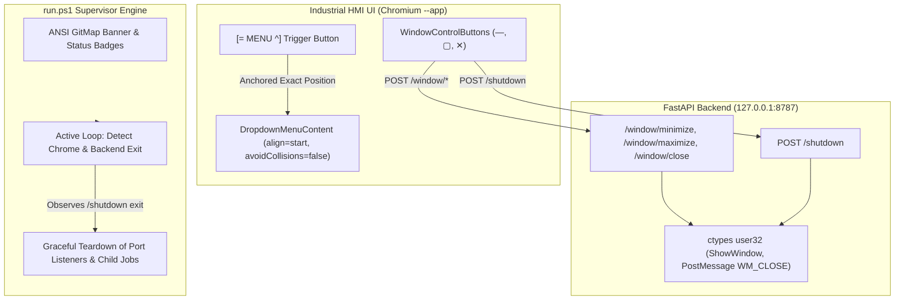

# Specification 82: Menu Glitch, Window Controls, and Professional CLI Runner

## Status
- **Status:** Approved / In Progress
- **Slug:** `menu-glitch-and-button-functionality-fix`
- **Owner:** GitMap Autonomous Engineering
- **Target Release:** v4.113.13

## 1. System Context & Overview
This specification defines the architectural remediation for three high-priority desktop user experience defects in CAT iVISION:
1. **Dropdown Menu Positioning & Hover Stability**: The top navigation dropdown menu anchored erratically at `(0, 0)` (left edge of viewport) rather than locking beneath the trigger button `[= MENU ^]`, and exhibited hover-induced repositioning glitches.
2. **Window Control Automation**: The minimize, maximize, and close controls in Chromium `--app` mode displayed blocking fallback messages ("Alt+F4 required" and "Minimize unavailable in browser mode"). We wire native loopback window control APIs (`/window/minimize`, `/window/maximize`, `/window/close`, `/shutdown`) via Windows API (`user32.dll`) so the controls behave natively.
3. **GitMap-Grade Professional CLI Runner (`run.ps1`)**: Replace plain unformatted script echoes with an ANSI double-bordered banner, colored status rows, structured telemetry, and active lifecycle supervision.

## 2. Component Architecture Diagram

## 3. Behavioral Contracts
- **Menu Alignment**: The dropdown menu MUST mount with `side="bottom"`, `align="start"`, and `avoidCollisions={false}` so its top-left coordinate is locked precisely to the bottom-left coordinate of the `[= MENU ^]` trigger button.
- **Window Close**: The Close (`✕`) button MUST dispatch `POST /window/close` and `POST /shutdown`, attempt `window.open('', '_self'); window.close()`, and display a clean "Closing Cat Vision..." status rather than an Alt+F4 alert dialog.
- **Window Minimize**: The Minimize (`—`) button MUST dispatch `POST /window/minimize` to minimize the native OS window without error toasts.
- **Window Maximize**: The Maximize (`▢`) button MUST toggle native OS maximization via `POST /window/maximize` or HTML5 fullscreen without error toasts.
