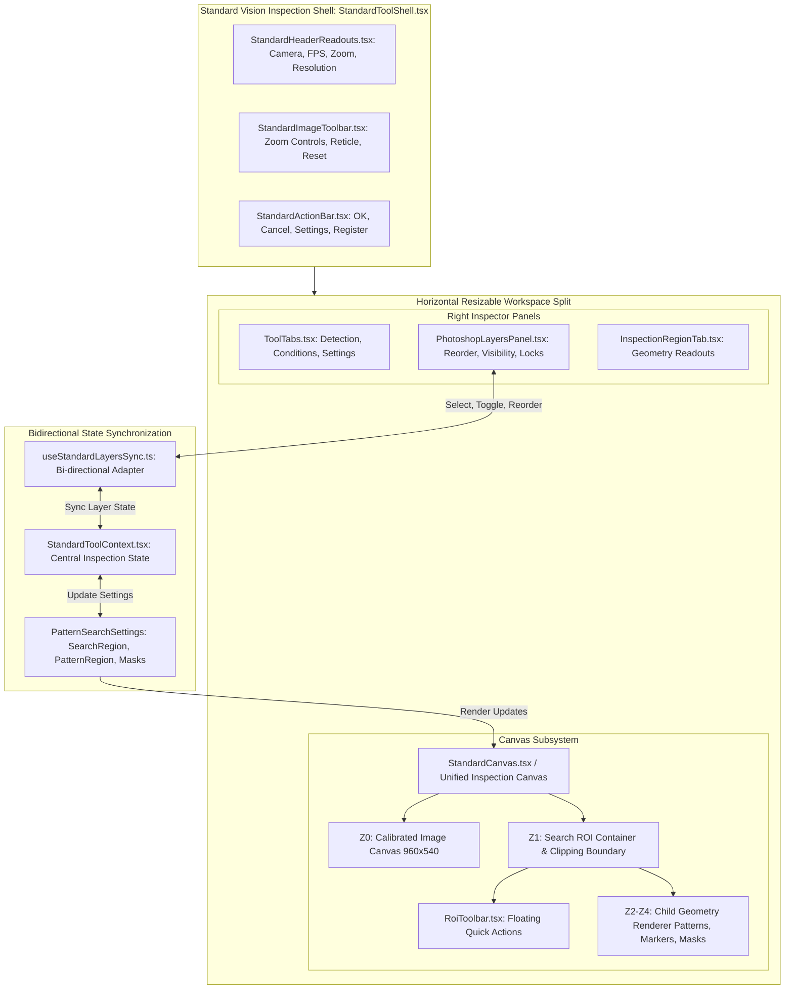
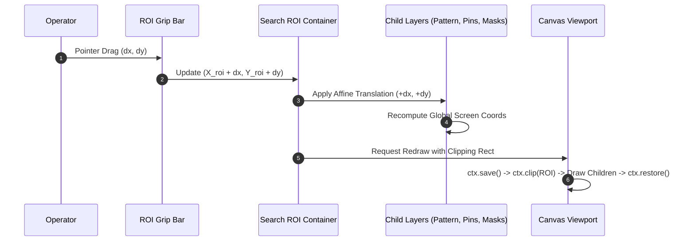
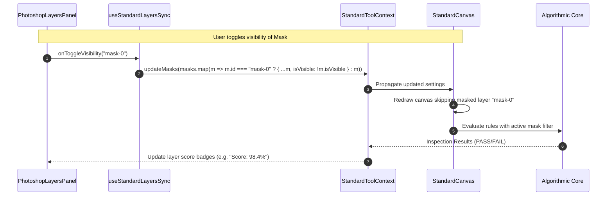

# Architecture Specification: Modern Photoshop Layers Panel & Standard Vision Inspection Integration
# Document Path: 02-spec/21-app/83-modern-design-layer-integration/01-architecture-spec.md
# Status: Approved Architecture Specification

---

## 1. Executive Summary & Strategic Intent

The **CAT Vision (CAT iVISION)** inspection suite delivers industrial-grade automated optical inspection (AOI) for high-speed electronics assembly, semiconductor packaging, and surface-mount technology (SMT). A persistent usability and architectural rift has developed between two decoupled subsystems within the application:

1. **Modern Photoshop Layers Engine (`src/components/vision/layers/PhotoshopLayersPanel.tsx`)**: An intuitive, high-density desktop layer hierarchy interface featuring individual visibility toggles, padlock locks, color tags, z-index stack reordering, contextual right-click menus, and region creation actions.
2. **Standard Vision Inspection System (`src/components/vision/standard/`)**: The primary workbench shell (`StandardToolShell.tsx`, `StandardCanvas.tsx`, `RegionOverlay.tsx`) utilized across dozens of core inspection tools (Area, Pattern Match, Greyscale Blob, Defect Calipers, Pin 1 Config, OCR2, Void Porosity).

### 1.1 The Strategic Problem

Currently, `PhotoshopLayersPanel.tsx` is completely isolated from the Standard Vision inspection tool suite. While `WorkpieceAnalyzeWorkspace.tsx` incorporates the layers panel, the standard tools rely on flat, uncoordinated DOM overlays (`RegionOverlay.tsx`) that display all regions simultaneously with hardcoded `#ff00ff` (neon magenta) resize handles. 

Furthermore, child inspection primitives (pattern template constellations, pin 1 indicators, and exclusion masks) are rendered as independent global screen rectangles rather than being mathematically bound, clipped, and transformed relative to their parent Region of Interest (ROI) container.

### 1.2 Core Architectural Invariants

This specification mandates five architectural invariants:

1. **Unified Photoshop Layer Stack**: The Standard Vision Shell (`StandardToolShell.tsx`) shall mount the `PhotoshopLayersPanel.tsx` as its primary spatial management plane, establishing full parity with modern graphic design and AOI systems.
2. **Strict 5-Tier Z-Stacking**: All visual elements on the canvas shall adhere to an immutable stacking order:
   $$\text{Z0 (Base Image)} \prec \text{Z1 (Search ROI)} \prec \text{Z2 (Pattern Templates)} \prec \text{Z3 (Feature Markers)} \prec \text{Z4 (Mask Overlays)}$$
3. **Hierarchical ROI Container & Clipping Mask**: Child layers (patterns, pin markers, masks) shall reside mathematically *inside* the Search ROI coordinate container. Moving or scaling the Search ROI automatically transforms child layers, and child graphics are bounded by the ROI clipping perimeter.
4. **Header Grip Bar & Event Separation**: The Search ROI container shall feature a dedicated top drag grip bar (`⋮⋮`). Pointer dragging on the grip bar moves the ROI container; pointer clicks within the interior surface pass through to select and edit child layers.
5. **In-ROI Floating Action Toolbar**: A dynamic floating toolbar (`RoiToolbar.tsx`) shall anchor directly to the active ROI, housing quick-action tool buttons (Lock, Shape Selector, Mask Exclude, Invert Polarity, Crop, Opacity).

---

## 2. High-Level System Architecture & Component Topology



### 2.1 File Map & Directory Boundaries

| File Path | Role in Architecture | Key Responsibilities |
| :--- | :--- | :--- |
| `src/components/vision/layers/PhotoshopLayersPanel.tsx` | Core Layers UI | Renders layer list, handles drag reordering, lock/visibility toggles, right-click context menu. |
| `src/components/vision/layers/types.ts` | Layer Type Definitions | Declares `VisionLayerItem`, `VisionLayerType`, and panel event interfaces. |
| `src/components/vision/standard/StandardToolShell.tsx` | Shell Container | Integrates the Photoshop Layers panel into the right dock panel alongside existing tool tabs. |
| `src/components/vision/standard/StandardCanvas.tsx` | Canvas Engine | Coordinates the base image, ROI containers, clipping masks, and child layer rendering. |
| `src/components/vision/white-box/RoiToolbar.tsx` | In-ROI Floating Toolbar | Houses action tool icons (Lock, Shape, Mask Exclude, Invert, Crop, Opacity). |
| `src/components/vision/standard/RegionOverlay.tsx` | Legacy Overlay (Deprecated) | Refactored into child component with grip bar, theme-consistent cyan/emerald handles, and pass-through clicks. |
| `src/components/vision/standard/StandardToolContext.tsx` | Global Context | Maintains active layer selection, layer visibility maps, and synchronization reducers. |
| `src/components/vision/standard/useStandardLayersSync.ts` | State Adapter | Translates `PatternSearchSettings` (search region, pattern region, masks) into `VisionLayerItem[]`. |

---

## 3. Coordinate Systems, Pinned Hierarchies & Clipping Masks

### 3.1 Multi-Tier Coordinate Frame Formalism

Vision inspection involves three distinct coordinate frames:

1. **Natural Frame ($\mathcal{F}_{nat}$)**: The hardware sensor frame $[0, W_{nat}] \times [0, H_{nat}]$ (standard baseline: $960 \times 540$ px).
2. **Display Viewport Frame ($\mathcal{F}_{disp}$)**: The CSS screen layout $[0, W_{disp}] \times [0, H_{disp}]$, subject to viewport zoom $z$ and pan offsets $(t_x, t_y)$.
3. **Local ROI Container Frame ($\mathcal{F}_{roi}$)**: The normalized unit bounding box $[0.0, 1.0] \times [0.0, 1.0]$ defined by the Search ROI.

```
+-----------------------------------------------------------------------------------------+
| Natural Camera Frame (960 x 540 px)                                                     |
|                                                                                         |
|       (X_roi, Y_roi)                                                                    |
|       +========================= Search ROI Container =========================+       |
|       |  [Toolbar] [Lock] [Shape: Rect] [Mask Exclude] [Invert] [Crop] [Opacity]       |
|       |  [Grip Bar] ⋮⋮ SEARCH REGION (T100)                        [X: 120, Y: 80]     |
|       |------------------------------------------------------------------------|       |
|       |                                                                        |       |
|       |   (u_pat, v_pat)                                                       |       |
|       |   +-------------------+              +-----------------------------+   |       |
|       |   | Pattern Template  |              | Exclusion Mask              |   |       |
|       |   | (Z2 Child Layer)  |              | (Z4 Child Layer)            |   |       |
|       |   |                   |              |                             |   |       |
|       |   +-------------------+              +-----------------------------+   |       |
|       |                                                                        |       |
|       |                (*) Feature Marker Pin 1 (Z3 Child Layer)               |       |
|       |                                                                        |       |
|       +========================================================================+       |
|                                                                                         |
+-----------------------------------------------------------------------------------------+
```

### 3.2 Mathematical Transformation Equations

Let the Search ROI in natural camera frame coordinates be denoted by:
$$R_{roi} = \left( X_{roi}, Y_{roi}, W_{roi}, H_{roi} \right)$$

Any child element $k$ (such as a pattern template, pin marker, or mask) has natural frame coordinates:
$$P^{(k)}_{nat} = \left( X^{(k)}, Y^{(k)} \right)$$

#### 3.2.1 Normalized Relative Mapping (Child $\to$ Local ROI)
The normalized local coordinate $(u^{(k)}, v^{(k)}) \in [0.0, 1.0]^2$ of the child within the parent ROI is:

$$u^{(k)} = \frac{X^{(k)} - X_{roi}}{W_{roi}}, \qquad v^{(k)} = \frac{Y^{(k)} - Y_{roi}}{H_{roi}}$$

#### 3.2.2 Reconstruction Upon ROI Translation or Scaling (Local ROI $\to$ Natural Frame)
When an operator drags or resizes the parent Search ROI to new dimensions $R'_{roi} = (X'_{roi}, Y'_{roi}, W'_{roi}, H'_{roi})$, the absolute position of child element $k$ updates deterministically:

$$X'^{(k)} = X'_{roi} + u^{(k)} \cdot W'_{roi}$$

$$Y'^{(k)} = Y'_{roi} + v^{(k)} \cdot H'_{roi}$$

For rectangular child bounds with dimensions $(W^{(k)}, H^{(k)})$, the dimensions scale proportionally:

$$W'^{(k)} = W^{(k)} \cdot \left(\frac{W'_{roi}}{W_{roi}}\right), \qquad H'^{(k)} = H^{(k)} \cdot \left(\frac{H'_{roi}}{H_{roi}}\right)$$

#### 3.2.3 Viewport Projection Transform
To render an element on screen given viewport zoom factor $z = \text{zoom} / 100$ and pan offsets $(t_x, t_y)$:

$$\begin{bmatrix} X_{disp} \\ Y_{disp} \\ 1 \end{bmatrix} = \begin{bmatrix} z & 0 & t_x \\ 0 & z & t_y \\ 0 & 0 & 1 \end{bmatrix} \begin{bmatrix} X_{nat} \\ Y_{nat} \\ 1 \end{bmatrix}$$

### 3.3 Clipping Mask Formulation & Boundary Enforcement

Child inspection layers must not spill outside their parent ROI. Mathematically, for any visual primitive geometry $G_{child} \subset \mathbb{R}^2$ and parent region $G_{roi} \subset \mathbb{R}^2$, the rendered geometry $G_{render}$ is strictly the boolean intersection:

$$G_{render} = G_{child} \cap G_{roi}$$



#### Clipping Implementation in Canvas 2D:
```typescript
export function renderRoiWithChildren(
  ctx: CanvasRenderingContext2D,
  roi: RectGeometry,
  children: VisualChildLayer[],
  zoom: number
): void {
  ctx.save();

  // 1. Establish clipping boundary based on ROI
  ctx.beginPath();
  ctx.rect(roi.x * zoom, roi.y * zoom, roi.width * zoom, roi.height * zoom);
  ctx.clip();

  // 2. Render all visible child layers within clipping bounds
  for (const child of children) {
    if (child.isVisible) {
      child.draw(ctx, zoom);
    }
  }

  ctx.restore();
}
```

---

## 4. Comprehensive 5-Tier Stacking Order (Z0 to Z4)

Every layer on the inspection canvas belongs to one of five deterministic visual tiers:

```
[Top-most Layer]
  ▲  Z4: Mask Overlays        (Exclusion zones, defect ignore regions)
  │  Z3: Feature Markers      (Pin 1 indicators, caliper ticks, pitch calipers)
  │  Z2: Pattern Templates    (24-box constellations, golden reference contours)
  │  Z1: Search ROI Container (Primary inspection boundary, grip bar, toolbar)
  │  Z0: Calibrated Image     (Natural frame bitmap, live camera stream)
[Bottom-most Layer]
```

### 4.1 Tier Specification Matrix

| Stacking Tier | Layer Type (`VisionLayerType`) | Default Color Tag | Opacity Range | User Movable | Deletable | Description |
| :--- | :--- | :--- | :--- | :--- | :--- | :--- |
| **Z0: Base Image** | `"image"` | `#38bdf8` (Sky) | $100\%$ | No (Fixed) | No | Calibrated grayscale or color sensor image ($960 \times 540$ px). |
| **Z1: Search ROI** | `"roi"` | `#00e5ff` (Cyan) | $10\% - 30\%$ | Yes (via Grip Bar) | No (Primary) | Master container bounding box; establishes coordinate system for child layers. |
| **Z2: Pattern Template** | `"pattern"` | `#10b981` (Emerald) | $20\% - 60\%$ | Yes (Local to ROI) | Yes | Reference golden templates, Atmel/Microchip multi-box constellations. |
| **Z3: Feature Markers** | `"overlay"` / `"rule"` | `#f59e0b` (Amber) | $80\% - 100\%$ | Yes (Pin points) | Yes | Caliper ticks, measured edge pairs, Pin 1 orientation markers, center crosses. |
| **Z4: Mask Overlays** | `"mask"` | `#f43f5e` (Rose) | $30\% - 70\%$ | Yes (Local to ROI) | Yes | Negative/exclusion masks (screws, reflective traces, via holes). |

### 4.2 Z-Index Normalization & Ordering Rules

In `PhotoshopLayersPanel.tsx`, layers are displayed in descending order of `zIndex` (the top visual layer appears at the top of the list, matching Adobe Photoshop conventions):

$$\text{List Index } 0 \iff \max(\text{zIndex})$$

When an operator clicks **Bring to Front**, **Send to Back**, **Move Up**, or **Move Down**, the z-index is recalculated within the bounds of that layer's permissible tier:
- Base image (Z0) is strictly locked at `zIndex = 0`.
- Search ROI (Z1) is fixed at `zIndex = 100`.
- Child layers (Z2 to Z4) occupy `zIndex \in [200, 499]`, allowing fine-grained reordering among patterns and masks while preserving the invariant that no mask or pattern can slip beneath the base image or search ROI container.

---

## 5. In-ROI Floating Toolbar Architecture

### 5.1 Dynamic Docking Physics

The In-ROI Floating Toolbar (`src/components/vision/white-box/RoiToolbar.tsx`) provides high-velocity access to inspection configuration directly on the canvas surface. It must dynamically position itself relative to the Search ROI container without ever clipping off-screen:

```
Case A: ROI top >= 36 px (Standard Overhead Docking)
+--------------------------------------------------------+
| [Toolbar: Lock | Shape | Mask | Invert | Crop | Alpha] |  <-- Above ROI (y - 32)
| +====================================================+ |
| | Search ROI                                         | |
| |                                                    | |

Case B: ROI top < 36 px (Interior Fallback Docking)
+--------------------------------------------------------+
| +====================================================+ |
| | [Toolbar: Lock | Shape | Mask | Invert | Crop]      | |  <-- Inside Top of ROI (y + 4)
| | Search ROI                                         | |
| |                                                    | |
```

#### Docking Formulation:
$$\text{Top}_{screen} = \begin{cases} 
Y_{roi} \cdot z + t_y - 32 & \text{if } (Y_{roi} \cdot z + t_y) \ge 36 \\
Y_{roi} \cdot z + t_y + 4 & \text{if } (Y_{roi} \cdot z + t_y) < 36 
\end{cases}$$

$$\text{Left}_{screen} = X_{roi} \cdot z + t_x$$

### 5.2 Action Toolset & Icon Matrix

The floating toolbar houses six action tools and a status pill:

| Tool Action | Icon (Lucide) | Target State / Mutation | Tooltip / Description |
| :--- | :--- | :--- | :--- |
| **Status Pill** | `Crosshair` | Read-only | Shows Tool ID (`T100`), shape type, and natural dimensions (`W x H`). |
| **Lock / Unlock** | `Lock` / `Unlock` | `isLocked = !isLocked` | Toggles container lock. When locked, grip bar drag and resize handles are disabled. |
| **Shape Selector** | `Square`, `Circle`, `Polygon` | `shape: ShapeType` | Cycles geometry between Rectangle (1:1 square), Circle, and Polygon. |
| **Mask Exclude** | `ShieldAlert` | `onCreateMask(roi)` | Instantly stamps a new child exclusion mask centered inside the active ROI. |
| **Invert Polarity** | `ArrowLeftRight` | `polarity: "dark-to-light" \| "light-to-dark"` | Reverses caliper edge detection polarity. |
| **Crop / Extract** | `Crop` | `onCropReference(roi)` | Extracts current pixel sub-matrix inside ROI as the new golden reference template. |
| **Opacity Toggle** | `SlidersHorizontal` | `opacity: 0.1 -> 0.3 -> 0.6 -> 0.9` | Cycles ROI background fill opacity to evaluate underlying workpiece texture. |

### 5.3 Header Grip Bar & Click-Through Event Routing

The major ergonomic defect in legacy `RegionOverlay.tsx` was attaching `pointerdown` to the entire rectangle surface, causing any interior click to drag the ROI rather than selecting child elements.

The modern architecture separates the interaction into two distinct DOM layers:

```
+========================================================================+
| [Grip Bar: cursor-grab / cursor-grabbing]  ⋮⋮ SEARCH REGION (DRAG ME)  |  <-- OnPointerDown = Start ROI Drag
|------------------------------------------------------------------------|
| [Interior Surface: pointer-events-none]                                |
|                                                                        |
|    +-----------------------------+                                     |
|    | Child Element (Pattern/Mask)|                                     |
|    | [pointer-events-auto]       |  <-- Clicks directly select Child!   |
|    +-----------------------------+                                     |
|                                                                        |
+========================================================================+
```

1. **Header Grip Bar (`height: 22px`)**: Features `cursor-grab`, active `cursor-grabbing`, and pointer capture. Dragging here translates the parent ROI container and all its children.
2. **Interior Body**: Rendered with `pointer-events-none` on the container background. Child layers (pattern boxes, pin 1 markings, masks) render with `pointer-events-auto`, permitting operators to click, select, drag, or delete child layers without moving the parent ROI.
3. **Corner / Edge Resize Handles**: Positioned at the 8 perimeter anchor points with `pointer-events-auto`, colored in clean industrial cyan (`#00e5ff`) or emerald (`#10b981`), replacing the neon magenta `#ff00ff`.

---

## 6. Component Architecture & Data Flow

### 6.1 Unified Data Interfaces (`src/components/vision/layers/types.ts`)

```typescript
export type VisionLayerType = "image" | "roi" | "pattern" | "mask" | "overlay" | "rule";

export interface VisionLayerItem {
  id: string;
  name: string;
  type: VisionLayerType;
  isVisible: boolean;
  isLocked: boolean;
  colorTag: string;
  zIndex: number;
  ruleId?: string;
  details?: string;
  parentId?: string; // Links child layers (pattern, mask) to parent Search ROI
  relativeCoords?: {
    u: number; // Normalized horizontal offset [0.0, 1.0]
    v: number; // Normalized vertical offset [0.0, 1.0]
    widthRatio: number;
    heightRatio: number;
  };
}

export interface RoiToolbarActions {
  onToggleLock: (regionId: string) => void;
  onChangeShape: (regionId: string, shape: "rectangle" | "circle" | "polygon") => void;
  onAddMaskExclude: (parentRoiId: string) => void;
  onInvertPolarity: (regionId: string) => void;
  onCropTemplate: (regionId: string) => void;
  onChangeOpacity: (regionId: string, opacity: number) => void;
}
```

### 6.2 Bidirectional State Synchronization Flow



---

## 7. Migration & Integration Strategy for Standard Vision Inspection

To eliminate the legacy fragmentation without disrupting operational inspection recipes:

1. **Step 1: Integrate `PhotoshopLayersPanel` into `StandardToolShell.tsx`**:
   - Add a dedicated "Layers" accordion or tab into the right dock panel of `StandardToolShell.tsx`.
   - Maintain bidirectional synchronization via `useStandardLayersSync.ts`.
2. **Step 2: Upgrade `RoiToolbar.tsx` with Full Toolset**:
   - Expand `RoiToolbar.tsx` from an empty label stub into the interactive 6-tool action bar described in Section 5.2.
   - Wire action handlers directly into `StandardToolContext`.
3. **Step 3: Refactor `RegionOverlay.tsx`**:
   - Introduce the Header Grip Bar with `cursor-grab`.
   - Set container body to `pointer-events-none` so interior clicks select child layers.
   - Replace neon magenta (`#ff00ff`) handles with theme-compliant `#00e5ff` (cyan) and `#10b981` (emerald).
4. **Step 4: Deprecate Standalone DOM Overlays in favor of Unified Canvas/SVG Stack**:
   - Merge `PatternMatchCanvas.tsx` and `StandardCanvas.tsx` rendering paths into a unified canvas/SVG viewport ensuring identical coordinate math, clipping masks, and performance across all inspection tools.

---

## 8. Acceptance Criteria & Architectural Verification Gates

| Gate ID | Area | Verification Criterion | Status Gate |
| :--- | :--- | :--- | :--- |
| `AC-ARCH-01` | Layers Panel | `PhotoshopLayersPanel.tsx` is mounted inside `StandardToolShell.tsx` and reflects all active layers (Image, ROI, Patterns, Masks). | Mandatory |
| `AC-ARCH-02` | Stacking Invariant | Layers strictly render in order $Z0 \prec Z1 \prec Z2 \prec Z3 \prec Z4$. No mask or pattern can be dragged below the base image. | Mandatory |
| `AC-ARCH-03` | Clipping Mask | Pattern templates and masks are strictly clipped to the parent Search ROI perimeter during canvas rendering. | Mandatory |
| `AC-ARCH-04` | Child Translation | Translating the Search ROI via the Header Grip bar translates all associated child layers by the identical natural coordinate delta $(\Delta X, \Delta Y)$. | Mandatory |
| `AC-ARCH-05` | Event Separation | Clicking inside the ROI body selects interior child elements; dragging is strictly initiated from the Header Grip bar. | Mandatory |
| `AC-ARCH-06` | Floating Toolbar | `RoiToolbar.tsx` renders all 6 action icons (Lock, Shape, Mask, Invert, Crop, Opacity) and docks above or inside ROI without viewport overflow. | Mandatory |
| `AC-ARCH-07` | Handle Styling | All resize handles render in industrial theme tokens (`#00e5ff`, `#10b981`, `#f59e0b`); zero occurrences of `#ff00ff`. | Mandatory |
