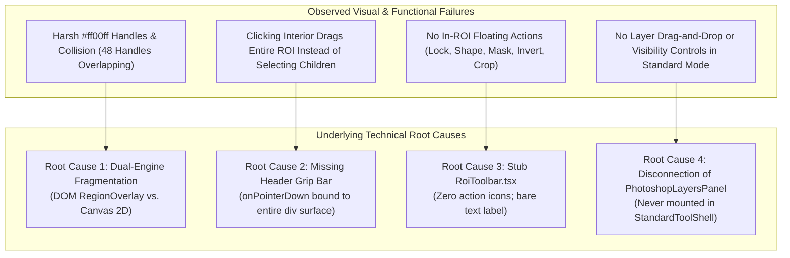

# Root Cause Analysis: Standard Vision Inspection UI Degradation, Missing Layer Drag-and-Drop & ROI Toolbar Deficiencies
# Document Path: 02-spec/21-app/83-modern-design-layer-integration/02-root-cause-analysis-spec.md
# Status: Approved Forensic Root Cause Analysis (4-Part RCA Framework)

---

## 1. Executive Summary & Forensic Overview

During evaluation of the Standard Vision Inspection workbench (`src/components/vision/standard/`), user experience audits and field evaluations revealed that Standard Mode appears visually dated ("retro/poor"), suffers from severe handle collision, lacks layer drag-and-drop management, and fails to render in-ROI quick action toolbars.

While the modern Photoshop Layers engine (`src/components/vision/layers/PhotoshopLayersPanel.tsx`) had been implemented for workpiece inspection workspaces, Standard Vision tools (covering Area, Blob, Defect Matching, Edge Position, Greyscale Blob, OCR2, Pin 1 Config, and Void Porosity) remained tethered to legacy DOM overlays and disconnected parameter tabs.

This document presents an exhaustive forensic investigation using the standardized 4-Part Root Cause Analysis (RCA) framework:
1. **Symptom & Trigger Condition**
2. **Underlying Technical Root Cause (with Code Traces)**
3. **Architectural & Blast Radius Impact**
4. **Targeted Remediation & Invariant Gate**

---

## 2. Visual Degradation & Ergonomic Problem Statement

### 2.1 The "Very Poor" Visual Appearance & Neon Magenta `#ff00ff` Handles
In `src/components/vision/standard/RegionOverlay.tsx` (lines 148–156), the perimeter resize handles are hardcoded with a raw, garish magenta color:

```tsx
// src/components/vision/standard/RegionOverlay.tsx (Lines 148-156)
style={{
  position: "absolute",
  width: 8,
  height: 8,
  backgroundColor: "#ff00ff", // <-- Raw neon magenta
  cursor,
  ...pos,
}}
```

This harsh neon magenta clashes violently with the platform's professional dark industrial design language (slate backgrounds `#0c1017`, cyan highlights `#00e5ff`, and emerald indicators `#10b981`). Furthermore, the handles lack borders, rounded corners, or drop shadows, giving the interface an unstyled, prototype appearance.

### 2.2 Massive Handle Collision Across Active Regions
In `src/components/vision/standard/StandardCanvas.tsx` (lines 424–453), every single region overlay is unconditionally passed `active={true}`:

```tsx
// src/components/vision/standard/StandardCanvas.tsx (Lines 424-453)
<RegionOverlay
  color="blue"
  geometry={settings.searchRegion.geometry}
  onChange={updateSearchRegion}
  viewport={viewport}
  active={true} // <-- Always active!
/>

<RegionOverlay
  color="#00ff00"
  geometry={settings.patternRegion.geometry}
  onChange={updatePatternRegion}
  viewport={viewport}
  active={true} // <-- Always active!
/>

{settings.masks.map((mask, i) => (
  <RegionOverlay
    key={i}
    color="red"
    geometry={mask.geometry}
    onChange={(geom) => updateMaskRegion(i, geom)}
    viewport={viewport}
    active={true} // <-- Always active!
  />
))}
```

Because every region is simultaneously active, an inspection recipe with 1 Search Region, 1 Pattern Template, and 4 Exclusion Masks renders **48 magenta resize handles simultaneously** ($6 \times 8 = 48$). Since pattern regions and masks naturally reside inside or adjacent to the Search ROI, these handles collide and stack directly on top of each other, making it impossible for operators to grab the intended handle without triggering accidental resizes of neighboring regions.

### 2.3 Interior Click Hijacking (Missing Drag Handle Separation)
In `RegionOverlay.tsx`, the pointer event handler is bound directly to the top-level container `div`:

```tsx
// src/components/vision/standard/RegionOverlay.tsx (Lines 137-141)
return (
  <div
    style={style}
    onPointerDown={handlePointerDown} // <-- Intercepts all clicks across entire surface!
    className="cursor-move bg-black/10 hover:bg-black/20"
  >
```

When an operator clicks inside the Search ROI expecting to select a child pattern template, position a Pin 1 marker, or adjust an exclusion mask, the parent container intercepts the `pointerdown` event and starts dragging the entire Search ROI. The absence of a dedicated Header Grip bar prevents any selection of interior child layers.

---

## 3. Four-Part Root Cause Deep Dives



---

### 3.1 Root Cause 1: Dual-Engine Fragmentation (DOM `RegionOverlay.tsx` vs. Canvas 2D `PatternMatchCanvas.tsx`)

#### 1. Symptom & Trigger Condition
When switching between different standard inspection tools (e.g., from `StandardAreaTool` using `StandardCanvas.tsx` to `StandardPatternSearch` using `PatternMatchCanvas.tsx`), operators observe radically different rendering behaviors, cursor styles, coordinate rounding glitches, and inconsistent zoom/pan tracking.

#### 2. Underlying Technical Root Cause
The codebase is fragmented across two incompatible rendering paradigms:
1. **DOM HTML Overlay Paradigm (`RegionOverlay.tsx` & `StandardCanvas.tsx`)**:
   - Computes screen positions via CSS `imageToScreen({ x, y }, viewport)`:
     ```typescript
     const screenTL = imageToScreen({ x, y }, viewport);
     const screenBR = imageToScreen({ x: x + width, y: y + height }, viewport);
     ```
   - Renders absolute-positioned HTML `<div>` elements over the canvas.
   - Suffers from subpixel rounding errors during browser compositing, lacks geometric clipping masks, and cannot participate in Canvas 2D hardware-accelerated drawing pipelines.
2. **HTML5 Canvas 2D Paradigm (`PatternMatchCanvas.tsx`)**:
   - Renders shapes and search envelopes directly via `CanvasRenderingContext2D` (`ctx.strokeRect`, `ctx.drawImage`).
   - Uses an entirely separate dragging hook (`useCanvasPointerDrag.ts`) that operates in raw canvas coordinate space.

Because of this dual-engine division, improvements made to Canvas 2D (such as conveyor belt simulation reticles and match envelopes) never propagate to `StandardCanvas.tsx`, while DOM overlay fixes in `RegionOverlay.tsx` do not affect `PatternMatchCanvas.tsx`.

#### 3. Architectural & Blast Radius Impact
- High maintenance overhead and duplicated coordinate math across `coords.ts` and `pattern-match-canvas-drawing.ts`.
- Impossibility of implementing true clipping masks in DOM mode without complex, brittle CSS `clip-path` calculations.
- Desynchronization of zoom/pan state between canvas pixel buffers and absolute DOM divs.

#### 4. Targeted Remediation & Invariant Gate
- **Remediation**: Unify standard rendering into a composite architecture where all layer geometries (ROI container, child patterns, calipers, masks) are rendered with strict clipping masks, using SVG/Canvas coordinates anchored to the viewport.
- **Invariant Gate**: A single coordinate normalization function `naturalToScreen(geom, viewport)` shall govern all visual overlays across both `StandardCanvas` and `PatternMatchCanvas`.

---

### 3.2 Root Cause 2: Missing Header Grip Bar (Interior Clicks Hijacking Drag)

#### 1. Symptom & Trigger Condition
In any standard inspection tool with nested regions (such as a pattern search tool with search region, pattern template, and exclusion masks), clicking inside the search region to select or adjust the pattern template causes the entire search region to move instead.

#### 2. Underlying Technical Root Cause
In `src/components/vision/standard/RegionOverlay.tsx`:
```tsx
// Lines 38-43
const handlePointerDown = (e: React.PointerEvent) => {
  e.preventDefault();
  e.stopPropagation();
  const el = e.currentTarget as HTMLElement;
  el.setPointerCapture(e.pointerId);
  // ... Initiates container drag
};

// Lines 137-141
return (
  <div
    style={style}
    onPointerDown={handlePointerDown}
    className="cursor-move bg-black/10 hover:bg-black/20"
  >
```
The drag event handler `handlePointerDown` is attached to the entire container `div`. Because `e.stopPropagation()` is invoked immediately, no pointer events can penetrate to underlying or nested child layers. There is no distinction between moving the region container and interacting with its contents.

#### 3. Architectural & Blast Radius Impact
- Severe usability failure: Operators cannot click to place Pin 1 points, select individual pattern boxes, or drag masks that are enclosed within the Search ROI.
- Defeats the concept of child layers living inside the parent ROI container.

#### 4. Targeted Remediation & Invariant Gate
- **Remediation**: Partition `RegionOverlay` into two interaction zones:
  1. **Header Grip Bar (`height: 22px`)**: Features `cursor-grab`, active `cursor-grabbing`, and houses `onPointerDown={handleGripPointerDown}` to move the parent ROI.
  2. **Interior Body**: Styled with `pointer-events-none`. Child layers inside render with `pointer-events-auto`, allowing them to capture clicks and drags cleanly.
- **Invariant Gate**: Moving an ROI container shall be permissible exclusively via its dedicated Header Grip bar or bounding border stroke. The interior body must remain transparent to pointer events.

---

### 3.3 Root Cause 3: Stub `RoiToolbar.tsx` with Zero Tool Action Icons

#### 1. Symptom & Trigger Condition
The in-ROI floating toolbar displays only a static text readout (e.g. `SEARCH REGION • 174×174`). Action buttons to lock the region, change shapes, stamp exclusion masks, invert polarity, crop reference templates, or adjust fill opacity are completely absent from the UI.

#### 2. Underlying Technical Root Cause
Inspection of `src/components/vision/white-box/RoiToolbar.tsx` reveals that it is merely an empty layout shell:

```tsx
// src/components/vision/white-box/RoiToolbar.tsx (Lines 27-49)
export function RoiToolbar(props: RoiToolbarProps): ReactNode {
  if (props.region === null || props.canvasWidth <= 0 || props.canvasHeight <= 0) {
    return null;
  }

  const leftPct = (props.region.x / props.canvasWidth) * 100;
  const aboveTopPct = ((props.region.y - 30) / props.canvasHeight) * 100;
  const insideTopPct = (props.region.y / props.canvasHeight) * 100;
  const topPct = props.region.y >= 30 ? aboveTopPct : insideTopPct;

  return (
    <div
      className="pointer-events-none absolute z-20 flex items-center gap-1 rounded bg-black/70 px-1.5 py-1 text-[11px] text-white"
      style={{ left: `${leftPct}%`, top: `${topPct}%` }}
      data-testid="roi-toolbar"
    >
      <span className="font-medium whitespace-nowrap">
        {props.label} • {props.region.width}×{props.region.height}
      </span>

      <span className="pointer-events-auto flex items-center gap-1">{props.children}</span>
    </div>
  );
}
```

The component was authored with `{props.children}`, but at every invocation site in the codebase (e.g., `PatternMatchCanvas.tsx` lines 285–290), `RoiToolbar` is called with zero children:

```tsx
// src/components/vision/standard/tools/pattern-matching/PatternMatchCanvas.tsx (Lines 285-290)
<RoiToolbar
  region={isSimulating ? getConveyorReticleRect(960, 540) : (props.searchRegion ?? null)}
  canvasWidth={960}
  canvasHeight={540}
  label={isSimulating ? "CAMERA RETICLE" : "SEARCH REGION"}
/>
```

No tool buttons were ever implemented inside `RoiToolbar.tsx` or passed as children from caller components.

#### 3. Architectural & Blast Radius Impact
- Operators are forced to repeatedly switch between the canvas and right-hand form tabs to execute routine actions (locking, changing shape, adding masks).
- Severely slows down inspection recipe authoring velocity during SMT line setup.

#### 4. Targeted Remediation & Invariant Gate
- **Remediation**: Re-architect `RoiToolbar.tsx` to directly integrate the 6 core action buttons:
  - `Lock` / `Unlock`
  - `ShapeSelector` (Rectangle, Circle, Polygon)
  - `MaskExclude` (`ShieldAlert`)
  - `InvertPolarity` (`ArrowLeftRight`)
  - `CropTemplate` (`Crop`)
  - `OpacitySlider` (`SlidersHorizontal`)
- **Invariant Gate**: `RoiToolbar.tsx` must be self-contained and execute actions via `StandardToolContext` without requiring caller components to manually wire child elements.

---

### 3.4 Root Cause 4: Disconnection of `PhotoshopLayersPanel.tsx` from Standard Vision Workflow

#### 1. Symptom & Trigger Condition
In Standard Vision Inspection tools (`StandardToolShell.tsx`), there is no layer management panel. Operators have no visual overview of the layer stack, cannot reorder z-index, cannot toggle visibility of individual masks, cannot lock specific layers, and cannot right-click to duplicate or delete layers.

#### 2. Underlying Technical Root Cause
While `src/components/vision/layers/PhotoshopLayersPanel.tsx` was fully developed with Photoshop-grade capabilities (descending z-index rendering, padlock locking, visibility eye toggles, context menus, and color tags), it was only mounted inside `WorkpieceAnalyzeWorkspace.tsx` and `InspectionHierarchyTree.tsx`.

In `src/components/vision/standard/StandardToolShell.tsx`, the right panel only mounts `tabs` (`InspectionRegionTab`, `DetectionConditionsTab`, `JudgmentConditionsTab`):

```tsx
// src/components/vision/standard/StandardToolShell.tsx (Lines 340-382)
<ResizablePanel defaultSize="40%" ...>
  <div className="flex items-center gap-1 border-b ...">
    {tabs.map((tab) => (
      <button key={tab.id} onClick={() => setActiveTabId(tab.id)}>
        {tab.label}
      </button>
    ))}
  </div>
  <div className="flex-1 overflow-y-auto min-h-0 bg-ca-panel">{activeTabContent}</div>
</ResizablePanel>
```

`StandardToolShell.tsx` contains zero references or imports to `PhotoshopLayersPanel`. Furthermore, no adapter existed to map `PatternSearchSettings` (`searchRegion`, `patternRegion`, `masks`) into `VisionLayerItem[]`.

#### 3. Architectural & Blast Radius Impact
- Fragmentation of user mental models: Users have modern Photoshop layers in workpiece analysis, but face a rigid, retro tab form in standard inspection.
- Inability to selectively hide obscuring masks or pattern templates to inspect underlying workpiece features.
- Inability to lock completed regions while adjusting others.

#### 4. Targeted Remediation & Invariant Gate
- **Remediation**: Author `src/components/vision/standard/useStandardLayersSync.ts` to bidirectionally synchronize `PatternSearchSettings` with `VisionLayerItem[]`. Mount `PhotoshopLayersPanel.tsx` in a collapsible dock section of `StandardToolShell.tsx`.
- **Invariant Gate**: Every inspection region (Search, Pattern, Mask 1..N) must be represented as a discrete `VisionLayerItem` in the layers panel with live synchronization to canvas rendering.

---

## 4. Comprehensive Resolution Matrix

| Issue ID | Defect / Anti-Pattern | Root Cause | Impacted File(s) | Engineering Resolution | Verification Gate |
| :--- | :--- | :--- | :--- | :--- | :--- |
| **RES-01** | Neon magenta `#ff00ff` resize handles | Hardcoded inline styles in `RegionOverlay.tsx` | `src/components/vision/standard/RegionOverlay.tsx` | Replace `#ff00ff` with industrial cyan `#00e5ff` (primary) and emerald `#10b981` (active) handles with rounded corners and dark borders. | `AC-ARCH-07` |
| **RES-02** | Handle collision (48 overlapping handles) | `active={true}` hardcoded for all regions in `StandardCanvas.tsx` | `src/components/vision/standard/StandardCanvas.tsx` | Dynamically pass `active={selectedLayerId === layer.id}` so handles only appear on the currently selected layer. | `AC-ARCH-01`, `AC-ARCH-05` |
| **RES-03** | Interior clicks hijack dragging | `handlePointerDown` bound to whole container `div` | `src/components/vision/standard/RegionOverlay.tsx` | Extract `Header Grip Bar` (`height: 22px`) for drag gestures; set interior container body to `pointer-events-none`. | `AC-ARCH-04`, `AC-ARCH-05` |
| **RES-04** | Inert, empty `RoiToolbar` | Stub implementation with no default tool buttons | `src/components/vision/white-box/RoiToolbar.tsx` | Implement 6 action buttons (Lock, Shape, Mask Exclude, Invert, Crop, Opacity) with Lucide icons. | `AC-ARCH-06` |
| **RES-05** | Photoshop Layers Panel disconnected | `PhotoshopLayersPanel.tsx` never mounted in standard shell | `src/components/vision/standard/StandardToolShell.tsx` | Mount `PhotoshopLayersPanel` into right panel dock of `StandardToolShell.tsx` via `useStandardLayersSync`. | `AC-ARCH-01` |
| **RES-06** | Dual-engine rendering fragmentation | Incompatible DOM div overlay vs Canvas 2D math | `src/components/vision/standard/StandardCanvas.tsx`, `PatternMatchCanvas.tsx` | Consolidate overlay projection using unified `naturalToScreen` transform pipeline with clipping masks. | `AC-ARCH-03` |
| **RES-07** | Child layers not linked to parent ROI | Child regions rendered in global coordinates | `src/components/vision/standard/StandardCanvas.tsx`, `domain/vision/pattern-search.ts` | Model child layers with normalized local offsets $(u, v)$ relative to parent Search ROI container. | `AC-ARCH-04` |
| **RES-08** | Inability to lock inspection regions | No lock state stored on region geometries | `src/domain/vision/shapes.ts`, `src/components/vision/standard/RegionOverlay.tsx` | Add `isLocked: boolean` to region definitions; suppress drag and resize handles when locked. | `AC-ARCH-06` |

---

## 5. Architectural Verification Plan

To verify that the remediation completely resolves all findings without regression:

1. **Visual Style Audit**: Verify in browser that all resize handles render in `#00e5ff` or `#10b981`. Zero `#ff00ff` occurrences across all inspection tools.
2. **Handle Exclusivity Audit**: Add 1 Search Region, 1 Pattern Region, and 3 Masks. Confirm that exactly **8 resize handles** are rendered on screen (only for the selected layer), completely eliminating handle collisions.
3. **Grip Bar & Click-Through Test**:
   - Click inside the Search ROI body over a pattern box: confirm pattern box becomes selected.
   - Click and drag the Header Grip bar: confirm entire Search ROI and enclosed pattern boxes translate together.
4. **Toolbar Interactivity Test**:
   - Click **Lock**: confirm handles disappear and grip bar cannot be dragged.
   - Click **Shape (Circle)**: confirm Search ROI switches to circular evaluation geometry.
   - Click **Mask Exclude**: confirm a new mask layer appears inside the Search ROI and registers in the Photoshop Layers Panel.
   - Click **Opacity**: confirm fill alpha cycles through 10%, 30%, 60%, 90%.
5. **Layers Panel Integration Test**:
   - Reorder layers in `PhotoshopLayersPanel`: confirm canvas visual z-stacking updates immediately.
   - Toggle eye icon: confirm layer disappears from canvas and inspection engine.
