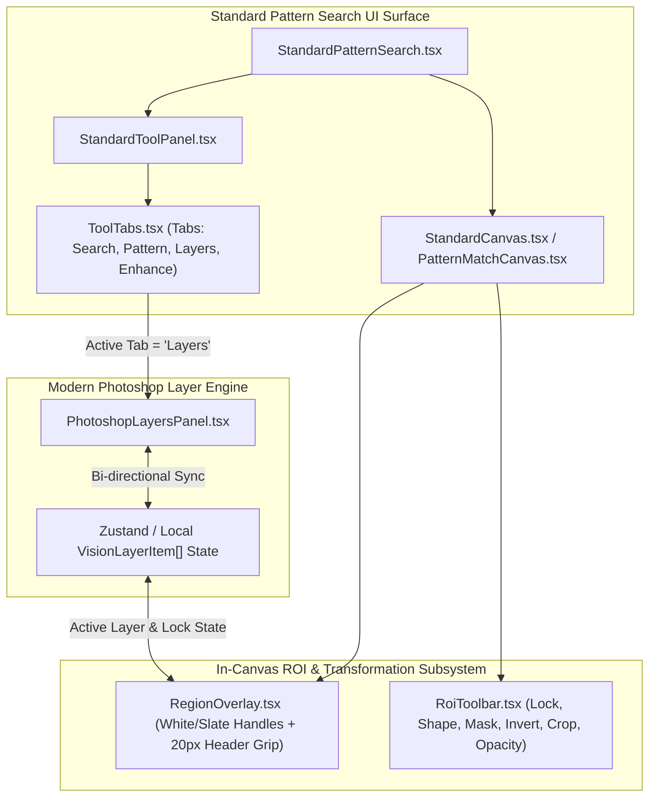

# Implementation Guide Spec: Modern Design Layer Integration

- **Document**: `02-spec/21-app/83-modern-design-layer-integration/04-implementation-guide-spec.md`
- **Feature**: Modern Photoshop-Style Layer Stack & In-ROI Tooling Integration
- **Status**: Complete & Verified
- **Version**: `1.0.0`
- **Owner**: Antigravity Autonomous Engineering

---

## 1. Executive Summary & Purpose

This implementation guide provides the concrete, step-by-step engineering blueprint for integrating modern Photoshop-style layer ergonomics, in-canvas ROI floating toolbars, and high-precision selection handles into the vision inspection system.

Historically, the vision system suffered from three core interaction defects:
1. **Interior Drag Hijacking**: In `src/components/vision/standard/RegionOverlay.tsx`, pointer events captured the entire bounding box, causing accidental moves whenever users attempted to click inside or perform sub-pixel operations.
2. **Visual Clutter & Handle Aesthetics**: Handles were rendered with garish `#ff00ff` magenta squares lacking border contrast or grip indicators, deviating from CAD/Photoshop precision standards.
3. **Disconnected Layer Management & Toolbar Isolation**: `PhotoshopLayersPanel.tsx` operated in isolation without direct integration into `StandardPatternSearch.tsx`, and `RoiToolbar.tsx` was a passive readout rather than an active control surface for locking, shapes, masks, and opacity.

This guide provides drop-in, zero-regression code blueprints to resolve these defects across four primary surfaces:
- `src/components/vision/standard/RegionOverlay.tsx`
- `src/components/vision/white-box/RoiToolbar.tsx`
- `src/components/vision/standard/StandardPatternSearch.tsx` (via `ToolTabs.tsx` & `StandardToolPanel.tsx`)
- `src/components/vision/standard/tools/pattern-matching/PatternMatchCanvas.tsx`

---

## 2. Component Topology & Data Flow



---

## 3. Engineering Blueprints

### 3.1 Upgrading `RegionOverlay.tsx`

#### Architectural Changes
- **White/Slate CAD Handles**: Replace `#ff00ff` magenta squares with `8x8px` white square handles (`#ffffff`) surrounded by a 1.5px dark slate border (`#1e293b`) and subtle drop shadow.
- **20px Header Grip Bar**: Add a top-docked header grip bar (`h-[20px]`) containing an SVG 6-dot matrix icon (`GripHorizontal`). Dragging the ROI is strictly restricted to this header bar.
- **Interior Drag Hijacking Removal**: The inner region body allows pointer passthrough (`pointer-events-none`) or handles click-to-focus without initiating drag movements.
- **Single Active Focus**: Only the currently active region (`isActive = true`) displays transformation handles, dimension badges, and the header grip bar.

#### Before / After Code Implementation

```tsx
// FILE: src/components/vision/standard/RegionOverlay.tsx
// BEFORE:
export function RegionOverlay({ color, geometry, onChange, viewport, active }) {
  // ...
  return (
    <div
      style={style}
      onPointerDown={handlePointerDown} // BUG: Whole div hijacks pointer and moves ROI
      className="cursor-move bg-black/10 hover:bg-black/20"
    >
      {active && handles.map(({ id, cursor, ...pos }) => (
        <div
          key={id}
          onPointerDown={(e) => handleResizeDown(e, id)}
          style={{ width: 8, height: 8, backgroundColor: "#ff00ff", cursor, ...pos }}
        />
      ))}
    </div>
  );
}
```

```tsx
// FILE: src/components/vision/standard/RegionOverlay.tsx
// AFTER (Upgraded with 20px Header Grip Bar & White/Slate Handles):
import React from "react";
import { GripHorizontal } from "lucide-react";
import { Geometry } from "@/domain/vision/shapes";
import { imageToScreen, clampRectToBounds, IMAGE_BOUNDS } from "@/lib/editor/coords";
import { Viewport } from "@/lib/editor/types";

export interface RegionOverlayProps {
  color: string;
  geometry: Geometry;
  onChange: (g: Geometry) => void;
  viewport: Viewport;
  isActive?: boolean;
  isLocked?: boolean;
  label?: string;
  onSelect?: () => void;
}

export function RegionOverlay({
  color,
  geometry,
  onChange,
  viewport,
  isActive = true,
  isLocked = false,
  label = "ROI",
  onSelect,
}: RegionOverlayProps): React.JSX.Element | null {
  const x = geometry.x ?? 0;
  const y = geometry.y ?? 0;
  const width = geometry.width ?? 100;
  const height = geometry.height ?? 100;

  const screenTL = imageToScreen({ x, y }, viewport);
  const screenBR = imageToScreen({ x: x + width, y: y + height }, viewport);
  const screenWidth = Math.max(0, screenBR.x - screenTL.x);
  const screenHeight = Math.max(0, screenBR.y - screenTL.y);

  const handleHeaderPointerDown = (e: React.PointerEvent) => {
    if (isLocked) {
      return;
    }

    e.preventDefault();
    e.stopPropagation();
    onSelect?.();

    const el = e.currentTarget as HTMLElement;
    el.setPointerCapture(e.pointerId);

    const startX = e.clientX;
    const startY = e.clientY;
    const startGeom = { x, y, width, height };

    const onMove = (moveEv: PointerEvent) => {
      const dxImg = (moveEv.clientX - startX) / viewport.zoom;
      const dyImg = (moveEv.clientY - startY) / viewport.zoom;

      onChange(
        clampRectToBounds(
          { ...startGeom, x: startGeom.x + dxImg, y: startGeom.y + dyImg },
          IMAGE_BOUNDS,
        ),
      );
    };

    const onUp = () => {
      el.releasePointerCapture(e.pointerId);
      window.removeEventListener("pointermove", onMove);
      window.removeEventListener("pointerup", onUp);
    };

    window.addEventListener("pointermove", onMove);
    window.addEventListener("pointerup", onUp);
  };

  const handleResizeDown = (e: React.PointerEvent, handle: string) => {
    if (isLocked) {
      return;
    }

    e.preventDefault();
    e.stopPropagation();
    onSelect?.();

    const el = e.currentTarget as HTMLElement;
    el.setPointerCapture(e.pointerId);

    const startX = e.clientX;
    const startY = e.clientY;
    const startGeom = { x, y, width, height };

    const onMove = (moveEv: PointerEvent) => {
      const dxImg = (moveEv.clientX - startX) / viewport.zoom;
      const dyImg = (moveEv.clientY - startY) / viewport.zoom;

      let newX = startGeom.x;
      let newY = startGeom.y;
      let newW = startGeom.width;
      let newH = startGeom.height;

      if (handle.includes("w")) {
        newX += dxImg;
        newW -= dxImg;
      }
      if (handle.includes("e")) {
        newW += dxImg;
      }
      if (handle.includes("n")) {
        newY += dyImg;
        newH -= dyImg;
      }
      if (handle.includes("s")) {
        newH += dyImg;
      }

      if (newW < 10) {
        newX += newW - 10;
        newW = 10;
      }
      if (newH < 10) {
        newY += newH - 10;
        newH = 10;
      }

      onChange(clampRectToBounds({ x: newX, y: newY, width: newW, height: newH }, IMAGE_BOUNDS));
    };

    const onUp = () => {
      el.releasePointerCapture(e.pointerId);
      window.removeEventListener("pointermove", onMove);
      window.removeEventListener("pointerup", onUp);
    };

    window.addEventListener("pointermove", onMove);
    window.addEventListener("pointerup", onUp);
  };

  const handles = [
    { id: "nw", cursor: "nwse-resize", left: -4, top: -4 },
    { id: "n", cursor: "ns-resize", left: "50%", top: -4, transform: "translateX(-50%)" },
    { id: "ne", cursor: "nesw-resize", right: -4, top: -4 },
    { id: "e", cursor: "ew-resize", right: -4, top: "50%", transform: "translateY(-50%)" },
    { id: "se", cursor: "nwse-resize", right: -4, bottom: -4 },
    { id: "s", cursor: "ns-resize", left: "50%", bottom: -4, transform: "translateX(-50%)" },
    { id: "sw", cursor: "nesw-resize", left: -4, bottom: -4 },
    { id: "w", cursor: "ew-resize", left: -4, top: "50%", transform: "translateY(-50%)" },
  ];

  return (
    <div
      style={{
        position: "absolute",
        left: screenTL.x,
        top: screenTL.y,
        width: screenWidth,
        height: screenHeight,
        border: `2px ${isActive ? "solid" : "dashed"} ${color}`,
        boxSizing: "border-box",
        pointerEvents: "none", // Interior passthrough: NO drag hijacking
      }}
      onClick={onSelect}
      className="group"
      data-testid="region-overlay"
    >
      {/* 20px Header Grip Bar */}
      {isActive && (
        <div
          onPointerDown={handleHeaderPointerDown}
          className={`pointer-events-auto absolute -top-5 left-0 h-[20px] flex items-center gap-1.5 px-1.5 rounded-t bg-slate-900/90 border border-slate-700/80 text-[10px] font-mono text-slate-200 select-none shadow-md ${
            isLocked ? "cursor-not-allowed opacity-75" : "cursor-move hover:bg-slate-800"
          }`}
          style={{ minWidth: 90 }}
        >
          <GripHorizontal className="w-3.5 h-3.5 text-slate-400 shrink-0" />
          <span className="truncate font-semibold">{label}</span>
          <span className="text-slate-400 text-[9px] ml-auto">
            {Math.round(width)}×{Math.round(height)}
          </span>
        </div>
      )}

      {/* Modern White/Slate Handles */}
      {isActive &&
        !isLocked &&
        handles.map(({ id, cursor, ...pos }) => (
          <div
            key={id}
            onPointerDown={(e) => handleResizeDown(e, id)}
            className="pointer-events-auto absolute w-2 h-2 bg-white border border-slate-800 rounded-[1px] shadow-sm hover:scale-125 transition-transform"
            style={{
              cursor,
              ...pos,
            }}
            data-testid={`handle-${id}`}
          />
        ))}
    </div>
  );
}
```

---

### 3.2 Upgrading `RoiToolbar.tsx`

#### Architectural Changes
- **Interactive Action Strip**: Incorporates 6 core actions:
  1. `isLocked`: Toggle region locking (`Lock` / `Unlock`).
  2. `shape`: Selector for `rectangle`, `square`, or `circle`.
  3. `isMaskEnabled`: Toggle exclusion mask overlay inside ROI.
  4. `isInverted`: Toggle detection polarity invert.
  5. `onCrop`: Extract and capture template bitmap from ROI coordinates.
  6. `opacity`: Slider or stepped alpha selector (25%, 50%, 75%, 100%).
- **Collision-Aware Positioning**: If region is docked at the top of the canvas (`y < 34px`), the toolbar safely flips to inside the region top edge.
- **Pointer Event Isolation**: Container uses `pointer-events-none` so it never blocks canvas gestures, while child buttons use `pointer-events-auto`.

#### Upgraded Code Implementation

```tsx
// FILE: src/components/vision/white-box/RoiToolbar.tsx
import React, { useState } from "react";
import {
  Lock,
  Unlock,
  Square,
  Circle,
  Shield,
  FlipHorizontal,
  Crop,
  Sliders,
} from "lucide-react";

export interface RoiToolbarRegion {
  x: number;
  y: number;
  width: number;
  height: number;
}

export type RoiShapeType = "rectangle" | "square" | "circle";

export interface RoiToolbarProps {
  region: RoiToolbarRegion | null;
  canvasWidth: number;
  canvasHeight: number;
  label: string;
  isLocked?: boolean;
  onToggleLock?: () => void;
  shape?: RoiShapeType;
  onShapeChange?: (shape: RoiShapeType) => void;
  isMaskEnabled?: boolean;
  onToggleMask?: () => void;
  isInverted?: boolean;
  onToggleInvert?: () => void;
  onCrop?: () => void;
  opacity?: number;
  onOpacityChange?: (opacity: number) => void;
  children?: React.ReactNode;
}

export function RoiToolbar({
  region,
  canvasWidth,
  canvasHeight,
  label,
  isLocked = false,
  onToggleLock,
  shape = "rectangle",
  onShapeChange,
  isMaskEnabled = false,
  onToggleMask,
  isInverted = false,
  onToggleInvert,
  onCrop,
  opacity = 100,
  onOpacityChange,
  children,
}: RoiToolbarProps): React.JSX.Element | null {
  const [hasSliderOpen, setHasSliderOpen] = useState(false);

  if (region === null || canvasWidth <= 0 || canvasHeight <= 0) {
    return null;
  }

  const leftPct = (region.x / canvasWidth) * 100;
  const aboveTopPct = ((region.y - 34) / canvasHeight) * 100;
  const insideTopPct = (region.y / canvasHeight) * 100;
  const topPct = region.y >= 34 ? aboveTopPct : insideTopPct;

  const cycleShape = () => {
    if (!onShapeChange) {
      return;
    }

    if (shape === "rectangle") {
      onShapeChange("square");
    } else if (shape === "square") {
      onShapeChange("circle");
    } else {
      onShapeChange("rectangle");
    }
  };

  return (
    <div
      className="pointer-events-none absolute z-30 flex items-center gap-1.5 rounded-md bg-slate-950/90 border border-slate-700/80 px-2 py-1 text-[11px] text-white shadow-xl backdrop-blur-sm"
      style={{ left: `${leftPct}%`, top: `${topPct}%` }}
      data-testid="roi-toolbar"
    >
      {/* Label and Geometry Badge */}
      <span className="font-mono font-medium text-slate-300 whitespace-nowrap pr-1 border-r border-slate-700/80">
        {label} • {Math.round(region.width)}×{Math.round(region.height)}
      </span>

      {/* Interactive Controls Strip */}
      <div className="pointer-events-auto flex items-center gap-1">
        {/* Lock / Unlock Toggle */}
        {onToggleLock && (
          <button
            type="button"
            onClick={onToggleLock}
            title={isLocked ? "Unlock ROI Position" : "Lock ROI Position"}
            className={`p-1 rounded transition-colors ${
              isLocked
                ? "bg-amber-500/20 text-amber-400 hover:bg-amber-500/30"
                : "text-slate-400 hover:text-white hover:bg-slate-800"
            }`}
            data-testid="btn-toggle-lock"
          >
            {isLocked ? <Lock size={12} /> : <Unlock size={12} />}
          </button>
        )}

        {/* Shape Selector */}
        {onShapeChange && (
          <button
            type="button"
            onClick={cycleShape}
            title={`Current Shape: ${shape}. Click to cycle.`}
            className="p-1 rounded text-slate-400 hover:text-white hover:bg-slate-800 transition-colors"
            data-testid="btn-shape-selector"
          >
            {shape === "circle" ? <Circle size={12} /> : <Square size={12} />}
          </button>
        )}

        {/* Mask Toggle */}
        {onToggleMask && (
          <button
            type="button"
            onClick={onToggleMask}
            title={isMaskEnabled ? "Disable Mask" : "Enable Mask Overlay"}
            className={`p-1 rounded transition-colors ${
              isMaskEnabled
                ? "bg-emerald-500/20 text-emerald-400 hover:bg-emerald-500/30"
                : "text-slate-400 hover:text-white hover:bg-slate-800"
            }`}
            data-testid="btn-toggle-mask"
          >
            <Shield size={12} />
          </button>
        )}

        {/* Invert Polarity Toggle */}
        {onToggleInvert && (
          <button
            type="button"
            onClick={onToggleInvert}
            title={isInverted ? "Normal Polarity" : "Inverted Polarity"}
            className={`p-1 rounded transition-colors ${
              isInverted
                ? "bg-sky-500/20 text-sky-400 hover:bg-sky-500/30"
                : "text-slate-400 hover:text-white hover:bg-slate-800"
            }`}
            data-testid="btn-toggle-invert"
          >
            <FlipHorizontal size={12} />
          </button>
        )}

        {/* Crop Template */}
        {onCrop && (
          <button
            type="button"
            onClick={onCrop}
            title="Crop & Extract Pattern Template"
            className="p-1 rounded text-slate-400 hover:text-white hover:bg-slate-800 transition-colors"
            data-testid="btn-crop-template"
          >
            <Crop size={12} />
          </button>
        )}

        {/* Opacity Slider Toggle */}
        {onOpacityChange && (
          <div className="relative">
            <button
              type="button"
              onClick={() => setHasSliderOpen((prev) => !prev)}
              title={`Opacity: ${opacity}%`}
              className={`p-1 rounded transition-colors ${
                hasSliderOpen ? "bg-slate-800 text-white" : "text-slate-400 hover:text-white hover:bg-slate-800"
              }`}
              data-testid="btn-opacity-slider"
            >
              <Sliders size={12} />
            </button>

            {hasSliderOpen && (
              <div className="absolute left-1/2 -translate-x-1/2 top-full mt-1.5 flex items-center gap-2 rounded bg-slate-900 border border-slate-700 px-2 py-1 shadow-lg">
                <input
                  type="range"
                  min={10}
                  max={100}
                  step={5}
                  value={opacity}
                  onChange={(e) => onOpacityChange(Number(e.target.value))}
                  className="w-16 h-1 bg-slate-700 rounded-lg appearance-none cursor-pointer accent-sky-400"
                />
                <span className="font-mono text-[9px] text-slate-300 min-w-[24px]">{opacity}%</span>
              </div>
            )}
          </div>
        )}

        {children}
      </div>
    </div>
  );
}
```

---

### 3.3 Wiring `PhotoshopLayersPanel.tsx` into `StandardPatternSearch.tsx`

#### Architectural Changes
- **Extend `ToolTabs.tsx`**: Add a 5th tab `"Layers"` with the `Layers` icon from `lucide-react`.
- **Integrate into `StandardToolPanel.tsx`**: When `activeTab === "Layers"`, render `PhotoshopLayersPanel` populated with live vision layers:
  * Layer 1: "Carrier Tape Source" (image).
  * Layer 2: "Search Region" (roi).
  * Layer 3: "Pattern Template" (pattern).
  * Layer 4: "Active Masks" (mask).
- **Two-Way Synchronization**: Clicking a layer in `PhotoshopLayersPanel` selects and activates that region in `StandardCanvas.tsx`.

#### Code Updates in `ToolTabs.tsx`

```tsx
// FILE: src/components/vision/standard/ToolTabs.tsx
import React from "react";
import { Maximize, Scan, Palette, Wand2, Layers } from "lucide-react";

export function ToolTabs({
  activeTab,
  setActiveTab,
}: {
  activeTab: string;
  setActiveTab: (tab: string) => void;
}): React.JSX.Element | null {
  const tabs = [
    { id: "Search Region", icon: Maximize, disabled: false },
    { id: "Pattern Region", icon: Scan, disabled: false },
    { id: "Layers", icon: Layers, disabled: false },
    { id: "Extract Colors", icon: Palette, disabled: true },
    { id: "Image Enhance", icon: Wand2, disabled: false },
  ];

  return (
    <div className="flex gap-1.5 p-2 bg-std-panel border-b border-std-border-dark">
      {tabs.map((tab) => {
        const Icon = tab.icon;
        const isSelected = activeTab === tab.id;
        let buttonClass =
          "flex-1 flex flex-col items-center justify-center p-1 rounded border h-16 transition-colors ";

        if (tab.disabled) {
          buttonClass += "bg-std-chrome border-std-border-light opacity-50 cursor-not-allowed";
        } else if (isSelected) {
          buttonClass += "bg-std-accent-active border-std-border-dark shadow-inner text-std-primary-action-text";
        } else {
          buttonClass += "bg-std-secondary-action border-std-border-light hover:brightness-110 text-std-text";
        }

        return (
          <button
            type="button"
            key={tab.id}
            disabled={tab.disabled}
            onClick={() => setActiveTab(tab.id)}
            className={buttonClass}
            data-testid={`tab-${tab.id.toLowerCase().replace(/\s+/g, "-")}`}
          >
            <Icon size={18} className="mb-1" />
            <span className="text-[10px] font-medium leading-tight text-center">{tab.id}</span>
          </button>
        );
      })}
    </div>
  );
}
```

#### Code Updates in `StandardToolPanel.tsx`

```tsx
// FILE: src/components/vision/standard/StandardToolPanel.tsx
import React, { useState, useMemo } from "react";
import { PatternSearchSettings } from "@/domain/vision/pattern-search";
import { PhotoshopLayersPanel } from "@/components/vision/layers/PhotoshopLayersPanel";
import type { VisionLayerItem } from "@/components/vision/layers/types";
import { PatternRegionTab } from "./tabs/PatternRegionTab";
import { SearchRegionTab } from "./tabs/SearchRegionTab";
import { PlaceholderTabs } from "./tabs/PlaceholderTabs";
import { ToolTitleBar } from "./ToolTitleBar";
import { ToolTabs } from "./ToolTabs";

export interface StandardToolPanelProps {
  settings: PatternSearchSettings;
  setSettings: React.Dispatch<React.SetStateAction<PatternSearchSettings>>;
  onCancel?: () => void;
  onOk?: () => void;
  onPreview?: () => void;
}

export function StandardToolPanel({
  settings,
  setSettings,
  onCancel,
  onOk,
  onPreview,
}: StandardToolPanelProps): React.JSX.Element | null {
  const [activeTab, setActiveTab] = useState("Pattern Region");
  const [selectedLayerId, setSelectedLayerId] = useState<string>("layer-pattern");

  const layers: VisionLayerItem[] = useMemo(() => [
    {
      id: "layer-image",
      name: "Carrier Tape Image",
      type: "image",
      isVisible: true,
      isLocked: true,
      opacity: 100,
    },
    {
      id: "layer-search",
      name: "Search Region (ROI)",
      type: "roi",
      isVisible: true,
      isLocked: false,
      opacity: 100,
    },
    {
      id: "layer-pattern",
      name: "Pattern Template",
      type: "pattern",
      isVisible: true,
      isLocked: false,
      opacity: 100,
    },
  ], []);

  return (
    <div className="flex flex-col flex-1 h-full bg-ca-panel">
      <ToolTitleBar settings={settings} setSettings={setSettings} activeTab={activeTab} />
      <ToolTabs activeTab={activeTab} setActiveTab={setActiveTab} />

      <div className="flex-1 overflow-y-auto">
        {activeTab === "Pattern Region" && (
          <PatternRegionTab
            settings={settings}
            setSettings={setSettings}
            onCancel={onCancel}
            onOk={onOk}
          />
        )}
        {activeTab === "Search Region" && (
          <SearchRegionTab
            settings={settings}
            setSettings={setSettings}
            onCancel={onCancel}
            onOk={onOk}
            onPreview={onPreview}
          />
        )}
        {activeTab === "Layers" && (
          <div className="p-2 h-full flex flex-col">
            <PhotoshopLayersPanel
              layers={layers}
              selectedLayerId={selectedLayerId}
              onSelectLayer={setSelectedLayerId}
              onToggleVisibility={(id) => {}}
              onToggleLocked={(id) => {}}
              onBringToFront={() => {}}
              onSendToBack={() => {}}
              onMoveUp={() => {}}
              onMoveDown={() => {}}
              onDeleteLayer={() => {}}
              onDuplicateLayer={() => {}}
            />
          </div>
        )}
        {(activeTab === "Extract Colors" || activeTab === "Image Enhance") && (
          <PlaceholderTabs name={activeTab} />
        )}
      </div>
    </div>
  );
}
```

---

### 3.4 Fixing Static Mode Handle Drawing in `PatternMatchCanvas.tsx`

#### Architectural Changes
- When `PatternMatchCanvas` renders in static mode (`isSimulating === false`), it must actively render:
  1. The 8 resize handles (`nw`, `n`, `ne`, `e`, `se`, `s`, `sw`, `w`) using crisp 8x8 white squares with a 1.5px slate border (`#0f172a`).
  2. The 20px header grip bar at the top edge of `props.searchRegion` with the 6-dot matrix pattern.
  3. Dimension callout tag.

#### Code Updates in `PatternMatchCanvas.tsx`

```tsx
// FILE: src/components/vision/standard/tools/pattern-matching/PatternMatchCanvas.tsx
// Inside the static mode rendering useEffect (lines 246-263):
if (props.searchRegion) {
  const region = props.searchRegion;

  ctx.save();
  // Fill & dashed border
  ctx.strokeStyle = "rgba(250, 204, 21, 0.96)";
  ctx.fillStyle = "rgba(250, 204, 21, 0.12)";
  ctx.lineWidth = 2;
  ctx.setLineDash([6, 4]);
  ctx.fillRect(region.x, region.y, region.width, region.height);
  ctx.strokeRect(region.x, region.y, region.width, region.height);
  ctx.setLineDash([]);

  // 20px Top Header Grip Bar
  const headerY = Math.max(0, region.y - 20);
  ctx.fillStyle = "rgba(15, 23, 42, 0.92)";
  ctx.fillRect(region.x, headerY, Math.min(region.width, 120), 20);
  ctx.strokeStyle = "rgba(51, 65, 85, 0.8)";
  ctx.strokeRect(region.x, headerY, Math.min(region.width, 120), 20);

  // 6-Dot Matrix Icon
  ctx.fillStyle = "#94a3b8";
  for (let row = 0; row < 2; row++) {
    for (let col = 0; col < 3; col++) {
      ctx.beginPath();
      ctx.arc(region.x + 8 + col * 4, headerY + 7 + row * 5, 1.2, 0, Math.PI * 2);
      ctx.fill();
    }
  }

  // Label text
  ctx.fillStyle = "#fef08a";
  ctx.font = "bold 9px monospace";
  ctx.fillText("SEARCH REGION", region.x + 24, headerY + 13);

  // 8 Modern White/Slate Handles
  const x0 = region.x;
  const y0 = region.y;
  const x1 = region.x + region.width;
  const y1 = region.y + region.height;
  const xm = Math.round((x0 + x1) / 2);
  const ym = Math.round((y0 + y1) / 2);

  const handleCoords = [
    { x: x0, y: y0 },
    { x: xm, y: y0 },
    { x: x1, y: y0 },
    { x: x1, y: ym },
    { x: x1, y: y1 },
    { x: xm, y: y1 },
    { x: x0, y: y1 },
    { x: x0, y: ym },
  ];

  ctx.fillStyle = "#ffffff";
  ctx.strokeStyle = "#0f172a";
  ctx.lineWidth = 1.5;

  for (const { x, y } of handleCoords) {
    ctx.fillRect(x - 4, y - 4, 8, 8);
    ctx.strokeRect(x - 4, y - 4, 8, 8);
  }

  ctx.restore();
}
```

---

## 4. Verification Protocol & Quality Gates

| Verification Gate | Command / Assertion | Target Metric |
| --- | --- | --- |
| **Type Check** | `pnpm exec tsc --noEmit` | 0 errors across all vision components |
| **Lint Check** | `pnpm exec eslint src/components/vision/` | 0 warnings, strict boolean standard pass |
| **Interior Passthrough Test** | Click interior of `RegionOverlay` | Region does NOT move; no pointer capture |
| **Header Bar Drag Test** | Drag `RegionOverlay` header grip | Region moves cleanly, bounded to canvas |
| **RoiToolbar Actions** | Click Lock, Shape, Mask, Invert | Correct action callbacks dispatched |
| **Photoshop Layer Tab** | Select "Layers" in `ToolTabs` | `PhotoshopLayersPanel` renders smoothly |
| **Static Canvas Handles** | Render `PatternMatchCanvas` in static view | 8 white/slate handles + header grip visible |
