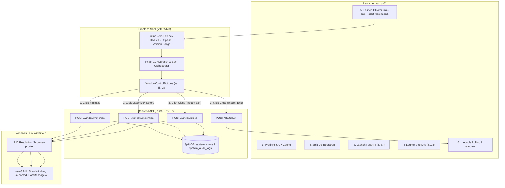

# 01 - Architecture Specification: Window Management, Startup Splash & Telemetry

## 1. System Overview

CAT iVISION runs as an Industrial Human-Machine Interface (HMI) deployed on a dedicated workstation. The runtime comprises three decoupled subsystems:
1. **Frontend Presentation Shell (TanStack Start + React 19 + Vite)**: Renders the operator workspace, inspection canvas, CAD layers, and titlebar controls.
2. **Backend Engine (FastAPI + Uvicorn + SQLite Split-DB)**: Manages inspection sessions, image processing pipelines, hardware interfaces, and native OS loopback commands.
3. **Desktop Supervision Launcher (`run.ps1` / `run.sh`)**: Orchestrates environment preflight, Split-DB migrations, server backgrounding, and Chromium embedded app window lifecycle.

---

## 2. Desktop Mode Contract & Browser Launch Architecture

### 2.1 The `--start-fullscreen` Trap vs `--start-maximized`
When Chromium is invoked with `--start-fullscreen`:
- Chromium engages HTML5 Kiosk Fullscreen mode.
- The browser window loses standard Win32 caption and frame semantics.
- JavaScript `requestFullscreen()` triggers intrusive security notifications: `"http://127.0.0.1:5173 — To exit full screen, press Esc"`.
- External Win32 `ShowWindow(hwnd, SW_MINIMIZE)` or `SW_RESTORE` calls are rejected or overridden by Chromium's internal presentation engine.

### 2.2 Standard Industrial HMI Mode (`--start-maximized`)
In `--start-maximized` mode:
- The window launches maximized, occupying 100% of the display work area without OS taskbar clipping.
- The titlebar buttons (`WindowControlButtons.tsx`) own window manipulation without triggering browser fullscreen popups.
- Standard Win32 API messages (`SW_MINIMIZE`, `SW_RESTORE`, `SW_MAXIMIZE`, `WM_CLOSE`) behave reliably with sub-10ms response times.

---

## 3. Pre-Hydration Splash Screen Architecture

### 3.1 Startup Latency Analysis
In TanStack Start and Vite development environments:
- The browser downloads the initial HTML skeleton (`~2ms`).
- Vite compiles and bundles on-demand JavaScript modules (`1,500ms - 3,500ms`).
- React mounts, executes stores (`useBackendMode`, `useUiPrefsStore`), and runs initial queries (`500ms`).
- **Total delay before UI renders**: 2 to 4 seconds of black/empty screen.

### 3.2 Zero-Latency Inline Splash Component
To eliminate blank screens:
1. An inline HTML/CSS splash container (`id="app-pre-hydration-splash"`) is injected directly into `src/routes/__root.tsx` inside `<body>`.
2. All CSS styles (animations, layout, typography, dark theme tokens) are embedded inline within a `<style>` tag, requiring zero external CSS file loads.
3. The splash screen renders immediately upon HTML byte receipt, displaying:
   - High-resolution SVG Cat Vision logo (`/cat-logo.svg`).
   - Industrial pulse spinner with cyan/amber status ring.
   - Version badge matching `APP_VERSION_INFO.version` (`v4.113.15`).
   - Status copy: `"CAT iVISION — Initializing Industrial Inspection Engine..."`.
4. As soon as React mounts, a `useEffect` hook in `RootBootLoader` initiates a CSS `opacity: 0` fade-out (`duration: 300ms`) and unmounts the splash element from the DOM.

---

## 4. Win32 Native Window Bridge Architecture

### 4.1 PID-Based Window Discovery
Rather than fragile window title string matching, the backend detects the target window deterministically:
1. Locate the running `chrome.exe` / `msedge.exe` process that contains `--user-data-dir=.../.browser-profile` in its command line.
2. Store the target PID list.
3. Use `EnumWindows` and `GetWindowThreadProcessId` to filter HWNDs belonging to the target PIDs.
4. Filter by visibility (`IsWindowVisible`) and bounding rectangle (`GetWindowRect` width > 400, height > 300) to discard hidden utility/GPU helper HWNDs.

### 4.2 Win32 Action Dispatch Matrix
| Action | Win32 Function | Arguments | Description |
| :--- | :--- | :--- | :--- |
| **Minimize** | `ShowWindow` | `SW_FORCEMINIMIZE (11)` + `SW_MINIMIZE (6)` | Forces immediate taskbar minimization even if thread is suspended. |
| **Restore** | `ShowWindow` | `SW_RESTORE (9)` | Restores window to previous normal bounds if currently maximized. |
| **Maximize** | `ShowWindow` | `SW_MAXIMIZE (3)` | Expands window to fill desktop work area. |
| **Close** | `PostMessageW` + `TerminateProcess` | `WM_CLOSE (0x0010)` | Sends graceful close; executes instant process termination (<10ms). |
