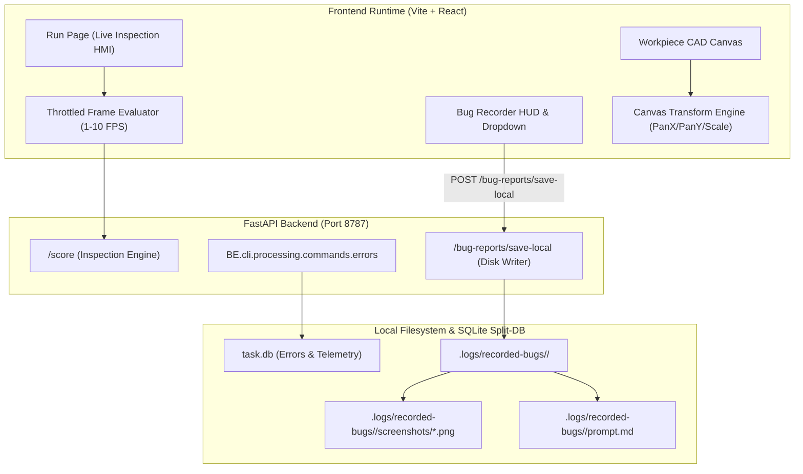

# 01 - Architecture Specification: Run Stability, Bug Recorder Dropdown & ROI Shape Immutability

- **Specification ID**: `SPEC-85-01`
- **Module**: `AppRuntime / InspectionCanvas / BugRecorder`
- **Status**: Verified Architecture
- **Date**: 2026-10-31

---

## 1. System Context & Overview

This specification formalizes the architectural boundary and interaction model between the frontend inspection HMI (`src/routes/run.tsx`, `WorkpieceAnalyzeWorkspace.tsx`), the Bug Recorder diagnostic subsystem (`src/components/recorder/`, `BE/routes/bug_reports.py`), and the vector CAD workpiece canvas (`VisualToolWorkpieceCanvas.tsx`, `RegionOverlay.tsx`).

---

## 2. Key Architectural Invariants

### 2.1 Run Screen State Decoupling
- **Zero DOM Element Recreation**: The inspection canvas background image (`MachineFrame.tsx`) uses `decoding="async"` and smooth CSS opacity transitions without remounting DOM image nodes on every tick.
- **Reference Image Synchronizer**: State setters (`setReferenceImage`) are gated so identical URLs are never dispatched repeatedly, eliminating state churn in Zustand.
- **Separated Timer Interval**: Wall clock elapsed time is isolated to avoid full component tree invalidations.

### 2.2 Bug Recorder 4-Action Export Model
- **Universal Multi-Action Selector**: Replacing single "Export ZIP" with a 4-action dropdown:
  1. `Export ZIP`: Bundles activity JSON, session metadata, and screenshots into an offline archive.
  2. `Copy Prompt for AI / IDE`: Emits markdown conforming to Google Antigravity file attachment syntax (`@[file;.logs/recorded-bugs/<session_id>/screenshots/<file_name>.png]`).
  3. `Save to Local Machine`: Persists directly to host disk `.logs/recorded-bugs/<id>/` via loopback HTTP endpoint.
  4. `Inspect in CLI`: Generates terminal diagnostic command `python -m BE.cli.processing.main errors list --session-id <id> --trace`.

### 2.3 ROI Shape Immutability & Coordinate Invariants
- **Non-Destructive Aspect Ratios**: Rectangular search regions (e.g. Caliper, Edge Width, Defect) preserve asymmetric width and height. Auto-squaring logic is strictly restricted to rules where `shapeType === "square"`.
- **True Circularity**: Circle ROIs enforce uniform diameter (`rx = ry = r`), preventing elliptical distortion.
- **Equilateral Polygon Vertices**: Regular polygons maintain uniform radius across resizing operations.
- **Boundary Clamping**: All ROI coordinates are strictly clamped within natural image bounds (`[0, naturalW - 16]`, `[0, naturalH - 16]`).

### 2.4 In-ROI Pattern Search Hierarchy
- **Parent-Child Coupling**: T102 Pattern Search template boxes (1..57) are modeled as child layers under the parent ROI (`depth: 1` or `2`).
- **Relative Coordinate Binding**: Child template boxes store percentage-based coordinates (`relX, relY, relWidth, relHeight`), locking them permanently inside the parent ROI bounds even when the ROI is moved or resized.

### 2.5 Canvas Movement & Viewport Freedom
- **Full Interior Draggability**: `RegionOverlay.tsx` enables interior body dragging (`pointerEvents: "auto"`), removing the constraint that forced operators to click solely on the top 20px header bar.
- **2D Canvas Pan State**: `VisualToolWorkpieceCanvas.tsx` introduces `panX, panY` with space-drag, middle-click, and gesture support, allowing unrestricted navigation at any zoom level.
