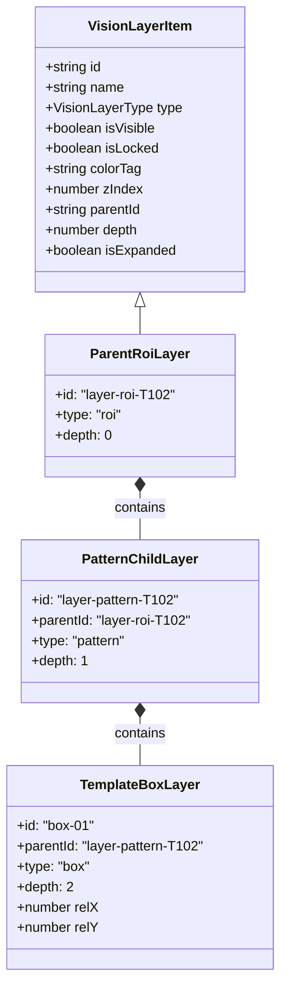

# 04 - ROI Shape Immutability & In-ROI Pattern Search Specification

- **Specification ID**: `SPEC-85-04`
- **Module**: `AppRuntime / InspectionCanvas / CADRules`
- **Status**: Verified Specification
- **Date**: 2026-10-31

---

## 1. Executive Summary

Industrial automated optical inspection (AOI) requires exact, millimeter-calibrated Regions of Interest (ROI). Auto-squaring rectangular search regions or distorting circular reticles produces severe false rejects and broken caliper measurements. This specification defines:
1. **Strict Shape Immutability**: Guarantees rectangular, circular, and polygonal ROIs are never automatically altered or squared.
2. **In-ROI Pattern Search Hierarchy**: Encapsulates T102 Pattern Search template constellations as child layers bound to parent ROI coordinates.
3. **Boundary Invariants**: Restricts all ROI extents strictly within natural image coordinate boundaries.

---

## 2. Shape Immutability Rules

### 2.1 Rectangles (Caliper, Defect, Edge Width, Barcode)
- **Aspect Ratio Freedom**: `width` and `height` are independently adjustable (`width !== height` allowed).
- **Auto-Squaring Ban**: No component or hook may call `squareSearchRegion` or set `width = height` unless `shapeType === "square"` is explicitly selected by the operator.
- **Workbench Parity**: `StandardWorkbenchCanvas` accepts `isSquareROI: props.isSquareROI ?? (props.shape === "square")`. When authoring or tuning Caliper rules (`StandardEdgeWidthTool`), `isSquareROI` is `false`.

### 2.2 Circles (Pin 1, Circular Pad, Via Hole)
- **True Circularity Invariant**: Diameter is uniform across all axes (`rx === ry === r`).
- **Rendering Invariant**: `ctx.arc(cx, cy, r, 0, Math.PI * 2)` replaces stretched `ctx.ellipse` calls.
- **Resize Locking**: Resizing any corner handle adjusts both width and height uniformly to preserve 1:1 circle geometry without elliptical stretching.

### 2.3 Regular Polygons (Hexagon, Octagon, Triangle)
- **Equilateral Invariant**: Vertices are calculated from a uniform circumscribed radius `r = Math.min(width, height) / 2`.
- **Proportional Scaling**: Resizing scales all vertex vectors proportionally without non-affine skewing.

---

## 3. In-ROI Pattern Search Layer Integration (T102)

### 3.1 Relative Coordinate Coupling
All pattern template boxes are stored with relative percentage coordinates `(relX, relY, relWidth, relHeight)`:
$$\text{box.x} = \text{roi.x} + \left(\frac{\text{box.relX}}{100}\right) \times \text{roi.width}$$
$$\text{box.y} = \text{roi.y} + \left(\frac{\text{box.relY}}{100}\right) \times \text{roi.height}$$
$$\text{box.width} = \max\left(4, \left(\frac{\text{box.relWidth}}{100}\right) \times \text{roi.width}\right)$$
$$\text{box.height} = \max\left(4, \left(\frac{\text{box.relHeight}}{100}\right) \times \text{roi.height}\right)$$

Moving or resizing the parent ROI automatically repositions all child template boxes without drifting or falling outside the parent region.
