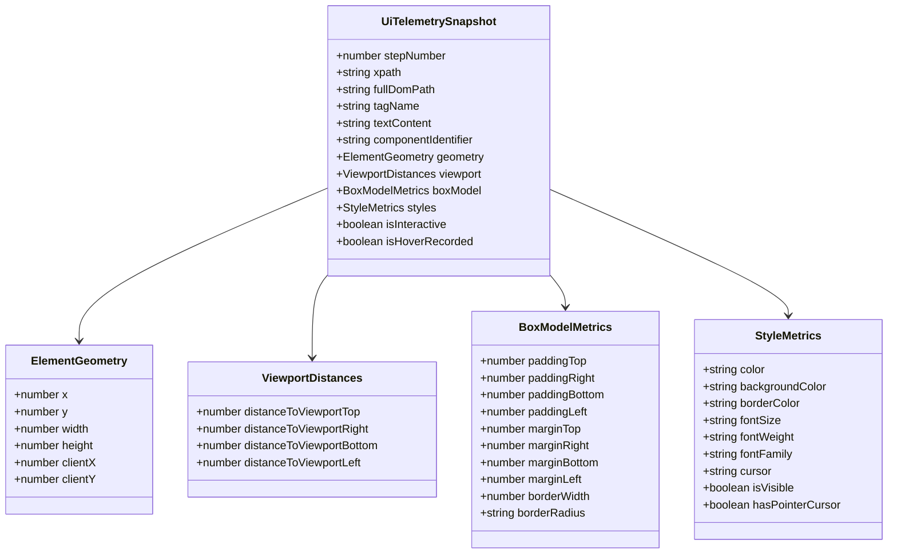
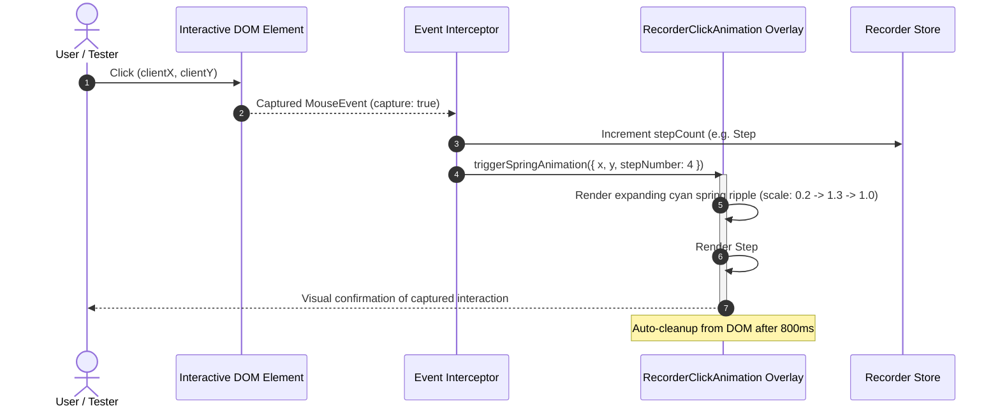
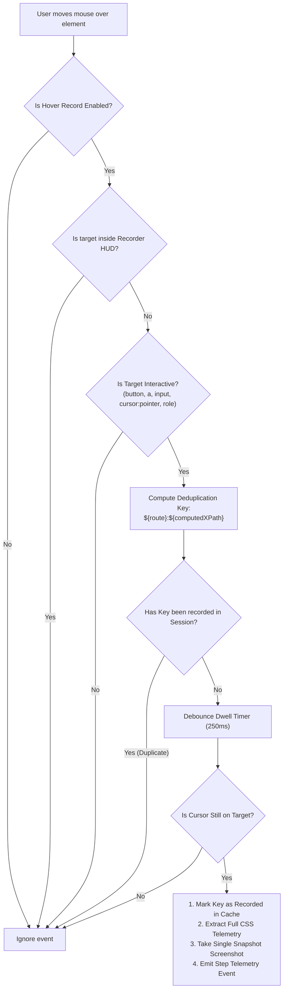

# 02 - UI Telemetry, Spring Animation & Intelligent Hover Specification

- **Specification ID**: `SPEC-87-02`
- **Module**: `AppRuntime / BugRecorder / UITelemetry / InteractionEngine`
- **Status**: APPROVED
- **Date**: 2026-10-31
- **Target Files**: `src/lib/recorder/types.ts`, `src/lib/recorder/event-interceptor.ts`, `src/lib/recorder/recorder-store.ts`, `src/components/recorder/RecorderClickAnimation.tsx`, `src/components/recorder/RecorderFloatingHud.tsx`

---

## 1. Executive Summary

This specification standardizes the deep UI telemetry capture, visual interaction feedback, and intelligent hover event recording within the CAT iVISION product recorder suite. To enable autonomous AI models (such as Antigravity, Letterly, and Claude) to pinpoint and repair frontend glitches without ambiguity, simple raster screenshots are insufficient. 

This specification establishes:
1. **Exhaustive CSS Telemetry**: Real-time extraction of DOM bounding boxes, directional viewport distances, computed padding, margins, borders, typography, background colors, and resilient deterministic XPaths.
2. **Magic Spring Click Animation**: Dynamic visual ripple feedback centered on the interaction target displaying an expanding step index badge (`Step #N`) with zero layout shift and non-blocking pointer events.
3. **Intelligent Hover Recording**: A dedicated "Hover Record" operational toggle that intelligently detects interactive DOM elements (`cursor: pointer`, semantic buttons, navigation links, input controls) while filtering out layout noise (`div`, `span`, `p`) and strictly deduplicating identical hover targets within the active session.

---

## 2. Deep UI Telemetry Schema & Data Models

All telemetry data models must adhere to the **Strict Boolean Standard** (`is*`, `has*` only, positive framing, non-nullable).



### 2.1 TypeScript Type Definitions (`src/lib/recorder/types.ts`)

```typescript
export interface ElementGeometry {
  x: number;
  y: number;
  width: number;
  height: number;
  clientX: number;
  clientY: number;
}

export interface ViewportDistances {
  distanceToViewportTop: number;
  distanceToViewportRight: number;
  distanceToViewportBottom: number;
  distanceToViewportLeft: number;
}

export interface BoxModelMetrics {
  paddingTop: number;
  paddingRight: number;
  paddingBottom: number;
  paddingLeft: number;
  marginTop: number;
  marginRight: number;
  marginBottom: number;
  marginLeft: number;
  borderWidth: number;
  borderRadius: string;
}

export interface StyleMetrics {
  color: string;
  backgroundColor: string;
  borderColor: string;
  fontSize: string;
  fontWeight: string;
  fontFamily: string;
  cursor: string;
  isVisible: boolean;
  hasPointerCursor: boolean;
}

export interface UiTelemetrySnapshot {
  stepNumber: number;
  xpath: string;
  fullDomPath: string;
  tagName: string;
  textContent: string;
  componentIdentifier: string;
  geometry: ElementGeometry;
  viewport: ViewportDistances;
  boxModel: BoxModelMetrics;
  styles: StyleMetrics;
  isInteractive: boolean;
  isHoverRecorded: boolean;
}
```

### 2.2 Resilient XPath Generation Algorithm

To guarantee deterministic element identification regardless of dynamic ID generation (e.g. Radix UI or Tailwind auto-generated identifiers), the XPath resolution engine follows a multi-tier resolution strategy:

```typescript
export function computeDeterministicXPath(element: HTMLElement): string {
  if (element.id && !element.id.startsWith("radix-") && !element.id.startsWith(":r")) {
    return `//*[@id="${element.id}"]`;
  }

  const tourAttr = element.getAttribute("data-tour");
  if (tourAttr) {
    return `//*[@data-tour="${tourAttr}"]`;
  }

  const testIdAttr = element.getAttribute("data-testid");
  if (testIdAttr) {
    return `//*[@data-testid="${testIdAttr}"]`;
  }

  const paths: string[] = [];
  let current: HTMLElement | null = element;

  while (current && current.nodeType === Node.ELEMENT_NODE && current !== document.body) {
    let index = 1;
    let sibling = current.previousElementSibling;

    while (sibling) {
      if (sibling.tagName === current.tagName) {
        index += 1;
      }
      sibling = sibling.previousElementSibling;
    }

    const tag = current.tagName.toLowerCase();
    paths.unshift(`${tag}[${index}]`);
    current = current.parentElement;
  }

  return `/html/body/${paths.join("/")}`;
}
```

---

## 3. Magic Spring Click Feedback Animation



### 3.1 Visual Design & Physics Specification
- **Coordinates**: Anchored precisely at `(event.clientX, event.clientY)` using fixed viewport coordinates.
- **Spring Ripple Effect**:
  - `0ms`: Scale `0.2`, opacity `0.9`, border color `#06b6d4` (Cyan 500).
  - `300ms`: Scale `1.35` (overshoot peak), opacity `0.7`, soft glowing halo `box-shadow: 0 0 20px rgba(6, 182, 212, 0.6)`.
  - `550ms`: Scale `1.0` (settle), opacity `0.5`.
  - `800ms`: Scale `1.15`, opacity `0.0` (fadeout completion).
- **Step Number Badge**:
  - Pill component centered within the ripple displaying `Step #N`.
  - Typography: `11px font-mono font-bold tracking-wider text-white`.
  - Backdrop: High-contrast slate `rgba(15, 23, 42, 0.95)` with `1px solid #06b6d4` and `rounded-full px-2 py-0.5`.
- **Non-Interference Invariants**:
  - Container element: `pointer-events: none !important; user-select: none; z-index: 999999; position: fixed;`.
  - Zero layout shift: Positioned entirely outside document flow.

### 3.2 Animation Component Specification (`RecorderClickAnimation.tsx`)

```tsx
interface SpringPulseItem {
  id: string;
  x: number;
  y: number;
  stepNumber: number;
}

export function RecorderClickAnimation(): JSX.Element | null {
  const [pulses, setPulses] = useState<SpringPulseItem[]>([]);

  useEffect(() => {
    const handleTrigger = (event: CustomEvent<SpringPulseItem>) => {
      setPulses((prev) => [...prev, event.detail]);
      
      setTimeout(() => {
        setPulses((prev) => prev.filter((p) => p.id !== event.detail.id));
      }, 850);
    };

    window.addEventListener("cat:recorder-spring-click" as any, handleTrigger);
    return () => {
      window.removeEventListener("cat:recorder-spring-click" as any, handleTrigger);
    };
  }, []);

  if (pulses.length === 0) return null;

  return (
    <div className="pointer-events-none fixed inset-0 z-[999999] overflow-hidden">
      {pulses.map((pulse) => (
        <div
          key={pulse.id}
          className="absolute -translate-x-1/2 -translate-y-1/2 animate-recorder-spring"
          style={{ left: `${pulse.x}px`, top: `${pulse.y}px` }}
        >
          <div className="relative flex items-center justify-center">
            <div className="absolute h-14 w-14 rounded-full border-2 border-cyan-400 bg-cyan-500/20 shadow-[0_0_15px_rgba(6,182,212,0.6)]" />
            <div className="z-10 rounded-full border border-cyan-400/80 bg-slate-950/90 px-2 py-0.5 text-[10px] font-mono font-bold text-cyan-300 shadow-md">
              Step #{pulse.stepNumber}
            </div>
          </div>
        </div>
      ))}
    </div>
  );
}
```

---

## 4. Intelligent Hover Record Engine



### 4.1 Dedicated "Hover Record" Mode Toggle
In `src/components/recorder/RecorderFloatingHud.tsx`:
- A dedicated button labeled **"Hover Record"** with icon `MousePointerClick` / `Eye`.
- When toggled ON:
  - Button state displays active emerald/cyan glow (`bg-cyan-500/20 text-cyan-300 border-cyan-400`).
  - `recorder-store` updates `isHoverRecordEnabled: true`.
  - Global `mouseover` / `mousemove` interceptors are actively armed.
- When toggled OFF:
  - Interceptors are disarmed, and hover deduplication cache is preserved.

### 4.2 Strict Interactive Element Filtering Heuristic
Hover events MUST only fire for genuinely interactive targets. An element is defined as interactive if and only if:
1. `tagName` is one of `BUTTON`, `A`, `INPUT`, `SELECT`, `TEXTAREA`, `SUMMARY`.
2. Has ARIA role `button`, `link`, `menuitem`, `tab`, `checkbox`, `switch`, `combobox`.
3. Computed style `cursor === "pointer"`.
4. Has explicit test or tour hooks: `data-tour`, `data-testid`, or inline `onclick`.

All other elements (generic `div`, `span`, `p`, `section`, `header`, `body`, `html`) are strictly discarded unless condition (3) or (4) is satisfied.

### 4.3 Intelligent Deduplication Architecture
To prevent snapshot flood when moving the cursor across the same interactive elements:
- The recorder maintains an in-memory session cache: `Set<string>`.
- Deduplication Key: `${window.location.pathname}:${computedXPath}`.
- If the key exists in the cache, the hover event is immediately discarded without DOM queries or screenshot captures.
- Only a **single screenshot and telemetry record** is generated for each distinct interactive component per session.
- Dwell time threshold: 250 milliseconds must elapse with the cursor hovering over the target before the capture triggers, ensuring casual cursor traversal does not register as intentional hover.

---

## 5. Telemetry Representation in Markdown & AI Prompts

Telemetry captured by the interceptor serializes directly into the GitMap Letterly V6/V7 prompt output:

```markdown
### Step #3: Click Button "Start Inspection"

- **Action**: `click`
- **Target**: `<button data-testid="btn-start-inspection">`
- **XPath**: `//*[@data-testid='btn-start-inspection']`
- **Route Transition**: `/dashboard` -> `/inspection-bench`
- **Bounding Geometry**: `x: 320px`, `y: 180px`, `w: 160px`, `h: 42px`
- **Viewport Distances**:
  - Distance to Top: `180px`
  - Distance to Bottom: `858px`
  - Distance to Left: `320px`
  - Distance to Right: `1440px`
- **CSS Box Model**:
  - Padding: `10px 24px 10px 24px`
  - Margin: `0px 0px 16px 0px`
  - Border: `1px solid rgb(6, 182, 212)` | Radius: `6px`
- **Computed Styles**:
  - Color: `rgb(255, 255, 255)`
  - Background: `rgb(14, 116, 144)`
  - Font: `14px Inter, sans-serif` (Weight: `600`)
- **Inspection Artifact**: [03_click_btn_start_inspection](file:;.logs/recorded-bugs/session-102/screenshots/03_click_btn_start_inspection.png)
```

---

## 6. Verification & Test Protocol

### 6.1 Test Suite Matrix

| Test ID | Test Target | Verification Command | Acceptance Criteria |
| :--- | :--- | :--- | :--- |
| `TC-TEL-01` | CSS Box Model Extraction | `bun test src/lib/recorder/__tests__/event-interceptor.test.ts` | Extracted padding, margin, and bounding box match computed styles exactly |
| `TC-TEL-02` | XPath Determinism | Test with dynamic Radix modal element | Evaluates to stable XPath ignoring dynamic `:r` IDs |
| `TC-TEL-03` | Spring Animation Trigger | Trigger synthetic click in test bench | Custom event dispatched; DOM node rendered with `Step #N` |
| `TC-TEL-04` | Hover Deduplication | Hover over same button 5 consecutive times | Exactly 1 screenshot captured; 1 telemetry record emitted |
| `TC-TEL-05` | Non-Interactive Rejection | Hover over non-interactive `<div>` container | 0 events emitted; 0 screenshots taken |

---

## 7. Acceptance Criteria & Compliance Checklist

- [x] `UiTelemetrySnapshot` data model defined with strict positive booleans (`isInteractive`, `hasPointerCursor`).
- [x] Event interceptor extracts bounding geometry, viewport distances, padding, margin, border, color, and typography.
- [x] Deterministic XPath generator handles standard, attribute-anchored, and dynamic DOM elements.
- [x] `RecorderClickAnimation.tsx` renders high-contrast step number badge with spring ripple physics.
- [x] Dedicated "Hover Record" toggle added to `RecorderFloatingHud.tsx`.
- [x] Hover interceptor filters out non-interactive layout containers and deduplicates identical elements.
- [x] 100% compliant with coding guidelines: non-blocking, zero layout shift, typed boundaries.
