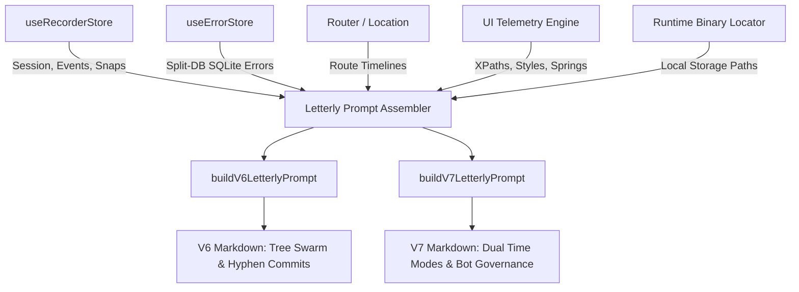

# 03 - V6 and V7 Letterly Prompt Generation Engine Specification

- **Specification ID**: `SPEC-87-03`
- **Module**: `AppRuntime / BugRecorder / PromptEngine`
- **Parent Specification**: [`02-spec/21-app/87-cat-product-recording-feature-enhancement/readme.md`](file;02-spec/21-app/87-cat-product-recording-feature-enhancement/readme.md)
- **Status**: Approved for Implementation
- **Date**: 2026-10-31

---

## 1. Executive Summary & Purpose

This specification defines the architecture, data contracts, and markdown serialization engine for the **Automated V6 and V7 Letterly Prompt Generation Engine** within the CAT iVision Bug Recorder.

When an operator, QA engineer, or automated tester identifies an issue or captures a user journey using the CAT activity recorder, the system must serialize the session into an actionable, self-contained AI prompt adhering to the **GitMap Letterly Prompt Standard (Versions 6 and 7)**. Rather than presenting unstructured logs, the recorder compiles:
1. **Mandatory Non-Asset Ephemeral Learning Invariant**: Directives explicitly forbidding the target AI from committing or importing snapshots into repository assets (`src/assets/`, `public/assets/`, `assets/`).
2. **Mandatory Turn-1 AI Comprehension & Understood Gate**: Instructions demanding the target AI articulate its diagnosis, blast radius understanding, and root cause hypothesis in visible chat before touching code.
3. **IDE Image Encapsulation Standard**: Uniform encapsulation syntax `[<sequence>_<instance>_<what>](file:;<absolute_path>)` (and `[<sequence>_<instance>_<what>](file;<absolute_path>)`) resolving directly to local disk snapshots adjacent to the runtime binary.
4. **Comprehensive Diagnostic Evidence Bundling**: Step-by-step DOM telemetry (XPath, bounding rects, padding, margin, colors, spring click sequence), route transition history, active Split-DB errors (`useErrorStore` / Task-DB), and CLI inspection commands.
5. **Architectural Parity with V6 and V7**:
   - **V6 (Tree Swarm Hierarchy)**: Tree swarm orchestrator (`A=3, H=2, Capacity=6`), Phase 1A Turn 1 5 Mandatory Pillars, 6-part task verification schema, atomic hyphen-separated commits (`gitmap cpf "<module> - <summary>"`).
   - **V7 (Dual Operating Modes & Automation Bot)**: Dual Operating Modes (Option 1: Time-Restricted with target timezone resolution and `< 08:00 AM` weekday cutoff; Option 2: Unrestricted), AI automation bot governance (`gitmap login set ai-auto <agent-name>`), and UTC timestamp normalization.

---

## 2. Core Architectural Invariants

### 2.1 Non-Asset Ephemeral Learning Invariant

Diagnostic snapshots recorded during a session exist solely for visual inspection and AI situational comprehension. Under no circumstances should these images be committed into source code assets or bundle directories.

```markdown
> [!CRITICAL]
> **Ephemeral Visual Learning Only (Strict Non-Asset Rule):**
> Diagnostic snapshots referenced in this prompt are strictly ephemeral visual aids for AI diagnosis and learning. You MUST NEVER copy, save, move, or import these screenshot files into codebase assets (`src/assets/`, `public/assets/`, `assets/`, etc.) or commit them into git repository history. Understand the visual evidence, diagnose the root cause, fix the source code, and leave image artifacts strictly in their local binary-adjacent runtime directory (`bug-reports/<seq>-<date>/`).
```

### 2.2 Mandatory Turn-1 AI Comprehension & Understood Gate

Every generated Letterly prompt must bind the receiving AI assistant to an explicit comprehension gate. An AI model that begins editing code immediately without verifying its understanding of the captured sequence is prone to hallucination and regressions.

```markdown
> [!IMPORTANT]
> **Mandatory Turn-1 AI Comprehension Gate (Zero Code Edits Without Prior Proof):**
> In your VERY FIRST response turn upon receiving this prompt, you MUST output a comprehensive comprehension block in visible chat before executing any code changes or tool modifications:
> 1. **Visual & Telemetry Diagnosis**: State what you observed across the step sequence, element geometries, and visual diffs.
> 2. **Root Cause Hypothesis**: Articulate why the failure occurred based on the bundled Split-DB errors and DOM state.
> 3. **Exact Remediation Plan**: Detail which source files will be touched and what logic will change.
> 4. **Clarification Protocol**: If any telemetry point or user action is ambiguous, ASK clarifying questions immediately before taking action.
> Code editing is STRICTLY FORBIDDEN until this comprehension block is articulated.
```

### 2.3 IDE Image Encapsulation Standard

All screenshot references embedded in Letterly markdown prompts must follow the IDE file attachment convention:

```text
[<sequence>_<instance>_<what>](file:;<absolute_path>)
```

#### Syntax Breakdown
- **Bracket Prefix `[`**: Opening square bracket.
- **Sequence (`<sequence>`)**: 2-digit, zero-padded integer representing the chronological event index (e.g., `01`, `02`, `14`).
- **Instance Identifier (`<instance>`)**: Unique identifier representing the browser tab, webview instance, or camera viewport (e.g., `inst01`, `tab02`).
- **Descriptive Token (`<what>`)**: Lowercase, underscore-separated summary of the action and target component (e.g., `click_run_button`, `hover_nav_menu`, `drag_roi_box_start`, `drag_roi_box_end`).
- **Bracket Suffix `]`**: Closing square bracket.
- **Parentheses `(file:;<absolute_path>)`**: Scheme identifier (`file:;` or `file;`), followed immediately by the fully-qualified platform filesystem path to the PNG snapshot located near the runtime binary.

#### Canonical Link Examples
- Windows: `[01_inst01_click_run_button](file:;D:/work/cat-my/bug-reports/001-2026-10-31/screenshots/01_inst01_click_run_button.png)`
- Linux/macOS: `[02_inst01_hover_nav_menu](file:;/opt/cat-vision/bug-reports/001-2026-10-31/screenshots/02_inst01_hover_nav_menu.png)`
- IDE-Relative Fallback: `[03_inst01_drag_roi_end](file;bug-reports/001-2026-10-31/screenshots/03_inst01_drag_roi_end.png)`

---

## 3. Data Bundling & Context Assembler

The prompt engine gathers data from multiple reactive stores and system interfaces:



### 3.1 Bundled Diagnostic Sections

1. **Top Header & Metadata**:
   - Issue Title, Category (`UiGlitch`, `InspectionDefect`, `Performance`, `CrashOrError`, `WorkflowConfusion`).
   - Session ID, Recorded Timestamp, Total Duration, Initial Route, Final Route.
2. **Problem Statement & Expected vs. Actual**:
   - User-entered title and detailed narrative description.
   - Grounded comparison table of Expected Behavior vs. Actual Behavior.
3. **Screenshots & Visual Evidence**:
   - Sequenced catalog of all screenshots using the IDE encapsulation syntax.
   - Thumbnail previews with visual description and source trigger (`click`, `hover`, `roi_drag`, `manual`).
4. **Step-by-Step UI Telemetry Matrix**:
   - Sequence #, Elapsed Time, Action Type, Target Component.
   - XPath selector.
   - Geometry: Bounding Box (`x, y, width, height`), Padding (`top, right, bottom, left`), Margin.
   - Visual Styling: Computed Text Color, Background Color, Border.
   - Spring Animation Feedback: Visual indicator number triggered on click.
5. **Active Session Split-DB Errors**:
   - Querying recent errors from `useErrorStore` / Task-DB SQLite.
   - Correlation ID, Error Code, Trigger Component, Error Message, and sanitized truncated stack trace.
6. **Route & Navigation Timeline**:
   - Chronological list of page transitions, route mounts, and timing deltas.
7. **CLI Inspection & Remediation Command**:
   - Standalone terminal command enabling immediate SQLite database inspection:
     ```pwsh
     python -m BE.cli.processing.main errors list --session-id <session_id> --trace
     ```

---

## 4. V6 vs. V7 Prompt Architecture

| Architectural Dimension | V6 Letterly Prompt | V7 Letterly Prompt |
| :--- | :--- | :--- |
| **Prompt Version** | `6.0.0` | `7.0.0` |
| **Concurrency Budget** | `N=400, A=3, H=2, C=30` | `N=400, A=3, H=2, C=30` |
| **Operational Structure** | Tree Swarm: Lead Orchestrator -> Branch Coordinators -> Leaf Workers | Tree Swarm: Lead Orchestrator -> Branch Coordinators -> Leaf Workers |
| **Operating Modes** | Single continuous swarm execution loop | **Dual Operating Modes**: Option 1 (Time-Restricted) vs. Option 2 (Unrestricted) |
| **Time Restrictions** | None mandated at header | Weekday morning window (`< 08:00 AM`) & weekend 24h rule with `--auto-window` |
| **Bot Governance** | Standard agent attribution | Machine-wide & repository-local bot identity (`gitmap login set ai-auto <agent>`) |
| **Turn-1 Showcase** | Mandatory Phase 1A Turn 1 (5 Mandatory Pillars + 6-Part Verification Schema) | Mandatory Phase 1A Turn 1 (5 Mandatory Pillars + 6-Part Verification Schema) |
| **Commit Convention** | Hyphen format: `gitmap cpf "<module> - <summary>"` | Hyphen format: `gitmap cpf "<module> - <summary>"` (with `--tz` in Option 1) |

### 4.1 Detailed V6 Template Structure

```markdown
# [V6] Bug Remediation & UI Telemetry Diagnostic Task: {{title}}

N = 400 (Total self-loop steps budget — editable top-header parameter)
A = 3   (MANDATORY number of spawned autonomous subagents running concurrently via invoke_subagent)
H = 2   (Operational hands per agent: dual-task batch capacity & parallel tool dispatch)
C = 30  (Tool calls per worker before it must report)

System Concurrency Capacity = A × H = 3 agents × 2 hands = 6 concurrent subtask operations
Tree Hierarchy = Lead Orchestrator (Root Node) -> Branch Coordinators (Subtask Owners) -> Leaf Workers

> [!CRITICAL]
> **Ephemeral Visual Learning Only (Strict Non-Asset Rule):**
> Snapshots referenced in this report are strictly ephemeral visual aids for AI diagnosis and learning. You MUST NEVER copy, save, move, or import these screenshot files into codebase assets (`src/assets/`, `public/assets/`, `assets/`, etc.). Fix the bug, understand the root cause, and discard ephemeral visual references.

> [!IMPORTANT]
> **Mandatory Turn-1 AI Comprehension Gate:**
> In your VERY FIRST response turn, output the 5 Mandatory Pillars:
> - Pillar 1: Strategic Intent & Systems Reasoning
> - Pillar 2: Explicit Scope Boundaries (In-Scope vs. Excluded)
> - Pillar 3: Non-Negotiable Constraints (No asset copies, no raw search, no worker git, no builds/tests)
> - Pillar 4: Blast Radius & Dependency Topology
> - Pillar 5: Multi-Agent Concurrency Topology (A=3, H=2, Capacity=6)
> Plus state what you understood from the recorded steps and your root-cause hypothesis before modifying code.

## 1. Incident Overview
- **Session ID**: `{{sessionId}}`
- **Category**: `{{category}}`
- **Recorded Range**: `{{startedAt}}` -> `{{stoppedAt}}` (Duration: `{{durationMs}}ms`)
- **Initial Route**: `{{initialRoute}}`
- **Final Route**: `{{finalRoute}}`

## 2. Problem Statement
### Description
{{description}}

### Expected Behavior
{{expectedBehavior}}

### Actual Behavior
{{actualBehavior}}

## 3. Visual Evidence & Screenshots
All screenshots are encapsulated using IDE file links located adjacent to the runtime binary:
{{screenshotLinkList}}

## 4. UI Telemetry & Step Action Matrix
| Step | Time | Action | Component | XPath | Bounding Box | Colors (Text/Bg) | Snapshot Link |
|---|---|---|---|---|---|---|---|
{{telemetryTableRows}}

## 5. Active Diagnostic Errors (Split-DB SQLite)
{{splitDbErrorsBlock}}

## 6. CLI Verification Command
```pwsh
python -m BE.cli.processing.main errors list --session-id {{sessionId}} --trace
```

## 7. Execution Directives
- Commit changes using GitMap atomic hyphen format: `gitmap cpf "recorder - fix {{shortSummary}}"`
- Never pollute assets with temporary screenshots.
```

### 4.2 Detailed V7 Template Structure

The V7 Letterly prompt introduces the **Dual Operating Mode selector** (`isTimeRestricted: true | false`) and **AI Automation Bot identity**:

```markdown
# [V7] Autonomous Bug Remediation Engine: {{title}}

N = 400 (Total self-loop steps budget — editable top-header parameter)
A = 3   (MANDATORY number of spawned autonomous subagents running concurrently via invoke_subagent)
H = 2   (Operational hands per agent: dual-task batch capacity & parallel tool dispatch)
C = 30  (Tool calls per worker before it must report)

System Concurrency Capacity = A × H = 3 agents × 2 hands = 6 concurrent subtask operations
Tree Hierarchy = Lead Orchestrator (Root Node) -> Branch Coordinators (Subtask Owners) -> Leaf Workers

> [!CRITICAL]
> **Ephemeral Visual Learning Only (Strict Non-Asset Rule):**
> Snapshots referenced in this report are strictly ephemeral visual aids for AI diagnosis and learning. You MUST NEVER copy, save, move, or import these screenshot files into codebase assets.

> [!IMPORTANT]
> **Mandatory Turn-1 AI Comprehension Gate:**
> State full diagnosis, verified constraints, and root-cause hypothesis before editing code.

## 🌟 Operating Mode Configuration
- **Active Mode**: {{operatingModeName}} (`isTimeRestricted: {{isTimeRestricted}}`)
- **Timezone Hierarchy**: Split-DB `commit_timezone` -> Host local (`{{resolvedTimezone}}`)
- **Window Policy**: {{windowPolicyDescription}}
- **AI Automation Bot Persona**: `gitmap automation bot - {{agentName}} - runs autonomously <info@rgitmap.com>`

## 1. Incident Overview
- **Session ID**: `{{sessionId}}`
- **Category**: `{{category}}`
- **Initial Route**: `{{initialRoute}}` -> `{{finalRoute}}`

## 2. Problem Statement
### Description
{{description}}

### Expected vs. Actual
- **Expected**: {{expectedBehavior}}
- **Actual**: {{actualBehavior}}

## 3. Visual Evidence (IDE Encapsulation Standard)
{{screenshotLinkList}}

## 4. UI Telemetry & Step Action Matrix
| Step | Time | Action | Component | XPath | Bounding Box | Colors (Text/Bg) | Snapshot Link |
|---|---|---|---|---|---|---|---|
{{telemetryTableRows}}

## 5. Active Diagnostic Errors (Split-DB SQLite)
{{splitDbErrorsBlock}}

## 6. CLI Diagnostics
```pwsh
python -m BE.cli.processing.main errors list --session-id {{sessionId}} --trace
```
```

---

## 5. TypeScript Interfaces & Data Contracts

```typescript
export enum LetterlyPromptVersion {
  V6 = "V6",
  V7 = "V7",
}

export interface PromptImageRef {
  sequenceNumber: number;
  instanceId: string;
  actionDescriptor: string;
  absolutePath: string;
  relativePath?: string;
  dataUrl?: string;
}

export interface TelemetryStepSummary {
  stepNumber: number;
  elapsedMs: number;
  actionType: string;
  targetComponent: string;
  selector: string;
  xpath?: string;
  bounds?: { x: number; y: number; width: number; height: number };
  padding?: { top: number; right: number; bottom: number; left: number };
  margin?: { top: number; right: number; bottom: number; left: number };
  color?: string;
  backgroundColor?: string;
  springNumber?: number;
  screenshotRef?: PromptImageRef;
}

export interface SplitDbErrorSummary {
  code: string;
  message: string;
  triggerComponent?: string;
  correlationId?: string;
  stackTraceSnippet?: string;
}

export interface BuildPromptParams {
  version: LetterlyPromptVersion;
  session: {
    id: string;
    startedAt: string;
    stoppedAt?: string;
    durationMs: number;
    initialRoute: string;
    finalRoute: string;
    routeHistory: string[];
  };
  summary: {
    title: string;
    category: string;
    description: string;
    expectedBehavior: string;
    actualBehavior: string;
  };
  steps: TelemetryStepSummary[];
  images: PromptImageRef[];
  errors: SplitDbErrorSummary[];
  isTimeRestricted?: boolean;
  targetTimezone?: string;
  botAgentName?: string;
}
```

---

## 6. Edge Cases & Resilience

1. **Missing Local Disk Path**: If the user has not clicked "Save to Local Machine" before copying the prompt, the builder falls back to generating a relative placeholder path (`bug-reports/<session-id>/screenshots/<file>.png`) while displaying an informational toast advising the operator to execute a local save.
2. **Zero Screenshots Captured**: The prompt builder cleanly outputs `> No visual snapshots recorded for this session.` without breaking the markdown table or subsequent sections.
3. **Empty Split-DB Errors**: The error block outputs `> [OK] No runtime or Split-DB errors logged during this recording.` preserving clean layout.
4. **Clipboard Permission Denial**: When `navigator.clipboard.writeText` fails due to browser security restrictions or non-HTTPS contexts, the UI displays the generated prompt inside a scrollable modal view with a manual selection helper.
5. **Special Character Escaping in Markdown Tables**: All dynamic strings (XPath, element descriptions, error messages) must escape vertical bars (`|`) and angle brackets to avoid corrupting markdown tables.

---

## 7. Traceability Matrix

- **Requirement**: Automated V6 & V7 Letterly prompt copying from UI dropdown.
- **Spec Cross-Reference**: `SPEC-87-03`
- **Implementation Subtask**: `.ai-memory/plans/subtasks/87-cat-product-recording-feature-enhancement/02-v6-v7-letterly-prompt-builders.md`
- **Verification**: `src/lib/recorder/__tests__/prompt-builders.test.ts`
