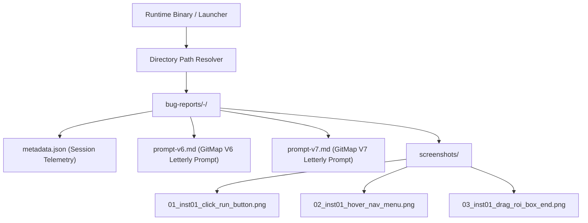
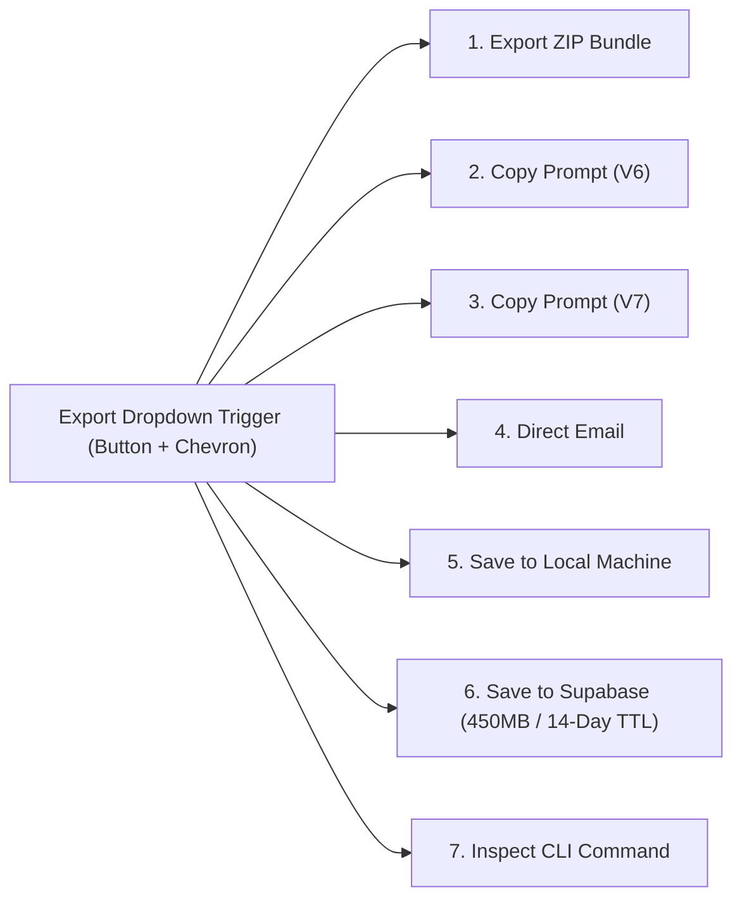

# 04 - Local Snapshot Storage Architecture & Multi-Action Export Specification

- **Specification ID**: `SPEC-87-04`
- **Module**: `AppRuntime / BugRecorder / Storage & Export`
- **Parent Specification**: [`02-spec/21-app/87-cat-product-recording-feature-enhancement/readme.md`](file;02-spec/21-app/87-cat-product-recording-feature-enhancement/readme.md)
- **Status**: Approved for Implementation
- **Date**: 2026-10-31

---

## 1. Executive Summary & Purpose

This specification governs the local file persistence and multi-destination export engine for the CAT iVision Bug Recorder.

### Core Problems Solved
1. **Repository Asset Pollution Prevention**: Previously, diagnostic screenshots risked being written into project asset folders (`assets/`, `src/assets/`, `public/assets/`). This spec guarantees that all recorded artifacts remain strictly adjacent to the executable binary in `bug-reports/<seq>-<date>/`.
2. **Deterministic Sequence & Naming**: Screenshots are systematically sequenced and named (`<seq>_<instance>_<action>_<target>.png`), reflecting the chronological user action, viewport instance, and clicked/hovered component.
3. **Cluttered HUD & Modal UI Replacement**: Replaces rows of loose, disconnected export buttons with a consolidated, high-ergonomics **Multi-Action Export Dropdown** across both the floating recording HUD (`RecorderFloatingHud.tsx`) and the export modal (`RecorderExportModal.tsx`).
4. **Direct Email Integration**: Provides an integrated email dispatch workflow (`EmailExportModal.tsx`) enabling immediate bug transmission with attached markdown prompts and telemetry.

---

## 2. Local Snapshot Storage Architecture

### 2.1 Binary-Adjacent Directory Resolution

Diagnostic snapshots must be stored adjacent to the application's runtime executable, completely outside the source code repository tree.



#### Directory Resolution Hierarchy
1. **Compiled Standalone Binary Mode** (e.g., `dist/cat-vision.exe` or `/usr/local/bin/cat-vision`):
   - Path: `<binary_directory>/bug-reports/<seq>-<YYYY-MM-DD>/`
2. **Local Development / Script Runner Mode** (`run.ps1` / `run.sh` / Python backend):
   - Resolved against the runtime runner root: `<repo_root>/bug-reports/<seq>-<YYYY-MM-DD>/`
   - Explicitly validated to ensure it NEVER resolves to `src/assets/`, `public/assets/`, or `assets/`.
3. **Sequence Number Generation (`<seq>`)**:
   - 3-digit zero-padded integer (e.g., `001`, `002`, `042`).
   - Computed by scanning existing session folders in `bug-reports/` and incrementing the highest existing prefix, or querying the Split-DB sequence tracker.
4. **Date Format (`<date>`)**:
   - ISO-8601 calendar date `YYYY-MM-DD` based on local session start time.

### 2.2 Sequenced Screenshot Naming Convention

Every screenshot saved to disk must adhere to the deterministic naming grammar:

```text
<seq>_<instance>_<action>_<target>.png
```

| Component | Format | Description | Example |
| :--- | :--- | :--- | :--- |
| `<seq>` | `\d{2}` | 2-digit chronological sequence index | `01`, `02`, `15` |
| `<instance>` | `inst\d{2}` | Browser tab, webview, or canvas instance ID | `inst01`, `inst02` |
| `<action>` | `[a-z]+` | Recorded user action type (`click`, `hover`, `drag_start`, `drag_end`, `manual`) | `click`, `hover`, `drag_end` |
| `<target>` | `[a-z0-9_-]+` | Sanitized identifier or tag of the affected UI element | `btn_run_recipe`, `menu_editor`, `roi_box_2` |

#### Full Path Examples:
- `bug-reports/001-2026-10-31/screenshots/01_inst01_click_btn_run_recipe.png`
- `bug-reports/001-2026-10-31/screenshots/02_inst01_hover_menu_editor.png`
- `bug-reports/001-2026-10-31/screenshots/03_inst01_drag_end_roi_crop_box.png`

---

## 3. Backend Persistence Endpoint (`POST /bug-reports/local`)

The local persistence service runs within the Python backend (`BE/routes/bug_reports.py`) and is restricted to loopback clients (`127.0.0.1`, `::1`, `localhost`).

### 3.1 Request Payload Schema

```json
{
  "session_id": "rec-m7b4x1-9k2lp",
  "initialRoute": "/recipes/editor",
  "summary": {
    "title": "ROI Bounding Box Misalignment on Canvas Drag",
    "category": "InspectionDefect",
    "description": "Dragging the corner of the ROI box snaps 20px off from cursor position.",
    "expectedBehavior": "Bounding box handle tracks cursor exactly.",
    "actualBehavior": "Bounding box lags and jumps 20px downwards."
  },
  "screenshots": [
    {
      "id": "snap-01",
      "sequence": 1,
      "instance": "inst01",
      "action": "click",
      "target": "roi_handle_top_right",
      "dataUrl": "data:image/png;base64,iVBORw0KGgoAAAANSUhEUgAA...",
      "timestamp": 1730376000000
    }
  ],
  "events": [],
  "errors": []
}
```

### 3.2 Response Payload Schema

```json
{
  "Status": {
    "IsSuccess": true,
    "Code": 200,
    "Message": "Bug report saved adjacent to runtime binary"
  },
  "Results": [
    {
      "sessionId": "rec-m7b4x1-9k2lp",
      "folderName": "001-2026-10-31",
      "savedDir": "D:\\work\\cat-my\\bug-reports\\001-2026-10-31",
      "promptFileV6": "D:\\work\\cat-my\\bug-reports\\001-2026-10-31\\prompt-v6.md",
      "promptFileV7": "D:\\work\\cat-my\\bug-reports\\001-2026-10-31\\prompt-v7.md",
      "screenshotCount": 3,
      "savedImages": [
        {
          "name": "01_inst01_click_roi_handle_top_right.png",
          "relPath": "bug-reports/001-2026-10-31/screenshots/01_inst01_click_roi_handle_top_right.png",
          "absPath": "D:\\work\\cat-my\\bug-reports\\001-2026-10-31\\screenshots\\01_inst01_click_roi_handle_top_right.png",
          "ideTag": "[01_inst01_click_roi_handle_top_right](file:;D:\\work\\cat-my\\bug-reports\\001-2026-10-31\\screenshots\\01_inst01_click_roi_handle_top_right.png)"
        }
      ]
    }
  ]
}
```

---

## 4. Multi-Action Export Dropdown UI

To replace disparate action buttons, a unified dropdown component (`RecorderExportDropdown.tsx`) is deployed across the recorder suite.

### 4.1 Supported Export Actions



| Option | Display Label | Icon | Hotkey / Shortcut | Handler Function |
| :--- | :--- | :--- | :--- | :--- |
| 1 | **Export ZIP Bundle** | `Download` | `Ctrl+Z` | `handleExportZip()` |
| 2 | **Copy Prompt (V6)** | `FileCode` | `Ctrl+6` | `handleCopyPromptV6()` |
| 3 | **Copy Prompt (V7)** | `Bot` | `Ctrl+7` | `handleCopyPromptV7()` |
| 4 | **Direct Email** | `Mail` | `Ctrl+E` | `handleOpenEmailModal()` |
| 5 | **Save to Local Machine** | `HardDrive` | `Ctrl+S` | `handleSaveLocalDisk()` |
| 6 | **Save to Supabase** | `CloudUpload` | `Ctrl+U` | `handleUploadSupabase()` |
| 7 | **Inspect CLI Command** | `Terminal` | `Ctrl+C` | `handleCopyCliCommand()` |

### 4.2 UI Design & Ergonomics

- **Trigger Button**: High-visibility pill or split-button (`bg-slate-800 hover:bg-slate-700 text-slate-100 border border-slate-700`).
- **Dropdown Menu**: Dark theme surface (`bg-slate-900 border border-slate-800 shadow-xl rounded-lg py-1.5 min-w-[240px]`).
- **Action Items**: Includes an icon, action label, short descriptive subtext, and keyboard shortcut hint.
- **Loading State**: Displays an inline animated spinner (`Loader2`) next to the specific action currently in-flight without locking the entire UI.
- **Toast Notifications**: Sonner toasts give instant confirmation upon success (e.g., `Copied V6 Letterly Prompt to clipboard!`, `Saved 4 screenshots to bug-reports/001-2026-10-31`).

---

## 5. Direct Email Dispatch Specification

When the operator selects **Direct Email**, the `EmailExportModal` opens to provide a dedicated, secure dispatch channel.

### 5.1 Modal User Interface & Form Fields

1. **Recipient Email Address**:
   - Controlled input with email format validation.
   - Pre-populated with default support address (`support@catvision.ai` or configured recipient from Split-DB settings).
2. **Subject Line**:
   - Pre-populated as `[Bug Report] <Category>: <Title> (Session: <SessionId>)`.
3. **Custom Message / Notes**:
   - Textarea for operator observations or context not captured by telemetry.
4. **Attachment Options (Checkboxes)**:
   - `[x] Include V6 / V7 Letterly Markdown Prompt`
   - `[x] Include Split-DB SQLite Error Logs`
   - `[x] Attach Screenshot Images (ZIP or Base64 references)`
5. **Dispatch Channels**:
   - **Backend Dispatch** (`POST /bug-reports` with `channels: ["email"]`): Sends directly through configured SMTP / transactional email backend.
   - **Client-Side Fallback** (`mailto:`): Generates pre-formatted mailto URL with subject and encoded body for standard mail clients (Outlook, Thunderbird, Apple Mail).

---

## 6. Frontend Component Architecture

### 6.1 Component Decomposition

```text
src/components/recorder/
├── RecorderExportDropdown.tsx   # Consolidated dropdown menu component
├── EmailExportModal.tsx         # Dedicated direct email dispatch modal
├── RecorderFloatingHud.tsx      # Embeds RecorderExportDropdown in floating HUD
└── RecorderExportModal.tsx      # Embeds RecorderExportDropdown in end-of-session modal
```

### 6.2 Component Contracts

```typescript
export interface RecorderExportDropdownProps {
  session: RecorderSession;
  summary: BugReportSummary;
  onOpenEmailModal: () => void;
  className?: string;
  isCompact?: boolean;
}

export interface EmailExportModalProps {
  isOpen: boolean;
  onClose: () => void;
  session: RecorderSession;
  summary: BugReportSummary;
}
```

---

## 7. Accessibility, Keyboard Navigation & Tokens

- **Keyboard Support**:
  - `ArrowDown` / `ArrowUp` to navigate dropdown items.
  - `Enter` or `Space` to execute selection via `KeyboardKeyType.isEnterOrSpace(event.key)`.
  - `Escape` closes the dropdown and returns focus to the trigger button.
- **Focus Ring**: Prominent contrast focus ring (`focus-visible:ring-2 focus-visible:ring-cyan-500 focus-visible:outline-none`).
- **Color Tokens**:
  - Background: `bg-slate-900`
  - Border: `border-slate-800`
  - Text Primary: `text-slate-100`
  - Text Muted: `text-slate-400`
  - Accent Hover: `hover:bg-slate-800/80`
  - Active Blue: `text-cyan-400`

---

## 8. Verification & Acceptance Criteria

1. **Storage Isolation**: Executing "Save to Local Machine" creates files exclusively under `bug-reports/<seq>-<date>/` near the runtime binary. No files are written to `src/assets/`, `public/assets/`, or `assets/`.
2. **File Naming Integrity**: All saved screenshots conform to `<seq>_<instance>_<action>_<target>.png`.
3. **IDE Link Format**: Generated markdown links strictly match `[<sequence>_<instance>_<what>](file:;<absolute_path>)`.
4. **Dropdown Operation**: All 7 dropdown actions execute cleanly without console errors.
5. **Email Modal Flow**: Direct email modal successfully dispatches report via backend or falls back to system mailto client.
