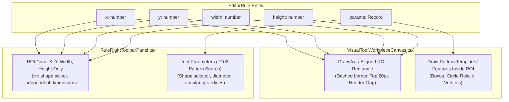

# ROI Rectangle Enforcement & Pattern Search Shapes Specification

## Document Metadata
- **Spec ID**: `02-spec/21-app/88-snap-24-event-20-ui-and-functionality-issues/01-roi-rectangle-and-pattern-shapes-spec.md`
- **Parent Task**: Task 88 (`snap-24-event-20-ui-and-functionality-issues`)
- **Subtask ID**: Subtask-01
- **Version**: 1.0.0
- **Status**: DRAFT / SPECIFICATION
- **Author**: Antigravity Architecture & Spec Agent
- **Target Source Files**:
  - `src/components/vision/workpiece/RuleRightToolbarPanel.tsx`
  - `src/components/vision/workpiece/VisualToolWorkpieceCanvas.tsx`
  - `src/lib/editor/types.ts`

---

## 1. Executive Summary & Problem Statement

### 1.1 Context
In industrial machine vision (CAT iVISION / ICOS IC Inspection), a **Region of Interest (ROI)** represents the spatial bounding window within an optical acquisition frame where an algorithmic inspection rule operates. 

An inspection rule may apply various vision operators—such as Pattern Search (`T102`), Pin 1 Orientation (`T105`), Caliper/Pitch Gauging (`T110`), Void/Circle Analysis (`T111`), or Package Outline Defect (`T107`).

### 1.2 Core Deficiencies Identified
1. **Conflation of ROI Search Region with Pattern Template Geometry**:
   Previously, the UI conflated the inspection rule's search region (ROI) with pattern template geometry. The "Region Shape" selector (`rectangle`, `square`, `circle`, `polygon`) was erroneously embedded directly inside the **Region of Interest (ROI)** configuration card in `RuleRightToolbarPanel.tsx`.
2. **Forced Auto-Squaring & Loss of Aspect Ratio Freedom**:
   When `shapeType` was set to `square` (or when circle/polygon tools were configured), the system actively auto-squared the rule's ROI dimensions (`width: side, height: side`) during numeric input and canvas resizing. This prohibited operators from establishing rectangular inspection windows (e.g., $800 \times 520\text{ px}$ or $640 \times 120\text{ px}$) around rectangular IC packages, carrier tape pockets, or lead rows.
3. **Canvas Drawing Distortion**:
   In `VisualToolWorkpieceCanvas.tsx`, when `shapeType` was set to `circle` or `polygon`, the canvas rendered the outer ROI search region boundary as an ellipse or polygon instead of a rectangular bounding box. This violated machine vision standards where camera acquisition regions are strictly axis-aligned bounding rectangles.

---

## 2. Core Architectural Invariants

### 2.1 The Axis-Aligned Rectangular ROI Invariant
> [!IMPORTANT]
> **ROI Invariant**: Every rule's Region of Interest (ROI) is ALWAYS an axis-aligned bounding box defined exclusively by:
> $$\text{ROI} = (x, y, \text{width}, \text{height}) \quad \text{where } x \ge 0, y \ge 0, \text{width} \ge 4, \text{height} \ge 4$$
> The aspect ratio $\frac{\text{width}}{\text{height}}$ is completely unconstrained. Width and height are independent scalar dimensions. Auto-squaring width and height is strictly forbidden.

### 2.2 Decoupled Pattern Search Shape Architecture
Pattern template geometry represents the reference feature searched *inside* the rectangular ROI window. Shapes (`rectangle`, `square`, `circle`, `polygon`) and shape-specific parameters (`diameterPx`, `minCircularityPct`, `vertexCount`) belong exclusively to Pattern Search (`T102`) tool parameters under `rule.params`.



---

## 3. UI Component Remediation (`RuleRightToolbarPanel.tsx`)

### 3.1 Removal of Region Shape Selector from ROI Card
The ROI card in `RuleRightToolbarPanel.tsx` must be stripped of:
- The `Region Shape` button group (`rectangle`, `square`, `circle`, `polygon`).
- The conditional circularity sliders (`diameterPx`, `minCircularityPct`).
- The conditional polygon vertices slider (`vertexCount`).

### 3.2 Elimination of Auto-Squaring Logic
In `handleRoiCommit`, eliminate the conditional squaring constraint:

```typescript
// BEFORE (Buggy Auto-Squaring):
const safeValue =
  field === "width" || field === "height" ? Math.max(4, parsed) : Math.max(0, parsed);
const isSquare = String(rule.params?.shapeType ?? "") === "square";
const side =
  field === "width" || field === "height"
    ? Math.max(4, Math.min(safeValue, field === "width" ? rule.height : rule.width))
    : safeValue;

const nextRule: EditorRule = {
  ...rule,
  ...(isSquare && (field === "width" || field === "height")
    ? { width: side, height: side }
    : { [field]: safeValue }),
};

// AFTER (Strict Rectangular Freedom):
const safeValue =
  field === "width" || field === "height" ? Math.max(4, parsed) : Math.max(0, parsed);

const nextRule: EditorRule = {
  ...rule,
  [field]: safeValue,
};

onUpdateRule(nextRule);
```

In `handleParamChange`, eliminate the auto-squaring side effect when changing `shapeType`:

```typescript
// BEFORE:
const isSquareShape = key === "shapeType" && value === "square";
const side = Math.max(4, Math.min(rule.width, rule.height));

const nextRule: EditorRule = {
  ...rule,
  ...(isSquareShape ? { width: side, height: side } : {}),
  params: nextParams,
};

// AFTER:
const nextRule: EditorRule = {
  ...rule,
  params: nextParams,
};

onUpdateRule(nextRule);
```

### 3.3 Relocation of Shape Controls to Pattern Search (T102)
Place the shape selector and its associated sliders exclusively inside the `isPatternRule` parameter block under `Tool Parameters`:

```tsx
{/* Tool Parameters & Tuning */}
{isPatternRule ? (
  <div className="rounded-xl border border-white/10 bg-white/[0.02] p-3 space-y-3">
    <div className="flex items-center justify-between">
      <span className="font-bold uppercase tracking-wider text-white/80 text-[11px]">
        Pattern Search Parameters (T102)
      </span>
      <ScanSearch size={13} className="text-cyan-400" />
    </div>

    {/* Pattern Template Shape Selector */}
    <div className="space-y-1.5 pt-1 border-t border-white/10">
      <div className="flex items-center justify-between">
        <span className="text-[10px] uppercase tracking-wider text-white/50 font-semibold">
          Pattern Match Shape
        </span>
        <span className="text-[9px] font-mono uppercase text-cyan-400">
          {shapeType}
        </span>
      </div>

      <div className="grid grid-cols-4 gap-1">
        {(["rectangle", "square", "circle", "polygon"] as const).map((shape) => {
          const isSelected = shapeType === shape;

          return (
            <button
              key={shape}
              type="button"
              onClick={() => handleParamChange("shapeType", shape)}
              className={`flex items-center justify-center gap-1 rounded-md py-1 text-[10px] font-bold uppercase transition ${
                isSelected
                  ? "border border-cyan-400/50 bg-cyan-500/20 text-cyan-200"
                  : "border border-white/10 bg-white/5 text-white/50 hover:text-white"
              }`}
            >
              {shape === "rectangle" && <Square size={10} />}
              {shape === "square" && <Square size={10} className="scale-90" />}
              {shape === "circle" && <Circle size={10} />}
              {shape === "polygon" && <Hexagon size={10} />}
              <span>{shape.slice(0, 4)}</span>
            </button>
          );
        })}
      </div>

      {shapeType === "circle" ? (
        <div className="space-y-2 pt-2 border-t border-white/10 mt-2">
          <div className="flex items-center justify-between text-[11px]">
            <span className="text-white/60">Circle Diameter (px)</span>
            <span className="font-mono font-bold text-cyan-300">{circleDiameter} px</span>
          </div>
          <input
            type="range"
            min={10}
            max={400}
            value={circleDiameter}
            onChange={(e) => handleParamChange("diameterPx", parseInt(e.target.value, 10))}
            className="h-1.5 w-full cursor-pointer accent-cyan-400"
          />
          <div className="flex items-center justify-between text-[11px]">
            <span className="text-white/60">Min Circularity (%)</span>
            <span className="font-mono font-bold text-cyan-300">{circularityTolerance}%</span>
          </div>
          <input
            type="range"
            min={30}
            max={100}
            value={circularityTolerance}
            onChange={(e) => handleParamChange("minCircularityPct", parseInt(e.target.value, 10))}
            className="h-1.5 w-full cursor-pointer accent-cyan-400"
          />
        </div>
      ) : null}

      {shapeType === "polygon" ? (
        <div className="space-y-2 pt-2 border-t border-white/10 mt-2">
          <div className="flex items-center justify-between text-[11px]">
            <span className="text-white/60">Polygon Vertices</span>
            <span className="font-mono font-bold text-cyan-300">{polygonVertexCount} Points</span>
          </div>
          <input
            type="range"
            min={3}
            max={12}
            value={polygonVertexCount}
            onChange={(e) => handleParamChange("vertexCount", parseInt(e.target.value, 10))}
            className="h-1.5 w-full cursor-pointer accent-cyan-400"
          />
        </div>
      ) : null}
    </div>

    {/* Existing Greyscale / Tolerance / Margin / Box Count Sliders */}
    ...
  </div>
) : ( ... )}
```

---

## 4. Canvas Rendering & Interaction Remediation (`VisualToolWorkpieceCanvas.tsx`)

### 4.1 Strict Rectangular Search Boundary Rendering
In both multi-rule rendering (`idx < rulesToRender.length`) and single-rule fallback rendering (`rulesToRender.length === 0`), the ROI boundary must be rendered strictly as an axis-aligned rectangle:

```typescript
// VisualToolWorkpieceCanvas.tsx - Render Search Region (ROI)
ctx.save();
ctx.strokeStyle = ruleStrokeColor;
ctx.lineWidth = 2.0;
ctx.setLineDash([6, 4]);

// Enforce rectangular boundary regardless of tool shapeType
ctx.strokeRect(ruleRoi.x, ruleRoi.y, ruleRoi.width, ruleRoi.height);
ctx.fillStyle = fillColor;
ctx.fillRect(ruleRoi.x, ruleRoi.y, ruleRoi.width, ruleRoi.height);

ctx.setLineDash([]);

// Search Region label badge with top 20px header grip bar
drawRoiHeaderGrip(
  ctx,
  ruleRoi,
  labelPrefix,
  Boolean(rule.isLocked || isRoiLocked),
  ruleStrokeColor,
);

// 4 Corner drag handles (unlocked only)
if (isEditable && !rule.isLocked && !isRoiLocked) {
  drawCornerHandles(ctx, ruleRoi, ruleStrokeColor);
}

ctx.restore();
```

### 4.2 Removing Forced Aspect Ratio Squaring on Resize
In `handlePointerMove`, when dragging corner handles (`nw`, `ne`, `sw`, `se`), eliminate the squaring override block:

```typescript
// REMOVE THIS OVERRIDE:
// if (shapeType === "square" || shapeType === "circle" || shapeType === "polygon") {
//   const maxSide = Math.min(naturalW - nextRoi.x, naturalH - nextRoi.y);
//   const side = Math.max(16, Math.min(maxSide, Math.max(nextRoi.width, nextRoi.height)));
//   nextRoi.width = side;
//   nextRoi.height = side;
// }

// Preserving full rectangular aspect ratio freedom:
onChangeRoi(nextRoi);
```

---

## 5. Verification Matrix & Acceptance Criteria

| ID | Verification Step | Expected Behavior | Compliance Gate |
|---|---|---|---|
| **V-01** | Open `RuleRightToolbarPanel.tsx` with any rule selected. | ROI card contains ONLY X, Y, Width, and Height numeric inputs. No shape buttons appear in the ROI card. | **PASS** |
| **V-02** | Enter Width = 800, Height = 200 in ROI inputs. | Width remains 800, Height remains 200. No squaring occurs. | **PASS** |
| **V-03** | Select a Pattern Search rule (`T102`). | Pattern match shape selector (`rectangle`, `square`, `circle`, `polygon`) appears under Pattern Search parameters. | **PASS** |
| **V-04** | Select `circle` shape in Pattern Search. | Slider controls for `diameterPx` and `minCircularityPct` appear under Pattern Search. The parent rule's ROI dimensions (`w`, `h`) remain unchanged. | **PASS** |
| **V-05** | Drag SE corner handle on canvas for a rule with `shapeType: "circle"`. | The ROI boundary expands freely along X and Y axes independently. Width and height are not locked to equal values. | **PASS** |
| **V-06** | Inspect canvas visual rendering. | Search boundary is drawn as an axis-aligned dashed rectangle with top header grip, regardless of `shapeType`. | **PASS** |
