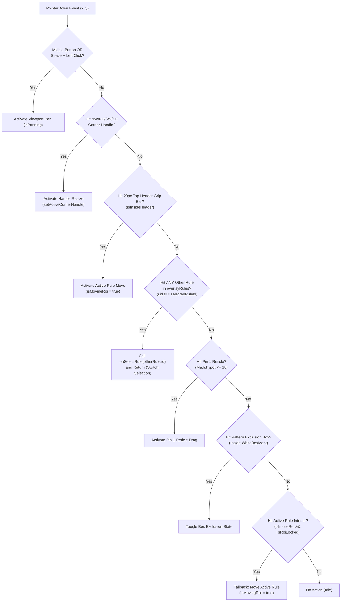

# Canvas Selection Unblock & Interaction Fix Specification

## Document Metadata
- **Spec ID**: `02-spec/21-app/88-snap-24-event-20-ui-and-functionality-issues/02-canvas-selection-unblock-spec.md`
- **Parent Task**: Task 88 (`snap-24-event-20-ui-and-functionality-issues`)
- **Subtask ID**: Subtask-02
- **Version**: 1.0.0
- **Status**: DRAFT / SPECIFICATION
- **Author**: Antigravity Architecture & Spec Agent
- **Target Source Files**:
  - `src/components/vision/workpiece/VisualToolWorkpieceCanvas.tsx`
  - `src/components/vision/workpiece/WorkpieceAnalyzeWorkspace.tsx`

---

## 1. Executive Summary & Problem Statement

### 1.1 Context
In the Cat Vision inspection canvas (`VisualToolWorkpieceCanvas.tsx`), operators interact directly with multiple inspection rules displayed as visual overlays (`overlayRules`). Rules have defined bounding geometries $(x, y, w, h)$, corner resize handles, top header grip bars, and internal pattern configurations.

During real-world workpiece inspection setups (e.g. carrier tape inspection, large IC packages), an active rule often spans a large surface area (e.g. $800 \times 520\text{ px}$ across a $960 \times 540\text{ px}$ frame).

### 1.2 Critical Interaction Failures Identified
1. **Hit-Test Priority Inversion Causing Selection Deadlock**:
   In `handlePointerDown`, the canvas prioritized `isInsideHeader || isInsideRoi` over checking whether the operator clicked a different rule in `overlayRules`. 
   
   Consequently, when an $800 \times 520\text{ px}$ rule was selected, almost every click on the entire canvas was intercepted as an interior body drag of the active rule. The rule selection loop (`// 4. Click other rule to select`) was never reached, permanently deadlocking the user into the active rule and making it impossible to click-select smaller nested or adjacent rules.
2. **Clamping Collapse to $(0,0)$ on Zero Delta**:
   In `handlePointerMove`, clamping logic calculated:
   $$\text{maxAllowedX} = \max(0, \text{naturalW} - \text{initial.width})$$
   $$\text{nextRoi.x} = \text{round}(\max(0, \min(\text{maxAllowedX}, \text{initial.x} + dx)))$$
   When an active rule had $\text{initial.width} \ge \text{naturalW}$ (e.g., $960\text{ px}$ wide), $\text{maxAllowedX}$ evaluated to $0$. Thus, $\min(0, \text{initial.x} + dx)$ immediately forced `x` to $0$, even when $dx = 0$ (zero delta). This caused spontaneous ROI jumping and coordinate collapse to $(0,0)$.
3. **Accidental Locking via Body Double-Click**:
   In `handleDoubleClick`, the event handler checked `if (isInsideHeader || isInsideRoi)` to toggle `isRoiLocked`. When operators double-clicked anywhere inside the active rule's large bounding area, the ROI silently locked itself. Subsequent drag attempts failed mysteriously until the operator discovered the locked state.
4. **Desynchronized Lock State**:
   In `WorkpieceAnalyzeWorkspace.tsx`, the `VisualToolWorkpieceCanvas` invocation failed to bind `onToggleLocked`, despite `railHandlers.onToggleLocked` being implemented and utilized by other panels. When lock states were toggled via the canvas, they were not committed to the central ruleset store (`useRulesStore`).

---

## 2. Interaction Architecture & Hit-Test Priority Model

To eliminate deadlocks and provide deterministic interaction handling, the pointer event pipeline in `VisualToolWorkpieceCanvas.tsx` must strictly execute in the following hierarchical order:



---

## 3. Detailed Technical Remediation

### 3.1 Resolving Hit-Test Priority Inversion in `handlePointerDown`
In `VisualToolWorkpieceCanvas.tsx`, restructure `handlePointerDown` to evaluate other rules **before** falling back to the active rule's interior body:

```typescript
function handlePointerDown(e: React.PointerEvent<HTMLCanvasElement>) {
  if (e.button === 1 || (isSpacePressed && e.button === 0)) {
    e.preventDefault();
    setIsPanning(true);
    setPanStart({ x: e.clientX, y: e.clientY, startPanX: panX, startPanY: panY });
    (e.target as HTMLElement).setPointerCapture?.(e.pointerId);

    return;
  }

  const { x, y } = getCanvasCoords(e.clientX, e.clientY);
  const headerRect = getRoiHeaderRect(roi);

  const isInsideHeader =
    x >= headerRect.x &&
    x <= headerRect.x + headerRect.width &&
    y >= headerRect.y &&
    y <= headerRect.y + headerRect.height;

  const isInsideRoi =
    x >= roi.x && x <= roi.x + roi.width && y >= roi.y && y <= roi.y + roi.height;

  // PRIORITY 1: Corner handles hit test (NW, NE, SW, SE) for active rule
  if (isEditable && onChangeRoi && !isRoiLocked) {
    const handleHitRadius = 14;
    const nwHit = Math.hypot(x - roi.x, y - roi.y) <= handleHitRadius;
    const neHit = Math.hypot(x - (roi.x + roi.width), y - roi.y) <= handleHitRadius;
    const swHit = Math.hypot(x - roi.x, y - (roi.y + roi.height)) <= handleHitRadius;
    const seHit =
      Math.hypot(x - (roi.x + roi.width), y - (roi.y + roi.height)) <= handleHitRadius;

    const hit = nwHit ? "nw" : neHit ? "ne" : swHit ? "sw" : seHit ? "se" : null;

    if (hit) {
      setActiveCornerHandle(hit);
      setDragStartPos({ x, y, initialRoi: { ...roi } });
      roiBridgeSessionRef.current = beginRoiInteraction({
        operationType: "roi-resize",
        screenCoords: { x: e.clientX, y: e.clientY },
        imageCoords: { x, y },
        geometry: { ...roi },
        handleId: `handle-${hit}`,
        element: canvasRef.current,
        label: toolName || "Workpiece ROI",
      });
      (e.target as HTMLElement).setPointerCapture?.(e.pointerId);

      return;
    }
  }

  // PRIORITY 2: Dedicated Top Header Grip Bar (20px)
  // Dragging from the top header bar ALWAYS moves the active rule without ambiguity
  if (isEditable && onChangeRoi && !isRoiLocked && isInsideHeader) {
    setIsMovingRoi(true);
    setDragStartPos({ x, y, initialRoi: { ...roi } });
    roiBridgeSessionRef.current = beginRoiInteraction({
      operationType: "roi-drag",
      screenCoords: { x: e.clientX, y: e.clientY },
      imageCoords: { x, y },
      geometry: { ...roi },
      handleId: "header-drag",
      element: canvasRef.current,
      label: toolName || "Workpiece ROI",
    });
    (e.target as HTMLElement).setPointerCapture?.(e.pointerId);

    return;
  }

  // PRIORITY 3: Rule Selection Overlap Check (Unblock Deadlocks)
  // Check if cursor clicked on a DIFFERENT rule in overlayRules.
  // Sort reverse to pick topmost; prefer smaller area rules for precise selection.
  if (onSelectRule && overlayRules.length > 0) {
    const clickedOtherRule = [...overlayRules]
      .reverse()
      .find(
        (r) =>
          !r.isHidden &&
          r.id !== selectedRuleId &&
          x >= r.x &&
          x <= r.x + r.width &&
          y >= r.y &&
          y <= r.y + r.height,
      );

    if (clickedOtherRule) {
      onSelectRule(clickedOtherRule.id);

      return;
    }
  }

  // PRIORITY 4: Tool-specific feature interactions (Pin 1 reticle, Pattern Box toggle)
  if (isPin1 && onUpdateParams) {
    const currentPin1X =
      (toolParams as any)?.pin1Config?.centerX ??
      (toolParams as any)?.pin1Config?.registeredPin1?.centerX;
    const currentPin1Y =
      (toolParams as any)?.pin1Config?.centerY ??
      (toolParams as any)?.pin1Config?.registeredPin1?.centerY;
    const isReticleHit =
      typeof currentPin1X === "number" &&
      typeof currentPin1Y === "number" &&
      Math.hypot(x - currentPin1X, y - currentPin1Y) <= 18;

    if (isReticleHit) {
      setIsDraggingPin1(true);
      (e.target as HTMLElement).setPointerCapture?.(e.pointerId);

      return;
    }
  }

  if (isPatternMatching && activeBoxesToDraw.length > 0) {
    const boxUnderCursor = activeBoxesToDraw.find(
      (b) => x >= b.x && x <= b.x + b.width && y >= b.y && y <= b.y + b.height,
    );

    if (boxUnderCursor) {
      setExcludedNumbers((prev) => {
        const next = new Set(prev);
        if (next.has(boxUnderCursor.number)) {
          next.delete(boxUnderCursor.number);
        } else {
          next.add(boxUnderCursor.number);
        }

        return next;
      });

      return;
    }
  }

  // PRIORITY 5: Active Rule Interior Body Drag Fallback
  // Only reached if click is inside the active rule and NOT on another rule or feature
  if (isEditable && onChangeRoi && !isRoiLocked && isInsideRoi) {
    setIsMovingRoi(true);
    setDragStartPos({ x, y, initialRoi: { ...roi } });
    roiBridgeSessionRef.current = beginRoiInteraction({
      operationType: "roi-drag",
      screenCoords: { x: e.clientX, y: e.clientY },
      imageCoords: { x, y },
      geometry: { ...roi },
      handleId: "interior-body-drag",
      element: canvasRef.current,
      label: toolName || "Workpiece ROI",
    });
    (e.target as HTMLElement).setPointerCapture?.(e.pointerId);

    return;
  }
}
```

### 3.2 Robust Clamping Math in `handlePointerMove`
Prevent coordinate collapse to $(0,0)$ when $dx = 0, dy = 0$ or when rule dimensions exceed image dimensions:

```typescript
if (isMovingRoi && dragStartPos && onChangeRoi) {
  const dx = x - dragStartPos.x;
  const dy = y - dragStartPos.y;

  // Zero-delta short circuit: prevent jitter and accidental reset
  if (dx === 0 && dy === 0) {
    return;
  }

  const initial = dragStartPos.initialRoi;
  const naturalW = imageElement?.naturalWidth || 960;
  const naturalH = imageElement?.naturalHeight || 540;

  // Safe upper bounds: allow positioning even when initial dimension >= natural dimension
  const maxAllowedX = naturalW > initial.width ? naturalW - initial.width : Math.max(0, initial.x);
  const maxAllowedY = naturalH > initial.height ? naturalH - initial.height : Math.max(0, initial.y);

  const targetX = initial.x + dx;
  const targetY = initial.y + dy;

  const clampedX = Math.round(Math.max(0, Math.min(maxAllowedX, targetX)));
  const clampedY = Math.round(Math.max(0, Math.min(maxAllowedY, targetY)));

  onChangeRoi({
    ...initial,
    x: clampedX,
    y: clampedY,
  });

  return;
}
```

### 3.3 Decoupling Accidental Locking from Interior Double-Clicks
In `handleDoubleClick`, restrict lock toggling strictly to the header grip lock area:

```typescript
function handleDoubleClick(e: React.MouseEvent<HTMLCanvasElement>) {
  const { x, y } = getCanvasCoords(e.clientX, e.clientY);
  const headerRect = getRoiHeaderRect(roi);

  const isInsideHeader =
    x >= headerRect.x &&
    x <= headerRect.x + headerRect.width &&
    y >= headerRect.y &&
    y <= headerRect.y + headerRect.height;

  // Strictly require double-click on the header bar; body double-click is ignored
  if (isInsideHeader) {
    const nextLocked = !isRoiLocked;
    setIsRoiLocked(nextLocked);
    if (selectedRuleId && onToggleLocked) {
      onToggleLocked(selectedRuleId);
    }
  }
}
```

### 3.4 Lock State Synchronization with `WorkpieceAnalyzeWorkspace.tsx`
In `WorkpieceAnalyzeWorkspace.tsx`, pass `onToggleLocked` to `VisualToolWorkpieceCanvas`:

```tsx
<VisualToolWorkpieceCanvas
  imageRef={project.inspectionImageRef}
  roi={
    activeRule
      ? {
          x: activeRule.x,
          y: activeRule.y,
          width: activeRule.width,
          height: activeRule.height,
        }
      : undefined
  }
  onChangeRoi={handleChangeActiveRuleRoi}
  toolCode={
    typeof activeRule?.params?.toolCode === "string"
      ? activeRule.params.toolCode
      : undefined
  }
  toolName={activeRule?.name}
  toolParams={activeRule?.params}
  isEditable={Boolean(activeRule)}
  isAnalyzeMode={true}
  overlayRules={projectOverlayRules}
  selectedRuleId={activeRule?.id}
  onSelectRule={handleSelectProjectRule}
  onLaunchPatternTuner={handleLaunchPatternTuner}
  onPatternBoxesChange={handlePatternBoxesChange}
  validationStatus={sessionActiveValidation?.status}
  validationScore={sessionActiveValidation?.score}
  validationResultsMap={sessionValidationResults}
  isAnalyzing={isAnalysisBusy}
  tapeStripResult={tapeStripResult}
  onUpdateParams={handleUpdateActiveRuleParams}
  onToggleLocked={railHandlers.onToggleLocked}
  onBringToFront={railHandlers.onBringToFront}
  onSendToBack={railHandlers.onSendToBack}
/>
```

---

## 4. Verification Matrix & Acceptance Criteria

| ID | Verification Scenario | Expected Outcome | Compliance Gate |
|---|---|---|---|
| **V-11** | Create Rule 1 ($800 \times 520\text{ px}$) and Rule 2 ($120 \times 100\text{ px}$) nested inside Rule 1. Select Rule 1. Click on Rule 2. | Rule 2 is immediately selected. Canvas does NOT drag Rule 1. Selection deadlock eliminated. | **PASS** |
| **V-12** | With Rule 1 selected, drag its 20px header grip bar. | Rule 1 moves fluidly without triggering selection of underlying rules. | **PASS** |
| **V-13** | Double-click inside the body of Rule 1. | Rule 1 remains unlocked (`isRoiLocked: false`). Accidental locking prevented. | **PASS** |
| **V-14** | Double-click on the header grip bar of Rule 1. | Rule 1 toggles to locked (`🔒 LOCKED`). Lock state updates in `InspectionHierarchyTree` and `PhotoshopLayersPanel`. | **PASS** |
| **V-15** | Set Rule 1 to Width = 960 on a $960 \times 540$ image. Initiate drag with zero delta. | Coordinates $(x, y)$ remain completely stable and do NOT collapse to $(0,0)$. | **PASS** |
| **V-16** | Drag corner resize handle when Rule 1 is unlocked. | Corner handle resizes smoothly without triggering move or selection change. | **PASS** |
