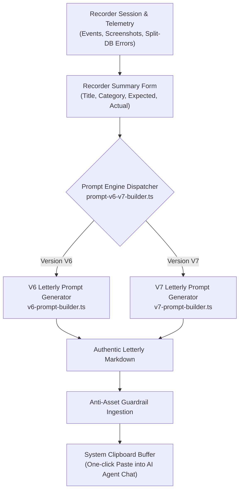

# Authentic GitMap Letterly Prompt Engine (V6 & V7) Specification

## Document Metadata
- **Spec ID**: `02-spec/21-app/88-snap-24-event-20-ui-and-functionality-issues/03-authentic-letterly-prompt-engine-spec.md`
- **Parent Task**: Task 88 (`snap-24-event-20-ui-and-functionality-issues`)
- **Subtask ID**: Subtask-03
- **Version**: 1.0.0
- **Status**: DRAFT / SPECIFICATION
- **Author**: Antigravity Architecture & Spec Agent
- **Target Source Files**:
  - `src/lib/recorder/prompt-v6-v7-builder.ts`
  - `src/lib/recorder/v6-prompt-builder.ts`
  - `src/lib/recorder/v7-prompt-builder.ts`

---

## 1. Executive Summary & Problem Statement

### 1.1 Context
In the Cat Vision activity and bug recorder, users record anomalous interaction sequences (such as Snap 24 Event 20 and Snap 99 Event 81) and export them as instructions for autonomous AI agents. 

Previously, the recorder outputted generic, verbose markdown blobs wrapped in fenced code blocks (`# [V6 Bug Remediation]`) that failed to conform to the project's canonical prompt format defined in `01-prompts/22-letterly/` (specifically `01-prompts/22-letterly/03-execute-n-steps-letterly.md` and `01-prompts/22-letterly/14-execute-recommit-time-restricted-letterly.md`). 

### 1.2 Core Deficiencies Identified
1. **Structural Non-Compliance**: Previous prompts did not match the Letterly header grammar (`# <Title>: high priority instruction, non-negotiable task`), lacked verbatim route navigation transitions with directional arrows (`From Page A -> Page B`), and lacked canonical subheaders (`## task: <Task Title>` and `## slug: <task-slug>`).
2. **Missing Anti-Asset Invariant**: AI agents consuming exported prompts were inadvertently copying screenshot PNG files into repository codebase asset folders (`assets/`, `src/assets/`, `public/assets/`), polluting git trees and bloating repositories.
3. **Improper Skill Invocations**: Prompts lacked the explicit `## Must follow and spawn agent using` section linking directly to `@[execute-parent-task-with-n-steps-v6]` or `@[execute-parent-task-with-n-steps-v7]`.
4. **Missing Slash Commands & Heatmap Directives**: Prompts lacked standardized `## Additional Instructions` specifying `[/plan]`, `[/learn]`, and GitMap RC Heatmap collision-prevention commands.

---

## 2. Architecture & Data Flow



---

## 3. Structural Specification of Authentic Letterly Prompts

Both V6 and V7 prompts must strictly follow the canonical layout from `01-prompts/22-letterly/`.

### 3.1 Common Section Grammar

1. **Title Header**:
   ```markdown
   # <Task Title>: high priority instruction, non-negotiable task
   ```
2. **Verbatim Context & Navigation Path**:
   Directly beneath the title header, output the user's reported problem statement followed by the route navigation history connected by directional arrows:
   ```markdown
   <User Problem Description / Verbatim Input>

   **Navigation Path:** From <Initial Route> -> <Intermediate Route> -> <Final Route>
   **Observed Behavior:** <Actual Behavior>
   **Expected Behavior:** <Expected Behavior>
   ```
3. **Task & Slug Headers**:
   ```markdown
   ## task: <Task Title>
   ## slug: <task-slug>
   ```
   *Note: `<task-slug>` must be clean lowercase-hyphenated string without sequential numeric prefix `xx-`.*
4. **Actionable Items Section**:
   ```markdown
   # Actionable Items Must Follow Non-Negotiable
   ```
   Must contain fixed foundational items 1 through 6, followed by sequential interaction events and diagnostic findings:
   - **Item 1 (Pull First)**: `Git pull BEFORE starting any work — first try gitmap pull <repo path> (or run gitmap pull in repository folder); if that fails, fall back to regular git pull and resolve merge conflicts so the repository is up to date and clean before starting.`
   - **Item 2 (Spec & Plan First)**: `Write spec under 02-spec/21-app/XX-<slug>/ and enqueue plan task in .ai-memory/plans/pending/XX-<slug>.md (subtasks in .ai-memory/plans/subtasks/XX-<slug>/) first (XX is sequence 01, 02).`
   - **Item 3 (GitMap Search Primacy)**: `Search codebase exclusively via GitMap (gitmap aum search, gitmap find, gitmap cat, gitmap ps, gitmap py, gitmap llm train); TOTAL BAN on rg, ripgrep, grep, git grep, Select-String.`
   - **Item 4 (Relative Git Paths)**: `Strictly use relative Git paths (02-spec/..., .ai-memory/..., src/...); only add relative paths, never add absolute paths during work or on the release page and in release notes.`
   - **Item 5 (Anti-Asset Ephemeral Learning Invariant)**:
     ```markdown
     IMPORTANT: The attached snapshot images are for learning purposes only to understand UI behavior and geometry. NEVER save, copy, move, or commit snapshot images into codebase assets (assets/, src/assets/, public/assets/). Leave image artifacts strictly in runtime logs (.logs/recorded-bugs/<session_id>/). Analyze the bug, formulate your fix, and discard/forget the images.
     ```
   - **Item 6 (SQL Repository Pattern & Enums)**: `Enforce SQL repository pattern and enum-driven actions per @[sql-repository-pattern-and-enum-actions](file;.agents/skills/sql-repository-pattern-and-enum-actions): all SQL isolated behind repository interfaces, operations dispatched by exhaustive enum switch with complete util methods (String, Parse, IsValid, All), and strongly-typed AppError envelopes.`
   - **Item 7..N (Chronological Interaction Telemetry & Diagnostics)**:
     - Chronological event timeline with sequence numbers, elapsed time, actor, event type, target component, XPath, coordinates, bounding box dimensions, and diagnostic evidence screenshot links.
     - Split-DB error stack traces with error codes, triggers, and authentic function names.
     - Component failure boundaries and remediation directives.
5. **Skill Invocation Trigger**:
   ```markdown
   ## Must follow and spawn agent using

   @[<target-skill>](file;.agents/skills/<target-skill>)
   ```
   - For V6: `@[execute-parent-task-with-n-steps-v6](file;.agents/skills/execute-parent-task-with-n-steps-v6)`
   - For V7: `@[execute-parent-task-with-n-steps-v7](file;.agents/skills/execute-parent-task-with-n-steps-v7)`
6. **Additional Instructions**:
   ```markdown
   ## Additional Instructions

   - [/plan](slashCommand;plan) first before doing work for improved work or less friction, faster execution for AI and coding without errors and following Coding Guidelines.
   - [/learn](slashCommand;learn) from @[gitmap](file;.agents/skills/gitmap) skill to leverage GitMap high-speed search, toolchain discovery, and caching.
   - Track in-flight file touches and prevent write collisions using GitMap RC Heatmap (`gitmap rc heatmap status` / `gitmap rc heatmap tree` / `gitmap rc heatmap live` / `gitmap rc heatmap sync`).
   - Only add relative paths, never add absolute paths during work; this must be respected on release page and in release notes as well.
   ```

---

## 4. Detailed Differences: V6 vs. V7 Letterly Prompts

| Feature / Section | V6 Letterly Prompt | V7 Letterly Prompt |
| :--- | :--- | :--- |
| **Execution Engine Skill** | `execute-parent-task-with-n-steps-v6` | `execute-parent-task-with-n-steps-v7` |
| **Concurrency Hierarchy** | Tree Swarm: $A=3$ agents, $H=2$ hands (Capacity = 6) | Tree Swarm ($A=3$, $H=2$) + Dynamic Worker Scaling |
| **Operating Modes** | Standard 3-Phase Budget (100 / 150 / 150) | Dual Modes: Option 1 (Time-Restricted) & Option 2 (Unrestricted) |
| **Time Restrictions** | None (Unrestricted execution) | Option 1: commits before 08:00 AM weekdays, anytime weekends in target timezone |
| **Autobot Governance** | None | Enforces `gitmap autobot` single-user bot identity and credential isolation |
| **Recommit Mandate** | Standard hyphenated commit (`gitmap cpf`) | Time-restricted recommits per `@[gitmap-time-restriction]` |

---

## 5. Technical Interfaces & Types (`src/lib/recorder/`)

### 5.1 Parameter Interface Standardization

To comply with coding guideline constraints (parameter structs for >2-3 parameters, positive booleans only, no nullable booleans):

```typescript
export interface LetterlyPromptOptions {
  summary?: BugReportSummary;
  splitDbErrors?: SplitDbErrorEntry[];
  baseDir?: string;
  isTimeRestricted?: boolean;
  targetTimezone?: string;
  botAgentName?: string;
}

export interface PromptBuilderParams {
  session: RecorderSession;
  options?: LetterlyPromptOptions;
}
```

### 5.2 Helper Functions

```typescript
/**
 * Formats a navigation route history array into an arrow-delimited sequence.
 * Example: ["/inspection", "/analysis", "/validation"] -> "From /inspection -> /analysis -> /validation"
 */
export function formatRouteNavigationPath(routes: readonly string[]): string;

/**
 * Builds a markdown link to the diagnostic screenshot stored strictly in .logs/.
 * Example: [01-click-roi_select](file;.logs/recorded-bugs/<session_id>/screenshots/01_click_roi_select.png)
 */
export function formatDiagnosticEvidenceLink(
  snapTitle: string,
  index: number,
  eventType: string,
  sessionId: string,
  baseDir?: string,
): string;
```

---

## 6. Implementation Guardrails & Compliance

1. **Anti-Asset Invariant (Strictly Enforced)**:
   The string warning MUST be embedded verbatim in both V6 and V7 outputs:
   `"IMPORTANT: The attached snapshot images are for learning purposes only to understand UI behavior and geometry. NEVER save, copy, move, or commit snapshot images into codebase assets (assets/, src/assets/, public/assets/). Leave image artifacts strictly in runtime logs (.logs/recorded-bugs/<session_id>/). Analyze the bug, formulate your fix, and discard/forget the images."`
2. **Zero Outer Markdown Code Fences**:
   The output string returned by `buildV6Prompt` and `buildV7Prompt` must NOT be wrapped in ````markdown ... ````. It must be emitted as raw, direct markdown ready for clipboard pasting.
3. **Relative Path Enforcement**:
   All paths in generated prompts must be strictly relative Git paths (e.g. `.logs/recorded-bugs/<session_id>/screenshots/01_snap.png`). No `D:\work\cat-my\...` absolute filesystem paths.
4. **Vertical Line Gaps**:
   Code in `src/lib/recorder/prompt-v6-v7-builder.ts`, `v6-prompt-builder.ts`, and `v7-prompt-builder.ts` must maintain blank lines before `if`, after `}`, and before `return`.

---

## 7. Verification & Acceptance Criteria

- [ ] `buildV6Prompt` produces output matching `# <Title>: high priority instruction, non-negotiable task`.
- [ ] `buildV7Prompt` includes Option 1 (Time-Restricted) & Option 2 (Unrestricted) directives and links to `@[execute-parent-task-with-n-steps-v7]`.
- [ ] Anti-Asset Ephemeral Learning Invariant is present in generated markdown.
- [ ] Screenshot links point to relative paths under `.logs/recorded-bugs/<session_id>/screenshots/`.
- [ ] Navigation path is formatted with directional arrows `From Route A -> Route B`.
- [ ] Unit tests in `src/lib/recorder/__tests__/` verify generated markdown headers, skills, and invariants.
