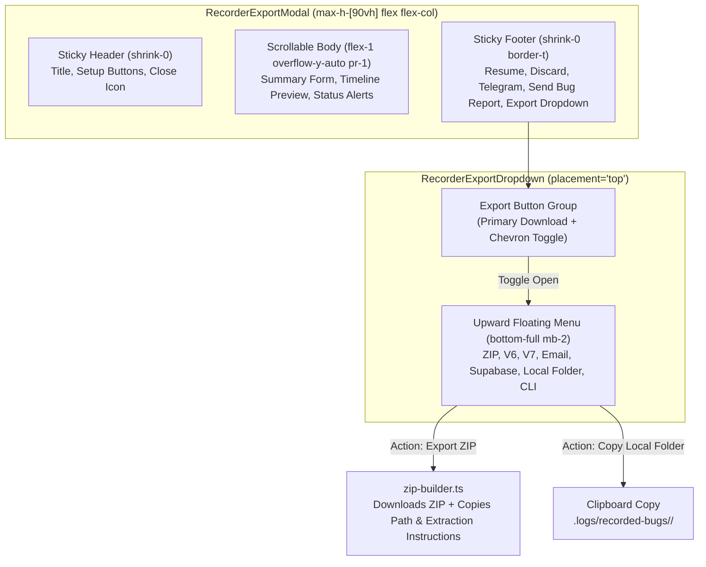

# Export Modal Scrolling, Upward Dropdown & Path Clipboard Specification

## Document Metadata
- **Spec ID**: `02-spec/21-app/88-snap-24-event-20-ui-and-functionality-issues/04-export-dropdown-and-modal-scroll-spec.md`
- **Parent Task**: Task 88 (`snap-24-event-20-ui-and-functionality-issues`)
- **Subtask ID**: Subtask-04
- **Version**: 1.0.0
- **Status**: DRAFT / SPECIFICATION
- **Author**: Antigravity Architecture & Spec Agent
- **Target Source Files**:
  - `src/components/recorder/RecorderExportModal.tsx`
  - `src/components/recorder/RecorderExportDropdown.tsx`
  - `src/lib/recorder/zip-builder.ts`

---

## 1. Executive Summary & Problem Statement

### 1.1 Context
The activity and bug recorder provides a post-recording export dialog (`RecorderExportModal.tsx`) where operators review the event timeline, fill in bug details, and export artifacts via a unified dropdown (`RecorderExportDropdown.tsx`).

### 1.2 Identified Defects & User Frustrations
1. **Modal Overflow & Cutoff**: `RecorderExportModal.tsx` lacked a height boundary (`max-h-[90vh]`) and scrollable body. In prolonged recording sessions (such as Snap 24 Event 20 and Snap 99 Event 81), the timeline preview and summary forms caused the modal to extend beyond the viewport bounds, rendering bottom action buttons completely inaccessible.
2. **Downward Dropdown Clipping**: `RecorderExportDropdown.tsx` was anchored with downward positioning (`top-full mt-2`). Because the export button is situated at the bottom-right footer of the modal, opening the menu clipped all 7 menu items off the bottom of the screen.
3. **Click-Outside Race Condition**: The dropdown's click-outside detection used a global `mousedown` event listener on `document`. When users clicked an action button inside the dropdown, `mousedown` fired before the element's `onClick`, unmounting the dropdown and dropping the user's action.
4. **Missing Export Path to Clipboard**: After downloading a ZIP bundle, users were left guessing the exact downloaded file path. The prompt instructions require the exact archive path (`C:\Users\Administrator\Downloads\<filename>.zip`) and PowerShell extraction commands to be copied directly to the clipboard.
5. **Missing Local Session Directory Clipboard Copy**: When executing on the same machine, copying a ZIP is unnecessary. Users need a direct "Copy Local Session Folder Path" button to copy `.logs/recorded-bugs/<session_id>/` directly to clipboard.

---

## 2. Architecture & UI Layout



---

## 3. Detailed Component Specifications

### 3.1 `RecorderExportModal.tsx` Scrolling Refactor

The modal layout must be partitioned into three distinct flex areas:

```tsx
<div className="fixed inset-0 z-[10060] flex items-center justify-center bg-black/80 backdrop-blur-sm p-4">
  <div className="relative w-full max-w-xl max-h-[90vh] rounded-xl border border-slate-700 bg-[#0f172a] p-5 shadow-2xl flex flex-col text-slate-100 animate-in fade-in zoom-in-95">
    
    {/* 1. Sticky Header */}
    <div className="shrink-0 flex items-center justify-between border-b border-slate-800 pb-3 mb-4">
      {/* Title, description, Setup buttons, Close button */}
    </div>

    {/* 2. Scrollable Body */}
    <div className="flex-1 overflow-y-auto pr-1 space-y-4 scrollbar-thin scrollbar-thumb-slate-700 scrollbar-track-transparent">
      <RecorderSummaryForm summary={summary} onChange={setSummary} />
      <RecorderTimelinePreview events={session.events} screenshots={session.screenshots} />
      {telegramStatus ? <TelegramStatusAlert status={telegramStatus} /> : null}
      {bugReportStatus ? <BugReportStatusAlert status={bugReportStatus} /> : null}
    </div>

    {/* 3. Sticky Footer */}
    <div className="shrink-0 flex flex-wrap items-center justify-between border-t border-slate-800 pt-3 mt-4 gap-2">
      {/* Resume, Discard, Telegram, Send Bug Report, RecorderExportDropdown */}
    </div>

  </div>
</div>
```

### 3.2 `RecorderExportDropdown.tsx` Upward Placement & Event Handling

#### Upward Placement Grammar
The dropdown menu container must be positioned upwards by default so that it renders directly above the action button:

```tsx
export interface RecorderExportDropdownProps {
  session: RecorderSession;
  summary: BugReportSummary;
  onOpenEmailModal: () => void;
  onPrimaryClick?: () => void;
  className?: string;
  isCompact?: boolean;
  placement?: "top" | "bottom";
}
```

When `placement === "top"` (default):
```tsx
const placementClasses = placement === "bottom"
  ? "top-full mt-2"
  : "bottom-full mb-2";

<div
  ref={menuRef}
  role="menu"
  aria-orientation="vertical"
  className={`absolute right-0 ${placementClasses} w-[360px] rounded-xl border border-slate-700 bg-[#0e131f] p-1.5 shadow-2xl backdrop-blur-xl z-[10070] animate-in fade-in zoom-in-95`}
>
  {/* Menu items */}
</div>
```

#### Click-Outside Race Condition Remediation
To prevent `mousedown` from destroying the dropdown before the menu button's `onClick` is handled:
1. Attach the `mousedown` handler with a defensive boundary check:
   ```tsx
   useEffect(() => {
     function handleClickOutside(event: MouseEvent) {
       const target = event.target as Node;
       if (containerRef.current && containerRef.current.contains(target)) {
         return; // Click is within container or menu; do not close
       }

       setIsDropdownOpen(false);
     }

     if (isDropdownOpen) {
       document.addEventListener("mousedown", handleClickOutside);
     }

     return () => {
       document.removeEventListener("mousedown", handleClickOutside);
     };
   }, [isDropdownOpen]);
   ```
2. For menu item actions, wrap handlers in `requestAnimationFrame` or execute action immediately before closing state:
   ```tsx
   const executeItemAction = async (item: DropdownItem): Promise<void> => {
     try {
       await item.action();
     } finally {
       setIsDropdownOpen(false);
     }
   };
   ```

### 3.3 ZIP Export Path & Extraction Instructions Clipboard Copy

In `src/lib/recorder/zip-builder.ts`:
Extend `ExportZipResult` to supply the full filesystem path and extraction commands:

```typescript
export interface ExportZipResult {
  isSuccess: boolean;
  filename: string;
  blobSize: number;
  downloadPath: string;
  extractionCommand: string;
  aiInstructions: string;
}
```

In `handleExportZip` in `RecorderExportDropdown.tsx`:
```typescript
const handleExportZip = async (): Promise<void> => {
  setIsExportingZip(true);

  try {
    toast.info("Generating ZIP bundle with snapshots and telemetry...");
    const result = await exportSessionToZip(session, summary);

    // Build rich clipboard instruction payload
    const clipboardPayload = [
      `# Bug Report Archive: ${result.filename}`,
      `Archive Path: ${result.downloadPath}`,
      "",
      "## PowerShell Extraction Command:",
      `Expand-Archive -Path "${result.downloadPath}" -DestinationPath ".logs/recorded-bugs/${session.id}/" -Force`,
      "",
      "## AI Execution Directive:",
      `Follow @[execute-parent-task-with-n-steps-v6] and review .logs/recorded-bugs/${session.id}/AI_BUG_REPORT.md to diagnose and resolve this defect.`
    ].join("\n");

    try {
      await navigator.clipboard.writeText(clipboardPayload);
      toast.success(`ZIP exported! Download path & extraction command copied to clipboard.`);
    } catch {
      toast.success(`ZIP exported to ${result.filename}!`);
    }
  } catch (err) {
    toast.error(`ZIP export failed: ${String(err)}`);
  } finally {
    setIsExportingZip(false);
    setIsDropdownOpen(false);
  }
};
```

### 3.4 "Copy Local Session Folder Path" Action

Add an explicit menu item to `items` in `RecorderExportDropdown.tsx`:

```typescript
{
  id: "copy-folder",
  label: "Copy Local Session Folder Path",
  sublabel: "Directory for local AI agents (.logs/recorded-bugs/...)",
  shortcut: "Ctrl+L",
  icon: FolderCode,
  iconColor: "text-amber-400",
  action: handleCopyLocalFolderPath,
  isLoading: false,
}
```

Implementation:
```typescript
const handleCopyLocalFolderPath = async (): Promise<void> => {
  const relPath = `.logs/recorded-bugs/${session.id}/`;
  const instruction = [
    `# Local Session Directory: ${relPath}`,
    `Inspect telemetry in \`${relPath}session.json\` and screenshots in \`${relPath}screenshots/\`.`,
    `Execute diagnosis using @[execute-parent-task-with-n-steps-v6](file;.agents/skills/execute-parent-task-with-n-steps-v6).`
  ].join("\n");

  try {
    await navigator.clipboard.writeText(instruction);
    toast.success(`Copied local session path (${relPath}) to clipboard!`);
  } catch {
    toast.info(relPath);
  } finally {
    setIsDropdownOpen(false);
  }
};
```

---

## 4. Coding Standards & Constraint Checklist

- [x] **Strict Boolean Standard**: Variables use `is` or `has` prefixes exclusively (`isExportModalOpen`, `isDropdownOpen`, `isExportingZip`, `isCompact`, `isSuccess`).
- [x] **Compound Keyboard Keys**: Keyboard navigation strictly uses `KeyboardKeyType.isEnterOrSpace(e.key)`, `KeyboardKeyType.isArrowDown(e.key)`, and `KeyboardKeyType.isEscape(e.key)`.
- [x] **Parameter Structs**: All helper functions with >2 arguments use option structs (`RecorderExportDropdownProps`, `PromptBuilderParams`).
- [x] **Vertical Line Gaps**: Blank lines precede `if`, follow `}`, and surround multiline function calls.
- [x] **Anti-Asset Invariant**: All image paths reference `.logs/recorded-bugs/<session_id>/screenshots/`, never `assets/`.

---

## 5. Verification & Acceptance Criteria

- [ ] Modal displays at maximum `90vh` with fixed header, scrollable body, and fixed footer.
- [ ] Timeline preview and summary form are scrollable when content overflows.
- [ ] Export dropdown opens upwards above the footer button (`bottom-full mb-2`).
- [ ] Clicking menu items reliably triggers their action without being aborted by click-outside listeners.
- [ ] Exporting ZIP copies the download path (`C:\Users\Administrator\Downloads\<filename>.zip`) and extraction command to clipboard.
- [ ] "Copy Local Session Folder Path" copies `.logs/recorded-bugs/<session_id>/` to clipboard.
