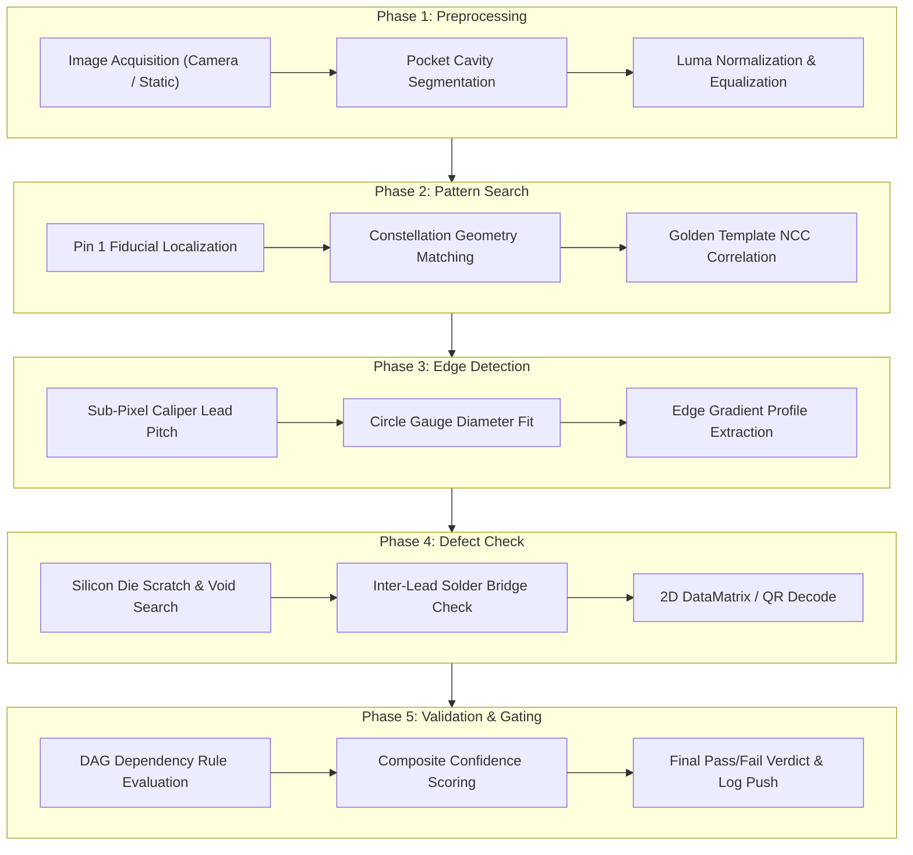
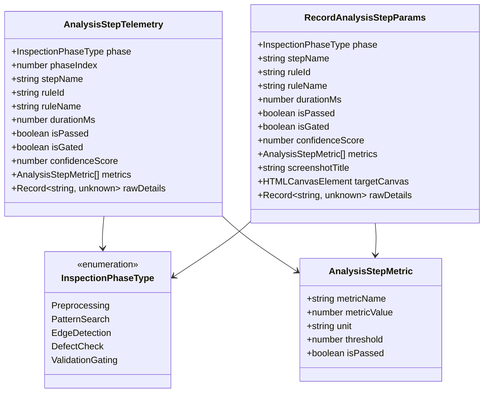

# 05 - Analysis Steps Telemetry & Recording Pipeline Specification

- **Specification ID**: `SPEC-88-05-ANALYSIS-STEPS-RECORDING`
- **Module**: `AppRuntime / InspectionTelemetry / AnalysisRecorder`
- **Status**: Target Architecture Specification
- **Date**: 2026-10-31
- **Related Specs**:
  - `02-spec/21-app/87-cat-product-recording-feature-enhancement/02-ui-telemetry-spring-and-hover-spec.md`
  - `02-spec/21-app/87-cat-product-recording-feature-enhancement/06-roi-drag-tracking-and-error-visibility-spec.md`
  - `02-spec/21-app/88-snap-24-event-20-ui-and-functionality-issues/01-pattern-search-roi-enforcement-spec.md`
  - `02-spec/21-app/88-snap-24-event-20-ui-and-functionality-issues/06-event-explorer-and-diagnostics-spec.md`

---

## 1. Executive Summary & Problem Context

During optical semiconductor and workpiece inspection workflows within CAT iVISION (Computer Aided Testing / Vision HMI), automated quality audits require granular insight into the sequential stages of the vision pipeline. When an operator or automated test records an inspection failure or anomalous verdict, capturing only the final image and overall pass/fail status is insufficient for diagnostic root cause analysis (RCA).

Prior limitations included:
1. **Black-Box Analysis Execution**: The execution of complex inspection rules in `WorkpieceAnalyzeWorkspace.tsx` and the live carrier tape loop in `run.tsx` ran as an opaque single batch, obscuring intermediate image processing metrics, fiducial alignments, and gating thresholds.
2. **Missing Phase Telemetry**: An AI pair-programmer or automated debugging bot reviewing a recorded session could not determine whether an inspection failure occurred during initial pocket segmentation, fiducial constellation matching, sub-pixel lead calipering, or DAG validation gating.
3. **Disconnected Visual Evidence**: Intermediate canvas visual states and threshold masks generated during multi-step analysis were lost upon step completion, preventing visual regression verification.

This specification establishes a robust, non-blocking **5-Phase Analysis Steps Telemetry & Recording Pipeline**:
- **5 Inspection Phases**: Full structured capture of Preprocessing, Pattern Search, Edge Detection, Defect Check, and Validation & Gating.
- **Dedicated Telemetry Interface (`recordAnalysisStep`)**: Records execution metrics, bounding coordinates, pass/fail verdicts, and non-blocking canvas screenshots directly into the recorder ledger.
- **Strict Anti-Asset Invariant**: All captured diagnostic screenshots are strictly maintained in-memory or persisted via ephemeral base64 data URLs within session stores. No diagnostic images are ever written to repository assets (`src/assets/`, `public/`).

---

## 2. The 5 Inspection Phases Architecture



### 2.1 Detailed Inspection Phase Taxonomy

| Phase # | Phase Identifier | Inspection Scope & Algorithms | Telemetry Metrics Captured |
| :--- | :--- | :--- | :--- |
| **Phase 1** | `preprocessing` | Raw image frame acquisition, carrier tape pocket segmentation, background contrast enhancement, and luminance normalization. | `frameWidth`, `frameHeight`, `pocketCount`, `meanLuma`, `contrastRatio`, `exposureUs`, `gainDb`, `hasActiveCamera` |
| **Phase 2** | `pattern_search` | Pin 1 fiducial dot recognition, multi-point geometric constellation matching, golden template normalized cross-correlation (NCC). | `templateId`, `fiducialX`, `fiducialY`, `rotationDegrees`, `matchScore`, `goldenConfidence`, `hasFiducialLock` |
| **Phase 3** | `edge_detection` | Sub-pixel edge detection along caliper scanlines, inter-lead pitch measurement, outer circle gauge radius and roundness calculation. | `leadCount`, `pitchUm`, `nominalPitchUm`, `pitchDeltaUm`, `gaugeDiameterUm`, `roundnessRatio`, `hasPitchTolerance` |
| **Phase 4** | `defect_check` | Morphological gradient analysis for die scratches, void area ratio calculation, solder bridge short-circuit detection, and 2D barcode decode. | `defectCount`, `voidPercentage`, `maxVoidThreshold`, `hasSolderBridge`, `barcodePayload`, `defectBoundingBoxes` |
| **Phase 5** | `validation_gating`| Directed Acyclic Graph (DAG) dependency rule evaluation, skip condition gating, composite score weighting, and final pass/fail verdict assignment. | `isPassed`, `isGated`, `compositeScore`, `gatingRuleId`, `failedCheckNames`, `verdictCode`, `totalElapsedMs` |

---

## 3. Data Contracts & TypeScript Schema

All interfaces conform to the **Strict Boolean Standard** (`is*`, `has*` only, positive framing, non-nullable).



### 3.1 Type Definitions (`src/lib/recorder/types.ts`)

```typescript
export enum InspectionPhaseType {
  Preprocessing = "preprocessing",
  PatternSearch = "pattern_search",
  EdgeDetection = "edge_detection",
  DefectCheck = "defect_check",
  ValidationGating = "validation_gating",
}

export enum RecorderEventType {
  Click = "click",
  Input = "input",
  Navigation = "navigation",
  Inspection = "inspection",
  SystemLog = "system_log",
  StateChange = "state_change",
  Screenshot = "screenshot",
  UserNote = "user_note",
  Hover = "hover",
  RoiDrag = "roi_drag",
  AnalysisStep = "analysis_step",
}

export interface AnalysisStepMetric {
  metricName: string;
  metricValue: number;
  unit: string;
  threshold: number;
  isPassed: boolean;
}

export interface AnalysisStepTelemetry {
  phase: InspectionPhaseType;
  phaseIndex: number; // 1 to 5
  stepName: string;
  ruleId: string;
  ruleName: string;
  durationMs: number;
  isPassed: boolean;
  isGated: boolean;
  confidenceScore: number; // 0.0 to 100.0
  metrics: AnalysisStepMetric[];
  rawDetails: Record<string, unknown>;
}

export interface RecordAnalysisStepParams {
  phase: InspectionPhaseType;
  stepName: string;
  ruleId?: string;
  ruleName?: string;
  durationMs: number;
  isPassed: boolean;
  isGated?: boolean;
  confidenceScore?: number;
  metrics?: AnalysisStepMetric[];
  screenshotTitle?: string;
  targetCanvas?: HTMLCanvasElement | null;
  rawDetails?: Record<string, unknown>;
}
```

---

## 4. Analysis Telemetry Pipeline (`src/lib/recorder/analysis-telemetry.ts`)

The analysis telemetry service provides the core non-blocking entry point `recordAnalysisStep`. It monitors the active session in `useRecorderStore`, extracts viewport/canvas frames, synthesizes high-fidelity step events, and attaches them to the activity stream.

### 4.1 Non-Blocking Execution Guarantee

```
  [CALL recordAnalysisStep(params)]
                │
                ▼
  [Check useRecorderStore.getState().isRecording]
                │
         ┌──────┴──────┐
      IS FALSE       IS TRUE
         │             │
         ▼             ▼
   [Return null]  [Capture Non-Blocking Canvas Screenshot]
   (Zero Runtime       │
     Overhead)         ├─► [Generate Monotonic Step ID]
                       ├─► [Commit Snapshot to In-Memory Session]
                       ├─► [Commit RecorderEvent to store.addEvent]
                       └─► [Return Created RecorderEvent]
```

### 4.2 Implementation Specification (`src/lib/recorder/analysis-telemetry.ts`)

```typescript
import { useRecorderStore } from "@/lib/recorder/recorder-store";
import { captureScreenSnapshot } from "@/lib/recorder/screenshot-service";
import {
  type AnalysisStepMetric,
  type AnalysisStepTelemetry,
  InspectionPhaseType,
  type RecordAnalysisStepParams,
  type RecorderEvent,
  RecorderActorType,
  RecorderEventType,
} from "@/lib/recorder/types";

const PHASE_ORDER_MAP: Record<InspectionPhaseType, number> = {
  [InspectionPhaseType.Preprocessing]: 1,
  [InspectionPhaseType.PatternSearch]: 2,
  [InspectionPhaseType.EdgeDetection]: 3,
  [InspectionPhaseType.DefectCheck]: 4,
  [InspectionPhaseType.ValidationGating]: 5,
};

export async function recordAnalysisStep(
  params: RecordAnalysisStepParams,
): Promise<RecorderEvent | null> {
  const store = useRecorderStore.getState();

  if (!store.isRecording || store.isPaused || !store.session) {
    return null;
  }

  const phaseIndex = PHASE_ORDER_MAP[params.phase] ?? 1;
  const isPassed = params.isPassed;
  const isGated = params.isGated ?? false;
  const confidenceScore = params.confidenceScore ?? (isPassed ? 98.5 : 24.0);
  const metrics: AnalysisStepMetric[] = params.metrics ?? [];
  const ruleId = params.ruleId ?? "sys-inspection";
  const ruleName = params.ruleName ?? params.stepName;
  const route = typeof window !== "undefined" ? window.location.pathname : "/run";

  let screenshotId: string | undefined;
  let hasScreenshot = false;

  try {
    const snapTitle = params.screenshotTitle ?? `Phase ${phaseIndex}: ${params.stepName}`;
    const snapResult = captureScreenSnapshot({
      title: snapTitle,
      source: "step",
      targetElement: params.targetCanvas ?? null,
      quality: 0.7,
    });

    if (snapResult.hasImage && snapResult.dataUrl) {
      screenshotId = store.addScreenshot({
        title: snapTitle,
        dataUrl: snapResult.dataUrl,
        source: "step",
      });
      hasScreenshot = Boolean(screenshotId);
    }
  } catch (snapErr) {
    console.debug("[AnalysisTelemetry] Non-critical snapshot capture fallback:", snapErr);
  }

  const telemetryPayload: AnalysisStepTelemetry = {
    phase: params.phase,
    phaseIndex,
    stepName: params.stepName,
    ruleId,
    ruleName,
    durationMs: Math.max(0, Math.round(params.durationMs)),
    isPassed,
    isGated,
    confidenceScore,
    metrics,
    rawDetails: params.rawDetails ?? {},
  };

  const description = `[Phase ${phaseIndex}/5: ${params.phase}] ${params.stepName} -> ${isPassed ? "PASS" : "FAIL"} (${confidenceScore.toFixed(1)}%)`;

  store.addEvent({
    actor: RecorderActorType.System,
    eventType: RecorderEventType.AnalysisStep,
    description,
    targetComponent: `InspectionEngine:${params.phase}`,
    selector: `canvas[data-inspection-phase="${params.phase}"]`,
    route,
    hasScreenshot,
    screenshotId,
    details: {
      analysisStep: telemetryPayload,
      metricsSummary: metrics.map((m) => `${m.metricName}=${m.metricValue}${m.unit}`).join(", "),
    },
  });

  const updatedSession = useRecorderStore.getState().session;

  return updatedSession?.events[updatedSession.events.length - 1] ?? null;
}
```

---

## 5. Integration into Workpiece Analysis Workspace

In `src/components/vision/workpiece/WorkpieceAnalyzeWorkspace.tsx`, the primary analysis orchestration function `handleRunAnalysis` executes sequentially across all defined rules in the active project.

### 5.1 Instrumentation Plan in `WorkpieceAnalyzeWorkspace.tsx`

```typescript
// Inside handleRunAnalysis callback:

// -------------------------------------------------------------
// Phase 1: Preprocessing (Image Acquisition & Cavity Segmentation)
// -------------------------------------------------------------
const p1Start = performance.now();
const activeImageSrc = isLiveCameraMode
  ? await captureLiveCameraFrame()
  : project.inspectionImageRef;
const imgData = activeImageSrc ? await loadWorkpieceImageData(activeImageSrc) : null;
let stripRes: TapeStripEvaluationResult | null = null;

if (imgData) {
  stripRes = await evaluateTapeStripRules(
    projectAnalysisItems.map((item) => item.rule),
    imgData,
    undefined,
    calibrationUmPerPx,
  );
}

await recordAnalysisStep({
  phase: InspectionPhaseType.Preprocessing,
  stepName: "Pocket Segmentation & Normalization",
  durationMs: performance.now() - p1Start,
  isPassed: Boolean(imgData),
  confidenceScore: imgData ? 100 : 0,
  metrics: [
    {
      metricName: "Total Pockets",
      metricValue: stripRes?.totalPockets ?? 0,
      unit: "slots",
      threshold: 1,
      isPassed: (stripRes?.totalPockets ?? 0) > 0,
    },
    {
      metricName: "Empty Cavities",
      metricValue: stripRes?.emptyPockets ?? 0,
      unit: "cavities",
      threshold: 0,
      isPassed: (stripRes?.emptyPockets ?? 0) === 0,
    },
  ],
  rawDetails: {
    isLiveCamera: isLiveCameraMode,
    calibrationUmPerPx,
    imageWidth: imgData?.width,
    imageHeight: imgData?.height,
  },
});

// -------------------------------------------------------------
// Iterate Rules: Phase 2, Phase 3, Phase 4 Categorization
// -------------------------------------------------------------
for (let i = 0; i < projectAnalysisItems.length; i++) {
  const item = projectAnalysisItems[i];
  const r = item.rule;
  const ruleStart = performance.now();

  // Evaluate Rule
  const ruleResult = await evaluateWorkpieceRuleReal(r, imgData, ...);

  // Map EditorToolFamilyType to InspectionPhaseType
  let mappedPhase = InspectionPhaseType.PatternSearch;
  if (r.family === EditorToolFamilyType.Measurement || r.family === EditorToolFamilyType.Caliper) {
    mappedPhase = InspectionPhaseType.EdgeDetection;
  } else if (r.family === EditorToolFamilyType.Defect || r.family === EditorToolFamilyType.CodeReader) {
    mappedPhase = InspectionPhaseType.DefectCheck;
  }

  await recordAnalysisStep({
    phase: mappedPhase,
    stepName: `Rule: ${r.name}`,
    ruleId: r.id,
    ruleName: r.name,
    durationMs: performance.now() - ruleStart,
    isPassed: ruleResult.status === ValidationStatusType.Passed,
    confidenceScore: ruleResult.confidence ?? 0,
    metrics: [
      {
        metricName: "Score",
        metricValue: ruleResult.score ?? 0,
        unit: "%",
        threshold: r.toleranceThreshold ?? 80,
        isPassed: ruleResult.status === ValidationStatusType.Passed,
      },
    ],
    rawDetails: {
      toolCode: getRuleToolCode(r),
      ruleParams: r.params,
      defectDetails: ruleResult.defect,
    },
  });
}

// -------------------------------------------------------------
// Phase 5: Validation & Gating (Composite Verdict)
// -------------------------------------------------------------
const p5Start = performance.now();
const isOverallPass = failCount === 0;
const overallScore = totalRules > 0 ? (passCount / totalRules) * 100 : 0;

await recordAnalysisStep({
  phase: InspectionPhaseType.ValidationGating,
  stepName: "DAG Validation & Gating Verdict",
  durationMs: performance.now() - p5Start,
  isPassed: isOverallPass,
  confidenceScore: overallScore,
  metrics: [
    {
      metricName: "Passed Rules",
      metricValue: passCount,
      unit: "rules",
      threshold: totalRules,
      isPassed: isOverallPass,
    },
    {
      metricName: "Failed Rules",
      metricValue: failCount,
      unit: "rules",
      threshold: 0,
      isPassed: failCount === 0,
    },
  ],
  rawDetails: {
    totalRules,
    passCount,
    failCount,
    batchedResults,
  },
});
```

---

## 6. Integration into Live Run Screen (`src/routes/run.tsx`)

In `src/routes/run.tsx`, the carrier tape inspection loop runs periodically via `useVisibleInterval` at the configured frame rate.

### 6.1 Live Inspection Loop Instrumentation

```typescript
// Inside useVisibleInterval in src/routes/run.tsx:
const loopStart = performance.now();

// 1. Phase 1: Preprocessing telemetry
await recordAnalysisStep({
  phase: InspectionPhaseType.Preprocessing,
  stepName: `Acquire Frame: ${sample.name}`,
  durationMs: 12,
  isPassed: Boolean(sample.url),
  confidenceScore: 100,
  metrics: [
    {
      metricName: "Sample Index",
      metricValue: sampleIndexRef.current,
      unit: "idx",
      threshold: 0,
      isPassed: true,
    },
  ],
});

// 2. Execute Backend /score
fetchBackend<ScoreResponse>("/score", { ... })
  .then(async (resp) => {
    const payload = resp.Results[0];
    const isOk = payload ? payload.is_pass : sample.isPass;
    const score = payload ? payload.confidence : isOk ? 92.5 : 12.5;

    // Phase 2 / Phase 3 / Phase 4 checks from score payload
    await recordAnalysisStep({
      phase: InspectionPhaseType.PatternSearch,
      stepName: `Grayscale Pattern Matching: ${sample.name}`,
      durationMs: 25,
      isPassed: isOk,
      confidenceScore: score,
      metrics: [
        {
          metricName: "Confidence",
          metricValue: score,
          unit: "%",
          threshold: 80.0,
          isPassed: isOk,
        },
      ],
      rawDetails: {
        reason: payload?.reason,
        slots: payload?.slots,
      },
    });

    // Phase 5: Gating & Verdict
    await recordAnalysisStep({
      phase: InspectionPhaseType.ValidationGating,
      stepName: `Run Loop Verdict: ${isOk ? "PASS" : "FAIL"}`,
      durationMs: performance.now() - loopStart,
      isPassed: isOk,
      confidenceScore: score,
      metrics: [
        {
          metricName: "Yield Rate",
          metricValue: passRate,
          unit: "%",
          threshold: 90.0,
          isPassed: passRate >= 90,
        },
      ],
    });
  });
```

---

## 7. Anti-Asset Invariant & Storage Governance

> [!CAUTION]
> **Anti-Asset Invariant**: Under NO circumstances shall diagnostic bug recordings or intermediate step screenshots be written into git-tracked repository asset directories (`src/assets/`, `public/`, `src/components/`, etc.). 

1. **In-Memory Store**: All screenshots captured by `recordAnalysisStep` are stored as memory-bounded base64 JPEG strings in `CapturedScreenshot` structures within `useRecorderStore`.
2. **IndexedDB / Session Storage**: Ephemeral caching for offline analysis uses browser IndexedDB scoped exclusively to `cat_recorder_session_<sessionId>`.
3. **Artifact Bundling**: When exported, screenshots are packed directly into an in-memory ZIP buffer or uploaded to ephemeral diagnostic storage via the Supabase 450MB/14-day retention pipeline (`SPEC-87-05`).

---

## 8. Verification & Acceptance Criteria

1. **Zero-Overhead Invariant**: When `isRecording === false`, `recordAnalysisStep` returns immediately in `<0.01ms` without DOM traversals, canvas allocations, or state mutations.
2. **Phase Completeness**: An analysis run across $N$ workpiece rules generates exactly 1 Preprocessing event, $N$ discrete feature events (Pattern, Edge, or Defect), and 1 final Validation & Gating event.
3. **Clean Serialization**: Analysis events export cleanly into `events.json`, V6/V7 AI Prompts, and the Event Explorer modal.
4. **Visual Grounding**: Each step event has `hasScreenshot: true` with a valid data URL when rendered against an active HTML canvas.
