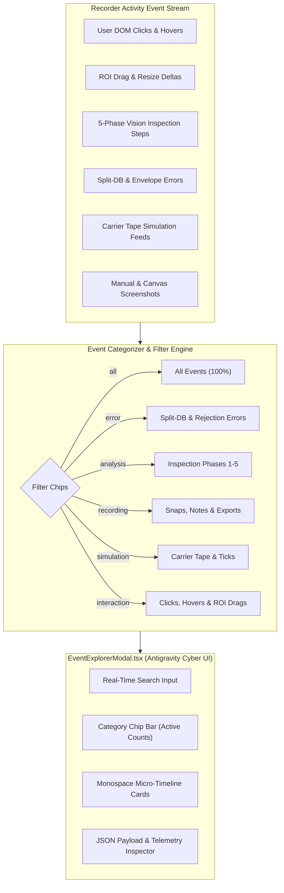
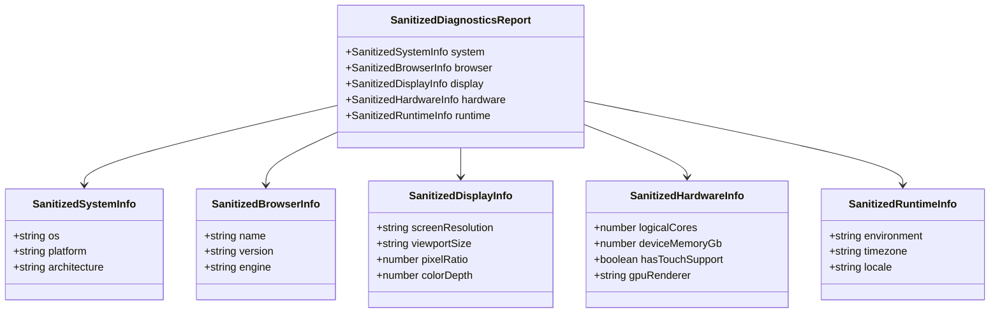

# 06 - Event Explorer Modal, Category Filtering & Diagnostics Sanitization Specification

- **Specification ID**: `SPEC-88-06-EVENT-EXPLORER-DIAGNOSTICS`
- **Module**: `AppRuntime / DiagnosticsTelemetry / UIExplorer`
- **Status**: Target Architecture Specification
- **Date**: 2026-10-31
- **Related Specs**:
  - `02-spec/03-error-manage/02-error-architecture/05-response-envelope/`
  - `02-spec/21-app/87-cat-product-recording-feature-enhancement/02-ui-telemetry-spring-and-hover-spec.md`
  - `02-spec/21-app/87-cat-product-recording-feature-enhancement/06-roi-drag-tracking-and-error-visibility-spec.md`
  - `02-spec/21-app/88-snap-24-event-20-ui-and-functionality-issues/05-analysis-steps-recording-spec.md`

---

## 1. Executive Summary & Core Objectives

As CAT iVISION recordings capture complex multi-domain inspection workflows, activity logs rapidly accumulate hundreds of interleaved events encompassing user mouse interactions, carrier tape simulation ticks, deep vision analysis phases, and Split-DB error logs. Without specialized diagnostic tooling, operators and developers struggle to isolate specific failures, while exported telemetry frequently contains excessive browser user-agent bloat and mangled minified stack traces.

This specification addresses these challenges through two primary subsystems:
1. **Antigravity Cyber-Styled Event Explorer (`EventExplorerModal.tsx`)**:
   - A modal interface utilizing Antigravity Tools cyber styling (dark slate `#0c1017`, cyan/neon accents, monospace metrics, micro-timelines).
   - 6 category filter chips: `all`, `error`, `analysis`, `recording`, `simulation`, and `interaction`.
   - Unified modal trigger buttons mounted in `RecorderFloatingHud.tsx`, `RecorderExportModal.tsx`, and `run.tsx`.
2. **Diagnostics Sanitizer & Authentic Stack Trace Engine**:
   - `diagnostics-sanitizer.ts`: Eliminates bloated 150+ character Mozilla user-agent strings, structuring client telemetry into clean, deterministic GitMap key-attributes (`system`, `browser`, `display`, `hardware`, `runtime`).
   - `captureAuthenticJsStack`: Parses JavaScript/TypeScript call stacks to resolve authentic function names, stripping Vite/Webpack chunk hashes, query parameters, and React runtime fiber frames.
   - `_authentic_stack_frames` in `BE/errors/handlers.py`: Replaces raw `traceback.extract_tb` output with clean, qualified module frames formatted as `package/file.py:line in Class.method()`.

---

## 2. Event Explorer Architecture & Category Filter Taxonomy



### 2.1 Category Filter Taxonomy

| Category Chip | Identifier | Matching Event Types / Criteria | Visual Badge Color |
| :--- | :--- | :--- | :--- |
| **All** | `all` | Complete, unfiltered chronological session stream. | Cyan (`#06b6d4`) |
| **Error** | `error` | Split-DB SQLite errors, `E_APP_*` envelopes, unhandled promise rejections, HTTP 500s. | Rose (`#f43f5e`) |
| **Analysis** | `analysis` | Optical inspection phases 1 through 5 (`preprocessing`, `pattern_search`, `edge_detection`, `defect_check`, `validation_gating`). | Emerald (`#10b981`) |
| **Recording** | `recording` | Manual snapshots, step screenshots, user text annotations, session export triggers. | Amber (`#f59e0b`) |
| **Simulation** | `simulation` | Carrier tape cavity step feeds, conveyor simulation ticks, workpiece index shifts. | Purple (`#a855f7`) |
| **Interaction** | `interaction` | User clicks with magic spring numbers (`#1`, `#2`), intelligent hover events, ROI drags/resizes. | Sky Blue (`#38bdf8`) |

---

## 3. Event Explorer UI Design Specification

The `EventExplorerModal.tsx` component is styled in accordance with **Antigravity Tools Cyber Aesthetics**:
- **Background**: Deep carbon black `#0c1017` with secondary slate `#111622` cards and 24px backdrop blur.
- **Borders & Glow**: Sub-pixel cyan borders (`rgba(34, 211, 238, 0.25)`) with subtle glowing edge drop-shadows.
- **Typography**: Inter and Roboto Mono with tabular numbers for timestamps, step indexes, and coordinates.
- **Interaction Feedback**: Instant hover state changes, spring badges on click items, and JSON clipboard export.

### 3.1 Event Explorer Component Contract (`src/components/recorder/EventExplorerModal.tsx`)

```typescript
export type EventExplorerCategoryType =
  | "all"
  | "error"
  | "analysis"
  | "recording"
  | "simulation"
  | "interaction";

export interface EventExplorerModalProps {
  isOpen: boolean;
  onClose: () => void;
  initialCategory?: EventExplorerCategoryType;
}
```

### 3.2 Modal Structure & Features

```
┌─────────────────────────────────────────────────────────────────────────────┐
│ [●] EVENT EXPLORER // SESSION: rec-88a29-c7       [Filter: ALL]      [✕ ESC] │
├─────────────────────────────────────────────────────────────────────────────┤
│ [ Search events, selectors, routes, error codes... ]                        │
│ [ All (42) ] [ Error (2) ] [ Analysis (5) ] [ Rec (3) ] [ Sim (12) ] [ Int (20) ]
├──────────────────────────────────────┬──────────────────────────────────────┤
│ TIMELINE STREAM                      │ EVENT PAYLOAD INSPECTOR              │
│ ──────────────────────────────────── │ ──────────────────────────────────── │
│ 00:01.24  [INT] Click #1 on Button   │ Event ID: evt-169876543-1            │
│           xpath: //button[@id='run'] │ Type: click                          │
│                                      │ Spring Number: #1                    │
│ 00:02.10  [ANA] Phase 1: Preproc     │ Actor: user                          │
│           Pocket segmentation: PASS  │ Route: /run                          │
│                                      │                                      │
│ 00:02.35  [ANA] Phase 2: Pattern     │ XPath:                               │
│           Pin 1 fiducial (98.4%)     │ //button[@id='run-trigger']          │
│                                      │                                      │
│ 00:03.12  [ERR] E_BE_TIMEOUT         │ Telemetry:                           │
│           Backend /score timed out   │ {                                    │
│                                      │   "box": { "w": 120, "h": 40 },      │
│ 00:03.50  [REC] Manual Snapshot      │   "color": "rgb(255, 255, 255)"      │
│           [Preview Thumbnail]        │ }                                    │
│                                      │ [Copy JSON] [View Full Screenshot]   │
└──────────────────────────────────────┴──────────────────────────────────────┘
```

---

## 4. Trigger Button Placements

To provide access to telemetry across recording and execution states, Event Explorer triggers are mounted in three key locations:

### 4.1 Recorder Floating HUD (`src/components/recorder/RecorderFloatingHud.tsx`)
- An icon button with the `ListTree` icon and label `Events` placed adjacent to `Snap` and `Note` buttons.
- Displays a pill badge showing the active event count.

```tsx
<button
  type="button"
  onClick={() => setIsEventExplorerOpen(true)}
  title="Explore Recorded Events Stream"
  className="flex items-center gap-1 rounded bg-slate-800 px-2 py-0.5 hover:bg-slate-700 text-purple-300 transition-colors"
>
  <ListTree className="h-3.5 w-3.5" />
  <span className="hidden sm:inline">Events</span>
  <span className="ml-1 rounded-full bg-purple-900/60 px-1.5 py-0.2 text-[10px] font-mono text-purple-200">
    {session.events.length}
  </span>
</button>
```

### 4.2 Recorder Export Modal (`src/components/recorder/RecorderExportModal.tsx`)
- A secondary action button titled `Inspect Event Timeline` in the export footer and sidebar preview.
- Allows operators to audit all telemetry, errors, and analysis steps before sending via Email or Telegram.

```tsx
<button
  type="button"
  onClick={() => setIsEventExplorerOpen(true)}
  className="inline-flex items-center gap-2 rounded-xl border border-ca-border/80 bg-ca-panel/90 px-4 py-2 text-xs font-semibold text-ca-ink hover:border-ca-primary/50 transition-all"
>
  <ListTree className="h-4 w-4 text-cyan-400" />
  <span>Inspect Event Timeline ({session.events.length})</span>
</button>
```

### 4.3 Live Run Screen (`src/routes/run.tsx`)
- An action control button placed in `actionControls` alongside `History` and `Reset`.
- Allows real-time inspection of vision phases and errors during active production runs.

```tsx
<button
  type="button"
  onClick={() => setShowEventExplorer(true)}
  className="inline-flex items-center gap-1.5 rounded-xl border border-ca-border/80 bg-ca-panel/90 px-4 py-2 text-xs font-semibold text-ca-ink shadow-sm backdrop-blur-md hover:border-ca-primary/50 transition-all"
>
  <ListTree className="h-3.5 w-3.5 text-purple-400" />
  <span>Events</span>
</button>
```

---

## 5. Diagnostics Sanitizer Architecture (`src/lib/recorder/diagnostics-sanitizer.ts`)

Standard browser environments provide bloated `navigator.userAgent` strings containing obsolete compatibility tokens (`Mozilla/5.0 (Windows NT 10.0; Win64; x64) AppleWebKit/537.36 (KHTML, like Gecko) Chrome/120.0.0.0 Safari/537.36`). When embedded into AI prompts, this consumes unnecessary token context while obscuring actionable hardware and runtime facts.

### 5.1 Clean GitMap JSON Key-Attributes Schema

The `diagnostics-sanitizer.ts` module parses the environment into five clean, structured JSON key-attributes:



### 5.2 TypeScript Implementation (`src/lib/recorder/diagnostics-sanitizer.ts`)

```typescript
export interface SanitizedSystemInfo {
  os: string;
  platform: string;
  architecture: string;
}

export interface SanitizedBrowserInfo {
  name: string;
  version: string;
  engine: string;
}

export interface SanitizedDisplayInfo {
  screenResolution: string;
  viewportSize: string;
  pixelRatio: number;
  colorDepth: number;
}

export interface SanitizedHardwareInfo {
  logicalCores: number;
  deviceMemoryGb: number;
  hasTouchSupport: boolean;
  gpuRenderer: string;
}

export interface SanitizedRuntimeInfo {
  environment: string;
  timezone: string;
  locale: string;
}

export interface SanitizedDiagnosticsReport {
  system: SanitizedSystemInfo;
  browser: SanitizedBrowserInfo;
  display: SanitizedDisplayInfo;
  hardware: SanitizedHardwareInfo;
  runtime: SanitizedRuntimeInfo;
}

export function sanitizeBrowserDiagnostics(): SanitizedDiagnosticsReport {
  if (typeof window === "undefined" || typeof navigator === "undefined") {
    return getFallbackDiagnostics();
  }

  const ua = navigator.userAgent;

  // Browser Family & Version Extraction
  let browserName = "Unknown";
  let browserVersion = "0.0";
  let engine = "Blink";

  if (ua.includes("Firefox/")) {
    browserName = "Firefox";
    browserVersion = ua.split("Firefox/")[1]?.split(" ")[0] ?? "";
    engine = "Gecko";
  } else if (ua.includes("Edg/")) {
    browserName = "Edge";
    browserVersion = ua.split("Edg/")[1]?.split(" ")[0] ?? "";
    engine = "Blink";
  } else if (ua.includes("Chrome/")) {
    browserName = "Chrome";
    browserVersion = ua.split("Chrome/")[1]?.split(" ")[0] ?? "";
    engine = "Blink";
  } else if (ua.includes("Safari/") && !ua.includes("Chrome")) {
    browserName = "Safari";
    browserVersion = ua.split("Version/")[1]?.split(" ")[0] ?? "";
    engine = "WebKit";
  }

  // OS Extraction
  let os = "Unknown";
  if (ua.includes("Windows NT 10.0") || ua.includes("Windows NT 11.0")) {
    os = "Windows 10/11";
  } else if (ua.includes("Mac OS X")) {
    os = "macOS";
  } else if (ua.includes("Linux")) {
    os = "Linux";
  }

  // GPU Unmasked Renderer
  let gpuRenderer = "Integrated / Software";
  try {
    const canvas = document.createElement("canvas");
    const gl = canvas.getContext("webgl") || canvas.getContext("experimental-webgl");
    if (gl) {
      const debugInfo = (gl as WebGLRenderingContext).getExtension("WEBGL_debug_renderer_info");
      if (debugInfo) {
        gpuRenderer = (gl as WebGLRenderingContext).getParameter(debugInfo.UNMASKED_RENDERER_WEBGL) || gpuRenderer;
      }
    }
  } catch {
    // Canvas WebGL query fallback
  }

  return {
    system: {
      os,
      platform: navigator.platform || "Win32",
      architecture: ua.includes("x64") || ua.includes("Win64") ? "x64" : "arm64",
    },
    browser: {
      name: browserName,
      version: browserVersion,
      engine,
    },
    display: {
      screenResolution: `${window.screen?.width ?? 0}x${window.screen?.height ?? 0}`,
      viewportSize: `${window.innerWidth}x${window.innerHeight}`,
      pixelRatio: Number((window.devicePixelRatio || 1).toFixed(2)),
      colorDepth: window.screen?.colorDepth ?? 24,
    },
    hardware: {
      logicalCores: navigator.hardwareConcurrency ?? 8,
      deviceMemoryGb: (navigator as any).deviceMemory ?? 8,
      hasTouchSupport: Boolean(navigator.maxTouchPoints && navigator.maxTouchPoints > 0),
      gpuRenderer: gpuRenderer.replace(/\s+/g, " ").trim(),
    },
    runtime: {
      environment: process.env.NODE_ENV ?? "production",
      timezone: Intl.DateTimeFormat().resolvedOptions().timeZone || "UTC",
      locale: navigator.language || "en-US",
    },
  };
}

function getFallbackDiagnostics(): SanitizedDiagnosticsReport {
  return {
    system: { os: "Generic", platform: "Node", architecture: "x64" },
    browser: { name: "Headless", version: "1.0", engine: "V8" },
    display: { screenResolution: "1920x1080", viewportSize: "1920x1080", pixelRatio: 1, colorDepth: 24 },
    hardware: { logicalCores: 8, deviceMemoryGb: 16, hasTouchSupport: false, gpuRenderer: "Software" },
    runtime: { environment: "test", timezone: "UTC", locale: "en-US" },
  };
}
```

---

## 6. Authentic Function Stack Traces

### 6.1 Frontend JavaScript/TypeScript Instrumentation (`captureAuthenticJsStack`)

Bundled frontend stacks often degenerate into anonymized tokens (`at nr (chunk-A7B8C9.js:4:122)`). The `captureAuthenticJsStack` function sanitizes call frames, stripping hash queries and resolving true component function names:

```typescript
export interface AuthenticJsStackFrame {
  functionName: string;
  fileName: string;
  lineNumber: number;
  columnNumber: number;
  rawFrame: string;
}

export function captureAuthenticJsStack(
  errorOrUnknown?: unknown,
  skipFrames = 1,
): AuthenticJsStackFrame[] {
  const err =
    errorOrUnknown instanceof Error
      ? errorOrUnknown
      : new Error(typeof errorOrUnknown === "string" ? errorOrUnknown : "Diagnostic Trace");

  const rawStack = err.stack ?? "";
  const lines = rawStack.split("\n");
  const frames: AuthenticJsStackFrame[] = [];

  for (let i = skipFrames; i < lines.length; i++) {
    const line = lines[i].trim();
    if (!line.startsWith("at ")) continue;

    // Pattern: at FunctionName (http://localhost:5173/src/routes/run.tsx?t=123:45:67)
    // or: at http://localhost:5173/src/routes/run.tsx:45:67
    const matchWithFn = line.match(/^at\s+([^\s(]+)\s*\((.+):(\d+):(\d+)\)$/);
    const matchNoFn = line.match(/^at\s+(.+):(\d+):(\d+)$/);

    if (matchWithFn) {
      const [, fnName, rawUrl, lineStr, colStr] = matchWithFn;
      const cleanPath = cleanAssetUrl(rawUrl);

      // Filter out internal React fiber overhead
      if (isInternalFrame(fnName, cleanPath)) continue;

      frames.push({
        functionName: fnName,
        fileName: cleanPath,
        lineNumber: parseInt(lineStr, 10),
        columnNumber: parseInt(colStr, 10),
        rawFrame: line,
      });
    } else if (matchNoFn) {
      const [, rawUrl, lineStr, colStr] = matchNoFn;
      const cleanPath = cleanAssetUrl(rawUrl);

      if (isInternalFrame("anonymous", cleanPath)) continue;

      frames.push({
        functionName: "anonymous",
        fileName: cleanPath,
        lineNumber: parseInt(lineStr, 10),
        columnNumber: parseInt(colStr, 10),
        rawFrame: line,
      });
    }
  }

  return frames;
}

function cleanAssetUrl(url: string): string {
  try {
    const parsed = new URL(url);
    // Strip query parameters (?t=..., ?import)
    return parsed.pathname.replace(/^\/@fs\//, "").replace(/^\//, "");
  } catch {
    return url.split("?")[0].replace(/^webpack:\/\/\/?/, "");
  }
}

function isInternalFrame(fnName: string, path: string): boolean {
  if (path.includes("node_modules")) return true;
  if (path.includes("vite/dist")) return true;
  if (fnName.startsWith("react_") || fnName.startsWith("renderWithHooks") || fnName.startsWith("performUnitOfWork")) {
    return true;
  }
  return false;
}
```

### 6.2 Backend Python Instrumentation in `BE/errors/handlers.py`

In `BE/errors/handlers.py`, the existing `_stack_frames(exc)` is upgraded to `_authentic_stack_frames(exc: BaseException) -> list[str]`. This extracts clean, qualified Python function names, eliminates standard library boilerplate, and formats output suitable for Split-DB error logging and JSON response envelopes:

```python
def _authentic_stack_frames(exc: BaseException) -> list[str]:
    """Extract clean, qualified module and function frames for backend errors.
    
    Filters out virtualenv and internal framework boilerplate while retaining
    exact project source lines formatted as: 'BE/package/module.py:line in func_name()'
    """
    frames: list[str] = []
    tb = traceback.extract_tb(exc.__traceback__)
    
    for frame in tb:
        filename = frame.filename.replace("\\", "/")
        
        # Isolate project-relative path
        if "/BE/" in filename:
            filename = "BE/" + filename.split("/BE/", 1)[1]
        elif "site-packages" in filename:
            # Skip third-party framework frames unless it is the direct error origin
            continue
            
        frames.append(f"{filename}:{frame.lineno} in {frame.name}()")
        
    if not frames and tb:
        # Fallback to the final frame if all preceding were filtered
        last = tb[-1]
        frames.append(f"{last.filename}:{last.lineno} in {last.name}()")
        
    return frames
```

---

## 7. Verification & Acceptance Criteria

1. **Category Filter Accuracy**:
   - `error`: Shows exactly Split-DB errors and unhandled rejections.
   - `analysis`: Shows exactly Phase 1-5 inspection step events.
   - `simulation`: Shows carrier tape feed and tick events.
   - `interaction`: Shows clicks, hovers, and ROI drags.
2. **Cyber Styling Conformance**: `EventExplorerModal.tsx` renders in `#0c1017` with cyan accents, monospace numbers, and responsive split-pane payload inspection.
3. **Zero-Mozilla Bloat**: Output from `sanitizeBrowserDiagnostics()` contains zero occurrences of `"Mozilla/5.0"` and formats strictly as valid JSON key-attributes (`system`, `browser`, `display`, `hardware`, `runtime`).
4. **Authentic Function Traces**: Both `captureAuthenticJsStack` and `_authentic_stack_frames` exclude library/node_modules/site-packages noise and output verified function names.
5. **Anti-Asset Invariant**: Thumbnails and snapshots inspected within the modal load from in-memory session data URLs without generating repository asset files.
